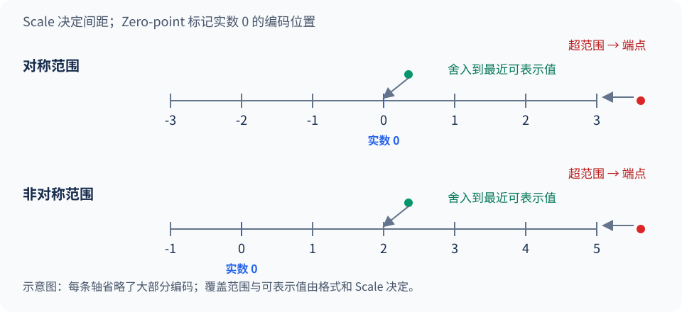

量化像是换一把刻度更少的尺子：原来能读到毫米，现在只能读到厘米。数据量小了，读数也粗了。**量化要回答的就是三件事：刻度怎么定（Scale 与零点），多少数据共用一把尺子（粒度），以及怎样让模型少受读数误差的影响（校准与 PTQ/QAT）。**

本节只讲与框架无关的基础概念，后面几节的 SmoothQuant、GPTQ/AWQ、KV Cache 量化和低比特浮点都建立在这些概念上。

> ⏰ **信息时效**：本节为通用原理，不依赖具体框架版本；舍入规则以 ONNX QuantizeLinear 算子定义为例。

<!-- more -->

## 📑 目录

- [1. 先分清量化的对象](#1-先分清量化的对象)
- [2. 数值映射、Scale 与 Zero-point](#2-数值映射scale-与-zero-point)
- [3. 张量维度与量化粒度](#3-张量维度与量化粒度)
- [4. 校准：给尺子选量程](#4-校准给尺子选量程)
- [5. PTQ 与 QAT](#5-ptq-与-qat)
- [6. 动手观察离群值的影响](#6-动手观察离群值的影响)
- [总结](#-总结)
- [自我检验清单](#-自我检验清单)
- [参考资料](#-参考资料)

---

## 1. 先分清量化的对象

推理时显存里主要有三类数据，它们都可以量化，但性质不同：

| 📊 对象 | 数据的特点 | 量化后的主要收益 |
|---|---|---|
| **权重（Weight）** | 训练完就固定，可以离线慢慢处理 | 模型变小，每步读的权重变少 |
| **激活（Activation）** | 随每次输入变化，只能在线处理 | 让矩阵乘法走低精度 Kernel |
| **KV Cache** | 随请求和上下文不断增长 | 每个历史 Token 占的缓存变少 |

常见记号 **W4A16** 表示权重 4-bit、激活 16-bit；**W8A8** 表示两者都是 8-bit。这个记号只描述线性层的两个输入，KV Cache 的精度要另外说明。

先算一笔粗账：7B 个参数全用 16-bit，纯数据约 14 GB；全用 4-bit 约 3.5 GB（十进制 GB，未计量化参数）。数据量降到四分之一，速度能快多少则取决于第 1 章讲的瓶颈在哪里。

---

## 2. 数值映射、Scale 与 Zero-point

### 2.1 量化与反量化

FP16 本身也只能表示有限个数，量化是把它们再映射到更少的编码上。对均匀整数编码，常用的仿射量化写作：

$$
q=\operatorname{clip}\left(\operatorname{round}(x/s)+z,\ q_{\min},q_{\max}\right),
\qquad \hat{x}=s(q-z)
$$

- $s>0$ 是 **Scale**，即尺子上相邻两格代表的数值间隔；
- $z$ 是 **Zero-point**，即实数 0 落在哪个整数格上；
- **量化**得到编码 $q$，**反量化**用 $s$、$z$ 把编码还原成近似值 $\hat x$。

`round` 的规则由实现决定，例如 ONNX 的整数 QuantizeLinear 采用"四舍六入五成双"（Round Half to Even）。

取 $s=0.1,z=0$：$x=0.26$ 记为 $q=3$，读回来是 $\hat x=0.3$，舍掉的 0.04 再也找不回来。换成 $s=1/16$，同一个 0.26 记为 4，读回 0.25。可见"保留一位小数"只是 $s=0.1$ 的巧合，**真正决定能表示哪些值的是位宽和 Scale**。一段区间内的数都会落到同一个格子上，比如 $s=0.1$ 时 0.251、0.26、0.349 都映射为 3。



图中绿色点被拉到最近的刻度，产生**舍入误差**；红色点超出量程被压到端点，产生**截断误差**。量化误差基本就是这两类。

### 2.2 对称量化

正负比较均衡的数据可以令 $z=0$。常见的 INT8 约定只用 $[-127,127]$：

$$
s=\frac{\max |x|}{127},\qquad q=\operatorname{clip}(\operatorname{round}(x/s),-127,127)
$$

INT8 类型本身能表示到 $-128$，这里主动放弃它，换来正负两端对称。好处是反量化只需乘一个 Scale，矩阵乘法里也不用做零点修正。

### 2.3 非对称量化

如果数据都在 $[0,6]$，对称量化会把一半编码浪费在用不到的负数上。非对称量化让量程贴着数据走：先取一个包含 0 的区间 $[a,b]$，再计算

$$
s=\frac{b-a}{q_{\max}-q_{\min}},\qquad
z=\operatorname{clip}\left(\operatorname{round}\left(q_{\min}-\frac{a}{s}\right),q_{\min},q_{\max}\right)
$$

例如 $[a,b]=[-1,3]$、编码范围 $[0,15]$，得到 $s=4/15,z=4$。$x=1$ 时 $q=\operatorname{round}(3.75)+4=8$，反量化为 $4\times4/15\approx1.067$。零点要取整，所以实际量程两端会略有偏移。

非对称量化更贴合偏移的分布，代价是要多存一个零点，计算时多一步修正。全零张量要单独处理，避免算出 $s=0$。

### 2.4 位宽决定刻度有多密

量程固定时，位宽每少 1 bit，格子数减半，格距翻倍。把 $[0,1]$ 均匀量化：

| 📊 位宽 | 编码数 | 相邻刻度间隔 | 最大舍入误差 |
|---|---:|---:|---:|
| 8-bit | 256 | $1/255\approx0.00392$ | $\approx0.00196$ |
| 4-bit | 16 | $1/15\approx0.06667$ | $\approx0.03333$ |
| 2-bit | 4 | $1/3\approx0.33333$ | $\approx0.16667$ |

从 8-bit 到 4-bit，格距变成约 17 倍。所以低比特方案几乎都要配合更细的粒度或更聪明的误差补偿，后面的 GPTQ、AWQ、KIVI 都在解决这件事。

---

## 3. 张量维度与量化粒度

### 3.1 先看清矩阵的轴

本章统一用数学写法 $Y=XW$：

$$
X\in\mathbb R^{T\times C_{\text{in}}},\qquad
W\in\mathbb R^{C_{\text{in}}\times C_{\text{out}}},\qquad
Y_{tk}=\sum_j X_{tj}W_{jk}
$$

$X$ 的行是 Token，列是输入通道。PyTorch 的 `nn.Linear.weight` 形状是 $C_{\text{out}}\times C_{\text{in}}$，正好是这里 $W$ 的转置，读代码时别把"行"和"列"弄反。

看一个小激活矩阵（3 个 Token、4 个通道）：

$$
X=\begin{bmatrix}
0.2&0.5&8.0&-0.1\\
0.3&0.4&9.0&-0.2\\
0.1&0.6&7.0&-0.1
\end{bmatrix}
$$

第 3 列在每个 Token 上都很大。这种"某几个通道持续偏大"的现象在 LLM 激活里很常见，是 4.2 节 SmoothQuant 的出发点。

### 3.2 多少数据共用一把尺子

粒度就是"一组共享 Scale 的数据有多大"。组越小，尺子越贴合局部数据，但要存、要读的 Scale 也越多：

| 📊 粒度 | 共享范围 | 典型用途 | 代价 |
|---|---|---|---|
| Per-tensor | 整个张量一个 Scale | 静态激活、FP8 权重 | 一个离群值拖累全体 |
| Per-channel | 每个输出通道一个 | INT8 权重 | Scale 数量等于输出通道数 |
| Per-group | 每 $g$ 个连续元素一个（如 128） | INT4 权重 | Scale 更多，Kernel 要分组反量化 |
| Per-token | 每个 Token 一个 | 动态激活 | 运行时要先求每行最大值 |

对上面的 $X$，Per-token 给每一行单独定量程，但同一行里 8.0 和 0.2 还是共用一把尺子，小值照样被挤得很粗。**粒度只能沿某个轴切分，切的方向和离群值所在的方向不一致时，再细也帮不上忙。** 激活的离群值沿通道分布，而矩阵乘法要求激活的 Scale 能从求和里提出来（只能按 Token 分），这就是 W8A8 难做的根源。

---

## 4. 校准：给尺子选量程

### 4.1 量程大了糊，小了断

Scale 由量程决定。量程取到最大值，离群值放得下，但大部分数据挤在少数几个格子里，舍入误差大；量程收窄，大部分数据读得更细，超出部分却被截断。**校准就是在舍入误差和截断误差之间找平衡。** 常见做法有直接取最大值、取百分位数，或者以 MSE、输出误差为目标搜索截断点。

权重是固定的，可以直接从权重本身统计。激活要喂真实样本才能看到分布，这批样本叫**校准集**。它应覆盖线上真实的语言、Chat Template 和输入长度，并且与评测集分开，否则评测分数会偏乐观。

### 4.2 静态与动态

- **静态量化**：用校准集离线算好 Scale，推理时直接用，开销最小，但输入分布变了就可能不准。
- **动态量化**：推理时按当前数据实时求 Scale，更贴合输入，代价是每次都要先求一遍最大值。

"动态"本身不说明粒度。看到一个方案自称动态量化时，要再确认三件事：Scale 在什么时候算、沿哪个轴算、作用在哪些算子上。

---

## 5. PTQ 与 QAT

**PTQ（Post-Training Quantization）** 在训练完成后直接量化，最多再用少量校准数据调整 Scale 或权重。**QAT（Quantization-Aware Training）** 则在训练或微调时就让模型"戴着量化误差"前向计算，让参数自己去适应。

QAT 的前向用 **Fake Quant**：先量化、再立刻反量化，数据仍是浮点，但已带上了舍入误差。`round` 的导数几乎处处为 0，反向传播时用 **STE（Straight-Through Estimator）** 近似：在量程内把梯度原样传过去，量程外的通常置 0。

| 📊 维度 | PTQ | QAT |
|---|---|---|
| 需要什么 | 训练好的模型，加少量校准数据 | 训练流程、数据与算力 |
| 怎样控制误差 | 选 Scale、截断点，或做逐层补偿（GPTQ/AWQ） | 让参数在训练中适应量化 |
| 适合何时 | 8-bit、4-bit 权重等误差可控的场景 | 更低比特，或 PTQ 精度不达标时 |
| 仍需验证 | 目标任务上的精度 | 目标任务上的精度，以及推理 Kernel 是否支持该格式 |

LLM 推理部署以 PTQ 为主，本章后面的方法基本都属于 PTQ。

💡 **提示**：PTQ 不等于不需要数据，大多数方法仍要校准集；QAT 也不是在整数上训练，主体计算仍是浮点，量化误差靠 Fake Quant 模拟。

---

## 6. 动手观察离群值的影响

下面用纯 Python 对 4 个数做对称 INT8 量化，比较"量程覆盖全部"和"截断到 1"两种选择：

```python
def quantize(values, amax):
    scale = amax / 127 if amax > 0 else 1.0
    codes = [max(-127, min(127, round(x / scale))) for x in values]
    return codes, scale


def dequantize(codes, scale):
    return [q * scale for q in codes]


x = [0.2, 0.5, 0.8, 20.0]
for label, bound in [("覆盖全部", 20.0), ("截断到 1", 1.0)]:
    codes, scale = quantize(x, bound)
    restored = dequantize(codes, scale)
    errors = [abs(a - b) for a, b in zip(x, restored)]
    print(label, "scale =", round(scale, 6))
    print("编码:", codes)
    print("还原:", [round(v, 6) for v in restored])
    print("绝对误差:", [round(v, 6) for v in errors])
```

量程覆盖 20 时，Scale 约 0.15748，三个小值只能还原成约 0.157、0.472、0.787，前两个的相对误差都在 5% 以上。截断到 1 后，小值几乎没有误差，20 却被压成 1，误差高达 19。

两种选择都不好：**一个离群值就能让整组数据进退两难。** 只靠调量程解决不了，要么把离群值转移走（4.2 节 SmoothQuant），要么缩小共享 Scale 的组、补偿误差（4.3 节 GPTQ/AWQ）。

---

## 📝 总结

- 量化是把数值映射到更少的编码上，误差来自舍入和截断两类。
- Scale 是格距，Zero-point 是 0 所在的格子；对称量化省掉零点修正，非对称量化更贴合偏移分布。
- 位宽每少 1 bit 格距翻倍，4-bit 的格距约是 8-bit 的 17 倍。
- 粒度决定多少数据共用一个 Scale，切分方向要和离群值的方向一致才有效。
- 校准在舍入与截断之间选量程；"动态"要说清时机、轴和作用的算子。
- PTQ 是 LLM 推理的主流，QAT 用 Fake Quant 和 STE 让参数适应量化误差。

## 🎯 自我检验清单

- 能写出仿射量化与反量化公式，并解释 Scale 和 Zero-point 的含义
- 能手算对称与非对称量化的 Scale、零点和某个值的还原结果
- 能估算一个模型在 16-bit 和 4-bit 下的权重存储量
- 能说明 Per-tensor、Per-channel、Per-group、Per-token 各自沿哪个轴共享 Scale
- 能解释为什么激活的通道离群值不能简单地靠 Per-token 量化解决
- 能区分静态与动态量化，并说出判断一个"动态"方案时要确认的三件事
- 能说明 PTQ 与 QAT 的差别，以及 Fake Quant 和 STE 的作用

## 📚 参考资料

- [ONNX — QuantizeLinear 算子定义](https://onnx.ai/onnx/operators/onnx__QuantizeLinear.html)
- [Quantization and Training of Neural Networks for Efficient Integer-Arithmetic-Only Inference（Jacob et al., 2017）](https://arxiv.org/abs/1712.05877)
- [PyTorch — Quantization 文档](https://docs.pytorch.org/docs/stable/quantization.html)
