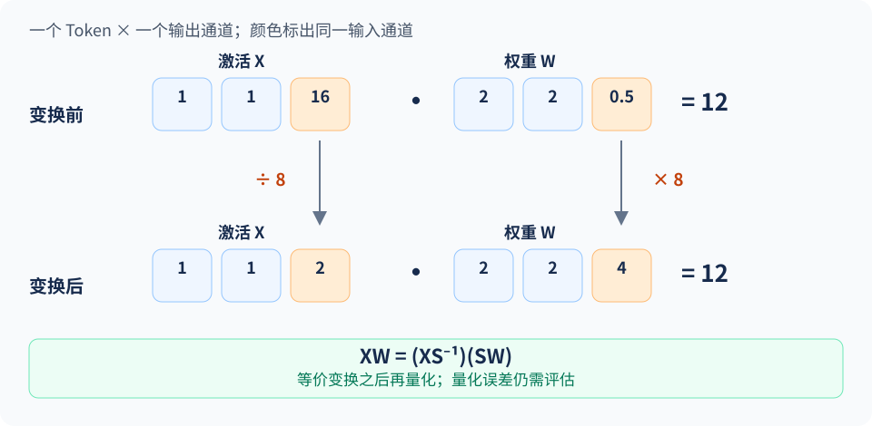
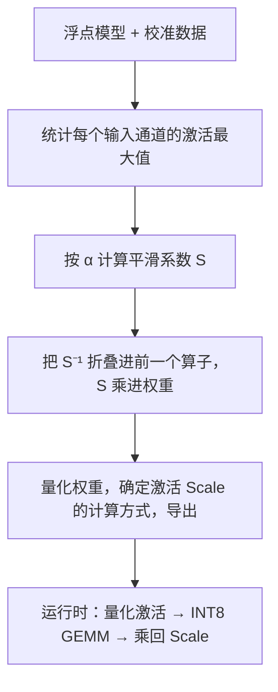

上一节的实验里，一个 20 就让 0.2、0.5 这些小值几乎读不清。LLM 的激活正有这种麻烦：少数通道的数值比其他通道大几十倍，INT8 的 255 个格子不够分。**SmoothQuant 的办法像挑担子：激活这头太重，就把一部分重量挪到权重那头，两头都不太重，再分别量化。** 挪动用的是数学上严格等价的缩放，线性层的输出不变。

> ⏰ **信息时效**：算法部分依据 SmoothQuant 论文；vLLM 与 LLM Compressor 的支持情况基于 vLLM v0.32.0（2026-10-18 发布）文档。

<!-- more -->

## 📑 目录

- [1. W8A8 难在哪里](#1-w8a8-难在哪里)
- [2. 等价缩放：一边除，一边乘](#2-等价缩放一边除一边乘)
- [3. 迁移强度 α 怎么选](#3-迁移强度-α-怎么选)
- [4. 从变换到 INT8 GEMM](#4-从变换到-int8-gemm)
- [5. 动手验证一个点积](#5-动手验证一个点积)
- [总结](#-总结)
- [自我检验清单](#-自我检验清单)
- [参考资料](#-参考资料)

---

## 1. W8A8 难在哪里

这里的 W8A8 特指 **INT8 权重 × INT8 激活**，线性层可以直接走 INT8 矩阵乘法。只压权重的方案（4.3 节）不碰激活，W8A8 则要在线处理每次都不一样的输入。

假设一个 Token 的隐藏向量里，大部分元素在 $[-1,1]$，某个通道却达到 80。按整行的最大绝对值求 Scale，$s=80/127\approx0.63$，$[-1,1]$ 里的数只能落到 $-2$ 到 $2$ 这几个编码上。Per-token 量化隔开了 Token 之间的差异，却管不了同一个 Token 内的通道差异。

[SmoothQuant 论文](https://arxiv.org/abs/2211.10438)观察到，这些大值集中在少数固定通道上，并在不同 Token 间反复出现；权重的分布则平坦得多，相对容易量化。于是问题变成：能不能把激活的"难"分一部分给权重？

---

## 2. 等价缩放：一边除，一边乘

### 2.1 公式

沿用 4.1 节的矩阵方向：

$$
Y=XW,\qquad X\in\mathbb{R}^{T\times C_{\text{in}}},\quad
W\in\mathbb{R}^{C_{\text{in}}\times C_{\text{out}}}
$$

取对角矩阵 $S=\operatorname{diag}(s_1,\ldots,s_{C_{\text{in}}})$，所有 $s_j>0$：

$$
Y=(XS^{-1})(SW)=\widetilde X\widetilde W
$$

对第 $j$ 个输入通道，$X$ 的第 $j$ 列除以 $s_j$，$W$ 的第 $j$ 行乘以 $s_j$。精确算术下一除一乘正好抵消，输出不变。

缩放作用在**同一个通道的所有 Token 上**，所以 $S$ 只有 $C_{\text{in}}$ 个系数，和 Token 数无关，可以离线算好。换成 PyTorch 的转置权重布局，乘的就是权重的列。

### 2.2 一个点积看懂



图中只展开一个 Token 和一个输出通道：$[1,1,16]$ 与 $[2,2,0.5]$ 的内积是 12。第三个激活除以 8、对应权重乘以 8，变成 $[1,1,2]$ 与 $[2,2,4]$，内积还是 12。激活的最大值从 16 降到 2，权重的最大值从 2 升到 4，**两个输入的量程都变得温和了**。

📌 **关键点**：平滑之后 $\widetilde X$、$\widetilde W$ 仍是浮点数，还没有任何 INT8 编码。平滑本身不引入误差，它的作用是让下一步量化的误差变小。SmoothQuant W8A8 = 平滑 + 量化，两步不能混为一谈。

---

## 3. 迁移强度 α 怎么选

挪得太少，激活的尖峰还在；挪得太多，权重又出现新的尖峰。SmoothQuant 用**迁移强度** $\alpha$ 控制挪多少：

$$
s_j=\frac{\left(\max_t|X_{tj}|\right)^\alpha}
{\left(\max_k|W_{jk}|\right)^{1-\alpha}},\qquad 0\leq\alpha\leq1
$$

激活的最大值用校准样本统计，权重的最大值直接从参数算。实现上还要防止分母接近 0。

- $\alpha$ 越大，激活被压得越平，更多难度转给权重；$\alpha$ 越小则相反。
- 论文把 $\alpha=0.5$ 称为 OPT、BLOOM 系列的通用"甜点"；激活更难量化的 GLM-130B 用了 0.75。
- 论文的消融显示，$\alpha$ 小于约 0.4 时激活难量化，大于约 0.6 时权重难量化（针对其实验模型）；后续版本中 LLaMA 系列用到 0.8 甚至更高。
- 合适的值要按模型在一小批校准数据上搜索，论文的做法是在 Pile 的子集上做网格搜索。

vLLM 文档给出的 LLM Compressor INT8 W8A8 示例用的是 `SmoothQuantModifier(smoothing_strength=0.8)`，这里的 `smoothing_strength` 就对应 $\alpha$。

⚠️ **注意**：这里有两种"Scale"。$s_j$ 是**平滑系数**，只做等价变换；INT8 的**量化 Scale** 在平滑之后按新的量程计算，负责映射到整数。

---

## 4. 从变换到 INT8 GEMM

### 4.1 离线流程



1. **收集激活范围**：用有代表性的校准文本跑前向，记录每个待量化线性层的输入通道最大值。
2. **计算并折叠平滑系数**：$S^{-1}$ 不必单独成为一个算子，可以并进前面的 LayerNorm/RMSNorm 的缩放参数里，$S$ 则直接乘进权重。
3. **量化**：选权重和激活的粒度，确定激活用静态校准还是动态计算 Scale，再验证逐层误差和整模型质量。
4. **导出**：保存真实的 INT8 权重和量化配置，交给支持该格式的推理 Kernel。

折叠有条件。一个 Norm 的输出若同时送给 Q、K、V 三个投影，三者必须用同一组 $S$，否则无法共用一次 $S^{-1}$。残差、非线性算子处也不能随意移动缩放，以工具支持的变换位置为准。

在 vLLM v0.32.0 文档的 LLM Compressor 示例中，INT8 W8A8 的配方是先平滑、再用 GPTQ 量化：

```python
from llmcompressor.modifiers.quantization import GPTQModifier
from llmcompressor.modifiers.smoothquant import SmoothQuantModifier

recipe = [
    SmoothQuantModifier(smoothing_strength=0.8),
    GPTQModifier(targets="Linear", scheme="W8A8", ignore=["lm_head"]),
]
```

`lm_head` 保持原精度，是这类配方的常见做法。导出后的检查点可以直接被 vLLM 加载，具体命令见 4.6 节。

### 4.2 运行时怎样算

为看清数据流，设平滑后的激活按 Token 量化、权重按输出通道量化，零点都为 0：

$$
\widehat X_{tj}=a_t Q^X_{tj},\qquad
\widehat W_{jk}=b_k Q^W_{jk}
$$

两个 Scale 都能从求和号里提出来：

$$
\widehat Y_{tk}=a_t b_k\sum_jQ^X_{tj}Q^W_{jk}
$$

求和部分是 INT8 乘、INT32 累加，最后乘回 $a_tb_k$ 转成 FP16/BF16。可见 **W8A8 只描述矩阵乘法的两个输入，累加和输出仍保留更高精度**。这也解释了 4.1 节的结论：激活 Scale 若按通道 $j$ 设，就提不出求和号，所以只能靠平滑把通道差异提前消掉。

### 4.3 收益与适用条件

论文报告，SmoothQuant 在其测试的模型上最高可提速 1.56 倍、显存减半，精度损失可以忽略。整模型能否提速，取决于 INT8 GEMM 省下的时间能否覆盖在线量化激活、处理 Scale 和类型转换的开销；矩阵很小、算子没融合，或大部分时间耗在 Attention 与调度上时，收益有限。

硬件也有边界。vLLM v0.32.0 文档注明，INT8 W8A8 计算支持 Turing 到 Hopper 的 NVIDIA GPU，**不支持计算能力 10.0 及以上的 Blackwell**，这类卡应改用 FP8（4.5 节）。

质量上，要重点看校准集没覆盖到的输入：长文本、代码、特殊符号和小语种。必要时让敏感层保留高精度。

---

## 5. 动手验证一个点积

把 2.2 节的例子接上对称 INT8 量化。`qdq` 表示 Quantize-Dequantize：算出整数编码后立刻转回浮点，用来模拟量化误差，并不执行真正的 INT8 GEMM。

```python
def qdq(values):
    amax = max(map(abs, values))
    scale = amax / 127 if amax else 1.0
    return [max(-127, min(127, round(v / scale))) * scale for v in values]


def dot(a, b):
    return sum(x * y for x, y in zip(a, b))


x, w = [1.0, 1.0, 16.0], [2.0, 2.0, 0.5]
s = [1.0, 1.0, 8.0]  # 手工选取便于观察，真实模型由校准统计和 α 算出
x_s = [v / k for v, k in zip(x, s)]
w_s = [v * k for v, k in zip(w, s)]

print("原始输出:", dot(x, w))
print("平滑后输出:", dot(x_s, w_s))
print("直接量化:", round(dot(qdq(x), qdq(w)), 6))
print("平滑后量化:", round(dot(qdq(x_s), qdq(w_s)), 6))
```

前两行都是 12.0，说明平滑是等价变换。直接量化得到约 12.094488，平滑后再量化约 12.063240，误差从 0.094 降到 0.063。这只是一个输出通道上的机制演示，真实模型的效果要靠整模型评测确认。

---

## 📝 总结

- INT8 W8A8 同时量化权重和激活，难点在于激活中集中在少数通道的离群值。
- SmoothQuant 利用 $XW=(XS^{-1})(SW)$ 把激活的量化难度迁移一部分给权重，再分别量化。
- 迁移强度 $\alpha$ 平衡两边的难度，论文中 0.5 是常见起点，不同模型需要搜索。
- 平滑系数 $S$ 可离线折叠进前一个算子；共享输入的多个投影必须用同一组系数。
- 激活 Scale 只能按 Token 设，才能从求和中提出，这是需要先平滑的根本原因。
- vLLM v0.32.0 中 INT8 W8A8 不支持 Blackwell，这类卡应选 FP8。

## 🎯 自我检验清单

- 能解释 Per-token 量化为什么挡不住通道离群值
- 能指出平滑变换分别改了 $X$ 和 $W$ 的哪个轴，以及 $S$ 有多少个系数
- 能写出 $\alpha$ 的平滑公式，说明增大 $\alpha$ 的效果
- 能区分平滑系数和量化 Scale
- 能说明为什么 Q、K、V 共享一个 Norm 输出时必须一起处理
- 能写出 W8A8 运行时的反量化公式，并说明累加用什么精度
- 能用 LLM Compressor 的配方描述一次 SmoothQuant + GPTQ 的 W8A8 量化

## 📚 参考资料

- [SmoothQuant: Accurate and Efficient Post-Training Quantization for Large Language Models（Xiao et al., 2022）](https://arxiv.org/abs/2211.10438)
- [SmoothQuant 官方代码](https://github.com/mit-han-lab/smoothquant)
- [vLLM v0.32.0 — INT8 W8A8（LLM Compressor）](https://docs.vllm.ai/en/v0.32.0/features/quantization/llm_compressor/int8_w8a8/)
- [LLM Compressor](https://github.com/vllm-project/llm-compressor)
