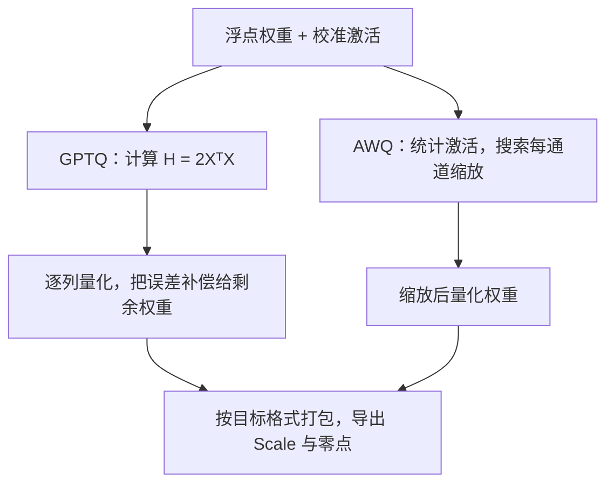
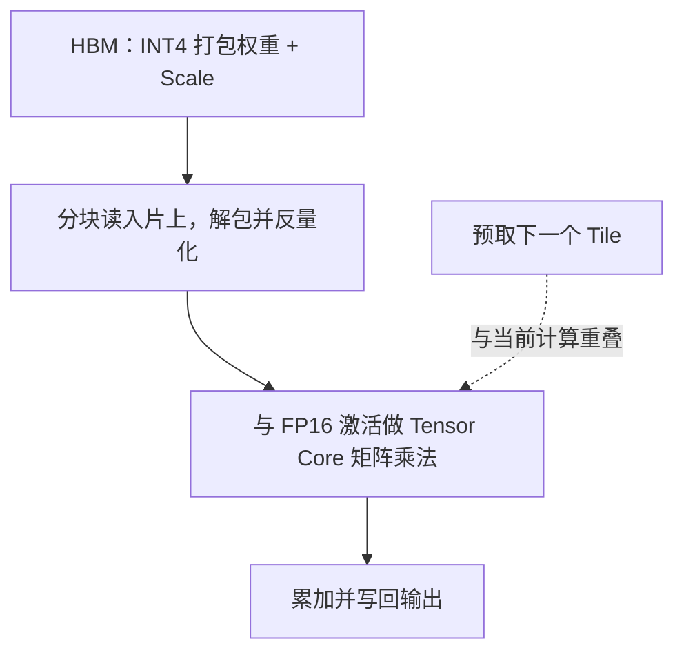

4.2 节的 W8A8 要同时对付权重和激活。这一节换个思路：**激活保留 FP16/BF16，只把权重压到 4-bit，即 W4A16。** Decode 阶段每步都要把整份权重从显存读一遍，权重变成四分之一，读的时间也跟着少。难点在于 4-bit 只有 16 个编码，格距是 8-bit 的约 17 倍（4.1 节），必须想办法让误差少伤输出。

GPTQ 和 AWQ 是两种主流的解法：前者像拼图时边放边调整剩下的块，后者先找出最要紧的几块重点保护。Marlin 则负责让 GPU 高效地读和算这些 4-bit 权重。

> ⏰ **信息时效**：算法部分依据各自论文；vLLM 的 Kernel 选择与工具链建议基于 vLLM v0.32.0（2026-10-18 发布）。

<!-- more -->

## 📑 目录

- [1. W4A16 的存储和计算](#1-w4a16-的存储和计算)
- [2. GPTQ：边量化边补偿](#2-gptq边量化边补偿)
- [3. AWQ：按激活找出要保护的通道](#3-awq按激活找出要保护的通道)
- [4. Marlin：让解包不拖慢计算](#4-marlin让解包不拖慢计算)
- [5. 怎样比较 GPTQ 与 AWQ](#5-怎样比较-gptq-与-awq)
- [总结](#-总结)
- [自我检验清单](#-自我检验清单)
- [参考资料](#-参考资料)

---

## 1. W4A16 的存储和计算

INT4 权重在显存里是**打包**存放的：一个 32-bit 字装 8 个 4-bit 编码，另外存每组的 Scale，非对称方案还有零点。推理时，Kernel 读出编码，在片上反量化成 FP16/BF16，再和 16-bit 激活做矩阵乘法。

所以看到"INT4 模型"，要分清两件事：**权重的存储类型**是 INT4，**乘法指令的输入类型**仍是 16-bit。这条路径省的是读权重的带宽，不是乘法的算力。

分组参数也占空间。每 128 个 INT4 权重共用一个 FP16 Scale 时，平均每个权重占：

$$
\frac{4}{8}+\frac{2}{128}=0.515625\ \text{byte}
$$

再加零点和对齐还会略多。能省多少时间，要看解包与反量化是否和矩阵乘法融合在同一个 Kernel 里，以及 KV 读取、Attention 等其他部分还占多大比例。

---

## 2. GPTQ：边量化边补偿

### 2.1 目标要带上输入

如果只最小化 $\|W-\widehat W\|_F^2$，每个权重的误差都按同样的分量计分。可经过线性层后，有的误差被输入放大，有的则互相抵消。[GPTQ](https://arxiv.org/abs/2210.17323) 用校准输入，把目标换成层输出的重建误差：

$$
\min_{\widehat W}\ \|XW-X\widehat W\|_F^2
$$

取一个输出通道的权重列 $w$，记 $\delta=w-\widehat w$：

$$
E=\|X\delta\|_2^2=\delta^\mathsf TX^\mathsf TX\delta,
\qquad H=2X^\mathsf TX
$$

$H$ 刻画了在真实输入下，每个方向上的误差要付多大代价，以及输入通道之间的相关性。它只来自单个线性层的重建目标，不需要整个语言模型损失的 Hessian。

### 2.2 补偿的直觉

拼图时一块放歪了，可以挪一挪旁边还没固定的块来弥补。GPTQ 也是这样：**每固定一个权重，就把它的误差分摊给还没量化的权重。**

看两维的例子。若校准输入的两列几乎相同，输出主要取决于 $w_1+w_2$。$w_1=0.26$ 量化成 0.30，多了 0.04；趁 $w_2$ 还没量化，让它减 0.04，输出就基本不变。两列不完全相同时，补多少由 $H$ 决定，不是简单的一加一减。

设 $F$ 是尚未固定的权重下标集合，$H_F$ 是对应的子矩阵。把 $w_i$ 固定为量化值 $\widehat w_i$ 后，最优补偿是：

$$
\Delta w_F=-\frac{w_i-\widehat w_i}{[H_F^{-1}]_{ii}}[H_F^{-1}]_{:,i}
$$

第 $i$ 项正好把 $w_i$ 变成 $\widehat w_i$，其余项给出剩余权重的调整量。$\widehat w_i$ 是反量化后的值，和原权重同一尺度，不是整数编码。官方实现还加了阻尼项保证数值稳定，并用 Cholesky 分解和分块更新降低成本。

两个"128"别搞混：**更新块大小**决定一次处理多少列、多久批量传播一次误差；**Group Size** 决定多少权重共享一个 Scale。

### 2.3 代价与效果

论文报告，GPTQ 量化 175B 参数的 GPT 模型约需 4 个 GPU 小时，降到 3–4 bit 时精度损失可忽略，第一次让 175B 模型能在单张 GPU 上运行。量化是离线一次性的成本，推理时不再需要 $H$。

---

## 3. AWQ：按激活找出要保护的通道

### 3.1 权重大，不一定最要紧

对 $y=\sum_jx_jw_j$，权重误差 $\Delta w_j$ 对输出的影响是 $x_j\Delta w_j$。**一个权重要不要紧，取决于和它相乘的激活有多大**，而不是它自己有多大。

[AWQ](https://arxiv.org/abs/2306.00978) 的论文指出两点：只保护 1% 的显著权重就能大幅减小量化误差；而找显著通道应该看激活分布，不是看权重。

### 3.2 用缩放代替混合精度

最直接的保护是让这 1% 保持 FP16，但混合精度的存储布局对 Kernel 很不友好。AWQ 改用缩放：量化前把显著通道的权重放大 $s_j$ 倍，输入相应除以 $s_j$。沿用 4.2 节的符号：

$$
Y=(XS^{-1})(SW),\qquad
\widehat Y=(XS^{-1})\,D(Q(SW))
$$

$Q$ 生成低比特编码，$D$ 用 Scale 和零点反量化。放大后，只要这个通道所在组的量化格距没有同比例变大，除回 $s_j$ 后它的有效误差就变小了。但放得太大会撑宽整组量程，误伤同组其他权重，所以 AWQ 要在校准数据上搜索缩放因子，再配合截断控制总误差。

部署出来的仍是规则的 INT4 布局，没有单独存成 FP16 的权重，这正是它容易被高效 Kernel 支持的原因。论文配套的 TinyChat 在桌面和移动 GPU 上比 Hugging Face FP16 实现快 3 倍以上。

### 3.3 与 SmoothQuant 对照

两者都用配对缩放，但目的不同：

| 📊 方法 | 处理什么 | 缩放的方向 | 典型配置 |
|---|---|---|---|
| SmoothQuant | 激活离群值让 INT8 激活难量化 | 压平激活，难度转给权重 | INT8 W8A8 |
| AWQ | 显著通道的权重误差被大激活放大 | 放大显著权重，降低其相对误差 | INT4 W4A16 |

只做 AWQ 的缩放搜索，得到的还是浮点权重，后面仍要量化和打包。比较方法时要分清三种中间产物：缩放后的浮点权重、模拟量化（QDQ）后的浮点权重、真正编码打包的部署权重。

---

## 4. Marlin：让解包不拖慢计算

编码好了，还有一道工程题。最笨的做法是先把整层 INT4 展开成 FP16 写回显存，再调用普通 GEMM，结果多了一次大规模读写，省下的带宽全吐了回去。

[Marlin](https://arxiv.org/abs/2408.11743) 把读权重、解包、反量化和矩阵乘法放进同一个 Kernel 的流水线里：

权重事先重排成适合运行时读取的布局，再用模块二讲过的 Tiling 与多级缓冲，把数据搬运和计算重叠起来。论文报告，Batch 在 16–32 以内时能接近 4 倍的理论加速上限，到 64–128 时加速逐渐减小但仍然明显；接入 vLLM 后端到端最高约 2.8 倍。

Batch 一大，计算重新成为瓶颈，少读权重的优势就被摊薄，这和第 1 章的 Roofline 分析一致。

### 4.1 vLLM 中的 Kernel 选择

在 vLLM v0.32.0 中，量化方法名和 Kernel 已经解耦：

- `--quantization` 写 `awq`、`awq_marlin` 或 `auto_awq`，都解析为同一个 `auto_awq` 配置；GPTQ 的 `gptq`、`gptq_marlin`、`auto_gptq` 同理。不写时按检查点里的 `quant_method` 自动识别。
- 具体用哪个 Kernel，由 vLLM 按优先级逐个检查能否实现当前层。CUDA 上 INT4 W4A16 权重的主要候选依次是 Machete（仅 Hopper，计算能力 9.0）、Marlin（Turing 及以上）、Conch、Exllama、Triton 等，第一个通过检查的胜出。
- 启动日志会打印 `Using MarlinLinearKernel for AutoAWQMarlinLinearMethod` 这类信息；AWQ 层不满足条件时则会提示 "Falling back to unoptimized AWQ kernels"。
- 想排除某个 Kernel 做对比，可以用环境变量 `VLLM_DISABLED_KERNELS`。

**GPTQ/AWQ 决定编码的误差，Kernel 决定编码跑得多快。** 判断实际走了哪条路径，看启动日志，不要只凭模型名字。

---

## 5. 怎样比较 GPTQ 与 AWQ

### 5.1 先拆开四个维度

"GPTQ、INT4 W4A16、Group Size 128、Marlin"这一串描述，分别回答了四个不同的问题：

| 📊 维度 | 例子 | 回答什么 |
|---|---|---|
| 量化算法 | GPTQ 或 AWQ | 怎样控制量化误差 |
| 格式与位宽 | INT4 W4A16 | 权重怎么编码，激活保留什么精度 |
| 量化粒度 | Group Size 128 | 多少权重共享一组 Scale |
| 执行实现 | Marlin、Machete | 编码怎样被读取和计算 |

W4A16 不限定算法，同一种算法也可以配不同的分组和 Kernel。四项都固定了，再比较算法本身：

| 📊 维度 | GPTQ | AWQ |
|---|---|---|
| 校准数据用来做什么 | 构造 $H$，衡量层输出误差 | 统计激活，搜索通道缩放 |
| 主要手段 | 逐列量化，补偿剩余权重 | 放大显著通道，降低其相对误差 |
| 离线计算 | 逐层求解重建问题，更新每个权重 | 搜索每通道的缩放因子，不逐个改写权重 |
| 推理速度 | 取决于导出布局与 Kernel | 同样取决于导出布局与 Kernel |

"AWQ 一定更快""GPTQ 一定更准"都缺少前提。公平对比至少要固定基础模型、位宽、Group Size、校准集、输入长度和负载，并记录实际加载的 Kernel。

### 5.2 用什么工具量化

- **LLM Compressor**：vLLM 项目维护，支持 GPTQ、AWQ 和 SmoothQuant，导出的 `compressed-tensors` 格式可直接被 vLLM 加载。vLLM 文档的 INT4 W4A16 示例用 `GPTQModifier(scheme="W4A16")`。
- **GPTQModel**：专注 GPTQ 系列，文档注明兼容的模型可以用 vLLM 的 Marlin 和 Machete Kernel。
- **AutoAWQ**：已停止维护，vLLM 文档建议改用 LLM Compressor 中的 AWQ。已有的 AutoAWQ 检查点仍能正常加载。

### 5.3 排查顺序

1. **确认检查点**：量化配置是否完整，基础模型和版本是否一致。
2. **看加载日志**：最终用了哪个 Kernel，有没有回退。
3. **先验质量**：用独立的任务集评测，别只挑几条好看的输出。
4. **再测性能**：分别看小 Batch Decode、大 Batch 和长 Prompt；量化省出的显存也可能被用来扩大并发。

---

## 📝 总结

- W4A16 只压缩权重，存储是 INT4，乘法输入仍是 16-bit，省的是读权重的带宽。
- GPTQ 用校准输入衡量层输出误差，借助 $H=2X^\mathsf TX$ 把每个权重的误差补偿给尚未量化的权重。
- AWQ 按激活大小找显著通道，用缩放代替混合精度来保护它们，部署布局仍然规整。
- Marlin 把解包、反量化和矩阵乘法融合进一条流水线，小 Batch 下接近 4 倍理论加速，Batch 变大后收益递减。
- vLLM v0.32.0 中 AWQ/GPTQ 的方法别名已统一，Kernel 按优先级自动选择，以启动日志为准。
- 比较 GPTQ 与 AWQ 前，先固定格式、粒度和 Kernel。

## 🎯 自我检验清单

- 能算出 Group Size 128、FP16 Scale 下每个 INT4 权重的平均存储量
- 能解释为什么 $\|XW-X\widehat W\|$ 比单看权重误差更贴近层输出
- 能用两个高度相关的输入通道说明 GPTQ 的补偿思路
- 能区分 GPTQ 的更新块大小和量化 Group Size
- 能说明 AWQ 为什么看激活而不是权重来找显著通道，以及它为何用缩放代替混合精度
- 能对比 AWQ 与 SmoothQuant 中配对缩放的方向和目的
- 能解释 Marlin 的加速为什么会随 Batch 变大而减小
- 能从 vLLM 启动日志判断 INT4 模型实际使用的 Kernel

## 📚 参考资料

- [GPTQ: Accurate Post-Training Quantization for Generative Pre-trained Transformers（Frantar et al., 2022）](https://arxiv.org/abs/2210.17323)
- [GPTQ 官方代码](https://github.com/IST-DASLab/gptq)
- [AWQ: Activation-aware Weight Quantization for LLM Compression and Acceleration（Lin et al., 2023）](https://arxiv.org/abs/2306.00978)
- [AWQ 官方代码](https://github.com/mit-han-lab/llm-awq)
- [MARLIN: Mixed-Precision Auto-Regressive Parallel Inference on Large Language Models（Frantar et al., 2024）](https://arxiv.org/abs/2408.11743)
- [Marlin 官方代码](https://github.com/IST-DASLab/marlin)
- [vLLM v0.32.0 — INT4 W4A16（LLM Compressor）](https://docs.vllm.ai/en/v0.32.0/features/quantization/llm_compressor/int4/)
- [vLLM v0.32.0 — AutoAWQ](https://docs.vllm.ai/en/v0.32.0/features/quantization/auto_awq/)
- [vLLM v0.32.0 — GPTQModel](https://docs.vllm.ai/en/v0.32.0/features/quantization/gptqmodel/)
- [vLLM v0.32.0 — 线性层 Kernel 选择源码](https://github.com/vllm-project/vllm/blob/v0.32.0/vllm/model_executor/kernels/linear/__init__.py)
