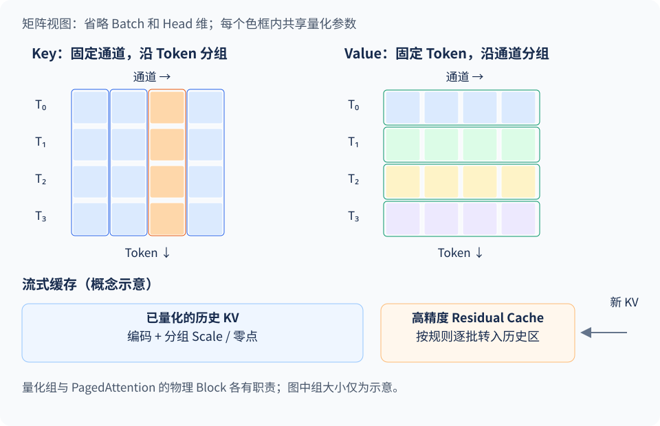

权重压到 INT4，模型终于装进了显存；可上下文一拉长、并发一上来，显存又不够了。第 1 章的账本解释过原因：**权重是一次性的固定开销，KV Cache 却随每个请求的历史 Token 不断增长。** 这一节看怎样让每个历史 Token 占得更少。

KV Cache 像一本边写边记的会议纪要：权重量化是在会前把参考资料印成小字版，可以慢慢排版；纪要却只能现场速记，记下一句就要马上能被查阅。所以 KV 量化方法必须便宜、能流式追加。

> ⏰ **信息时效**：KIVI 部分依据论文；vLLM 的参数、Scale 方案与校准路径基于 v0.32.0（2026-10-18 发布）。旧版本中的 `calculate_kv_scales` 参数在 v0.32.0 中已不存在。

<!-- more -->

## 📑 目录

- [1. 先估算能省下多少缓存](#1-先估算能省下多少缓存)
- [2. KV 为什么不能照搬权重量化](#2-kv-为什么不能照搬权重量化)
- [3. KIVI：Key 按通道，Value 按 Token](#3-kivikey-按通道value-按-token)
- [4. vLLM 的 FP8 KV Cache](#4-vllm-的-fp8-kv-cache)
- [5. 怎样验证长上下文收益](#5-怎样验证长上下文收益)
- [总结](#-总结)
- [自我检验清单](#-自我检验清单)
- [参考资料](#-参考资料)

---

## 1. 先估算能省下多少缓存

对常规 MHA/GQA，设层数 $L$、请求数 $B$、每请求缓存长度 $T$、KV Head 数 $H_{\text{KV}}$、Head 维度 $d$、每个元素 $b$ 字节：

$$
M_{\text{KV}}=2LBTH_{\text{KV}}db
$$

开头的 2 对应 K 和 V。取 $L=32,H_{\text{KV}}=8,d=128$，单请求缓存 32768 个 Token，16-bit 下：

$$
2\times32\times32768\times8\times128\times2\ \text{B}=4\ \text{GiB}
$$

8-bit 约 2 GiB，2-bit 约 0.5 GiB。2-bit 的数字只是编码本身的下限，还没算分组的 Scale/零点、高精度残留区、对齐与分页开销。MLA、滑动窗口和混合架构的缓存结构不同，要按实际结构另算。

两件事可以叠加：PagedAttention 让已有空间少浪费，量化让每个元素变小。权重量化不会自动改变这里的 $b$，KV 精度要单独配置。

---

## 2. KV 为什么不能照搬权重量化

**时间约束不同。** 权重可以离线花几小时跑 GPTQ，处理一次反复使用。KV 则在请求执行中不断产生，每生成一个 Token 就要写入一份。量化必须足够便宜，否则省下的显存要拿延迟来换。

**误差进入的位置不同。** 记 $P=\operatorname{softmax}(QK^\mathsf T/\sqrt d)$：

- **Key 的误差**先改变 $QK^\mathsf T$，再经过 Softmax，可能让模型关注错位置。
- **Value 的误差**进入 $PV$，按注意力权重加权后影响输出。

所以 KV 量化的效果要放回长上下文任务里验证。几条短对话正常，说明不了长文档检索、跨段推理和长输出也正常。

---

## 3. KIVI：Key 按通道，Value 按 Token

### 3.1 两个张量，两种分组

[KIVI](https://arxiv.org/abs/2402.02750) 是一种免调参的 2-bit KV Cache 量化算法。它的出发点是一个观察：在其研究的模型中，**Key 有明显的通道离群值，Value 没有**。因此论文主张 Key 按通道量化、Value 按 Token 量化。

固定一层、一个请求和一个 KV Head，把 K、V 都看成 $T\times d$ 矩阵，沿用 4.1 节"行 = Token，列 = 通道"的约定：

- **Key Per-channel**：固定一个通道，沿连续的若干 Token 分组求量化参数（竖着切）。
- **Value Per-token**：固定一个 Token，沿通道分组求量化参数（横着切）。



Key 竖着切，大幅值通道就被单独隔开，不再拖累其他通道；Value 横着切，每个 Token 用自己的范围。图中彩色框是共享量化参数的组，和 PagedAttention 的物理 KV Block 不是一回事。

这在 2-bit 下格外关键：每组只有 4 个编码，大小悬殊的数挤在一组，小值几乎都会落到同一个编码上（4.1 节）。

论文标题里的 **Asymmetric** 指 K 和 V 用不同的策略；组内则是基于最小值、最大值的非对称映射。"怎么分组"和"组内怎么编码"是两个问题。

### 3.2 新 Token 凑不满一组怎么办

Key 的组跨越多个 Token，刚生成的几个 Token 还凑不满一组。KIVI 为此保留一段高精度的 **Residual Cache（残留缓存）**，和已量化的历史一起参与 Attention；新 Token 积累够了，再成批量化移入历史区。

残留区让流式写入可行，也让最近的 Token 保持高精度，但它占额外空间。上下文越短，残留区和元数据的占比越高，实际压缩比离"16-bit 到 2-bit 的 8 倍"就越远。

论文在 Llama、Falcon 和 Mistral 上测试，报告峰值显存（含模型权重）降低 2.6 倍，Batch 可放大到 4 倍，实际推理负载下吞吐提升 2.35–3.47 倍。

📌 **关键点**：KIVI 是论文方法，有自己的实现，不等于 vLLM 默认的 KV 路径。2-bit 是论文在其模型和任务上验证的配置，换模型要重新评测。

---

## 4. vLLM 的 FP8 KV Cache

工程上更常用的路线是把 KV 存成 FP8：数据量减半，精度压力比 2-bit 小得多，也不需要 KIVI 那样的特殊缓存结构。FP8 的数值格式在 4.5 节展开，这里只看使用环节。

### 4.1 选格式

`kv_cache_dtype` 的常用取值：

| 📊 取值 | 含义 | 支持说明（v0.32.0 文档） |
|---|---|---|
| `auto` | 与模型数据类型一致 | 默认值 |
| `fp8` / `fp8_e4m3` | E4M3，精度更高 | CUDA 11.8+ 与 ROCm |
| `fp8_e5m2` | E5M2，范围更大、精度更低 | CUDA 11.8+ |

源码里的 `CacheDType` 还列出了 `int8_per_token_head`、`fp8_per_token_head`、`nvfp4` 等更多选项，它们依赖特定的 Attention 后端，使用前要查对应后端的支持情况。另外，DeepSeek-V3.2 等少数模型默认就用 FP8 KV。

### 4.2 FP8 也要 Scale

FP8 的指数范围有限，实际值仍要乘一个 Scale 放进合适的区间。v0.32.0 支持两种 Scale 粒度：

- **Per-tensor**：Q、K、V 各一个 Scale。
- **Per-attention-head**：每个 Head 一个，`q_scale` 有 `num_heads` 个，`k/v_scale` 有 `num_kv_heads` 个。目前只有 Flash Attention 后端支持，且必须用 LLM Compressor 校准。

Scale 的来源有两条路径：

1. **不校准**：只设 `kv_cache_dtype="fp8"`，所有 Scale 取 1.0。检查点里没有 Scale 时，启动日志会警告 "Using KV cache scaling factor 1.0 for fp8_e4m3"。
2. **用数据集校准（文档推荐）**：用 LLM Compressor 的 `QuantizationModifier` 配 `kv_cache_scheme`，在校准集上做一次 `oneshot`，把 Scale 写进检查点。文档示例用 512 条样本、最大长度 2048，`strategy` 可选 `"tensor"` 或 `"attn_head"`。

⚠️ **注意**：旧版本中用随机 Token 估计 Scale 的 `calculate_kv_scales` 参数，在 v0.32.0 中已经不存在。只剩"Scale 取 1.0"和"读取检查点里的校准 Scale"两种情况，**能跑通不等于已经校准**。

### 4.3 先跑通，再校准

下面的离线示例只验证 FP8 KV 路径能否加载和生成：

```python
from vllm import LLM, SamplingParams

llm = LLM(
    model="Qwen/Qwen2.5-7B-Instruct",
    dtype="bfloat16",  # 检查点的发布精度
    max_model_len=4096,
    kv_cache_dtype="fp8",  # 未校准：Scale 全部为 1.0
)
outputs = llm.chat(
    [[{"role": "user", "content": "用两句话说明 KV Cache 量化节省了什么。"}]],
    SamplingParams(temperature=0, max_tokens=128),
)
print(outputs[0].outputs[0].text)
```

正式对比应使用带校准 Scale 的检查点，并在日志里确认没有出现 Scale 为 1.0 的警告。

### 4.4 跳过敏感层

有些层对 KV 量化更敏感，例如滑动窗口 Attention 层。`--kv-cache-dtype-skip-layers` 可以让指定的层保持原精度，其余层照常量化：

```bash
vllm serve <model> \
  --kv-cache-dtype fp8 \
  --kv-cache-dtype-skip-layers sliding_window  # 也可以写层号，如 0 1 23
```

Python 接口对应参数 `kv_cache_dtype_skip_layers=["sliding_window"]`。

### 4.5 存储精度不等于计算精度

FP8 KV 首先减少的是存储；读出来以后，后端可能转回高精度再算，也可能直接在 FP8 域做 Attention。vLLM 文档注明，**Flash Attention 3 后端配合 FP8 KV 时，Attention 在 FP8 域计算，Query 也会被量化成 FP8**。所以只看 `kv_cache_dtype` 不能断定整段 Attention 的精度，要结合 GPU、后端和启动日志一起判断（第 2 章讲过后端选择）。

---

## 5. 怎样验证长上下文收益

先固定权重格式，只改 KV 配置，才看得出变化来自哪里：

| 📊 要验证的收益 | 对比条件 | 观察什么 |
|---|---|---|
| 缓存容量 | 相同的 KV 显存预算 | 可缓存的 Token 数、能承载的上下文和并发 |
| 单请求延迟 | 相同的输入/输出长度和并发 | TTFT、TPOT，量化与转换有无额外开销 |
| 服务吞吐 | 相同的质量要求与延迟目标 | 多出的容量能否变成更多有效并发 |
| 长上下文质量 | 独立的长文本任务集 | 检索正确率、引用位置、跨段推理和长输出 |

vLLM 会把剩余显存都分给 KV 池，所以两次运行在 `nvidia-smi` 里看起来占用差不多。真正变化的是**同样的预算能放下多少 KV Token**，这个数字在启动日志里，比截一张总显存图更能说明问题。

权重量化和 KV 量化组合时，先分别验证，再测组合。两种误差会在同一个网络里叠加，各自通过评测不代表组合后也没问题。

---

## 📝 总结

- KV 量化减少每个历史 Token 的存储，收益随上下文长度和并发增大。
- KV 在线产生，量化方法必须便宜、支持流式追加；K 的误差影响注意力分布，V 的误差影响加权输出。
- KIVI 对 Key 按通道、Value 按 Token 分组，用高精度残留缓存处理凑不满一组的新 Token。
- vLLM v0.32.0 的 FP8 KV 支持 Per-tensor 与 Per-attention-head 两种 Scale，Scale 要么取 1.0，要么来自 LLM Compressor 校准的检查点。
- 敏感层可以用 `--kv-cache-dtype-skip-layers` 保留原精度；FA3 后端下 Attention 本身也会在 FP8 域计算。
- 判断收益要看日志中的 KV Token 容量，并单独做长上下文质量评测。

## 🎯 自我检验清单

- 能用 $M_{\text{KV}}=2LBTH_{\text{KV}}db$ 估算一个模型在给定上下文下的 KV 占用
- 能说明 KV 量化与权重量化在时间约束和误差传播上的区别
- 能画出 KIVI 中 Key、Value 的分组方向，并解释为什么这样分
- 能解释 Residual Cache 为什么会拉低实际压缩比
- 能说出 vLLM v0.32.0 中 FP8 KV Scale 的两种粒度和两种来源
- 能从启动日志判断 FP8 KV 是否真的用上了校准 Scale
- 能说明显存占用看起来相同时，怎样判断 KV 量化是否增加了容量

## 📚 参考资料

- [KIVI: A Tuning-Free Asymmetric 2bit Quantization for KV Cache（Liu et al., 2024）](https://arxiv.org/abs/2402.02750)
- [KIVI 官方实现](https://github.com/jy-yuan/KIVI)
- [vLLM v0.32.0 — Quantized KV Cache](https://docs.vllm.ai/en/v0.32.0/features/quantization/quantized_kvcache/)
- [vLLM v0.32.0 — CacheConfig 源码](https://github.com/vllm-project/vllm/blob/v0.32.0/vllm/config/cache.py)
- [LLM Compressor — KV Cache 量化示例](https://github.com/vllm-project/llm-compressor/tree/main/examples/quantization_kv_cache)
