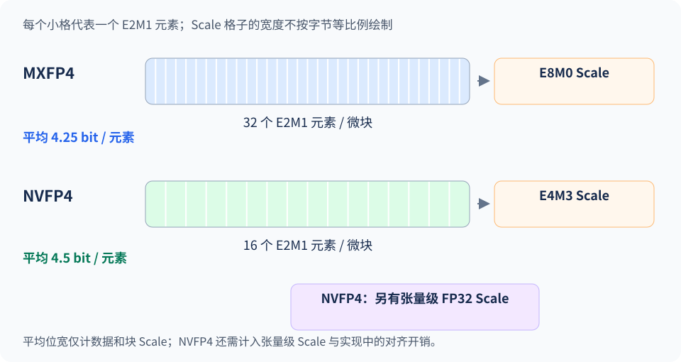

前几节用的都是整数编码，上一节又出现了 FP8 KV Cache。INT8 和 FP8 都是 8 个 bit，区别在于怎么解读：**整数格式像一把等距刻度的直尺，浮点格式更像对数刻度的计算尺，靠近 0 刻得密，越往外越疏。** 这一节先讲从 INT 换成 FP 改变了什么，再看 Hopper 起普及的 FP8，以及 Blackwell 上的 NVFP4、MXFP4。

> ⏰ **信息时效**：格式定义依据 OCP MX 规范、FP8 Formats 论文与 NVIDIA 官方说明；vLLM 的硬件支持与在线量化方案基于 v0.32.0（2026-10-18 发布）文档。

<!-- more -->

## 📑 目录

- [1. FP8：范围和精度怎样分配](#1-fp8范围和精度怎样分配)
- [2. 为什么 FP8 仍然需要 Scale](#2-为什么-fp8-仍然需要-scale)
- [3. FP4 与微块缩放](#3-fp4-与微块缩放)
- [4. NVFP4 与 MXFP4 的区别](#4-nvfp4-与-mxfp4-的区别)
- [5. 硬件支持怎样变成模型收益](#5-硬件支持怎样变成模型收益)
- [总结](#-总结)
- [自我检验清单](#-自我检验清单)
- [参考资料](#-参考资料)

---

## 1. FP8：范围和精度怎样分配

### 1.1 同一串 bit，两种含义

均匀 INT8 量化里，整数 $q$ 按 $s(q-z)$ 解读，Scale 固定后相邻重建值等距。FP8 则把 8 个 bit 分成符号、指数、尾数三段。例如 `00111000`：

- 按有符号 INT8 读，是 56；
- 按 E4M3 读，符号 0、指数 `0111`、尾数 `000`，是 1.0。

所以把一份 INT8 编码的类型标签改成 FP8，数值就全变了。格式之间转换，必须从原值重新编码，并重新计算 Scale。E4M3 的完整编码和特殊值见 [ONNX 的 FP8 说明](https://onnx.ai/onnx/technical/float8.html)。

| 📊 比较项 | 均匀整数量化 | 低比特浮点量化 |
|---|---|---|
| 编码的含义 | 整数，配 Scale 和零点 | 符号、指数、尾数，配外部 Scale |
| 固定 Scale 后的间距 | 处处相等 | 随指数区间变化 |
| 误差特点 | 绝对误差上界统一 | 正规数范围内相对误差大致统一 |
| 计算 | 需要整数输入的 Kernel | 需要对应浮点格式的 Kernel |

**位宽没变，变的是可表示值怎样分布、范围多大、走哪条计算路径。** 哪种误差更小，要结合数据分布、Scale 和粒度来判断。

### 1.2 E4M3 与 E5M2

8 个 bit 怎么分给指数和尾数，就是范围与精度的取舍。[FP8 Formats 论文](https://arxiv.org/abs/2209.05433)提出了两种编码，后来被 NVIDIA 等硬件广泛采用：

| 📊 格式 | 符号 / 指数 / 尾数 | 最大有限值 | 特殊值 | 取舍 |
|---|---|---|---|---|
| E4M3 | 1 / 4 / 3 | ±448 | 只有 NaN，无 Inf | 精度更高，范围较小 |
| E5M2 | 1 / 5 / 2 | ±57344 | ±Inf 与 NaN | 范围更大，精度更低 |

E5M2 遵循 IEEE 754 的特殊值约定；E4M3 不表示无穷大、只留一个尾数模式给 NaN，从而把范围扩展到 448。推理中的权重和激活一般用 E4M3，vLLM 的 FP8 W8A8 也以 E4M3 为主；论文建议的分工是 E4M3 用于权重和激活，E5M2 用于训练时的梯度。

以 E4M3 的正规数为例：在 $[1,2)$ 内相邻值间隔是 $1/8=0.125$，到 $[8,16)$ 内变成 1。**它保住的是相对精度**，和 INT8 的固定步长不同。接近 0 时另有次正规数的表示规则。

比较格式时要交代 Scale。外部 Scale 为 1 时，E4M3 能精确表示 1.375，INT8 只能就近取 1；但给 INT8 选 $s=0.125$，它同样能精确表示 1.375，代价是最大值降到 $127\times0.125=15.875$。只拿一个数的误差，推不出哪种格式整体更好。

📌 **关键点**：把数除以 Scale 后 `round()`，得到的是整数网格；即使再裁到 $[-448,448]$，也不是 E4M3。模拟 FP8 误差要用真实的类型转换（如 PyTorch 的 `torch.float8_e4m3fn`）。

---

## 2. 为什么 FP8 仍然需要 Scale

FP8 的指数范围依然有限。合适的外部 Scale 能减少数值掉进次正规区、下溢成 0 或溢出最大值。在正规数范围内，只改变 2 的幂次的 Scale 基本不提高相对精度，**Scale 的作用主要是让分布落进可表示的范围**。

常见写法：

$$
q=\operatorname{cast}_{\text{FP8}}(x/s),\qquad \hat{x}=s q
$$

按最大值缩放时取 $s=\max|x|/F_{\max}$，E4M3 的 $F_{\max}=448$，全零张量单独处理。这里 $s$ 是反量化时相乘的 Scale，有些库存的是倒数，读代码时要确认方向。

和整数一样，FP8 的 Scale 也可以按张量、通道、Token 或 Block 设置。vLLM v0.32.0 的在线 FP8 量化就提供了两种粒度：

| 📊 方案 | 权重 | 激活 |
|---|---|---|
| `fp8_per_tensor` | E4M3，每个张量一个 FP32 Scale | 每个张量一个 Scale；Ada、Hopper 上线性层激活改用 Per-token |
| `fp8_per_block` | E4M3，每个 128×128 块一个 Scale | 每个 1×128 块一个 Scale |

硬件方面，vLLM v0.32.0 文档注明：FP8 **计算**需要计算能力 8.9 及以上（Ada、Hopper、Blackwell）；Turing、Ampere 上 FP8 模型也能运行，但走的是 FP8 Marlin 的 W8A16 路径，即只有权重是 FP8，乘法仍用 16-bit。文档称 FP8 可让模型显存减半、吞吐最高提升 1.6 倍。

---

## 3. FP4 与微块缩放

### 3.1 E2M1 只有 8 个幅值

缩到 4-bit，E2M1 只剩 1 个符号位、2 个指数位、1 个尾数位，非负幅值只有：

$$
0,\ 0.5,\ 1,\ 1.5,\ 2,\ 3,\ 4,\ 6
$$

0.5 是次正规数；最大值是 6 而不是 8，因为只有 1 位尾数，最大正规数是 $2^2\times1.5$。完整编码见 [ONNX 的 FP4 说明](https://onnx.ai/onnx/technical/float4.html)。

只有 8 个幅值，如果整层几百万个数共用一个 Scale，局部差异几乎全丢。于是有了 **Micro-block Scaling（微块缩放）**：每一小组元素共享一个 Scale，各自适配自己的范围。好比一张大合影只能统一曝光，拆成多张小照片就能每张单独调亮度。

### 3.2 粒度要写清楚形状

微块缩放和 4.1 节的 Per-group 是同一种思想，但 **Per-group 和 Block-wise 的叫法并不统一**：Block 可能是一维的，也可能是二维的。以 PyTorch 布局 $W_{\text{torch}}\in\mathbb{R}^{256\times512}$（每行一个输出通道）为例：

| 📊 配置 | 共用 Scale 的元素 | Scale 数量 |
|---|---|---|
| Per-group，$G=128$ | 同一行内连续 128 个 | $256\times(512/128)=1024$ |
| 二维 Block，$128\times128$ | 128 行 × 128 列的区域 | $(256/128)\times(512/128)=8$ |

一维 $1\times128$ 的 Block 和上面的 Per-group 是同一种分组；二维 $128\times128$ 则跨输出通道共享 Scale，上一节的 `fp8_per_block` 权重就是这种。**比较粒度时要写出张量布局、分组轴和组形状。** GPTQ 的更新块、GEMM 的计算 Tile 属于执行过程，不决定 Scale 的共享范围。

### 3.3 Scale 本身也有格式

FP4 的微块由格式规范直接规定块大小和 Scale 类型：

两种格式的数据元素都是 E2M1，区别在于每块多少个元素、Scale 用什么格式存。

看一个例子：两组数据 $[0.5,1,2,6]$ 和 $[5,10,20,60]$，分别用 Scale 1 和 10，就都能用同一组 E2M1 值精确表示。可 Scale 本身也要编码：MXFP4 的 E8M0 只能存 2 的幂，存不了 10；NVFP4 的 E4M3 可以，$10=1.25\times2^3$。

NVIDIA 的 NVFP4 说明给了一个示例：同一组数据的 Scale 编码误差（MSE），E8M0 是 0.72，E4M3 只有 0.08。Scale 越贴近真实范围，块内的 E2M1 刻度就用得越充分。

---

## 4. NVFP4 与 MXFP4 的区别

### 4.1 两层 Scale 与一层 Scale

| 📊 比较项 | MXFP4 | NVFP4 |
|---|---|---|
| 来源 | OCP MX 规范（多家厂商共同制定） | NVIDIA，随 Blackwell 推出 |
| 数据元素 | E2M1 | E2M1 |
| 块大小 | 32 个元素 | 16 个元素 |
| 块 Scale | E8M0，只能是 2 的幂 | E4M3，带 3 位尾数 |
| 张量级 Scale | 无 | 额外一个 FP32 Scale |
| 平均位宽（不含张量级 Scale） | $4+8/32=4.25$ bit | $4+8/16=4.5$ bit |

NVFP4 的反量化是两级相乘：

$$
\hat{x}=s_{\text{tensor}}\cdot s_{\text{block}}\cdot q
$$

E4M3 的块 Scale 最大只有 448，覆盖不了整个张量的动态范围，所以先用 FP32 的张量级 Scale 把整体拉到合适区间，再由块 Scale 做局部微调。MXFP4 的 E8M0 有 8 位指数，范围足够大，不需要第二层；代价是 Scale 只能取 2 的幂，块内最大值往往用不满 E2M1 的刻度。

**NVFP4 用更小的块、更精细的 Scale 换精度，多付 0.25 bit/元素的元数据。** NVIDIA 的说明报告，DeepSeek-R1-0528 从 FP8 转到 NVFP4 后，关键评测的精度下降在 1% 以内；模型显存约为 FP16 的 1/3.5、FP8 的 1/1.8。这些是厂商在特定模型上的结果，换模型仍要自己评测。

### 4.2 在 vLLM v0.32.0 中怎样使用

| 📊 入口 | 格式 | 说明 |
|---|---|---|
| `--quantization mxfp4`（在线） | 权重 E2M1 + 每 1×32 一个 E8M0 Scale | 线性层激活精度取决于后端，有的后端仍用 BF16 |
| `--quantization mxfp8`（在线） | 权重 FP8 + 每 1×32 一个 E8M0 Scale | W8A8 需要 SM100 及以上，其他 GPU 回退为 W8A16 |
| ModelOpt 检查点（`modelopt_fp4`） | NVFP4，或 W4A16 的 NVFP4 权重 | 没有原生 FP4 的 GPU 上回退到 Marlin W4A16 |

在线量化在加载时从 BF16/FP16 检查点直接转换，不需要校准数据，适合快速试用；NVFP4 通常先用 NVIDIA Model Optimizer 离线量化导出，再交给 vLLM 加载。线性层 Kernel 可以用 `--linear-backend` 固定，取值包括 `cutlass`、`flashinfer_cutlass`、`flashinfer_trtllm`、`marlin` 等，它取代了旧的 `VLLM_NVFP4_GEMM_BACKEND` 环境变量。

⚠️ **注意**：在线 FP8 的方案名是 `fp8_per_tensor` 或 `fp8_per_block`。对未量化的检查点写 `--quantization fp8` 会直接报错，这和旧版本的行为不同。

---

## 5. 硬件支持怎样变成模型收益

"这张卡支持 FP4" 和 "这个模型用 FP4 跑得更快" 之间隔着好几步。要拿到计算上的收益，至少要同时满足三个条件：

1. **Tensor Core 有对应的指令**：在 NVIDIA GPU 上，FP8 从 Ada、Hopper 开始；NVFP4、MXFP4 的原生矩阵乘法要 Blackwell 的第五代 Tensor Core。
2. **框架选中了对应的 Kernel**：vLLM 按平台自动挑选，没有原生 Kernel 时会回退到 Marlin 这类 Weight-only 路径，日志里有警告。
3. **激活也被量化**：只有权重是低比特时（W4A16、W8A16），乘法仍在 16-bit 上做，省的是带宽而不是算力。

三条都满足，也只是线性层变快。长上下文下 Attention 和 KV 读取可能占大头，这部分要靠 4.4 节的 KV 量化和第 2 章的 Attention 后端解决。

| 📊 部署情况 | 实际执行 | 主要收益 |
|---|---|---|
| FP8 模型，Ada / Hopper / Blackwell | FP8 W8A8 GEMM | 显存减半，计算吞吐提升 |
| FP8 模型，Ampere | FP8 Marlin，W8A16 | 显存减半，Decode 读权重更快 |
| NVFP4 模型，Blackwell 原生 Kernel | FP4 GEMM | 显存最小，计算吞吐提升 |
| NVFP4 模型，无原生 FP4 的 GPU | Marlin W4A16 | 只剩显存和带宽收益 |

💡 **提示**：确认实际路径，看启动日志里 `Selected <kernel> for <module>` 或回退警告这类信息，比看模型名字可靠。

---

## 📝 总结

- INT 与 FP 用同样的位宽，区别在可表示值的分布：整数等距，浮点在正规数范围内保持相对精度。
- E4M3 最大 ±448、精度更高，用于推理的权重和激活；E5M2 最大 ±57344、范围更大，论文建议用于梯度。
- FP8 仍需要外部 Scale，作用是让数据落进可表示范围；vLLM v0.32.0 在线方案为 `fp8_per_tensor` 和 `fp8_per_block`。
- E2M1 只有 8 个幅值，必须配合微块缩放；比较粒度要写清布局、分组轴和组形状。
- MXFP4 是 32 元素 + E8M0 Scale，NVFP4 是 16 元素 + E4M3 Scale + FP32 张量 Scale，后者 Scale 更精细。
- 硬件收益要同时满足指令支持、Kernel 选中、激活也量化三个条件，否则会回退到 Weight-only 路径。

## 🎯 自我检验清单

- 能解释同一串 8 bit 按 INT8 和 E4M3 读为什么得到不同的数
- 能写出 E4M3、E5M2 的位分配、最大值和特殊值差异
- 能说明 FP8 为什么仍需要 Scale，并按最大值缩放算出 $s$
- 能列出 E2M1 的 8 个非负幅值，解释最大值为什么是 6
- 能算出给定张量在 Per-group 与二维 Block 粒度下的 Scale 数量
- 能对比 MXFP4 与 NVFP4 的块大小、Scale 格式和平均位宽
- 能说出 vLLM v0.32.0 中 FP8 计算的硬件门槛，以及 Ampere 上走的是什么路径
- 能判断一个 NVFP4 模型在某张 GPU 上是否真的用上了 FP4 计算

## 📚 参考资料

- [FP8 Formats for Deep Learning（Micikevicius et al., 2022）](https://arxiv.org/abs/2209.05433)
- [OCP Microscaling Formats (MX) Specification v1.0](https://www.opencompute.org/documents/ocp-microscaling-formats-mx-v1-0-spec-final-pdf)
- [NVIDIA — Introducing NVFP4 for Efficient and Accurate Low-Precision Inference](https://developer.nvidia.com/blog/introducing-nvfp4-for-efficient-and-accurate-low-precision-inference/)
- [ONNX — Float stored in 8 bits](https://onnx.ai/onnx/technical/float8.html)
- [ONNX — Float stored in 4 bits](https://onnx.ai/onnx/technical/float4.html)
- [vLLM v0.32.0 — FP8 W8A8](https://docs.vllm.ai/en/v0.32.0/features/quantization/llm_compressor/fp8/)
- [vLLM v0.32.0 — Online Quantization](https://docs.vllm.ai/en/v0.32.0/features/quantization/online/)
- [vLLM v0.32.0 — NVIDIA Model Optimizer](https://docs.vllm.ai/en/v0.32.0/features/quantization/modelopt/)
