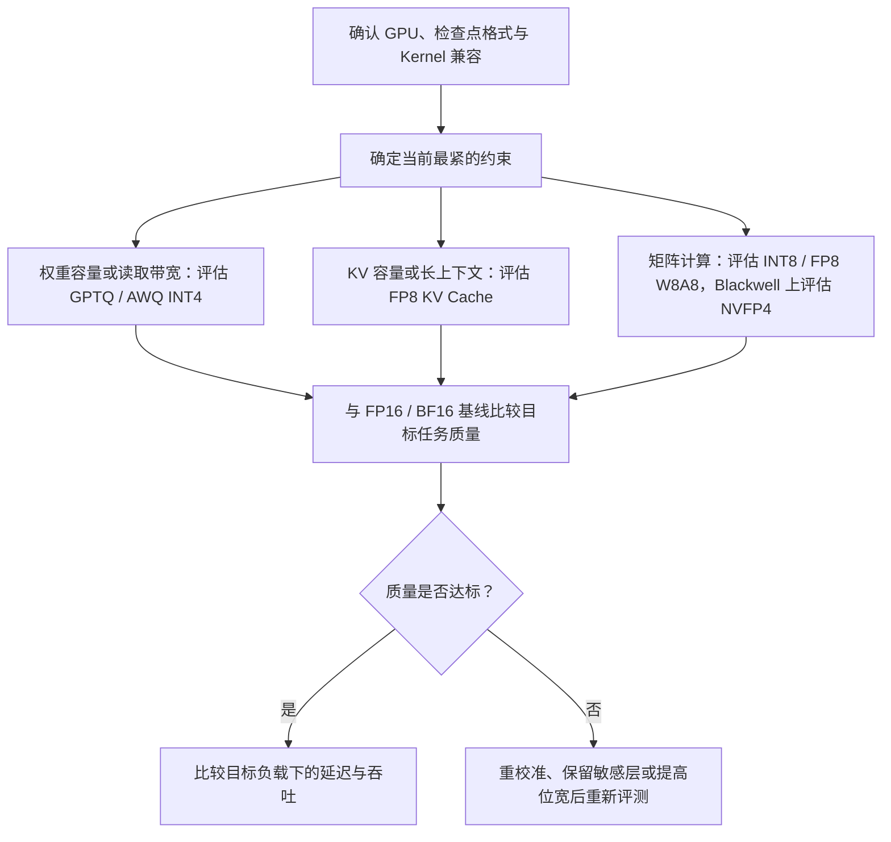

方法讲完了，回到一个具体的部署问题：手里有一个模型、一张 GPU，先试哪种量化？这有点像看病，**先找出最难受的症状（最紧的约束），再排除身体条件不允许的疗法（硬件和后端不支持的路径），最后用检查结果（质量与性能评测）确认疗效。** 这一节先建立候选顺序，再在 vLLM 上对比 FP16 与 AWQ INT4。

> ⏰ **信息时效**：vLLM 的量化入口、方案名与 Kernel 选择基于 v0.32.0（2026-10-18 发布）。量化支持矩阵变化较快，换版本后请重新核对文档和启动日志。

<!-- more -->

## 📑 目录

- [1. 从瓶颈出发选候选](#1-从瓶颈出发选候选)
- [2. vLLM 怎样识别量化模型](#2-vllm-怎样识别量化模型)
- [3. 启动 FP16 与 AWQ 服务](#3-启动-fp16-与-awq-服务)
- [4. 控制变量测离线吞吐](#4-控制变量测离线吞吐)
- [5. 生成质量怎样比较](#5-生成质量怎样比较)
- [6. 读懂结果与常见问题](#6-读懂结果与常见问题)
- [总结](#-总结)
- [自我检验清单](#-自我检验清单)
- [参考资料](#-参考资料)

---

## 1. 从瓶颈出发选候选



几条分支可以组合。权重装不下、长上下文缓存也不够时，先验证 INT4 权重，再叠加 FP8 KV Cache，每加一项都单独评测一次。

| 📊 首要约束 | 优先候选 | 下一步确认什么 |
|---|---|---|
| 精度退化容忍度低 | 以 FP16/BF16 为基线，先试 8-bit（FP8 或 INT8 W8A8） | 目标任务质量；8-bit 也可能不达标 |
| 权重装不下、小 Batch 读权重慢 | GPTQ/AWQ INT4（W4A16） | Group Size、实际 Kernel、敏感层 |
| 长上下文或并发被 KV 限制 | FP8 KV Cache | Scale 是否校准、Attention 后端、长文本质量 |
| GEMM 计算占比高 | 硬件支持的 W8A8；Blackwell 上评估 NVFP4 | 实际算子路径和端到端收益 |

硬件会先筛掉一部分候选。按 vLLM v0.32.0 文档：FP8 计算需要计算能力 8.9 及以上，Ampere 上只能走 W8A16；INT8 W8A8 支持 Turing 到 Hopper，**不支持 Blackwell**；NVFP4 的原生计算要 Blackwell，其他 GPU 回退到 Marlin W4A16。

还没有量化检查点时，要先离线生成：

- **LLM Compressor**：vLLM 项目维护，覆盖 GPTQ、AWQ、SmoothQuant、FP8 和 KV Cache Scale 校准，导出 `compressed-tensors` 格式。
- **GPTQModel**：专注 GPTQ 系列。
- **NVIDIA Model Optimizer**：导出 FP8、NVFP4、MXFP8 等 ModelOpt 格式。

校准与导出是独立的一段流程，本节主实验直接用已发布的检查点，集中验证部署效果。

---

## 2. vLLM 怎样识别量化模型

### 2.1 方法、格式与 Kernel 分开看

| 📊 名称 | 属于哪一层 | 加载时看什么 |
|---|---|---|
| GPTQ、AWQ | 量化算法及其常见检查点格式 | 位宽、Group Size、零点、权重排列 |
| `compressed-tensors` | 可承载多种方案的格式与配置体系 | 实际可能是 INT8、INT4、FP8 等 |
| FP8、NVFP4、MXFP4 | 数值格式及对应的缩放方案 | 检查点配置、硬件、后端 |
| Marlin、Machete、CUTLASS 等 | 执行 Kernel | 是否匹配权重布局和设备 |

vLLM 从检查点配置里的 `quant_method` 识别方案，一般不需要写 `--quantization`。v0.32.0 中方法名和 Kernel 已经解耦：`awq`、`awq_marlin`、`auto_awq` 都解析为同一个 `auto_awq` 配置，GPTQ 同理；具体 Kernel 由 vLLM 按优先级自动挑选（4.3 节）。所以**写不写 `--quantization`，都要看启动日志确认实际 Kernel**，例如 `Using MarlinLinearKernel for AutoAWQMarlinLinearMethod`，或 FP8 层的 `Selected <kernel> for <module>`。

### 2.2 不同入口的含义

下面几条命令是不同配置的入口，一次只启动一个，本地路径换成已导出的检查点：

```bash
# 已有 AWQ 检查点：由配置识别位宽，自动选择 Kernel
vllm serve Qwen/Qwen2.5-7B-Instruct-AWQ --dtype half

# 已有 compressed-tensors 检查点（LLM Compressor 导出）：由配置识别具体方案
vllm serve /path/to/compressed-tensors-model

# 已有 ModelOpt NVFP4 检查点
vllm serve /path/to/nvfp4-model --quantization modelopt_fp4

# 在线 FP8：加载时把 BF16/FP16 权重转成 FP8，不需要校准数据
vllm serve Qwen/Qwen2.5-7B-Instruct --quantization fp8_per_tensor
```

在线量化目前提供 `fp8_per_tensor`、`fp8_per_block`、`mxfp8`、`mxfp4` 等方案（格式细节见 4.5 节），激活在每次前向时动态求 Scale。文档提示 `fp8_per_tensor` 的延迟收益有限，它更适合快速试用；追求性能和质量时，用离线校准的检查点。

⚠️ **注意**：旧版本里的 `--quantization fp8` 在线量化写法在 v0.32.0 中已不再支持，对未量化检查点使用会报错并提示改用 `fp8_per_tensor`。`fp8` 仍可用于加载本身就是 FP8 的检查点。

在线转换发生在加载阶段，峰值显存可能高于最终的量化权重占用。原始模型按原精度都放不下时，应准备离线量化的检查点。

### 2.3 先保存实验环境

沿用第 3 章的 Linux/CUDA 环境，不再重复安装。实验前至少记录：

```bash
python -c "import vllm, torch; print('vLLM:', vllm.__version__); print('PyTorch:', torch.__version__); print('CUDA:', torch.version.cuda)"
nvidia-smi
```

模型仓库的 revision 也要记下，最好先下载固定快照，再把后面的模型参数换成本地路径。GPU 型号、驱动、vLLM 版本、检查点配置和实际 Kernel 都是结果的一部分。下文不预填吞吐数字，请在自己的设备上测。

---

## 3. 启动 FP16 与 AWQ 服务

先用原始模型跑 FP16 基线：

```bash
vllm serve Qwen/Qwen2.5-7B-Instruct \
    --served-model-name quant-demo \
    --dtype half \
    --max-model-len 4096 \
    --max-num-seqs 32 \
    --gpu-memory-utilization 0.9 \
    --generation-config vllm \
    --no-enable-prefix-caching
```

发几条请求、保存日志后停止进程，确认显存已释放，再启动 AWQ：

```bash
vllm serve Qwen/Qwen2.5-7B-Instruct-AWQ \
    --served-model-name quant-demo \
    --dtype half \
    --max-model-len 4096 \
    --max-num-seqs 32 \
    --gpu-memory-utilization 0.9 \
    --generation-config vllm \
    --no-enable-prefix-caching
```

两边保持相同的激活类型、上下文上限、并发上限和缓存精度，都不传 `--quantization`，由检查点配置决定。原始 Qwen 检查点以 BF16 发布，这里统一用 FP16，是为了和 AWQ 的 FP16 激活路径对齐（见 [AWQ 模型卡](https://huggingface.co/Qwen/Qwen2.5-7B-Instruct-AWQ)）。

每次启动都记下三样东西：模型权重占用、可用的 KV Token 容量、实际的量化 Kernel。AWQ 省下的权重空间会被 vLLM 分给 KV Cache，所以 `nvidia-smi` 里的总占用不会缩到四分之一，变的是 KV 容量。

---

## 4. 控制变量测离线吞吐

### 4.1 先回答一个有限的问题

下面的实验只回答：**相同的输入 Token、固定的输出长度、相同的引擎配置下，一批请求完成得多快？** 它不给在线的 TTFT/TPOT 尾延迟，也不代表真实到达率下的服务表现，在线压测留给"性能分析与 Benchmark"一章。

关掉前面的在线服务，把下面的代码存为 `compare_quant.py`。脚本每次只加载一个模型，预热后测三轮，保存输出 Token/s、总 Token/s 和生成样例。两种模型用同一个 Tokenizer 构造输入，吞吐阶段关闭 Prefix Cache，并忽略 EOS 以固定输出量。

```python
import argparse
import json
import statistics
import time
from pathlib import Path

from transformers import AutoTokenizer
from vllm import LLM, SamplingParams


def main():
    parser = argparse.ArgumentParser()
    parser.add_argument("--model", required=True)
    parser.add_argument("--tokenizer", default="Qwen/Qwen2.5-7B-Instruct")
    parser.add_argument("--quantization", default=None)
    parser.add_argument("--num-prompts", type=int, default=64)
    parser.add_argument("--input-len", type=int, default=512)
    parser.add_argument("--output-len", type=int, default=256)
    parser.add_argument("--save", required=True)
    args = parser.parse_args()
    if min(args.num_prompts, args.input_len, args.output_len) <= 0:
        parser.error("请求数和 Token 长度必须为正")
    if args.input_len + args.output_len > 4096:
        parser.error("输入与输出之和不能超过本实验的 4096 Token 上限")

    tokenizer = AutoTokenizer.from_pretrained(args.tokenizer)
    # 构造可重复的等长输入。这里只测速度，不用这批重复文本评质量。
    prompts = []
    for i in range(args.num_prompts):
        unit = tokenizer.encode(
            f"请求编号 {i}。请解释量化对推理显存和计算的影响。",
            add_special_tokens=False,
        )
        ids = (unit * (args.input_len // len(unit) + 1))[:args.input_len]
        prompts.append({"prompt_token_ids": ids})

    llm = LLM(
        model=args.model,
        tokenizer=args.tokenizer,
        quantization=args.quantization,
        dtype="half",
        max_model_len=4096,
        max_num_seqs=32,
        max_num_batched_tokens=2048,
        gpu_memory_utilization=0.9,
        kv_cache_dtype="auto",
        enable_prefix_caching=False,
        generation_config="vllm",
        seed=0,
    )
    params = SamplingParams(
        temperature=0, max_tokens=args.output_len, ignore_eos=True, seed=0
    )
    llm.generate(prompts, params, use_tqdm=False)  # 完整负载预热，不计时
    measurements = []
    for _ in range(3):
        start = time.perf_counter()
        outputs = llm.generate(prompts, params, use_tqdm=False)
        elapsed = time.perf_counter() - start
        output_tokens = sum(len(o.outputs[0].token_ids) for o in outputs)
        expected = args.num_prompts * args.output_len
        if output_tokens != expected:
            raise RuntimeError(f"实际输出 {output_tokens}，预期 {expected}")
        input_tokens = sum(len(o.prompt_token_ids) for o in outputs)
        measurements.append({
            "seconds": elapsed,
            "output_tokens_per_second": output_tokens / elapsed,
            "total_tokens_per_second": (input_tokens + output_tokens) / elapsed,
        })

    # 质量样例恢复正常 EOS，并使用一致的 Chat Template；不纳入吞吐计时。
    questions = [
        "只返回 JSON：name 为 Alice，count 为整数 3，不要 Markdown 围栏。",
        "有 17 箱货物，每箱 24 件，发出 89 件后还剩多少件？给出计算。",
        "写一个 Python 函数，判断字符串是否为回文，忽略大小写和非字母数字字符。",
    ]
    chats = [[{"role": "user", "content": q}] for q in questions]
    texts = [tokenizer.apply_chat_template(
        chat, tokenize=False, add_generation_prompt=True
    ) for chat in chats]
    examples = llm.generate(
        texts, SamplingParams(temperature=0, max_tokens=512, seed=0),
        use_tqdm=False,
    )
    result = {
        "config": vars(args),
        "runs": measurements,
        "median_output_tokens_per_second": statistics.median(
            r["output_tokens_per_second"] for r in measurements
        ),
        "examples": [
            {"question": q, "answer": o.outputs[0].text}
            for q, o in zip(questions, examples)
        ],
    }
    Path(args.save).write_text(
        json.dumps(result, ensure_ascii=False, indent=2), encoding="utf-8"
    )
    print(json.dumps(result, ensure_ascii=False, indent=2))


if __name__ == "__main__":
    main()
```

### 4.2 分别运行两个进程

```bash
python compare_quant.py \
    --model Qwen/Qwen2.5-7B-Instruct \
    --save fp16.json

python compare_quant.py \
    --model Qwen/Qwen2.5-7B-Instruct-AWQ \
    --save awq-int4.json
```

第一条结束后再跑第二条，避免两个引擎抢显存。每边提交 64 个请求，每个输入 512、输出 256 Token，引擎同时处理的序列上限是 32。想看小 Batch 场景，可以给两条命令都加上 `--num-prompts 1 --input-len 64`，结果另存。

计时包住整个阻塞式的 `generate()` 调用，含本地调度和输出整理；模型下载、加载和首次预热不计入。严肃对比时，保持 GPU 空闲状态一致，交替运行两种配置并观察波动；要分析算子耗时，再用 Profiling 工具。

---

## 5. 生成质量怎样比较

脚本里的三条问题只是冒烟检查，用来发现明显的格式、算术和代码能力退化：

| 📊 样例 | 检查方法 |
|---|---|
| JSON 输出 | 能解析为对象，字段和值正确，`count` 是整数 |
| 算术 | 应得到 $17\times24-89=319$，过程与答案一致 |
| 回文函数 | 用空串、`A man, a plan, a canal: Panama`、`ab` 等输入测试 |

两份输出逐字不同不等于质量退化。即使温度为 0，不同的数值路径也不保证输出完全一样，应按任务要求打分，统计通过率的变化。

正式评测要独立于校准集，并覆盖实际业务：中文指令、代码、数学、结构化输出、长文档问答等。固定 Prompt、Chat Template、最大生成长度和评分规则后，再比较基线和量化模型。PPL 可以作为补充，但代替不了代码正确率或检索准确率。

某类任务明显退化时，先排查模板、截断和量化配置；确认评测本身一致后，再考虑更细的粒度、让敏感层保留高精度、提高位宽或重新校准。PTQ 仍达不到要求、又具备训练条件时，才考虑 QAT。

---

## 6. 读懂结果与常见问题

把两份 JSON 和启动日志整理成下表。没跑的项留空，不要拿论文或别的设备的数字来填：

| 📊 指标 | FP16 基线 | AWQ INT4 |
|---|---|---|
| 模型 revision / vLLM / GPU | 待记录 | 待记录 |
| 实际量化 Kernel | 不适用 | 待记录 |
| 模型权重占用 / KV Token 容量 | 待记录 | 待记录 |
| 输出 Token/s 中位数（3 轮） | 待测 | 待测 |
| 总 Token/s 与输入输出长度 | 待测 | 待测 |
| 任务通过率 / 失败样例 | 待评测 | 待评测 |

输出 Token/s 之比可以作为这组固定负载下的加速比。计入输入 Token 的总吞吐要另列，两种口径不能混着比。

| 📊 现象 | 优先检查 |
|---|---|
| AWQ 检查点无法加载 | 是否是真正的 AWQ 检查点，配置与工具版本是否匹配 |
| INT4 装得下却比 FP16 慢 | 日志里实际选中的 Kernel、有无 "Falling back to unoptimized AWQ kernels" 回退、矩阵形状和当前瓶颈 |
| 总显存几乎没降 | KV 池是否吃掉了省下的权重空间，看 KV Token 容量 |
| 小 Batch 快，大 Batch 改善不大 | GEMM 是否已转向计算受限（4.3 节） |
| 长文本质量下降 | KV 精度、Scale 是否校准、截断长度、长文本评测覆盖 |
| NVFP4 模型没有变快 | GPU 是否有原生 FP4 Kernel，日志是否提示回退到 Marlin W4A16 |

💡 **提示**：想排除某个 Kernel 做对照，可以用环境变量 `VLLM_DISABLED_KERNELS`；NVFP4 等格式的线性层后端可以用 `--linear-backend` 固定。

FP16 基线在当前设备上跑不起来时，如实记录容量限制。可以减小共同负载，或换一台显存足够的设备重做对照。只跑出量化模型能证明部署可行，但得不出相对 FP16 快了多少。

---

## 📝 总结

- 先从权重、KV 或计算瓶颈选候选，再按硬件筛掉不支持的路径：FP8 计算要 CC 8.9+，INT8 W8A8 不支持 Blackwell，NVFP4 原生计算要 Blackwell。
- 量化算法、检查点格式、数值格式和执行 Kernel 是四件事；vLLM v0.32.0 从检查点自动识别方案并按优先级选 Kernel，以启动日志为准。
- 在线量化用 `fp8_per_tensor`、`fp8_per_block`、`mxfp8`、`mxfp4` 等方案名，旧的 `--quantization fp8` 在线写法已不再支持。
- 对照实验要固定模型来源、输入输出长度、引擎配置和测量口径，一次只改一个变量。
- 量化的价值是在质量和延迟达标的前提下，换来的显存或吞吐收益。

## 🎯 自我检验清单

- 能根据当前瓶颈说明先试哪种量化，并说出理由
- 能说出 FP8、INT8 W8A8、NVFP4 在 vLLM v0.32.0 中各自的硬件门槛
- 能解释 `compressed-tensors` 为什么没有唯一的位宽
- 能从启动日志判断量化模型实际使用的 Kernel，以及是否发生了回退
- 能写出 v0.32.0 中在线 FP8 量化的正确参数
- 能区分压缩比、离线吞吐加速比与在线延迟指标
- 能指出本节实验控制了哪些变量，还缺哪些质量评测

## 📚 参考资料

- [vLLM v0.32.0 — Quantization 支持概览](https://docs.vllm.ai/en/v0.32.0/features/quantization/)
- [vLLM v0.32.0 — Online Quantization](https://docs.vllm.ai/en/v0.32.0/features/quantization/online/)
- [vLLM v0.32.0 — AutoAWQ](https://docs.vllm.ai/en/v0.32.0/features/quantization/auto_awq/)
- [vLLM v0.32.0 — INT4 W4A16（LLM Compressor）](https://docs.vllm.ai/en/v0.32.0/features/quantization/llm_compressor/int4/)
- [vLLM v0.32.0 — INT8 W8A8（LLM Compressor）](https://docs.vllm.ai/en/v0.32.0/features/quantization/llm_compressor/int8_w8a8/)
- [vLLM v0.32.0 — FP8 W8A8](https://docs.vllm.ai/en/v0.32.0/features/quantization/llm_compressor/fp8/)
- [vLLM v0.32.0 — NVIDIA Model Optimizer](https://docs.vllm.ai/en/v0.32.0/features/quantization/modelopt/)
- [Qwen2.5-7B-Instruct-AWQ 模型卡](https://huggingface.co/Qwen/Qwen2.5-7B-Instruct-AWQ)
- [LLM Compressor](https://github.com/vllm-project/llm-compressor)
