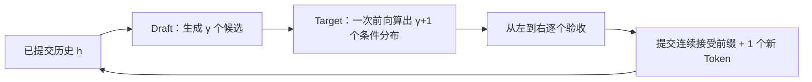

第 1 章把 Decode 比作接龙：大模型写完一个 Token，才知道下一个该接什么。第 2 章用批处理让一次权重搬运服务更多请求，第 4 章用低比特让每次搬得更少。这一章换个思路：**同一个请求，能不能一次大模型前向就确认好几个 Token？**

Speculative Decoding（投机解码）的答案是"先猜后验"：让便宜的 Draft 先写一段草稿，再让昂贵的 Target 一次性批改。猜对的部分直接收下，猜错的地方由 Target 改写。难点在于"改写"要怎么做，才能让最终输出和 Target 自己一个个写出来的**分布完全一样**。本节先讲清一轮的流程，再给出证明，最后落到 KV Cache 的工程细节。

> ⏰ **信息时效**：原理部分与框架版本无关；涉及 vLLM 实现的描述基于 v0.32.0（2026-10-18 发布）。

<!-- more -->

## 📑 目录

- [1. 串行瓶颈：每搬一次权重只写一个 Token](#1-串行瓶颈每搬一次权重只写一个-token)
- [2. Draft + Verify：一轮里发生了什么](#2-draft--verify一轮里发生了什么)
- [3. 接受规则：贪心与随机采样要分开](#3-接受规则贪心与随机采样要分开)
- [4. 正确性证明：两条路径合起来才是 Target](#4-正确性证明两条路径合起来才是-target)
- [5. 从一个位置推广到整段序列](#5-从一个位置推广到整段序列)
- [6. KV Cache：草稿不是已经提交的历史](#6-kv-cache草稿不是已经提交的历史)
- [7. 动手实验：错误的重采样怎样改变分布](#7-动手实验错误的重采样怎样改变分布)
- [8. 工程边界：无损到底保证什么](#8-工程边界无损到底保证什么)
- [总结](#-总结)
- [自我检验清单](#-自我检验清单)
- [参考资料](#-参考资料)

---

## 1. 串行瓶颈：每搬一次权重只写一个 Token

自回归生成每一步都依赖前面已经确定的 Token：

$$
x_{t+1}\sim p(\cdot\mid x_{\le t})
$$

$x_{t+1}$ 没定下来，$x_{t+2}$ 的条件分布就无从谈起。所以 Target 不能凭空"同时预测后面十个位置"——那会丢掉后一个 Token 对前一个 Token 的依赖。

问题在于硬件利用率。小 Batch 的 Decode 基本是访存受限：GPU 把几十 GB 权重从显存读一遍，只为算一个位置，计算单元大部分时间在等数据。如果这一遍读取能顺便算好几个位置，单位 Token 的成本就降下来了。

投机解码正是利用这份空闲：先由别人提供几个**候选 Token**，Target 把它们当作已知输入，一次前向同时算出每个位置的条件分布，再逐个判断收不收。

用一个类比：主编逐字写稿太慢，于是请助手先写一段，主编一口气审完。最终内容仍由主编拍板，只是把"自己逐字起草"换成了"批量审阅草稿"。

📌 **关键点**：投机解码减少的是 **Target 的串行调用轮数**，自回归依赖本身并没有消失——独立 Draft 自己通常也要逐 Token 生成。

---

## 2. Draft + Verify：一轮里发生了什么

### 2.1 两个模型，两套条件分布

设已提交的历史为 $h$，本轮草稿长度为 $\gamma$：

- **Draft** 按 $q_i(\cdot)=q(\cdot\mid h,y_{<i})$ 依次提议 $y_1,\ldots,y_\gamma$。
- **Target** 在同样的历史上算出 $p_i(\cdot)=p(\cdot\mid h,y_{<i})$，用来核验第 $i$ 个候选。

这里的 $p$、$q$ 都是**实际用于采样的分布**，已经包含温度、Top-k/Top-p 等处理。后面的证明对任意一对归一化分布都成立，但前提是验收时用的就是采样时的那一对。

### 2.2 为什么 Target 能一次验完

候选串一旦写好，对 Target 来说就是一段已知输入。它用 Causal Attention 同时算出所有位置的隐藏状态，第 $i$ 个位置只看得到 $h,y_{<i}$，不会偷看后面的候选。

这和训练时的 Teacher Forcing 是一回事：**输入已知，多个条件预测可以并行算；至于采不采用，稍后再决定。** 一轮实际会算出 $p_1,\ldots,p_{\gamma+1}$ 共 $\gamma+1$ 个分布，最后一个留给"全部接受"时再多生成一个 Token。



举个例子：Draft 猜了 4 个 Token，前 2 个通过、第 3 个被拒。那么本轮提交前 2 个，再在第 3 个位置补一个按规则重新采样的 Token，第 4 个候选直接作废。如果 4 个全部通过，就从 $p_5$ 再采一个，这一轮一共前进 5 个 Token。

---

## 3. 接受规则：贪心与随机采样要分开

### 3.1 贪心：和 Target 的 argmax 比

Target 用贪心解码时，规则很直接：第 $i$ 个候选等于 Target 在该位置的 `argmax` 就接受，否则换成 Target 的 `argmax` 并结束本轮。

这样得到的序列与 Target 自己贪心解码完全一致（前提是数值计算一致、并列最大值的处理一致）。但它只适用于温度为 0 的情况。

### 3.2 随机采样：按概率比接受

温度大于 0 时，对从 $q_i$ 抽出的候选 $y_i$，标准 Speculative Sampling 的接受概率是：

$$
a_i(y_i)=\min\left(1,\frac{p_i(y_i)}{q_i(y_i)}\right)
$$

直觉很好理解：Target 比 Draft 更看好这个 Token（$p\ge q$），就一定收下；Target 没那么看好，就按 $p/q$ 的比例打折收下。实现上抽一个 $u\sim U(0,1)$，$u<a_i$ 时接受。

被拒绝后，**不能简单地从 $p_i$ 重新抽一次**，而要从残差分布采样：

$$
r_i(x)=\frac{[p_i(x)-q_i(x)]_+}{\sum_z[p_i(z)-q_i(z)]_+},\qquad [v]_+=\max(v,0)
$$

残差只保留 Target 比 Draft "更想要"的那部分概率。为什么必须这样做，第 4 节给出证明，第 7 节用代码演示错误做法的后果。

### 3.3 Draft 只给 Token、不给概率时

N-gram 这类方法只产出 Token，没有概率；vLLM 对模型类 Draft 的默认设置 `draft_sample_method="greedy"` 也只取 Draft 的 argmax，不保存整份 Draft 概率。此时可以把 $q$ 看成落在候选上的 one-hot 分布：$q(y)=1$，其他位置为 0。

代入上面的公式，接受概率变成 $p(y)$；拒绝后的残差就是"把 $y$ 去掉、其余按 $p$ 重新归一化"。两条路径合起来依然恰好是 $p$，所以这仍是无损的。代价是 Draft 的概率信息没被利用，接受率取决于 Target 对 Draft 首选 Token 给出多大的概率。若改用 `"probabilistic"`，vLLM 会保存 Draft 的完整概率参与验收，换来更多显存占用。

🔑 **核心概念**：**残差分布是对接受路径"多给或少给"的概率质量做补偿。** 接受规则和修正采样必须成对使用，只改其中一个都会改变最终分布。

---

## 4. 正确性证明：两条路径合起来才是 Target

固定一个位置和它的历史，省略下标。推导思路与 [Leviathan 等人](https://arxiv.org/abs/2211.17192)、[Chen 等人](https://arxiv.org/abs/2302.01318)的论文一致。某个 Token $x$ 最终被输出，只有两条路：被 Draft 抽中并接受，或者在拒绝后从残差里抽中。

### 4.1 接受路径贡献多少

先被抽中、再被接受的联合概率是：

$$
q(x)a(x)=q(x)\min\left(1,\frac{p(x)}{q(x)}\right)=\min(p(x),q(x))
$$

记总接受概率 $A=\sum_x\min(p(x),q(x))$，拒绝概率 $\beta=1-A$。由于 $p$、$q$ 都归一化，$\sum_x p(x)=\sum_x\min(p,q)+\sum_x[p-q]_+$，于是：

$$
\beta=\sum_x[p(x)-q(x)]_+
$$

这正是残差分布的分母。

### 4.2 拒绝路径补上缺口

拒绝后按 $r$ 采样，输出 $x$ 的联合概率是：

$$
\beta\,r(x)=[p(x)-q(x)]_+
$$

两条路径相加：

$$
\Pr(\text{输出}=x)=\min(p(x),q(x))+[p(x)-q(x)]_+=p(x)
$$

证毕。$p=q$ 时 $\beta=0$，永远不会走到拒绝路径，残差分母为零的情况也就不会出现。

⚠️ **注意**：只看"被接受的 Token"，它们服从的是 $\min(p,q)/A$，一般不等于 $p$。严格服从 Target 的，是接受与修正**合在一起**的最终输出。

### 4.3 接受率反映两个分布有多接近

用全变差距离 $\operatorname{TV}(p,q)=\frac12\sum_x|p(x)-q(x)|$ 可以写出：

$$
A=1-\operatorname{TV}(p,q)
$$

Draft 和 Target 的分布重合得越多，需要修正的次数越少。不过这只是某个历史下单个位置的接受概率，离"整个请求快多少"还隔着成本账，第 5.4 节专门算这笔账。

---

## 5. 从一个位置推广到整段序列

每个被保留的 Token 都是在**真实已提交的前缀**上按上述规则产生的，所以可以逐位置归纳，得到整段序列的分布与 Target 一致：

$$
\Pr(x_{1:n}\mid h)=\prod_{i=1}^{n}p(x_i\mid h,x_{<i})
$$

### 5.1 为什么首个拒绝后必须停

假设 $y_3$ 被拒、换成了 $z_3$。已经算好的 $p_4$ 是以 $h,y_1,y_2,y_3$ 为条件的，而真实历史已经变成 $h,y_1,y_2,z_3$。$y_4$ 的验收依据随之失效，哪怕它看起来"也挺合理"。

所以每轮只能提交**连续接受的前缀**，不能跳过错误位置去拼后面的候选。第 5.3 节的 Draft Tree 只保留一条合法路径，依据的也是这一点。

### 5.2 为什么可以多出一个 Token

全部 $\gamma$ 个候选都通过时，$p_{\gamma+1}$ 已经在正确的历史上算好了，直接从中采样即可；中途被拒时则补一个修正 Token。两种情况都保证每轮至少前进 1 个、至多 $\gamma+1$ 个 Token。

遇到 EOS、Stop String、输出长度上限或上下文上限时，实际提交会更短。引擎会在停止条件处截断，不会为了凑满一轮而越过它。

---

## 6. KV Cache：草稿不是已经提交的历史

候选进入 Target 前向时，会先占用 KV 槽位。但在验收结果出来之前，这些 KV 只是"试算"：被拒的部分必须作废，否则下一轮就会读到一段从未真正发生的历史。

| 📦 状态 | 应该怎么处理 | 常见错误 |
|---|---|---|
| 已提交历史 | 保留对应 KV | 回退时误删了 Prompt 的 KV |
| 连续接受的候选 | 直接复用验证时算出的 KV | 再跑一遍前向，白白浪费收益 |
| 被拒位置及其后缀 | 标记失效，回退缓存指针 | 下一轮还读到错误候选的 KV |
| 修正 / 额外 Token | 提交，但 KV 留到下一轮作为输入时再算 | 把"已采样"误当成"已有 KV" |

最后一行是最容易出 off-by-one 的地方：修正 Token 已经对外输出，但它自己的 KV 要等它作为下一次前向的输入时才会生成。所以引擎内部要分别记录**已提交 Token 数**和**已计算 KV 的 Token 数**。

Draft 如果有自己的 KV Cache，也要跟着回退到最终提交的历史上。Target 否决了 $y_3$，Draft 下一轮就必须从 $z_3$ 接着猜，而不是沿着自己原来的 $y_3$ 往下走。

📌 **关键点**：概率证明管"每个 Token 怎么采"，缓存与调度管"下一轮看到的历史对不对"。两者任何一处错位，理论上的无损都落不了地。

---

## 7. 动手实验：错误的重采样怎样改变分布

下面只用 Python 标准库，模拟**固定历史下的一个位置**，不加载模型，也不涉及 GPU 性能。代码对比三种做法：标准规则、拒绝后直接从 $p$ 重抽的错误规则，以及第 3.3 节的 one-hot Draft。

```python
import random
from collections import Counter

p = [0.6, 0.3, 0.1]  # Target
q = [0.2, 0.5, 0.3]  # Draft


def final_dist(p, q, resample):
    """接受路径 min(p, q) + 拒绝概率 × 拒绝后采样分布。"""
    overlap = [min(a, b) for a, b in zip(p, q)]
    beta = 1 - sum(overlap)
    return [o + beta * r for o, r in zip(overlap, resample)]


beta = sum(max(a - b, 0) for a, b in zip(p, q))
residual = [max(a - b, 0) / beta for a, b in zip(p, q)]
print("标准规则:", final_dist(p, q, residual))
print("错误规则（拒绝后直接抽 p）:", final_dist(p, q, p))

# one-hot Draft：总是提议 q 的 argmax（Token 1），q 退化为 [0, 1, 0]
q_onehot = [0.0, 1.0, 0.0]
beta1 = sum(max(a - b, 0) for a, b in zip(p, q_onehot))
residual1 = [max(a - b, 0) / beta1 for a, b in zip(p, q_onehot)]
exact = final_dist(p, q_onehot, residual1)
assert all(abs(a - b) < 1e-12 for a, b in zip(exact, p))
print("one-hot Draft:", exact, "接受率:", 1 - beta1)

# 蒙特卡洛验证标准规则
rng = random.Random(42)
counts, accepted, trials = Counter(), 0, 100_000
for _ in range(trials):
    y = rng.choices(range(3), weights=q)[0]
    if rng.random() < min(1, p[y] / q[y]):
        token, accepted = y, accepted + 1
    else:
        token = rng.choices(range(3), weights=residual)[0]
    counts[token] += 1
print("经验分布:", [counts[i] / trials for i in range(3)], "接受率:", accepted / trials)
```

标准规则下，接受路径贡献 $[0.2,0.3,0.1]$，拒绝概率 0.4 全部补给第一个 Token，最终恢复 $[0.6,0.3,0.1]$。错误规则得到 $[0.44,0.42,0.14]$：第二个 Token 被高估了 40%。one-hot Draft 的接受率只有 0.3，但最终分布同样是 $p$——无损和接受率高低是两回事。

蒙特卡洛结果会有几个千分点的波动，它用来帮助理解证明，正确性仍以精确计算为准。

---

## 8. 工程边界：无损到底保证什么

"无损"是一个精确的数学承诺，它的范围也要说准：

- **保证分布一致**：正确实现的投机采样，输出分布等于**被验证的那个 Target** 的分布。
- **不保证逐字相同**：随机采样时，两条执行路径消耗随机数的方式不同，同一个 Seed 也可能得到不同文本。
- **不修复 Target 本身**：Target 若已量化，保证针对的是量化后的模型，不会自动恢复成原始 BF16 模型。
- **只覆盖标准规则**：阈值放行、Typical Acceptance、vLLM 用于压测的 `synthetic` 模式等都不在此列，需要单独评估质量。

重复惩罚、结构化输出这类依赖历史的 Logits Processor，在验证时也要按每个候选前缀分别更新状态。框架是否支持某种组合，以所用版本的文档和测试为准。

[vLLM 文档](https://docs.vllm.ai/en/stable/features/speculative_decoding/#lossless-guarantees-of-speculative-decoding)把无损拆成三层：理论上无损（受限于硬件数值精度）、算法层面由 Rejection Sampler 的收敛测试与贪心一致性测试保证，以及不承诺 logprobs 完全稳定。Batch 形状和 Kernel 不同，可能让两个几乎并列的 Logits 交换大小，所以上线前仍需要做端到端的输出比对。

---

## 📝 总结

- 投机解码让便宜的 Draft 先写候选，再用一次 Target 前向批量验证，减少的是 Target 的串行轮数。
- 并行计算的是**已知候选**的条件分布，自回归依赖仍然存在。
- 贪心时比较 argmax；随机采样时按 $\min(1,p/q)$ 接受，拒绝后从残差 $[p-q]_+$ 归一化采样。
- 接受路径贡献 $\min(p,q)$，拒绝路径补上 $[p-q]_+$，两者相加恰好是 $p$。
- 只给 Token 的 Draft 可视为 one-hot 的 $q$，同样无损，只是接受率取决于 $p(y)$。
- 每轮只提交连续接受前缀加 1 个新 Token，首个拒绝后的候选全部作废。
- KV 回退、Draft 状态同步和 Logits Processor 状态，是无损能否落地的工程部分。
- 无损以实际 Target 为基准，不等于文本逐字一致，也不等于一定提速。

## 🎯 自我检验清单

- 能解释为什么候选已知时可以并行验证，而未知的未来不能直接并行生成
- 能标出 $p_i$ 和 $q_i$ 分别以哪一段历史为条件
- 能写出贪心与随机采样两种接受规则
- 能从接受、拒绝两条路径推导出最终分布等于 $p$
- 能用数值例子说明拒绝后直接从 $p$ 重抽为什么有偏
- 能解释 one-hot Draft 为什么仍然无损
- 能说明首个拒绝后必须丢弃后缀的原因，以及额外 Token 从哪里来
- 能区分已提交 Token、已计算 KV 和临时候选三种状态
- 能说清"无损"在量化 Target、相同 Seed 和近似验收下的边界

## 📚 参考资料

- [Fast Inference from Transformers via Speculative Decoding（Leviathan et al., 2023）](https://arxiv.org/abs/2211.17192)
- [Accelerating Large Language Model Decoding with Speculative Sampling（Chen et al., 2023）](https://arxiv.org/abs/2302.01318)
- [vLLM — Speculative Decoding 与无损保证](https://docs.vllm.ai/en/stable/features/speculative_decoding/)
- [vLLM v0.32.0 — Rejection Sampler 实现](https://github.com/vllm-project/vllm/blob/v0.32.0/vllm/v1/sample/rejection_sampler.py)
- [vLLM v0.32.0 — SpeculativeConfig（draft_sample_method 等字段）](https://github.com/vllm-project/vllm/blob/v0.32.0/vllm/config/speculative.py)
