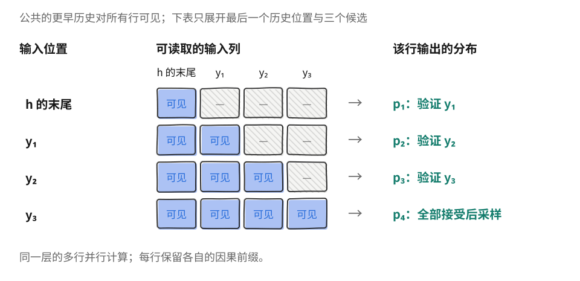
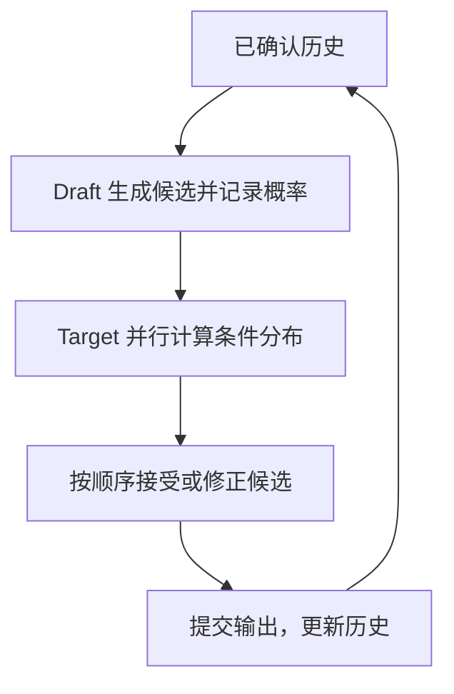

前面介绍的批处理让一次权重读取服务多个请求，量化则减少需要读取的数据。投机解码继续利用 Decode 阶段的性能特点：**先以较低成本生成一段候选，再让大模型一次验证多个位置，减少生成同样长度文本所需的大模型调用轮数。** 本节先解释为什么能够并行验证，再说明怎样保证最终输出仍服从大模型的分布。

<!-- more -->

## 📑 目录

- [1. 已知候选为什么可以并行验证](#1-已知候选为什么可以并行验证)
- [2. 一轮 Draft 与 Verify](#2-一轮-draft-与-verify)
- [3. 贪心解码与随机采样的接受规则](#3-贪心解码与随机采样的接受规则)
- [4. 拒绝采样的正确性证明](#4-拒绝采样的正确性证明)
- [5. 从单个位置到完整序列](#5-从单个位置到完整序列)
- [6. 动手验证输出分布](#6-动手验证输出分布)
- [总结](#-总结)
- [自我检验清单](#-自我检验清单)
- [参考资料](#-参考资料)

---

## 1. 已知候选为什么可以并行验证

普通自回归生成需要先确定 $x_{t+1}$，才能构造下一步的输入，得到 $p(x_{t+2}\mid x_{\le t+1})$。等待的是**前一个 Token 的取值**。这与第一章的 Prefill 有一个直接联系：如果整段输入已经给定，各位置的隐藏状态便可以在每一层中并行计算，同时由因果 Mask 限制可见范围。

现在假设已有历史 $h$，一个较便宜的草稿生成器（**Draft**）先给出候选 $y_1,y_2,y_3$。目标大模型（**Target**）就能把这些候选当作已知输入，一次前向得到：

$$
\begin{aligned}
p_1&=p(\cdot\mid h),\\
p_2&=p(\cdot\mid h,y_1),\\
p_3&=p(\cdot\mid h,y_1,y_2),\\
p_4&=p(\cdot\mid h,y_1,y_2,y_3).
\end{aligned}
$$

这些分布只在相应候选前缀下成立。Target 还没有认可候选，它只是提前计算了“如果前面确实是这些 Token，下一步会是什么”。



图中每一行是一个输入位置，每一列是可以读取的输入。最后一个历史 Token 所在行预测 $y_1$；输入 $y_1$ 的行预测 $y_2$，依此类推。**输入某个候选后得到的 Logits 用于预测它的后继，验证该候选要用前一位置的 Logits。** 若历史已缓存并保留了 $p_1$，本轮只需补算候选部分；另一种实现会将尚未计算的最后一个历史 Token 一起送入验证。

并行发生在同一层的多个位置之间，层与层仍按顺序执行。因果关系由 Mask 保留，后面的候选不会被前面位置偷看。

### 1.1 权重读取如何被摊薄

沿用第一章的小 Batch、权重带宽受限场景：普通 Decode 每轮只为每个请求推进一个位置，却要执行整个 Target。验证一段候选时，各层的权重可以服务这一段的多个位置，矩阵乘法有了更多行，权重读取成本得到摊薄。

“一轮只搬一次大模型权重”可以作为这个场景的近似理解。更准确地说，**一次 Target 前向覆盖多个候选位置，减少了重复前向带来的权重流量**。实际显存读取次数仍受分块、缓存和 Kernel 实现影响；验证更长的段也会增加计算量和 KV 访问，耗时不会永远等于普通单步 Decode。

## 2. 一轮 Draft 与 Verify

先讨论最基本的单链草稿。设草稿长度为 $\gamma$，Draft 按自己的条件分布逐步生成：

$$
y_i\sim q_i(\cdot),\qquad q_i(\cdot)=q(\cdot\mid h,y_{<i}).
$$

Draft 记录生成候选时实际使用的概率。Target 随后并行计算相同前缀下的 $p_i$，以及整段之后的 $p_{\gamma+1}$。



接受规则决定本轮能提交多少 Token。这里的 $p_i,q_i$ 都是**实际采样分布**；如果使用温度、Top-p 或其他概率处理，验证时必须与生成候选时使用的规则一致。原始 Logits、处理后的概率和选中 Token 的概率不能混用。

## 3. 贪心解码与随机采样的接受规则

### 3.1 贪心解码：比较 Token ID

若基线采用贪心解码，Target 每步选择概率最大的 Token。验证时从第一个候选开始，检查：

$$
y_i=\operatorname*{arg\,max}_x p_i(x).
$$

相等就接受；第一次不相等时，输出 Target 的选择，并放弃后续候选。只要概率计算与并列最大值的处理一致，这样能复现 Target 的贪心序列。

### 3.2 随机采样：按概率比接受

随机采样需要保留分布中的多种可能，不能要求候选每次都等于 Target 的最高概率 Token。标准投机采样对 $y_i$ 使用接受概率：

$$
a_i(y_i)=\min\left(1,\frac{p_i(y_i)}{q_i(y_i)}\right).
$$

抽取 $u\sim U[0,1)$，当 $u<a_i(y_i)$ 时接受。由于 $y_i$ 来自 $q_i$，被实际抽中的候选具有 $q_i(y_i)>0$。

例如，Draft 给某候选 0.6 的概率，Target 只给 0.3，那么它以 $0.3/0.6=0.5$ 的概率被接受；若 Target 给 0.8，则该候选必然接受。前一种情况削减了 Draft 对这个 Token 的过度偏好，后一种情况还需要通过拒绝后的修正补足概率。

**这里比较的是同一个 Token 在两个条件分布中的概率。** 隐藏向量的余弦相似度可以用于其他分析，但“相似度超过阈值就接受”无法保证输出符合 Target 分布。即使两个向量很相似，它们经输出层和 Softmax 得到的概率也可能不同。

### 3.3 拒绝后从哪里重新采样

在第 $i$ 个位置首次拒绝时，要从残差分布中抽取替代 Token：

$$
r_i(x)=\frac{[p_i(x)-q_i(x)]_+}{\sum_v[p_i(v)-q_i(v)]_+},\qquad [z]_+=\max(z,0).
$$

它保留 Target 比 Draft 更偏好的部分，并重新归一化。直接从 $p_i$ 再抽一次通常会改变最终分布，下面给出原因。[标准算法](https://proceedings.mlr.press/v202/leviathan23a.html)

## 4. 拒绝采样的正确性证明

固定某个已确认前缀，暂时省略位置下标。一个 Token $x$ 可以通过两条路径成为输出：作为草稿被接受，或在发生拒绝后被重新采样。

**接受路径的概率质量**为：

$$
q(x)a(x)=q(x)\min\left(1,\frac{p(x)}{q(x)}\right)=\min(p(x),q(x)).
$$

当 $q(x)=0$ 时，这条路径贡献为 0，上式按 $\min(p(x),0)=0$ 理解，无需计算除法。总拒绝概率为：

$$
\rho=1-\sum_x\min(p(x),q(x))
=\sum_x[p(x)-q(x)]_+.
$$

因此，**拒绝后修正路径的概率质量**为 $\rho r(x)=[p(x)-q(x)]_+$。两条路径相加：

$$
P(\text{输出 }x)=\min(p(x),q(x))+[p(x)-q(x)]_+=p(x).
$$

若 $\rho=0$，说明两个分布相同，不会进入拒绝分支，也无需构造残差分布。

📌 **关键点**：保分布保证来自“接受 + 拒绝后修正”的完整过程。只观察被接受的草稿，会漏掉一部分输出概率。

例如词表只有 A、B、C，取 $p=(0.5,0.3,0.2)$、$q=(0.2,0.5,0.3)$：

| Token | $p(x)$ | $q(x)$ | 接受路径贡献 | 拒绝后修正贡献 | 最终概率 |
|---|---|---|---|---|---|
| A | 0.5 | 0.2 | 0.2 | 0.3 | 0.5 |
| B | 0.3 | 0.5 | 0.3 | 0 | 0.3 |
| C | 0.2 | 0.3 | 0.2 | 0 | 0.2 |

总拒绝概率是 0.3，残差分布为 $(1,0,0)$。如果拒绝后改为从 $p$ 抽样，最终概率将变成 $(0.35,0.39,0.26)$，已经偏离目标。

## 5. 从单个位置到完整序列

### 5.1 首次拒绝后为什么不能继续使用原草稿

假设 $y_1$ 被接受，$y_2$ 被替换成 $z$。原来提前算好的 $p_3$ 条件是 $(h,y_1,y_2)$，新的真实历史却是 $(h,y_1,z)$。两者不同，$p_3$ 及更后面的结果就不能直接用于生成。

所以一轮只保留**从开头连续接受的前缀**，再加上一个修正 Token。被拒绝的后缀及其临时计算状态都要失效；KV Cache 如何处理将在 5.4 节展开。

### 5.2 全部接受时为什么能多生成一个 Token

若 $\gamma$ 个候选全部接受，$p_{\gamma+1}$ 已经以正确历史为条件，可以直接从中抽取一个额外 Token。忽略 EOS 和长度上限，一轮因此输出 1 到 $\gamma+1$ 个 Token。这个额外 Token 也常称为 Bonus Token。

每轮输出都使用正确历史下的目标条件分布，逐步应用上一节的证明，再结合概率链式法则，就得到完整序列的目标分布。**分布相同不要求随机种子相同时逐字输出相同**：两套程序使用随机数的顺序可能不同。贪心一致性、随机采样的分布一致性应分别验证。

## 6. 动手验证输出分布

下面直接计算所有概率质量，不需要模型或 GPU，也没有有限次随机实验带来的抽样波动：

```python
p = [0.5, 0.3, 0.2]
q = [0.2, 0.5, 0.3]

accepted = [min(px, qx) for px, qx in zip(p, q)]
reject_prob = 1 - sum(accepted)
residual = [max(px - qx, 0.0) for px, qx in zip(p, q)]
if reject_prob > 0:
    residual = [x / sum(residual) for x in residual]

correct = [a + reject_prob * r for a, r in zip(accepted, residual)]
wrong = [a + reject_prob * px for a, px in zip(accepted, p)]
print("正确修正:", [round(x, 4) for x in correct])
print("直接从 p 重采样:", [round(x, 4) for x in wrong])
assert all(abs(x - y) < 1e-12 for x, y in zip(correct, p))
```

可以再令 $q=p$，观察拒绝概率变成 0；或者令 $q=[1.0,0.0,0.0]$，验证确定性草稿也可以通过正确修正得到目标分布。这为下一节的无模型草稿提供了基础。

## 📝 总结

- 已知候选允许 Target 在因果 Mask 下并行计算多个位置，减少串行调用轮数。
- 贪心解码比较 Token ID；随机采样按概率比接受，并在拒绝后使用残差分布。
- 输出保分布需要把接受与修正两条路径一起计算。
- 首次拒绝后原后缀失效；全部接受时可利用已计算的分布额外生成一个 Token。

## 🎯 自我检验清单

- 能说明并行验证与自回归因果依赖如何同时成立
- 能解释输入 $y_i$ 后得到的 Logits 验证的是哪个位置
- 能手算接受概率、残差分布与最终输出概率
- 能解释为什么余弦相似度阈值无法替代拒绝采样
- 能说明首次拒绝后停止，以及全部接受后增加一个 Token 的原因

## 📚 参考资料

- [Fast Inference from Transformers via Speculative Decoding](https://proceedings.mlr.press/v202/leviathan23a.html)
- [Accelerating Large Language Model Decoding with Speculative Sampling](https://arxiv.org/abs/2302.01318)
- [下一节：Draft 模型与 N-gram/Suffix 方案](./5.2-Draft模型与N-gram-Suffix方案.md)
