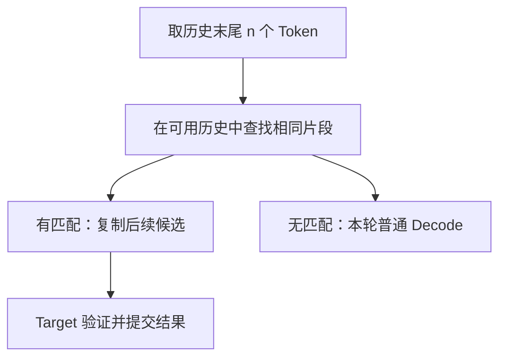

上一节证明，使用正确的验证与修正规则，Draft 可以与 Target 有不同的分布。接下来要解决的是成本问题：**怎样让草稿足够便宜，同时有足够长的前缀被接受？** 本节先看独立小模型，再看不需要额外神经网络的历史匹配方案。

<!-- more -->

## 📑 目录

- [1. 独立 Draft 模型的选择](#1-独立-draft-模型的选择)
- [2. N-gram 如何生成候选](#2-n-gram-如何生成候选)
- [3. Suffix Decoding 的历史统计](#3-suffix-decoding-的历史统计)
- [4. 接受率与候选覆盖](#4-接受率与候选覆盖)
- [5. 动手观察匹配长度](#5-动手观察匹配长度)
- [总结](#-总结)
- [自我检验清单](#-自我检验清单)
- [参考资料](#-参考资料)

---

## 1. 独立 Draft 模型的选择

独立 Draft 是一个较小的自回归模型。它读取当前历史，连续生成若干候选；Target 对这些候选进行验证。两个模型都要执行前向，Draft 的参数、运行时间和 KV Cache 都是新增成本。

### 1.1 大小与能力匹配

模型更小通常意味着草稿更便宜，但候选可能更难被 Target 接受。换用更强的 Draft 可以提高预测质量，却可能让每轮草稿生成耗时超过省下的大模型调用时间。因此要一起看三个量：

| 观察项 | 需要回答的问题 |
|---|---|
| 草稿耗时 | 生成一段候选要花多久，是否包含通信与调度等待 |
| 接受前缀长度 | 每轮实际能保留多少个连续候选 |
| 额外显存 | 草稿参数与缓存是否挤占了原本可用的并发容量 |

通用评测分数也不能直接替代匹配度。服务代码补全时，熟悉目标代码风格的 Draft 可能更有用；服务中文对话时，则要看相应语言与对话模板。这里优化的是**与给定 Target、给定任务的配合效果**。

### 1.2 Tokenizer 与输入约定

最直接的实现要求两个模型对同一 Token ID 有相同含义，词表、特殊 Token 和输入模板能够对齐。“属于同一个模型系列”只是筛选线索，还需要核对具体版本。

若同一句话被切成不同 Token，Target 就不能直接拿 Draft 的 ID 逐位置验证。跨词表投机需要额外映射或专门算法；例如 vLLM 的相应路径有独立配置与限制，不能默认任意两个模型可以组合。[Draft Model 配置](https://github.com/vllm-project/vllm/blob/v0.31.0/docs/features/speculative_decoding/draft_model.md)

上下文长度也要匹配。若 Draft 无法处理当前长上下文，需要明确回退或截取策略；截取历史会改变草稿分布和接受率。Target 仍应按完整的有效历史验证。

## 2. N-gram 如何生成候选

输入或已生成文本中，经常存在可复用片段。代码修改会重复原代码，文档抽取会复制原文，格式化输出也会重复字段。**N-gram 草稿**利用当前历史末尾的若干 Token，查找更早出现过的相同片段，然后复制其后续 Token 作为候选。

以整数代表 Token ID，已有历史为：

```text
[11, 22, 33, 44, 90, 11, 22]
```

当前结尾是 `[11, 22]`。在历史开头找到相同片段后，可以提议 `[33, 44]`。查找没有判断这两个候选是否正确，后续仍由 Target 验证。



这里的 $n$ 是**匹配长度**，草稿长度 $\gamma$ 是**复制的后续长度**，两者不是同一个参数。较长匹配往往约束更强，但命中次数会减少；较短匹配更容易找到，却可能只匹配到常见标点等弱线索。

不同实现搜索 Prompt、当前请求输出或其他历史的范围可能不同，重复匹配的选择规则也可能不同。阅读配置时，应同时确认查找范围、匹配窗口和候选长度。[vLLM N-gram 示例](https://github.com/vllm-project/vllm/blob/v0.31.0/docs/features/speculative_decoding/n_gram.md)

### 2.1 没有小模型概率，怎样验证

确定性查找可以视为一个退化的草稿分布：对它选中的候选 $y$，$q(y)=1$，其他 Token 的概率为 0。代入上一节的公式，接受概率就是 $p(y)$；若拒绝，残差分布会从其他 Token 中重新采样。

这说明概率来自**提议规则实际怎样选择候选**，并不要求草稿一定由神经网络生成。如果规则还包含随机选择，就需要使用对应的提议分布。贪心 Target 仍可按 Token ID 相等的规则验证。

## 3. Suffix Decoding 的历史统计

Suffix Decoding 同样从当前后缀出发，但进一步组织可复用历史，并根据延续片段的出现频次估计候选的可信程度。它可以利用 Prompt 与已有生成记录，动态决定本轮提议多长的段。[技术报告](https://arxiv.org/abs/2411.04975)

假设匹配后缀 `[11,22]` 在可用记录中出现十次，其中八次后面接 33，两次接 55。频次便为提议 33 提供了一个便宜的排序依据。再继续往后，若延续越来越分散，就可以提前结束草稿，减少低价值验证。

这类频次反映的是已收集历史的延续规律，与 Target 的下一 Token 概率有区别。即使某个候选在历史中频繁出现，也仍要验证。

| 方案 | 草稿信息来源 | 新增的主要成本 | 适合先观察的条件 |
|---|---|---|---|
| 独立小模型 | 模型参数与当前历史 | 前向、模型权重及 KV | 有兼容且较便宜的模型 |
| N-gram | 已有 Token 片段 | 查找、候选复制 | 当前输入或输出有重复 |
| Suffix Decoding | 累积的片段与频次 | 索引维护、查找、历史存储 | 重复跨越多个位置或生成记录 |

无模型方案省去了 Draft 网络，查找和索引本身仍有开销。使用跨请求历史时，还要把历史范围与实验顺序记下来：缓存逐渐积累，后运行的实验可能获得更高命中率。vLLM 的 Suffix 路径使用 Arctic Inference，具体配置留到 5.5 节。[实现说明](https://github.com/vllm-project/vllm/blob/v0.31.0/docs/features/speculative_decoding/suffix.md)

## 4. 接受率与候选覆盖

固定一个前缀时，标准随机投机采样的单位置接受概率为：

$$
\alpha=\sum_x q(x)\min\left(1,\frac{p(x)}{q(x)}\right)
=\sum_x\min(p(x),q(x))
=1-\frac12\sum_x|p(x)-q(x)|.
$$

它说明两个条件分布越接近，越有机会接受候选。不过，运行报告中的接受率通常汇总了多个位置与多轮结果，需要明确分母：

$$
A=\frac{\text{接受的草稿 Token 数}}{\text{提议的草稿 Token 数}},\qquad
\overline L=\frac{\text{接受的草稿 Token 数}}{\text{验证轮数}}.
$$

前者描述候选利用比例，后者描述一轮平均保留多少草稿。两者都不包含额外生成的修正或 Bonus Token。对于动态长度草稿，不能直接用配置的最大长度乘 $A$ 得到 $\overline L$。

还要报告**候选覆盖情况**：多少请求或轮次实际有候选。例如，有候选的 10 轮共提议 40 个、接受 32 个，接受率是 80%；若还有 90 轮因没有匹配而普通解码，这个 80% 无法代表整体的加速机会。覆盖率按请求还是按轮统计，也必须说明。

📌 **关键点**：接受率回答“提议被用了多少”，加速比还取决于“提议花了多久”和“有多少时候能提议”。完整性能模型将在 5.4 节给出。

## 5. 动手观察匹配长度

下面实现一个最小历史查找器：优先找较长匹配，同长度下从较近的历史开始，且只复制当前匹配后缀之前已经出现的内容。它用于观察匹配行为，不复现某个推理框架的全部策略。

```python
def lookup(history, min_n, max_n, draft_len):
    for n in range(min(max_n, len(history)), min_n - 1, -1):
        tail_start = len(history) - n
        tail = history[tail_start:]
        for start in range(tail_start - n, -1, -1):
            if history[start:start + n] == tail:
                continuation = history[start + n:tail_start]
                if continuation:
                    return n, continuation[:draft_len]
    return 0, []

history = [11, 22, 33, 44, 90, 11, 22]
print(lookup(history, 2, 2, 2))  # (2, [33, 44])
print(lookup(history, 3, 3, 2))  # (0, [])
assert lookup(history, 2, 2, 2) == (2, [33, 44])
```

匹配长度为 3 时，末尾变成 `[90,11,22]`，更早的历史里找不到它。这解释了为什么增大匹配窗口可能让本来存在的草稿消失。命中以后候选是否能通过验证，还要取决于 Target 的分布，单靠这个查找器无法给出接受率。

## 📝 总结

- 独立 Draft 要同时考虑生成成本、任务匹配、输入兼容和显存占用。
- N-gram 匹配当前后缀并复制后续片段，匹配长度与草稿长度需要分开。
- Suffix Decoding 利用历史统计和动态长度，历史缓存范围会影响实验结果。
- 接受率、平均接受长度和候选覆盖共同描述草稿效果。

## 🎯 自我检验清单

- 能解释为什么最小的 Draft 未必带来最高加速比
- 能说明词表、模板和上下文长度为什么需要核对
- 能手工生成一段 N-gram 候选，并区分匹配长度和草稿长度
- 能解释确定性提议怎样接入随机投机采样
- 能区分接受率、平均接受长度和候选覆盖的统计口径

## 📚 参考资料

- [vLLM v0.31.0 — Draft Models](https://github.com/vllm-project/vllm/blob/v0.31.0/docs/features/speculative_decoding/draft_model.md)
- [vLLM v0.31.0 — N-Gram Speculation](https://github.com/vllm-project/vllm/blob/v0.31.0/docs/features/speculative_decoding/n_gram.md)
- [SuffixDecoding: Extreme Speculative Decoding for Emerging AI Applications](https://arxiv.org/abs/2411.04975)
- [下一节：Self-Draft 与 Draft Tree](./5.3-Self-Draft与Draft-Tree.md)
