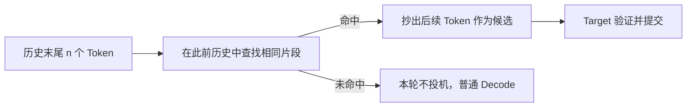

上一节证明了：只要验收与修正做对，Draft 猜得再差也不会把输出带偏。但从性能上看，草稿写得慢、又总被否决，投机就成了白忙一场。所以本节的问题是：**怎样让"猜一段"的成本，低于"少调几次大模型"省下来的时间？**

答案不一定是再加载一个神经网络。模型输出经常复制 Prompt，代码反复出现同样的标识符，Agent 一遍遍走相似的步骤——这些历史本身就是现成的草稿来源。本节把独立小模型、N-gram 和 Suffix Decoding 放到同一张表上比较，并在最后统一接受率的统计口径，后续 5.4、5.5 都沿用这里的定义。

> ⏰ **信息时效**：框架行为与参数默认值基于 vLLM v0.32.0（2026-10-18 发布）源码与文档。

<!-- more -->

## 📑 目录

- [1. 好 Draft 的标准：快、准、能接上](#1-好-draft-的标准快准能接上)
- [2. 独立小模型：不是越小越好](#2-独立小模型不是越小越好)
- [3. Tokenizer 与上下文：两个模型要说同一种语言](#3-tokenizer-与上下文两个模型要说同一种语言)
- [4. N-gram：在历史里找已经写过的下一段](#4-n-gram在历史里找已经写过的下一段)
- [5. Suffix Decoding：从一次匹配到历史统计](#5-suffix-decoding从一次匹配到历史统计)
- [6. 动手实验：匹配窗口与候选覆盖](#6-动手实验匹配窗口与候选覆盖)
- [7. 接受率：先把分母说清楚](#7-接受率先把分母说清楚)
- [8. 工程选型：按业务和资源挑候选](#8-工程选型按业务和资源挑候选)
- [总结](#-总结)
- [自我检验清单](#-自我检验清单)
- [参考资料](#-参考资料)

---

## 1. 好 Draft 的标准：快、准、能接上

负责提议候选的组件叫 Proposer。一个好用的 Proposer 要同时满足三点：

1. **便宜**：生成候选的耗时、显存和通信开销小。
2. **准**：在真实业务上，候选经常与 Target 的选择一致。
3. **接得上**：Token ID、上下文、缓存与采样规则能和推理引擎对接。

就像招助手：工资低只是一方面，还要看他写的稿子主编改起来费不费劲，以及他交的文件能不能在主编的软件里打开。

| 📊 路线 | 候选从哪来 | 额外权重 | 擅长的场景 |
|---|---|---|---|
| 独立 Draft 模型 | 小模型的条件预测 | 有 | 能提议历史中没出现过的新内容 |
| N-gram / Prompt Lookup | 历史中相同的 Token 片段 | 无 | 复制、抽取、改写 |
| Suffix Decoding | 后缀树匹配 + 续写频次 | 无 | 重复轨迹、代码编辑、相似请求 |

📌 **关键点**："无模型"只是说没有额外的神经网络权重。查找、索引维护、CPU 与 GPU 之间的数据传递以及 Target 验证，都有各自的成本。

---

## 2. 独立小模型：不是越小越好

### 2.1 小模型为什么够用

一段文本里，并不是每个位置都同样难。标点、常见连接词、语法结构、上文出现过的变量名，小模型也能猜得八九不离十。把这些"容易的位置"交给小模型，Target 只需要验收。

参数量只是一个粗略的成本指标。Draft 的实际延迟还取决于层数、Attention 结构、KV 长度、Kernel 实现和 Batch 大小。一个层数很深的 0.5B 模型，逐 Token 生成时未必比层数浅的 1B 模型快。

### 2.2 与 Target 对得上，比自身分数高更重要

挑 Draft 时要看的是**它在目标业务上与 Target 有多一致**：

- Target 擅长代码，而 Draft 没怎么见过代码，语法部分能猜中，算法选择就会频繁被拒。
- 训练数据、对齐方式或语言分布不同，常用的续写习惯也会错开。同一家族、同一批数据训练的小模型通常是首选，vLLM 文档的示例就是 `Qwen/Qwen3-8B` 搭配 `Qwen/Qwen3-0.6B`。
- Draft 更大往往接受得更多，但多出来的 Draft 时间可能把收益吃掉。

所以选型的依据是实测的"（Draft 耗时 + 验证耗时）/ 已提交 Token 数"，排行榜分数只能当参考。

### 2.3 并行 Draft：一次前向出多个候选

传统 Draft 要逐 Token 跑 $\gamma$ 次前向，草稿越长越慢。[PARD](https://arxiv.org/abs/2504.18583)（Parallel Draft Model）换了一种训练方式，让 Draft 一次前向就预测出多个位置，Draft 的耗时基本不再随 $\gamma$ 线性增长。vLLM v0.32.0 通过 `"parallel_drafting": true` 启用，官方示例给 `amd/PARD-Qwen3-0.6B` 配了 12 个候选。这类方法需要专门训练的 Draft 权重，普通小模型打开这个开关并不会变成并行 Draft。

### 2.4 额外模型会挤占服务容量

独立 Draft 除了权重，还有自己的 KV Cache、激活和工作空间。显存总量不变，留给 Target KV 的空间就会变少，能同时服务的请求也随之减少。

单请求变快、最大并发变小，这两件事可以同时发生。5.5 节的实战会把低并发延迟和服务容量分开测。

---

## 3. Tokenizer 与上下文：两个模型要说同一种语言

### 3.1 文本相同，Token ID 未必相同

第 5.1 节的 $p(x)$、$q(x)$ 默认定义在同一个 Token 空间上。两个 Tokenizer 都能编码"hello"，不代表它们切分方式一样，更不代表每个整数编号含义一样。

需要核对的是词表的 Token → ID 映射、特殊 Token（BOS/EOS/Chat 模板标记），以及 Target 实际使用的 Chat Template。`vocab_size` 相同只说明数量一样。

下面的离线检查需要 `transformers` 和模型文件，不运行推理：

```python
from transformers import AutoTokenizer

target = AutoTokenizer.from_pretrained("Qwen/Qwen3-8B")
draft = AutoTokenizer.from_pretrained("Qwen/Qwen3-0.6B")

t_vocab, d_vocab = target.get_vocab(), draft.get_vocab()
diff = {tok for tok in t_vocab.keys() | d_vocab.keys()
        if t_vocab.get(tok) != d_vocab.get(tok)}
print("映射不一致的 Token 数:", len(diff))
print("EOS:", target.eos_token_id, draft.eos_token_id)

messages = [{"role": "user", "content": "你好"}]
same_template = target.apply_chat_template(messages, tokenize=True) == \
    draft.apply_chat_template(messages, tokenize=True)
print("同一段对话的模板编码是否一致:", same_template)
```

推理时 Draft 读的是 Target 那一份已编码的历史，不会自己再套一遍模板。所以模板差异影响的是 Draft 有没有"见过"这种格式，进而影响接受率。

### 3.2 词表不同：单独的工程路线

vLLM 默认要求两边共享词表。v0.32.0 提供了 `use_heterogeneous_vocab: true`，用 Token-Level Intersection（TLI）算法支持不同家族、不同 Tokenizer 的 Draft，但目前只能用于 `draft_model` 方法，并且只支持默认的 `draft_sample_method="greedy"`。

### 3.3 Draft 的上下文不能悄悄变短

Draft 要能处理"实际历史 + 候选"的总长度。最大上下文、RoPE 配置和长文能力不一致时，长请求可能直接失败，或者接受率在长文本上明显下滑。部署前应把 Draft 的 `max_model_len` 与 Target 对齐，或者明确记录 Draft 只看部分历史这一设计。

---

## 4. N-gram：在历史里找已经写过的下一段

### 4.1 先对上尾巴，再抄后面

假设当前历史末尾是 `[A, B, C]`，而更早的位置出现过 `[A, B, C, D, E, F]`。查找器发现尾巴对得上，就把后面的 `[D, E, F]` 当作候选交给 Target。



匹配发生在 **Token ID 序列**上，与中文分词或字符数无关。这里有两个独立的参数：

- **查找窗口** $n$：vLLM 中是 `prompt_lookup_min` 和 `prompt_lookup_max`。两者都不设时默认为 5；只设一个时，另一个取同样的值。
- **提议长度**：`num_speculative_tokens`，最多抄出多少个后续 Token。

vLLM v0.32.0 的 CPU 实现会在**整个请求历史**（Prompt 加已生成内容）中查找，优先取 $[\text{min},\text{max}]$ 范围内**最长**的匹配，同样长度时取**最早出现**的位置。该版本还新增了 `ngram_gpu` 方法，把查找放到 GPU 上，适配 V2 Model Runner。

### 4.2 窗口长短的权衡

- 窗口长：约束强，候选更可能相关，但命中更少。
- 窗口短：容易命中，却可能只是对上了一个逗号加"的"，后面的续写分歧很大。
- 提议长：一次抄得多，可能省下更多 Target 调用，也可能前几个就被拒，后面全白算。

Prompt Lookup 最适合"输出大量复用输入"的任务：摘要引用原文、代码只改几行、按模板抽取字段。

### 4.3 没有概率，怎么验证

N-gram 给出的是确定的 Token。按第 5.1 节 3.3 的分析，可以把它看成 one-hot 的 $q$，验收规则退化为"以 $p(y)$ 的概率接受"，残差就是去掉 $y$ 后按 $p$ 重新归一化。结论不变：输出分布仍是 Target 的。

---

## 5. Suffix Decoding：从一次匹配到历史统计

N-gram 的思路是"以前写过同样的尾巴，后面大概还能照抄"，每次只看一处匹配。[SuffixDecoding](https://arxiv.org/abs/2411.04975) 更进一步：用后缀树把历史组织起来，记录每种续写出现过多少次，再挑最有把握的路线。

### 5.1 频次当作便宜的置信度

假设某个后缀之后，`return` 出现过 20 次、`raise` 出现过 2 次，那么先提议 `return` 显然更划算。续写越分散，就越不值得往深处猜。vLLM 用 `suffix_decoding_min_token_prob`（默认 0.1）过滤掉估计概率太低的 Token。

这些频次只是 Proposer 内部的排序依据，不是 Target 的条件概率，最终收不收仍由 Target 验证决定。

### 5.2 历史范围与动态长度

Suffix Decoding 维护两类后缀树：

- **Prompt 树**：针对当前请求的 Prompt 和已生成内容。
- **全局树**：跨请求缓存历史输出，由 `suffix_decoding_max_cached_requests`（默认 10000）控制规模，设为 0 即关闭。

每一步提议多少个 Token 是动态决定的：匹配越长、越有把握，就猜得越多。因此 `num_speculative_tokens` 在这里是**上限**，文档建议设到 16 或 32。它在代码编辑、Agent 自我反思循环、RL Rollout 这类高重复任务上效果明显；生成全新内容时，历史再多也帮不上忙。

### 5.3 接入成本

| 🔍 成本项 | 要核对什么 |
|---|---|
| 搜索与更新 | 建树、更新频次是否拖慢每一步 |
| 历史存储 | 全局树缓存多少请求、占多少内存 |
| 统计作用域 | 跨请求共享历史是否符合业务的数据隔离要求 |
| 依赖 | 需要 `pip install arctic-inference`，记录版本 |

💡 **提示**：全局树会让一个用户的输出影响另一个用户请求的候选。候选仍要经过 Target 验证，输出分布不受影响；但在多租户场景，是否允许这种共享，应由业务的隔离要求决定。

📌 **关键点**：Prefix Cache 复用的是**已经算过的 KV**，减少重复 Prefill；N-gram/Suffix 提议的是**可能要生成的 Token**，仍需验证。两者都叫"复用历史"，但统计指标不能混在一起。

---

## 6. 动手实验：匹配窗口与候选覆盖

下面用整数代替 Token ID，按 vLLM 的规则实现一个简化查找器：从长窗口往短窗口找，同长度取最早出现的位置。它只演示规则，vLLM 实际用的是一次扫描完成的 KMP 变体。

```python
def propose(history, min_n=2, max_n=4, k=3):
    """返回 (命中窗口长度, 候选)；未命中返回 (None, [])。"""
    for n in range(min(max_n, len(history) - 1), min_n - 1, -1):
        tail = history[-n:]
        # 起点 < len - n，排除尾巴自身；从前往后扫，取最早的匹配
        for start in range(len(history) - n):
            if history[start:start + n] == tail:
                return n, history[start + n:start + n + k]
    return None, []


h1 = [10, 11, 12, 20, 21, 99, 10, 11, 12]
print("h1:", propose(h1))                      # (3, [20, 21, 99])
print("h1 只允许 4-gram:", propose(h1, min_n=4))  # (None, [])

h2 = [7, 8, 1, 7, 8, 2, 7, 8]                  # 尾巴 [7, 8] 出现过两次
print("h2:", propose(h2))                      # 取最早一处：(2, [1, 7, 8])
print("没有重复:", propose([1, 2, 3, 4, 5]))
```

`h1` 命中 3-gram，限制成 4-gram 就没有候选。`h2` 里尾巴 `[7, 8]` 后面跟过 1 也跟过 2，规则选最早的一处，提议 1；如果 Target 这次想写 2，候选就会第一位被拒。

可以动手改一改：给 `h2` 再加几次 `7, 8, 2`，想想 Suffix Decoding 按频次会提议什么。"取某一处匹配"和"按历史频次挑续写"的差别就在这里。

---

## 7. 接受率：先把分母说清楚

### 7.1 三个相关但不同的量

本章后面都用这一组定义。设观测区间内一共提出 $D$ 个候选 Token、接受了其中 $C$ 个，共进行了 $R$ 轮验收：

$$
\text{Draft Acceptance Rate}=\frac{C}{D}
$$

$$
\text{Mean Acceptance Length}=1+\frac{C}{R}
$$

平均接受长度里的"加一"，是每轮都会提交的那个修正或额外 Token。vLLM 的逐请求指标和 Prometheus 指标都采用这两个口径。

第三个量是**候选覆盖**：有多少步真正提出了候选。N-gram 查不到时这一步就不投机，若只统计有候选的轮次，90% 的接受率背后可能只有 10% 的步骤在投机。

### 7.2 固定长度与动态长度不能互相换算

只有每轮都提出相同的 $\gamma$ 个候选时，才有 $D=\gamma R$，此时平均接受长度可写成 $1+\gamma\cdot C/D$。Suffix、动态 SD 这类每轮长度不同的方案，必须直接用实际的 $D$ 和 $R$ 计算。

另一个常见混淆是位置上的接受率："第 $i$ 位在前面都通过时被接受的概率"和"从第 1 位一路通过到第 $i$ 位的概率"是两回事，后者随 $i$ 增大衰减得快得多。vLLM 的 `vllm:spec_decode_num_accepted_tokens_per_pos` 统计的是后者对应的计数。

⚠️ **注意**：接受率 90% 不等于提速 90%。Draft 生成、验证长度、显存容量和调度负载都会进入耗时的分母，第 5.4 节专门推导这笔账。

---

## 8. 工程选型：按业务和资源挑候选

| 🎯 业务特征 | 先试哪种 | 重点观察 |
|---|---|---|
| 输出大量复用 Prompt | N-gram | 候选覆盖、查找窗口、接受前缀长度 |
| 重复编辑、相似轨迹多 | Suffix | 全局树作用域、动态长度、建树开销 |
| 新内容多、复制少 | 独立 Draft / PARD | 与 Target 的一致性、Draft 耗时、额外显存 |
| 模型自带或有适配的辅助模块 | MTP / EAGLE（见 5.3） | 产物与 Target 版本是否匹配 |

先拿真实的 Prompt 和采样配置，测出候选覆盖、平均接受长度和端到端延迟，再决定要不要上更复杂的方案。"代码""对话"只是任务标签，真正决定效果的是重复程度、分布匹配与系统成本。

✅ **收益机会**：便宜又容易命中的候选，可以减少 Target 的调用次数。

❌ **代价**：独立模型要占显存；无模型方案依赖可复用的历史；两者都要额外维护缓存与验证流程。

---

## 📝 总结

- 好 Draft 要同时做到便宜、准、接得上，参数少只是其中一项。
- 独立小模型能猜新内容，但要算上权重、KV 和能力匹配；PARD 用并行 Draft 降低草稿延迟。
- `vocab_size` 相同不等于 Token ID 一致，特殊 Token、模板和上下文长度都要核对；异构词表需要 TLI。
- N-gram 用历史尾部匹配后续，查找窗口和提议长度是两个参数；vLLM 取最长、最早的匹配。
- Suffix 用后缀树和频次动态决定提议长度，成本在建树、缓存和依赖上。
- 确定性候选等价于 one-hot 的 $q$，配合标准验收依然无损。
- 接受率 $C/D$、平均接受长度 $1+C/R$ 和候选覆盖要分开报告。

## 🎯 自我检验清单

- 能说明为什么更大的 Draft 可能更准却更慢
- 能列出独立 Draft 额外占用的显存项
- 能写一段脚本检查两个 Tokenizer 的 Token → ID 映射是否一致
- 能区分 N-gram 的查找窗口与提议长度，并说出 vLLM 的默认值
- 能描述 vLLM N-gram 在多处匹配时选哪一处
- 能说明 Suffix 的频次为什么仍需 Target 验证，以及全局树的隔离风险
- 能区分 Prefix Cache 与历史 Token 提议
- 能用 $C$、$D$、$R$ 计算接受率与平均接受长度，并指出动态长度下的换算陷阱

## 📚 参考资料

- [Fast Inference from Transformers via Speculative Decoding（Leviathan et al., 2023）](https://arxiv.org/abs/2211.17192)
- [Transformers — Assisted Decoding 与 Prompt Lookup](https://huggingface.co/docs/transformers/assisted_decoding)
- [SuffixDecoding: Extreme Speculative Decoding for Emerging AI Applications（Oliaro et al.）](https://arxiv.org/abs/2411.04975)
- [Snowflake — Arctic Inference 官方实现](https://github.com/snowflakedb/ArcticInference)
- [PARD: Accelerating LLM Inference with Low-Cost PARallel Draft Model Adaptation（An et al.）](https://arxiv.org/abs/2504.18583)
- [vLLM — Draft Models](https://docs.vllm.ai/en/stable/features/speculative_decoding/draft_model/)
- [vLLM — Parallel Draft Models](https://docs.vllm.ai/en/stable/features/speculative_decoding/parallel_draft_model/)
- [vLLM — N-Gram Speculation](https://docs.vllm.ai/en/stable/features/speculative_decoding/n_gram/)
- [vLLM — Suffix Decoding](https://docs.vllm.ai/en/stable/features/speculative_decoding/suffix/)
- [vLLM v0.32.0 — N-gram Proposer 实现](https://github.com/vllm-project/vllm/blob/v0.32.0/vllm/v1/spec_decode/ngram_proposer.py)
