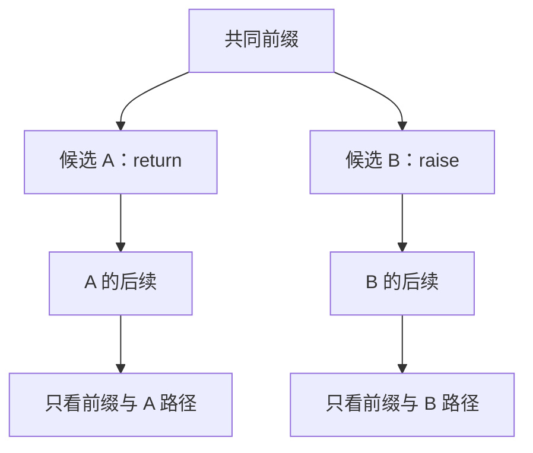

独立 Draft 像另请了一位助手：工资低，但每次都要从头读一遍全文才能动笔。能不能让助手直接用上主编已经形成的理解？Target 的隐藏状态里已经装着对上文的丰富理解，**在这些表示上接几个小头或一个轻量网络，往往比从 Token 开始再跑一个完整模型更划算。**

这一类方法统称 Self-Draft，本节按出现顺序介绍：Medusa 在 Target 上挂多个预测头，EAGLE 系列训练一个读取 Target 特征的小网络，MTP 则是模型预训练时就自带的多 Token 预测模块。它们都需要专门训练的权重，而且这些权重和 Target 的具体版本绑定。

> ⏰ **信息时效**：论文结论以各自 arXiv 版本为准；vLLM 支持情况基于 v0.32.0（2026-10-18 发布），SGLang 参数以其官方文档为准。

<!-- more -->

## 📑 目录

- [1. Self-Draft：复用什么，增加什么](#1-self-draft复用什么增加什么)
- [2. Medusa：一次隐藏状态，多个未来预测头](#2-medusa一次隐藏状态多个未来预测头)
- [3. Draft Tree 与 Tree Attention](#3-draft-tree-与-tree-attention)
- [4. EAGLE：从特征出发的轻量草稿](#4-eagle从特征出发的轻量草稿)
- [5. EAGLE-2：把树预算花在更有把握的路径上](#5-eagle-2把树预算花在更有把握的路径上)
- [6. EAGLE-3：改变训练目标与输入信息](#6-eagle-3改变训练目标与输入信息)
- [7. MTP：预训练时就带上的草稿模块](#7-mtp预训练时就带上的草稿模块)
- [8. 动手实验：兄弟节点为什么不能互相看见](#8-动手实验兄弟节点为什么不能互相看见)
- [9. 验收与部署：树形计算不自动保证无损](#9-验收与部署树形计算不自动保证无损)
- [总结](#-总结)
- [自我检验清单](#-自我检验清单)
- [参考资料](#-参考资料)

---

## 1. Self-Draft：复用什么，增加什么

| 📊 路线 | 复用 Target 的什么 | 新增部分 | 怎么得到 |
|---|---|---|---|
| 独立 Draft | 只共享 Token 历史 | 一个完整的小模型 | 选同家族的兼容模型 |
| Medusa | 最后一层隐藏状态 | 多个预测头 | 在 Target 上训练这些头 |
| EAGLE / EAGLE-2 | 高层特征 + Token | 一层左右的草稿网络 | 针对 Target 训练 |
| EAGLE-3 | 低、中、高多层特征 + Token | 草稿网络 | 改进的训练流程 |
| MTP | 共享 Embedding 与输出头 | 预训练时一起训练的 MTP 模块 | 随模型权重一起发布 |

这些方法改进的都是"出草稿"这一步，Target 仍要验证。辅助模块的权重、激活和缓存同样要计入显存预算。

🔑 **核心概念**：**复用 Target 的表示，省掉重复理解；保留 Target 的验收，最终输出仍由它决定。** 是否严格保分布，取决于用的是哪种接受规则（见第 9 节）。

---

## 2. Medusa：一次隐藏状态，多个未来预测头

### 2.1 多个头一起猜

普通 LM Head 把当前隐藏状态 $h_t$ 映射成下一个 Token 的分布。[Medusa](https://arxiv.org/abs/2401.10774) 在同一个 $h_t$ 上再挂 $K$ 个小头，第 $k$ 个头直接预测更远的第 $t+k+1$ 个位置：

$$
q^{(k)}=\operatorname{softmax}\big(g_k(h_t)\big),\qquad k=1,\ldots,K
$$

每个 $g_k$ 是一个带残差连接的单层前馈网络。所有头读的是同一个 $h_t$，可以一次算完，不必像独立 Draft 那样串行跑好几步。

代价也很明显：第 3 个头预测时，并不知道第 1、2 个位置最后选了什么。越远的头越像"闭着眼猜"，准确率衰减得越快。

### 2.2 多个候选组成一棵树

每个头只取 Top-1，前面错一个整条链就废了。Medusa 让每个头保留几个候选，把可能的组合组织成一棵树，让 Target 一次验完多条分支。

但不能把每个头 Top-k 的所有组合都展开：每层 $b$ 个分支、深 $d$ 层，节点数是 $b^d$ 量级。Medusa 的做法是在校准集上统计各条路径的命中情况，只保留最有希望的那些节点，构成一棵稀疏树。

### 2.3 Medusa-1 与 Medusa-2

论文给出了两种训练方式：

- **Medusa-1**：冻结 Target 骨干，只训练预测头。Target 没变，配合精确验收可以做到无损。
- **Medusa-2**：骨干和预测头一起训练，让表示更适合预测远处的 Token。

Medusa-2 实际上已经得到了一个新的 Target。即使验收是精确的，它保证的也是对新模型的分布一致，评测时要拿训练前的原模型做质量对照。就像只给主编配助手，和连主编的写作习惯一起重新训练，是两种程度的改动。

---

## 3. Draft Tree 与 Tree Attention

### 3.1 树上每条路径是一段不同的历史

同一个前缀后面可能接 `return`，也可能接 `raise`，它们的后续分别属于两段互斥的历史。Tree Attention 规定：每个节点只能看到共同前缀和**自己的祖先**。



把树节点展平成一个数组送进 Attention 时，不能用普通的下三角 Mask，否则排在后面的 B 分支会看到 A 分支，等于把两种互斥的续写当成了连续文本。

### 3.2 Position ID 按深度编号

同一层的兄弟节点处在序列的同一个位置，Position ID 应该按树深度设，而不是按展平后的数组下标递增。Mask 决定"能看到谁"，Position ID 决定"自己在第几个位置"，两者都要对。

所有节点共享前缀的 KV；验证结束后只提交一条通过验收的路径，其他分支的临时 KV 全部作废。

📌 **关键点**：Tree Attention 是一次算多条候选历史的批处理技巧。它保证每条路径的计算各自正确，选哪条路径则由验收规则决定。

---

## 4. EAGLE：从特征出发的轻量草稿

### 4.1 为什么在特征上做草稿

独立小模型要从 Token 开始重新跑一遍网络，相当于把 Target 已经做过的理解再做一次。[EAGLE](https://arxiv.org/abs/2401.15077) 的观察是：Target 进入 LM Head 之前的顶层特征（论文称 second-to-top-layer feature）比 Token 更有规律，用"一个全连接层 + 一层 Decoder"的小网络，就能根据当前特征自回归地预测下一个特征，再通过 Target 的 LM Head 转成 Token 候选。

### 4.2 只看特征不够，还要看 Token

特征序列并不完全决定未来。采样时 Target 选了 `return` 还是 `raise`，下一步的特征会走向完全不同的方向。所以 EAGLE 的草稿网络同时输入两样东西：当前特征，以及**已经采样出的下一个 Token**（提前一步的 Token 序列）。Token 信息消除了"走哪条分支"的不确定性。

草稿网络的输出照样交给 Target 验证。由于它读的是 Target 的特征，结构、隐藏维度、特征层位置和训练所用的 Target 都必须对得上。

⚠️ **注意**：EAGLE 权重和具体的 Target 版本绑定。参数规模相同、名字相近的两个 8B 模型，不能共用同一份 EAGLE 权重。

---

## 5. EAGLE-2：把树预算花在更有把握的路径上

### 5.1 固定树的浪费

EAGLE 和 Medusa 都用静态树：每一轮的深度和分支数固定不变。可实际上，有的上下文后续几乎是确定的，适合往深处猜；有的一开始就有好几种写法，适合铺宽。

[EAGLE-2](https://arxiv.org/abs/2406.16858) 发现草稿模型的置信度与实际接受率高度相关，于是用置信度在每一轮动态地扩展和剪枝候选树，让有限的节点预算落在最可能被接受的地方。

### 5.2 看整条路径，而不只看当前节点

一个节点自己的置信度是 0.95，但它的父节点只有 0.1 的机会被接受，那它最终被提交的机会也很小。树上的路径必须从根一路连续通过，所以 EAGLE-2 用路径上置信度的乘积来估计节点价值：

$$
v(u)\approx\prod_{j\in\operatorname{path}(u)}c_j
$$

其中 $c_j$ 是草稿模型对路径上第 $j$ 个节点的置信度。扩展阶段选 $v$ 最高的若干节点继续往下长；重排阶段再从所有节点里挑 $v$ 最高的一批送去验证。

### 5.3 置信度只用来分配预算

"置信度与接受率相关"是在论文的模型和任务上测出来的经验关系，换模型、换温度、换任务都应重新确认。另外，$v(u)$ 只决定把哪些节点送去验证，验证本身仍是第 5.1 节的标准规则，置信度并不参与接受与否的判定。

---

## 6. EAGLE-3：改变训练目标与输入信息

[EAGLE-3](https://arxiv.org/abs/2503.01840) 的作者发现，EAGLE 增加训练数据后提升很有限，原因在于"必须预测出 Target 的下一个特征"这个约束限制了草稿网络。EAGLE-3 做了三处改动：

1. **去掉特征预测损失**，只用 Token 预测作为训练目标，让草稿网络自由学习对预测有用的表示。
2. **融合多层特征**：把 Target 低、中、高三层的特征拼接后输入，不再只依赖最后一层。
3. **Training-time Test（TTT）**：推理时，草稿网络从第二步起读的是自己上一步的输出，而不是 Target 的真实特征。训练时就模拟这个过程，让网络习惯在自己的中间结果上继续预测。

这里的 "Test" 指训练中模拟推理阶段的多步草稿，与评测集、部署时再训练都没有关系。

打个比方：EAGLE 要求助手先临摹主编脑中的草图再写字，EAGLE-3 只要求他写出主编会写的字，同时在训练时就练习"接着自己写的往下写"。

---

## 7. MTP：预训练时就带上的草稿模块

### 7.1 从训练目标变成推理加速

前面几种方法都是"模型训完以后，再为它配一个草稿模块"。Multi-Token Prediction（MTP）把顺序倒了过来：预训练时就让模型多预测几个未来 Token，这个辅助目标能让模型学到更好的表示；推理时，训练好的 MTP 模块正好可以拿来当草稿。

[DeepSeek-V3](https://arxiv.org/abs/2412.19437) 是代表。它的 MTP 模块与 Medusa 的"并列小头"有一处关键区别：**按顺序预测，保留因果链。** 第 $k$ 个模块读取上一深度的表示 $h^{k-1}$ 和第 $i+k$ 个 Token 的 Embedding，各自做 RMSNorm 后拼接、经投影矩阵 $M_k$ 压回原维度，再过一个 Transformer Block，最后用**与主模型共享**的输出头预测第 $i+k+1$ 个 Token：

$$
h'^{k}_i=M_k\big[\operatorname{RMSNorm}(h^{k-1}_i);\ \operatorname{RMSNorm}(\operatorname{Emb}(t_{i+k}))\big]
$$

Embedding 和输出头都与主模型共享，所以 MTP 模块本身很轻。这个结构和 EAGLE"特征 + Token"的思路几乎一致，区别在于它和主模型一起预训练，而不是事后单独训练。

### 7.2 实际效果

DeepSeek-V3 训练时只预测一个额外 Token（深度 $D=1$）。论文报告，推理时用 MTP 模块做投机，第二个 Token 的接受率在 85%–90% 之间，解码速度（TPS）达到原来的 1.8 倍。这是该模型、该部署条件下的数字，换模型或负载需要重测。

📌 **关键点**：MTP 的优势是**零额外准备**。权重随模型一起发布，训练分布与 Target 完全一致，不用担心版本错配。前提是模型本身带有 MTP 模块，没有就用不上。

### 7.3 在 vLLM 中的形态

vLLM v0.32.0 统一用 `"method": "mtp"` 启用这类能力，早期的 `deepseek_mtp`、`qwen3_5_mtp` 等模型专用名称已被废弃并自动改写为 `mtp`。文档给出的示例包括 `XiaomiMiMo/MiMo-7B-Base`，以及 Gemma 4 搭配官方 assistant 检查点（assistant 层与 Target 共享 KV Cache）。官方建议从 `num_speculative_tokens: 1` 开始调。

### 7.4 更远的探索：一次前向出一整块草稿

EAGLE 和 MTP 生成草稿仍是逐 Token 的，草稿越长越慢。[DFlash](https://arxiv.org/abs/2602.06036) 把草稿模型换成一个以 Target 特征为条件的小型块扩散（Block Diffusion）模型，一次前向生成一整块候选。作者报告在多个模型与任务上达到 6 倍以上的无损加速，最高比 EAGLE-3 再快 2.5 倍。vLLM v0.32.0 已提供 `"method": "dflash"`，但这是 2026 年的新工作，结论还需要更多独立复现。

---

## 8. 动手实验：兄弟节点为什么不能互相看见

下面只构造树形 Mask 和 Position ID，不做 Attention 计算。节点 0 是根，1 和 2 是兄弟，3 挂在 1 下，4 挂在 2 下；共同前缀不在这个小矩阵里。

```python
parents = [-1, 0, 0, 1, 2]
n = len(parents)
mask = [[0] * n for _ in range(n)]
depth = [0] * n

for node, parent in enumerate(parents):
    assert parent < node, "要求父节点排在子节点之前"
    depth[node] = 0 if parent == -1 else depth[parent] + 1
    cursor = node
    while cursor != -1:          # 沿祖先链往上，逐个标记可见
        mask[node][cursor] = 1
        cursor = parents[cursor]

causal = [[1 if j <= i else 0 for j in range(n)] for i in range(n)]
print("相对 Position ID:", depth)
for i, (tree_row, causal_row) in enumerate(zip(mask, causal)):
    leaked = [j for j in range(n) if causal_row[j] and not tree_row[j]]
    print(f"节点 {i}: 树形 Mask {tree_row}  下三角会多看到 {leaked}")

assert mask[4] == [1, 0, 1, 0, 1]
assert depth[1] == depth[2] == 1
```

节点 4 在数组里排在最后，用下三角 Mask 会看到节点 1 和 3，而它们属于另一条分支。打印结果把每个节点"多看到的节点"列了出来。

真实实现还要处理共同前缀、分页 KV 的块表、Batch 内不同请求的树边界，并让 Attention Kernel 支持这种稀疏 Mask。这个例子只说明数据流上的约束。

---

## 9. 验收与部署：树形计算不自动保证无损

### 9.1 Medusa 的 Typical Acceptance

Medusa 除了精确的拒绝采样，还提出了 Typical Acceptance：只要候选在 Target 分布下的概率超过一个与熵相关的阈值，就认为它"足够合理"并接受。这样能接受得更长，在论文的评测中生成质量也基本保持；但它不满足第 5.1 节的保分布证明，属于近似方案。

评测报告里应当把这些情况分开写清楚：冻结骨干还是联合训练，贪心匹配、精确随机采样还是 Typical Acceptance。光写"用了 Medusa"，回答不了输出质量有什么保证。

### 9.2 三件容易混在一起的事

- **并行前向**：一次 Target 调用计算多个位置或多个树节点，是计算层面的优化。
- **Token 级验收**：候选从左到右逐个按规则核验，遇到首个拒绝就停，即第 5.1 节的标准规则。
- **Block Verification**：把整块候选放在一起决定接受多少、如何修正，是另一种采样算法。

[Block Verification](https://arxiv.org/abs/2403.10444) 证明了在保分布的前提下，联合验收的预期提交长度不低于逐 Token 验收。它需要配套的概率规则，与"把几个 Token 放进同一个 Tensor"不是一回事。vLLM v0.32.0 通过 `"rejection_sample_method": "block"` 提供了这一算法。

### 9.3 论文结构与框架实现要分开核对

框架里的 `method` 名称是一套加载与执行约定，未必复现论文里的全部结构。以树为例：

- **vLLM v0.32.0**：`eagle`、`eagle3`、`mtp` 都按**线性链**出草稿，没有树形验证。
- **SGLang**：EAGLE 系列在 `--speculative-eagle-topk` 大于 1 时构建草稿树，配合 `--speculative-num-steps`（草稿步数）和 `--speculative-num-draft-tokens`（最终送去验证的节点数）控制预算。它默认开启的 V2 Overlap Scheduler 只支持 `topk=1`，要用树需显式调整。

部署时逐项核对：Target 的 revision、辅助权重的来源、特征层约定、词表、dtype、量化方式以及实际运行的后端。树节点越多，验证计算和临时 KV 越多，节点预算应按实测的性能曲线来定。

---

## 📝 总结

- Self-Draft 复用 Target 的表示来便宜地出草稿，但辅助模块都需要专门训练，并与 Target 版本绑定。
- Medusa 用多个并列头一次预测多个未来位置，越远越不准；Medusa-2 联合训练后，对照基准要换成原模型。
- Tree Attention 只让节点看到共同前缀与祖先，Position ID 按深度编号，最终只提交一条路径。
- EAGLE 用"特征 + 提前一步的 Token"做草稿；EAGLE-2 用路径置信度乘积动态分配树预算。
- EAGLE-3 去掉特征损失、融合多层特征，并用 Training-time Test 让训练贴近多步推理。
- MTP 在预训练时就带上顺序预测模块，推理时直接充当草稿，DeepSeek-V3 报告第二 Token 接受率 85%–90%。
- Typical Acceptance 是近似方案；Block Verification 保分布且能接受更长；vLLM 与 SGLang 对树的支持不同。

## 🎯 自我检验清单

- 能说明复用 Target 表示与使用独立小模型的区别和代价
- 能解释 Medusa 多头为什么能并行，又为什么越远越不准
- 能区分 Medusa-1 与 Medusa-2 的训练方式和质量对照基准
- 能为一棵小树写出正确的 Tree Attention Mask 与 Position ID
- 能解释 EAGLE 为什么需要 Token 信息，以及 EAGLE 权重为什么不能跨 Target 复用
- 能说明 EAGLE-2 为什么用路径置信度乘积而不是节点自身置信度
- 能列出 EAGLE-3 相对 EAGLE 的三处主要改动
- 能对比 DeepSeek-V3 的 MTP 模块与 Medusa 预测头的结构差异
- 能区分并行前向、Token 级验收与 Block Verification，并指出 Typical Acceptance 不保分布

## 📚 参考资料

- [Medusa: Simple LLM Inference Acceleration Framework with Multiple Decoding Heads（Cai et al., 2024）](https://arxiv.org/abs/2401.10774)
- [FasterDecoding — Medusa 官方实现](https://github.com/FasterDecoding/Medusa)
- [EAGLE: Speculative Sampling Requires Rethinking Feature Uncertainty（Li et al., 2024）](https://arxiv.org/abs/2401.15077)
- [EAGLE-2: Faster Inference of Language Models with Dynamic Draft Trees（Li et al., 2024）](https://arxiv.org/abs/2406.16858)
- [EAGLE-3: Scaling up Inference Acceleration of Large Language Models via Training-Time Test（Li et al., 2025）](https://arxiv.org/abs/2503.01840)
- [SafeAILab — EAGLE 官方实现](https://github.com/SafeAILab/EAGLE)
- [DeepSeek-V3 Technical Report（DeepSeek-AI, 2024）](https://arxiv.org/abs/2412.19437)
- [DFlash: Block Diffusion for Flash Speculative Decoding（Chen et al., 2026）](https://arxiv.org/abs/2602.06036)
- [Block Verification Accelerates Speculative Decoding（Sun et al., 2024）](https://arxiv.org/abs/2403.10444)
- [vLLM — EAGLE Draft Models](https://docs.vllm.ai/en/stable/features/speculative_decoding/eagle/)
- [vLLM — Multi-Token Prediction (MTP)](https://docs.vllm.ai/en/stable/features/speculative_decoding/mtp/)
- [SGLang — Speculative Decoding](https://docs.sglang.io/advanced_features/speculative_decoding.html)
