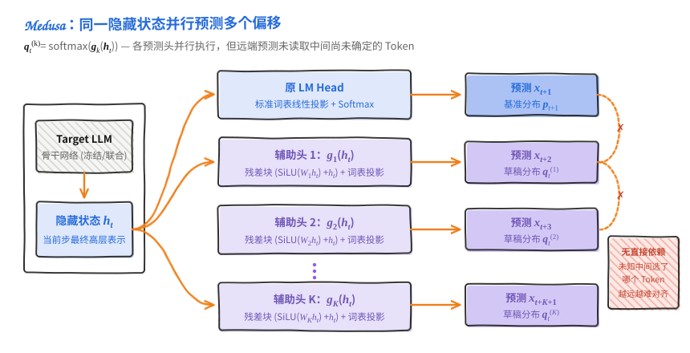
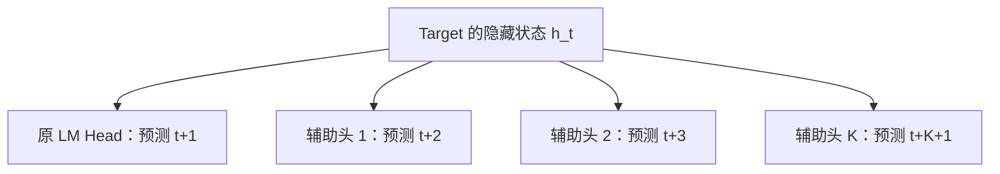
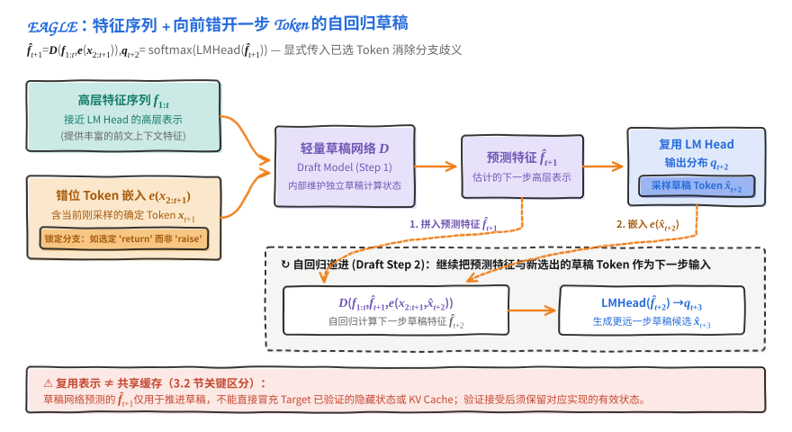
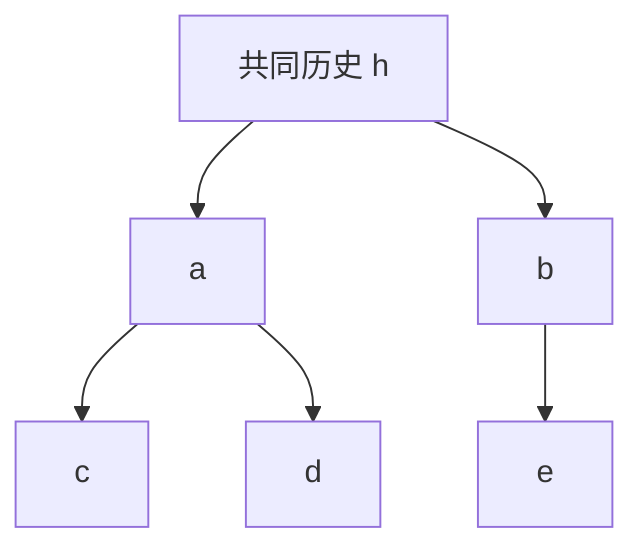
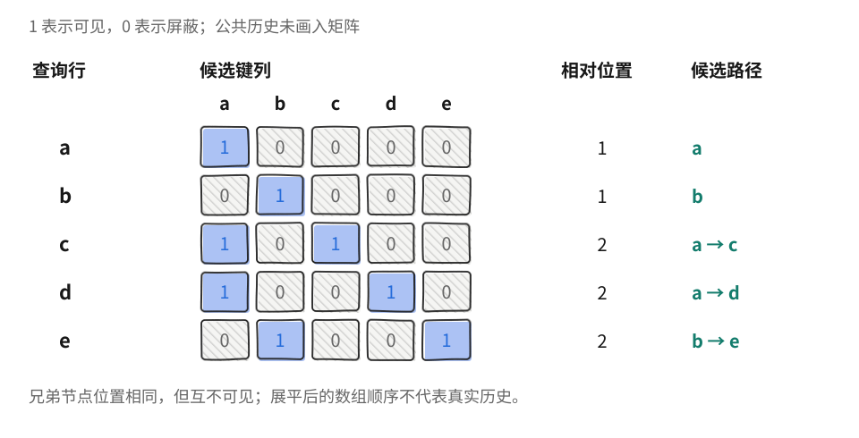

独立 Draft 从 Token 历史开始计算，Target 也要处理同一段历史。既然 Target 已经产生了包含上下文信息的隐藏状态，能否直接利用这些表示生成草稿？本节按大纲介绍 Medusa 和 EAGLE 家族，再说明如何把多个候选组织成树，交给 Target 验证。

<!-- more -->

## 📑 目录

- [1. Self-Draft 复用什么](#1-self-draft-复用什么)
- [2. Medusa 的多预测头](#2-medusa-的多预测头)
- [3. EAGLE 的特征草稿](#3-eagle-的特征草稿)
- [4. Draft Tree 与 Tree Attention](#4-draft-tree-与-tree-attention)
- [5. EAGLE-2 与 EAGLE-3](#5-eagle-2-与-eagle-3)
- [6. 从 Token 验证到 Block Verification](#6-从-token-验证到-block-verification)
- [总结](#-总结)
- [自我检验清单](#-自我检验清单)
- [参考资料](#-参考资料)

---

## 1. Self-Draft 复用什么

“Self-Draft” 在不同资料中范围不完全相同：有的方案跳过 Target 的部分层，有的复用它的表示并附加小网络。本节关注后者。它们仍然可能需要训练额外参数，只是草稿不必由一个从头处理全部 Token 的独立模型生成。

前文把激活写成 Token 行、通道列的矩阵。在某个位置 $t$，隐藏向量 $h_t$ 就是这张矩阵的一行，包含网络到该层为止对前缀的计算结果。把它理解成“模型对前文的表示”有助于建立直觉；它仍是一个具体的数值向量，不能直接当作文字摘要。

| 方法 | 从 Target 复用的信息 | 新增部分 |
|---|---|---|
| Medusa | 当前位置最后的隐藏状态 | 预测多个未来位置的辅助头 |
| EAGLE / EAGLE-2 | 高层特征与 Token 信息 | 生成特征草稿的轻量网络 |
| EAGLE-3 | 多层特征与 Token 信息 | 改变训练目标的草稿网络 |

**草稿网络提供候选，Target 提供验证分布。** 复用隐藏状态不会免除验证，也不意味着辅助模型的参数与缓存免费。选用不同层的特征，还必须与训练时的层位置、维度和 Target 版本一致。

## 2. Medusa 的多预测头



### 2.1 同一个隐藏状态预测多个偏移

普通 LM Head 根据 $h_t$ 预测 $x_{t+1}$。Medusa 在同一隐藏状态上增加多个辅助头，第 $k$ 个头学习预测更远的 $x_{t+k+1}$。简写为：
$$
q_t^{(k)}=\operatorname{softmax}(g_k(h_t)),\qquad k=1,\ldots,K.
$$

$g_k$ 是可训练的小模块。原论文采用带残差连接的前馈变换及词表投影，并非简单复制几个相同的线性层。各个头对应不同预测距离，可以并行执行。[Medusa 论文](https://arxiv.org/abs/2401.10774)



这里的“多头”指多个输出预测模块，与 Attention 中的多个注意力头含义不同。较远位置的预测也没有读到尚未确定的中间 Token，它只能根据当前表示估计未来，因此距离越远，候选之间的依赖越难准确处理。

### 2.2 训练与接受规则分别决定什么

Medusa-1 冻结原骨干并训练辅助头；Medusa-2 联合训练骨干与辅助头。后者改变了 Target 本身，评测时应使用训练后的 Target 作为相应基线。

接受规则还需要单独看。Medusa 讨论的 Typical Acceptance 根据 Target 概率与阈值保留候选，追求质量与接受长度之间的权衡。它不具备 5.1 节标准拒绝采样的同一份严格保分布证明。冻结骨干、使用贪心匹配、使用精确随机采样和使用近似阈值，是不同的配置条件。

## 3. EAGLE 的特征草稿



### 3.1 特征与 Token 为什么都要输入

早期 EAGLE 在高层特征空间中自回归生成草稿，然后利用输出头获得 Token 分布。论文所说的 second-to-top-layer 特征按其网络计层约定理解，通常指接近 LM Head 的高层表示；不能凭“倒数第二层”几个字，在任意实现中随意选择一层。

关键在于：当前特征提供了前文信息，但下一个特征还取决于**这一步实际选中了哪个 Token**。若当前分布可能生成 `return` 或 `raise`，沿两个分支继续计算，后续表示就不同。

因此 EAGLE 将特征序列与**向前错开一步的 Token 信息**配对。用一个省略内部序列状态的示意式表示：

$$
\widehat f_{t+1}=D(f_{1:t},e(x_{2:t+1})),\qquad
q_{t+2}=\operatorname{softmax}(\operatorname{LMHead}(\widehat f_{t+1})).
$$

其中 $e(x)$ 是 Token Embedding，$D$ 是训练过的草稿网络。这里已经选出 $x_{t+1}$，用它约束对应的下一步特征，再产生 $x_{t+2}$ 的候选分布。后续 Draft 步会把自己预测的特征继续作为输入，因此这条草稿路径仍有自回归依赖。[EAGLE 论文](https://arxiv.org/abs/2401.15077)

### 3.2 复用表示与共享缓存的区别

Target 提供的特征是草稿输入，草稿网络内部仍有自己的计算状态。它预测的特征也不能直接冒充 Target 已验证的隐藏状态或 KV。真正接受候选以后，后续生成应使用对应实现保留下来的有效状态；缓存管理仍要区分网络与前缀。

与 Medusa 相比，前者让多个头直接预测不同偏移，EAGLE 则利用已选 Token 推进轻量草稿网络。这两种方式都复用表示，草稿生成过程却不同。

## 4. Draft Tree 与 Tree Attention

### 4.1 为什么候选要有分支

单链在早期猜错一次，后面即使有很多计算也无法使用。如果在不确定位置保留两个候选，就有机会覆盖不同的有效续写。例如：



这棵树包含 `a→c`、`a→d`、`b→e` 三条两步续写。它共享 `a` 的计算，又为第一步的 `b` 保留另一种可能。**树增加的是候选历史的覆盖范围，最终提交的输出仍是一条连续路径。**

以贪心验证为例，若 Target 在共同历史后选择 `b`，并在 `b` 后选择 `e`，就可以提交 `b→e`。只猜 `a→c` 的单链会在第一步失败；树已经为 `b` 及其后续准备了计算结果，因此可能多推进一步。

Medusa 可以从各个偏移的预测头中保留多个候选，再按选定的树结构组织组合；EAGLE 则能沿候选分支继续生成条件草稿。生成树的方式不同，Target 验证时都要按实际路径重新计算条件分布。

树宽与树深有不同作用。加宽覆盖同一位置的更多选择，加深尝试一次提交更多 Token。若每层都有 $b$ 个分支、深度为 $d$，候选节点数可达 $\sum_{j=1}^{d}b^j$；验证预算很快就会增长，不能无限展开所有组合。

### 4.2 展平之后怎样保持分支隔离

为了批量计算，可以把上面的候选按 `[a,b,c,d,e]` 放入一个张量。但普通下三角 Mask 会让 `b` 读取 `a`，让 `e` 读取 `c,d`，这些都不属于它们的历史。

Tree Attention 为每个候选设置祖先可见关系：它可以读取共同历史、自己以及本分支的祖先，同层兄弟与其他分支不可见。位置编号也按路径深度设置：`a,b` 属于同一位置，`c,d,e` 属于下一个位置。



图中只画候选区域，公共历史的 KV 对所有候选都可见。读取 `c` 所在行，可以看到它只访问 `a,c`；`e` 只访问 `b,e`。验证某个节点的 Token 时，使用其父节点对应的预测分布；节点自身计算出的分布用于它的后继。

下面用父节点编号生成同一矩阵：

```python
parents = [-1, -1, 0, 0, 1]  # a,b 的父节点是公共历史
mask = [[0] * len(parents) for _ in parents]
depth = [0] * len(parents)
for node, parent in enumerate(parents):
    assert -1 <= parent < node
    depth[node] = 1 if parent == -1 else depth[parent] + 1
    cursor = node
    while cursor != -1:
        mask[node][cursor] = 1
        cursor = parents[cursor]

print("相对位置:", depth)
for row in mask:
    print(row)
assert mask[2] == [1, 0, 1, 0, 0]
assert mask[4] == [0, 1, 0, 0, 1]
```

这段代码只检查可见关系。生产实现还需要将 Mask、位置编号、候选排列和 KV 地址映射一起交给支持树形计算的 Attention 后端。

## 5. EAGLE-2 与 EAGLE-3

### 5.1 EAGLE-2：按置信度分配树预算

固定树对每一轮使用同样的分支安排。有些前缀的后续很集中，适合向深处延伸；另一些前缀在较早位置存在多个可能，适合增加宽度。EAGLE-2 利用 Draft 置信度与实际接受情况的相关性，动态扩展并选择草稿树。[EAGLE-2 论文](https://arxiv.org/abs/2406.16858)

深处节点的价值依赖整条路径。例如，两条路径的条件置信度分别为 $(0.9,0.8)$ 和 $(0.2,0.95)$，乘积为 0.72 与 0.19。只看叶子的 0.95 就选择第二条，会忽略到达它之前的不确定性。

这类路径评分帮助分配候选预算，最终是否接受仍由 Target 验证。所谓置信度校准，应理解为预测置信度能否在当前数据上合理反映实际结果；换任务或采样温度后，需要重新检查。Draft 置信度 0.8 并不自动等于 80% 的接受概率。

### 5.2 EAGLE-3：改变输入与训练目标

EAGLE-3 进一步融合 Target 的低、中、高层特征，并移除“草稿输出必须拟合指定 Target 特征”的回归约束，转向直接优化 Token 预测。它仍有内部向量，但这些向量无需等于 Target 某层的真实特征。[EAGLE-3 论文](https://arxiv.org/abs/2503.01840)

移除特征约束后，只用真实 Target 特征训练第一步会产生新问题：推理第二步读到的是 Draft 自己生成的向量，输入分布已经变化。Training-time Test 在训练中模拟这种多步使用过程，让网络学习继续处理自己的输出。这里的 Test 指模拟测试阶段的草稿运行方式。

| 方案 | 本节关注的变化 |
|---|---|
| EAGLE | 结合 Token 信息进行高层特征预测 |
| EAGLE-2 | 利用置信度动态组织草稿树 |
| EAGLE-3 | 多层特征融合、直接 Token 目标与多步训练 |

EAGLE-3 可以结合树形草稿，但论文结构与推理引擎的执行路径需要分别核对。一个 `eagle3` 配置项，不足以说明后端一定复现了论文中的整套动态树策略。

## 6. 从 Token 验证到 Block Verification

目前已经出现三件容易混在一起的事：

| 概念 | 解决的问题 |
|---|---|
| 并行前向 | 一次计算多个候选位置的 Target 分布 |
| Tree Attention | 让不同候选路径各自遵守正确的因果历史 |
| 接受算法 | 根据这些分布决定输出什么，保证相应的正确性 |

5.1 节采用标准 Token 级规则：从前往后接受，首次拒绝后修正。Block Verification 则联合考虑一段候选的接受与修正，在保持目标分布的条件下改进预期输出长度，是对**接受算法**的进一步研究。[Block Verification 论文](https://arxiv.org/abs/2403.10444)

把多个 Token 放进一次前向，并不自动等于采用了 Block Verification；树形计算也不允许任意挑选概率最高的完整路径来替代随机采样。使用哪一种接受算法，需要与候选生成方式和框架实现配套。

## 📝 总结

- Medusa 与 EAGLE 复用 Target 的表示，但仍需训练辅助模块并验证候选。
- Medusa 的多预测头面向不同未来偏移，早期 EAGLE 则结合 Token 信息预测后续特征。
- 候选树扩大续写覆盖，Mask 与位置编号必须体现各自的祖先路径。
- EAGLE-2 改进树构建，EAGLE-3 改进特征输入与训练目标。
- 并行计算、树形注意力和 Block Verification 分属不同环节。

## 🎯 自我检验清单

- 能区分 Medusa 的输出预测头与 Attention Head
- 能解释早期 EAGLE 为什么要同时输入特征和已选择 Token
- 能画出一个节点允许读取的祖先，并确定其位置编号
- 能说明树宽、树深与验证节点数之间的关系
- 能区分 EAGLE-2 的置信度评分与 Target 的接受概率
- 能说明 EAGLE-3 与早期特征回归目标的区别

## 📚 参考资料

- [Medusa: Simple LLM Inference Acceleration Framework with Multiple Decoding Heads](https://arxiv.org/abs/2401.10774)
- [EAGLE: Speculative Sampling Requires Rethinking Feature Uncertainty](https://arxiv.org/abs/2401.15077)
- [EAGLE-2: Faster Inference of Language Models with Dynamic Draft Trees](https://arxiv.org/abs/2406.16858)
- [EAGLE-3: Scaling up Inference Acceleration of Large Language Models via Training-Time Test](https://arxiv.org/abs/2503.01840)
- [Block Verification Accelerates Speculative Decoding](https://arxiv.org/abs/2403.10444)
- [下一节：收益边界与限制](./5.4-收益边界与限制.md)
