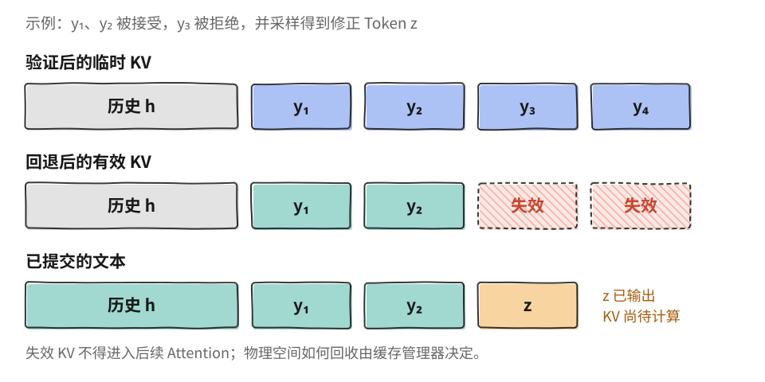

前面介绍了草稿与验证的几种实现。部署时需要把它们放回整条推理链路：一次多提交几个 Token，也可能伴随更长的草稿计算、更多临时 KV 和更复杂的调度。本节用平均提交长度与完整轮耗时判断收益，再讨论与前面章节技术的组合。

<!-- more -->

## 📑 目录

- [1. 从接受长度计算加速条件](#1-从接受长度计算加速条件)
- [2. 任务与草稿长度的影响](#2-任务与草稿长度的影响)
- [3. KV Cache 的保留与回退](#3-kv-cache-的保留与回退)
- [4. 与量化叠加时的基准](#4-与量化叠加时的基准)
- [5. Continuous Batching 与流式输出](#5-continuous-batching-与流式输出)
- [总结](#-总结)
- [自我检验清单](#-自我检验清单)
- [参考资料](#-参考资料)

---

## 1. 从接受长度计算加速条件

设一轮最多提议 $\gamma$ 个 Token，连续接受的草稿长度为 $L$。在没有触发 EOS 或长度上限的标准单链流程中，本轮输出 $L+1$ 个 Token，额外的一个来自拒绝后的修正或全部接受后的采样。

### 1.1 不需要独立假设的表达式

记 $s_i=P(L\ge i)$，即“前 $i$ 个候选全部接受”的概率，则：

$$
\mathbb E[L+1]=1+\sum_{i=1}^{\gamma}s_i.
$$

这是非负整数随机变量的尾概率求和。它不要求各位置独立。只有在“走到每个位置后的条件接受率都近似为同一个 $\alpha$”的简化条件下，才有 $s_i\approx\alpha^i$：

$$
\mathbb E[L+1]\approx1+\alpha+\cdots+\alpha^\gamma
=\frac{1-\alpha^{\gamma+1}}{1-\alpha}.
$$

$\alpha=1$ 时取 $\gamma+1$。5.2 节运行统计的“接受 Token 数 / 提议 Token 数”包含首拒绝后的未用候选，不能未经区分就代入这里的条件接受率。

### 1.2 一轮成本要计算完整

令 $t_0$ 为普通 Target Decode 的单步耗时，$T_D$ 为一轮草稿耗时，$T_V$ 为验证耗时，$T_O$ 为缓存维护、采样、调度等其他耗时。在单请求、稳态 Decode 的近似下：

$$
\text{Speedup}\approx
\frac{\mathbb E[L+1]\,t_0}{T_D+T_V+T_O}.
$$

分子代表普通解码生成相同数量 Token 的时间。只有分母更小，投机才有收益。它不是包含 Prefill、排队和网络时间的端到端公式，也不能直接预测高并发总吞吐。[性能模型的原始讨论](https://proceedings.mlr.press/v202/leviathan23a.html)

举一个演算例子：$\gamma=4,\alpha=0.8$，平均每轮推进约 3.36 个 Token。若普通单步为 10 ms，投机轮耗时为 20 ms，估算加速约 $3.36\times10/20=1.68$ 倍；若投机轮耗时升到 36 ms，结果约为 0.93 倍，已经更慢。这里的数字用于演算，不是硬件实测。

```python
gamma, alpha = 4, 0.8
expected_tokens = sum(alpha ** i for i in range(gamma + 1))
for round_ms in [20, 36]:
    speedup = expected_tokens * 10 / round_ms
    print(round_ms, "ms:", round(speedup, 2), "x")
```

## 2. 任务与草稿长度的影响

### 2.1 代码和开放对话怎样比较

代码中的固定语法、重复标识符和局部修改可能有利于草稿；开放对话的续写选择更多，草稿分布也可能与 Target 相差更大。因此大纲中的任务区分可以作为实验出发点，但任务名称本身无法决定接受率。

例如，从零生成陌生算法可能缺少可复制片段；开放对话中的模板化回答却可能高度重复。对 N-gram，要看重复片段与命中覆盖；对模型草稿，要看条件分布匹配。语言、采样温度、输入长度也应记录。

### 2.2 多猜一个 Token 是否值得

在上面的简化模型中，把长度从 $\gamma$ 加到 $\gamma+1$，期望提交量只增加 $\alpha^{\gamma+1}$。较后位置更容易因前面拒绝而失效，新增计算的收益会递减。

树形草稿还要分别记录深度与节点数。增加宽度会多算一些备选分支，未必提高最终提交深度；增加深度则依赖前面整条路径通过。合理的长度与树预算，需要由实际接受情况和耗时共同决定。

## 3. KV Cache 的保留与回退

### 3.1 验证生成的 KV 还未全部有效

第二章已经解释了 KV Cache 与物理 Block，本节只看投机新增的状态。Target 为候选执行前向时，会得到这些位置的 KV；候选尚未被接受，因此这部分缓存只能暂存。

假设历史 $h$ 已有有效 KV，本轮候选为 $y_1,y_2,y_3,y_4$。验证接受前两个，在 $y_3$ 处拒绝并生成修正 Token $z$：



图中需要分开看两种状态：

- **已提交文本**变成 $h,y_1,y_2,z$。
- **当前可复用的 Target KV**覆盖 $h,y_1,y_2$；$z$ 刚被采样出来，自身 KV 通常要在下一次前向中补齐。

$y_3,y_4$ 对应的缓存失效。即使 $y_4$ 的 Token ID 恰巧还想继续使用，它的 KV 也依赖包含 $y_3$ 的旧前缀，不能直接接到 $z$ 后面。全部接受时，已有候选 KV 可以保留，但新采样的 Bonus Token 同样通常还没有自身 KV。

### 3.2 逻辑回退与物理释放

回退可以通过缩短有效长度、恢复块表或重映射槽位完成，并不要求立刻把显存内容清零。失效位置必须无法再被有效 Attention 访问；空闲空间何时归还，则取决于分配器。

若接受前缀与拒绝后缀共用同一个物理 Block，不能把整块都当作无用数据释放。树形验证还要将选中路径的 KV 对应到后续的逻辑序列，其他分支失效；可能涉及索引收集、重映射或复制。

独立 Draft 有自己的网络和 KV，不能拿它的缓存代替 Target KV。拒绝以后，Draft 也要回到正确前缀并吸收修正 Token。复用特征的方案则还要同步其辅助状态，避免下一轮从已被否定的分支继续生成。

### 3.3 显存成本随候选规模变化

沿用第一章的记号，每个 Token 的 Target KV 数据量近似为：

$$
m_{\text{KV}}=2\,n_{\text{layers}}\,n_{\text{kv-heads}}\,d_{\text{head}}\,b,
$$

其中 $b$ 为每元素字节数。单请求新增 $N$ 个候选位置，临时 KV 数据量约为 $Nm_{\text{KV}}$；树形方案的 $N$ 要按节点数计算。实际还受 Block 对齐、预分配、并行分片及模型结构影响。

独立 Draft 的参数、KV 和工作区另算。即使其余参数都不变，新增占用也可能降低可并发请求数，触发抢占与重计算。**接受率高，只说明草稿有效；临时缓存挤占服务容量的代价仍要计入。**

## 4. 与量化叠加时的基准

第四章已经讨论量化误差。将它与投机组合时，应区分改动发生在哪里：

| 改动 | 对草稿及正确性基准的影响 |
|---|---|
| 只量化 Draft | 改变 $q$ 与接受率；使用一致的提议概率和精确修正时，输出仍以原 Target 为准 |
| 量化 Target 权重或激活 | 验证分布变为量化后 Target 的 $p$；不能承诺与原高精度模型相同 |
| 量化 Target KV | 改变 Target 计算所使用的状态，需以相同 KV 配置建立基线 |
| 使用近似接受规则 | 需要单独评估它对输出分布与质量的影响 |

缓存回退出错属于状态错误，不能用“量化会有一点误差”解释。浮点 Kernel 与 Batch 形状也可能引起数值差异，应将数值稳定性与算法层面的保分布保证分开检查。[vLLM 的无损说明](https://github.com/vllm-project/vllm/blob/v0.31.0/docs/features/speculative_decoding/README.md#lossless-guarantees-of-speculative-decoding)

性能收益同样不能简单相乘。权重量化降低了普通 Decode 的权重读取成本，验证与草稿的相对成本便可能上升。应该分别测普通推理、仅量化、仅投机以及二者组合，逐项比较。

## 5. Continuous Batching 与流式输出

### 5.1 调度预算从请求数扩展到候选位置数

Continuous Batching 已经让同一轮服务多个请求。当批次本身足够大，GPU 的可用计算空间可能减少，再给每个请求增加候选位置，就可能让验证阶段变成主要成本。

调度器还要处理每个请求不同的草稿长度、临时 KV 配额和接受结果。若同时有 Prefill，请求之间竞争的包括 Token 预算、计算时间与显存。单请求延迟下降，并不保证混合负载下的吞吐和 P99 延迟也改善。

可以按前文的测试方法逐步增加并发，观察普通与投机两条曲线在哪里接近或交叉。高负载下缩短草稿或回退普通 Decode，是否有效同样需要测量，不能仅按接受率设置阈值。

### 5.2 多 Token 提交改变流式节奏

一轮完成后可能同时输出多个 Token，平均 TPOT 会降低，但客户端看到的文本可能成批到达。需要一起观察 TTFT、端到端延迟和流式块之间的时间间隔。一个网络块也未必对应一个 Token。

EOS、停止字符串和最大输出长度仍应在已接受路径上生效。若某轮可以接受五个候选，却在第二个遇到停止条件，就应结束输出，并清理其余临时状态。实测平均输出长度也会因此偏离前面忽略停止条件的理论公式。

## 📝 总结

- 判断收益需要同时计算平均提交长度与完整轮耗时。
- 位于后面的候选依赖前面连续通过，扩大草稿或树预算会出现收益递减。
- 已输出 Token、有效 KV 与临时 KV 是不同状态，回退要同步 Target 和草稿状态。
- 量化改变性能基线；量化 Target 也改变投机所保持的目标分布。
- 批处理容量、尾延迟和流式体验需要与单请求加速一起评估。

## 🎯 自我检验清单

- 能从 $P(L\ge i)$ 推导平均提交长度，并说明简化公式的条件
- 能举例说明接受率较高却仍然变慢
- 能标出拒绝后哪些 KV 有效、哪些失效，以及修正 Token 的 KV 何时产生
- 能说明候选节点数与临时缓存占用的关系
- 能区分量化 Draft、量化 Target 与修改接受规则的影响
- 能解释低并发收益为什么不能直接外推到 Continuous Batching

## 📚 参考资料

- [Fast Inference from Transformers via Speculative Decoding](https://proceedings.mlr.press/v202/leviathan23a.html)
- [vLLM v0.31.0 — Speculative Decoding](https://github.com/vllm-project/vllm/blob/v0.31.0/docs/features/speculative_decoding/README.md)
- [vLLM v0.31.0 — V1 Scheduler](https://github.com/vllm-project/vllm/blob/v0.31.0/vllm/v1/core/sched/scheduler.py)
- [下一节：vLLM 投机解码实战](./5.5-vLLM投机解码实战.md)
