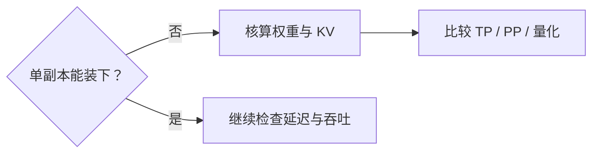
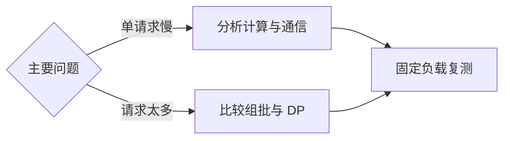
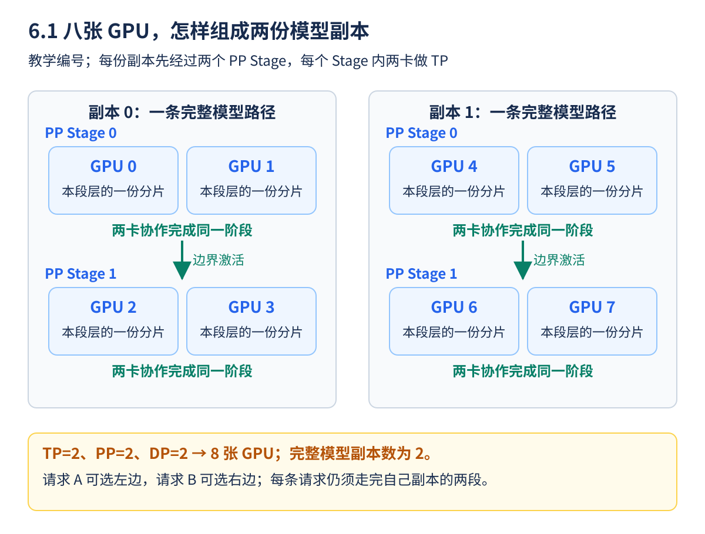

同样增加到两张 GPU，可能得到三种不同结果：模型终于装得下、一个用户等得更短，或者更多用户能同时被服务。这三个目标需要分别判断。把权重拆到两卡上，与在两卡各放一份完整模型，对请求路径、显存和通信的影响都不同。

本节先用一个四层模型讲清 TP、PP、DP、EP 各自分配什么工作，再算权重与 KV 的显存占用，最后把 GPU 组成完整副本。读后续命令时，先画出这一层关系，参数就有了对应的对象。本章实现说明固定以 **vLLM v0.19.0** 为基线。

<!-- more -->

## 📑 目录

- [1. 推理并行与训练并行，目标有什么不同](#1-推理并行与训练并行目标有什么不同)
  - [1.1 先认识本章反复出现的几个对象](#11-先认识本章反复出现的几个对象)
  - [1.2 为什么推理的评价标准不同](#12-为什么推理的评价标准不同)
- [2. 四种并行，各自切的是什么](#2-四种并行各自切的是什么)
  - [2.1 先用一个四层模型想象四种分法](#21-先用一个四层模型想象四种分法)
  - [2.2 从数据流图检查自己的理解](#22-从数据流图检查自己的理解)
  - [2.3 再用部署目标选择候选](#23-再用部署目标选择候选)
- [3. 显存账本：切权重不等于所有东西等比例缩小](#3-显存账本切权重不等于所有东西等比例缩小)
- [4. GPU 数量与副本的关系](#4-gpu-数量与副本的关系)
  - [4.1 先分副本，再在副本里找每张卡](#41-先分副本再在副本里找每张卡)
- [5. 把并行策略放回真实拓扑](#5-把并行策略放回真实拓扑)
- [6. 用同一工作负载决定下一步](#6-用同一工作负载决定下一步)
- [总结](#-总结)
- [自我检验清单](#-自我检验清单)
- [参考资料](#-参考资料)

---

## 1. 推理并行与训练并行，目标有什么不同

### 1.1 先认识本章反复出现的几个对象

用户输入文字以后，Tokenizer 会把它转换成 Token ID；模型再把 ID 变成数值向量，经过一层层计算，得到下一个 Token 的概率并采样。下一轮会用上新生成的 Token，继续重复这个过程。

输入阶段叫 Prefill，后续逐步生成叫 Decode。KV Cache 保存此前 Attention 需要的 Key/Value，帮助后续生成复用历史计算。**Token 是模型处理的单位，不固定等于一个汉字、单词或字符。**

| 名词 | 本章中的含义 | 用两卡服务器理解 |
|---|---|---|
| GPU / 卡 | 执行计算、保存显存状态的设备 | GPU 0、GPU 1 |
| 节点（Node） | 一台参与部署的机器 | 一台机器可以装两张或更多卡 |
| 进程 / Worker | 运行在操作系统中的执行者 | 常见组织是每卡一个模型 Worker |
| Rank | 通信组成员的编号 | 用来区分谁持有什么分片、和谁通信 |
| 副本（Replica） | 足以完成一条请求的完整模型计算路径 | 可以单卡完成，也可以跨两卡协作 |
| Batch | 一轮一起处理的一组工作 | 可能包含多条请求的 Token |

Rank 要结合具体通信组理解：某成员在 TP 组内的编号、在 DP 维度的编号不一定相同。它也不必等于 `nvidia-smi` 上的 GPU 编号。

特别容易混淆的是“副本”和“GPU”：如果一个模型拆在两卡上，两卡合起来才是一份副本；如果两卡各自保存完整模型、分别接请求，则是两份副本。

### 1.2 为什么推理的评价标准不同

训练需要前向、反向、优化器状态和梯度同步；普通推理主要执行前向，并不断维护请求的 KV Cache。不能把“训练时 DP 很有效”直接翻译成“推理时也要同步梯度”。

| 📊 问题 | 训练更关注 | 在线推理更关注 |
|---|---|---|
| 状态装载 | 参数、梯度、优化器 | 参数、KV、激活、工作空间 |
| 单位工作 | 训练 Step / 样本 | 请求、输入 Token、输出 Token |
| 时间目标 | 每 Step 耗时、整体收敛 | TTFT、TPOT、尾延迟 |
| 扩展目标 | 有效训练吞吐 | 满足质量与延迟约束的吞吐 |

**Prefill 与 Decode 也不是一回事。** 长输入可以形成较大的矩阵运算；低并发 Decode 每步的 Token 较少，更容易暴露权重读取和通信启动成本。相同 TP 配置可能加快 Prefill，却让短 Decode 变慢。

可以把前面的时间指标再翻译一遍：TTFT 是“发出请求后多久看到第一个输出”；TPOT 是“首 Token 以后，平均多久产生一个后续 Token”；吞吐则是“一段时间完成了多少请求或输出 Token”。

假设请求在 0 秒发出，0.5 秒看到第一个 Token，1.4 秒看到第十个 Token，那么 TTFT 为 0.5 秒，首 Token 后的平均 TPOT 为 $(1.4-0.5)/(10-1)=0.1$ 秒。系统同时服务更多人，可以提高总吞吐，却不一定让这位用户更早看到首字。

所以部署前先写目标：是让单个用户少等一会，还是让更多用户同时达标？目标不同，选择的并行方式可能完全不同。

## 2. 四种并行，各自切的是什么

| 策略 | 切分对象 | 一条请求怎样执行 | 主要代价 |
|---|---|---|---|
| TP：张量并行 | 一层中的矩阵或 Attention Head | 多卡共同完成同一层 | 频繁的集合通信 |
| PP：流水线并行 | 连续的模型层 | 依次经过多个 Stage | 阶段依赖、气泡、跨段传输 |
| DP：数据并行 | 不同请求批次 | 路由到某个副本 | 重复权重、负载不均 |
| EP：专家并行 | MoE 的专家集合 | Token 路由到相应专家 | Dispatch/Combine、专家热点 |

### 2.1 先用一个四层模型想象四种分法

假设模型有四层 $F_1,F_2,F_3,F_4$，一条请求要依次经过这四层。两张 GPU 可以按下面几种方式组织：

- **TP**：GPU 0、1 都参与四层计算，但每层各负责一部分矩阵。处理第一层时两卡就要合作，第二层仍如此。
- **PP**：GPU 0 负责 $F_1,F_2$，GPU 1 负责 $F_3,F_4$。同一请求先经过前一张卡，再经过后一张卡。
- **DP**：GPU 0、1 各保存四层。请求 A 交给 GPU 0，请求 B 交给 GPU 1，各自完成全程。
- **EP**：前提是模型本身含 MoE 专家层；专家分在两卡上，Token 根据门控结果前往对应专家。普通 Dense 模型不能只改一个参数就变成 MoE。

其中 TP、PP 改变“一条请求如何由多卡共同完成”；DP 改变“不同请求怎样分给完整计算路径”；EP 则利用模型内部已有的专家结构。先记住切分对象，再看名字里的“并行”。

### 2.2 从数据流图检查自己的理解


**顺着箭头读图**：TP 让同一批 Token 在多卡上协作计算同一层；PP 让同一请求的激活经过不同模型层；DP 把不同请求分到不同副本；EP 则把 Token 送往被选中的专家，再把结果按 Token 合成。

图中 TP 采用**行并行线性层**的部分和归约示例，其他 TP 布局的通信方式见 6.2；DP 画的是单卡 Dense 独立副本；EP 只展开 MoE 专家层，并用一个 Token 的 Top-2 路由说明 Dispatch/Combine。实际副本可以跨多卡，几种并行也可以组合。

读图时可以遮住标题，只看箭头回答：两卡是否接收同一批 Token？它们算的是同一层、不同层，还是不同请求？最后是把部分结果合成一个输出，还是分别返回两个请求的结果？能够回答这些问题，就已经抓住了四种并行的主要区别。

### 2.3 再用部署目标选择候选

例如模型的权重单卡装不下，增加独立 DP 副本并不能让其中任何一份装得下，这时应先考虑 TP/PP 或量化。如果单卡已能运行且单请求延迟达标，只是请求越来越多，增加副本才更直接。



已经能装下以后，再按测到的瓶颈选择方向；MoE 还需单独核算专家分布和通信。



📌 **关键点**：TP、PP、DP、EP 描述不同维度，并不是四个互斥的按钮；但也不能把四个数字不加区别地相乘。

## 3. 显存账本：切权重不等于所有东西等比例缩小

对某一张 GPU，先写：

$$
M_{\text{rank}}=M_W+M_{\text{KV}}+M_{\text{activation}}+M_{\text{workspace}}+M_{\text{runtime}}
$$

这五项分别是：模型权重、历史缓存、中间激活、Kernel/通信等临时工作空间，以及框架运行时开销。可以把它们想成店里的固定设备、每位顾客的存物柜、正在加工的半成品和操作台，不能只计算设备占地。

假设一张卡的可用预算是 40 GiB，某个工作负载需要权重 28 GiB、KV 12 GiB、其他开销 5 GiB，合计 45 GiB，已经超出预算。若一种两卡方案把权重均分为每卡 14 GiB，但 KV 每卡仍需 12 GiB、其他仍为 5 GiB，则每卡约 31 GiB，**不是直接把 45 除以 2**。这些数字只用于说明算账方法，不是某个模型的实测占用。

理想均匀 TP×PP 下，权重主体约按 $1/(tp\cdot pp)$ 分摊；Embedding、未切分参数、重排缓存和不均匀层会偏离这个近似。DP 则为每份副本再准备权重。

对常规 MHA/GQA，先假设不同请求之间不共享物理 KV 块，其 KV 纯数据账本为：

$$
M_{\text{KV}}=2L\sum_r T_r H_{\text{KV}}d\,b
$$

新手可以按乘法顺序理解：一个 Token、一个 KV Head 的 Key 或 Value 有 $d$ 个数；每数占 $b$ 字节；乘上 KV Head 数 $H_{\text{KV}}$、历史 Token 数与层数 $L$，最后乘 2 计入 Key 和 Value 两份。$\sum_r T_r$ 表示把所有活跃请求各自保留的历史长度相加。

因此，一条长对话和很多条短对话都会消耗缓存；请求结束后，活跃缓存才有机会释放或转为可复用状态。能加载权重，只说明固定部分放进去了，不说明还能承载任意长上下文。

例如一个假设的 GQA 模型有 32 层、8 个 KV Head，每个 Head 宽度 128，缓存每元素 2 字节。一条保留 4096 Token 的序列，其未分片 KV 纯数据为 $2\times32\times4096\times8\times128\times2=536870912$ 字节，即 512 MiB。十条同长度序列就是约 5 GiB，还没有算缓存块取整、元数据和其他运行开销。

这个例子也能解释为什么“同时在线十个人”并不等于一个固定显存值：每个人保留的上下文长度不同，缓存需求就不同。这里的 GiB/MiB 使用 1024 进制，不能与 1000 进制的 GB/MB 混着计算。

PP 按本 Stage 的层数算。TP 应按该 Rank 实际持有的 KV Head 算：GQA/MQA 的 KV Head 较少时可能出现复制，不能一律将上式除以 TP。MLA、滑动窗口和混合模型还要换成实际缓存结构。

显存“刚好放满权重”也不够。请求到来后，KV 和工作空间还会增长；是否能支撑目标并发，要看启动日志中的缓存 Token 容量和运行时抢占。

“抢占”可以理解为当前缓存不够，引擎暂时把某些请求让出活跃集合，之后可能重算或按支持的机制恢复。它能帮助系统继续运行，但会增加等待，不能把没有立刻 OOM 当成容量已经合适。

## 4. GPU 数量与副本的关系

对这里讨论的规则 TP×PP×DP 拓扑，GPU 工作进程数为：

$$
N_{\text{GPU}}=tp\cdot pp\cdot dp
$$

例如 TP=2、PP=2、DP=2，需要 8 张 GPU。它表示两份副本，每份跨四张卡，**不是八份完整模型**。API Server、Tokenizer 等 CPU 进程不应算进 GPU 数量。

可以先分副本，再在副本里分阶段：

| 完整副本 | PP Stage | 此 Stage 的 TP 协作卡 | 含义 |
|---|---|---|---|
| 副本 0 | Stage 0 | GPU 0、1 | 共同计算前半模型层 |
| 副本 0 | Stage 1 | GPU 2、3 | 共同计算后半模型层 |
| 副本 1 | Stage 0 | GPU 4、5 | 第二份副本的前半层 |
| 副本 1 | Stage 1 | GPU 6、7 | 第二份副本的后半层 |

这里 GPU 编号只是教学画法。请求 A 可以选副本 0，但随后仍要经过它的两个 PP Stage；不会只交给 GPU 0 就完成全部计算。请求 B 可以同时交给副本 1，两份副本内部各自协作。

### 4.1 先分副本，再在副本里找每张卡



先遮住右半图，只跟踪请求 A。它选择副本 0 后，GPU 0、1 一起完成前半模型层；边界激活再交给 GPU 2、3，由后两卡一起完成后半模型层。前一段与后一段合起来，才是这条请求需要的完整路径。图中的两卡 TP 是同层分工，两段 PP 是先后依赖。

再展开右半图：GPU 4～7 形成另一份同样完整的路径，请求 B 可以由它处理。DP 增加了可选路径，TP/PP 则决定一条路径内部如何计算。这也解释了公式中三个因子的含义：先数 DP 份路径，再数每份的 PP 段数，最后数每段的 TP 卡数。

如果只把八张卡上的“权重显存”相加，在每份权重主体为 140 GiB 的理想假设下，应得到约 280 GiB，而不是 140 GiB；DP 复制了两份。每卡约 35 GiB 只是权重均分的近似，仍须为 KV、激活与工作空间留预算。图中的编号仅用于说明分组，不约束框架实际 Rank 编号或跨机布局。

**练习与答案**：保持 TP=2、PP=2，只把 DP 从 2 改为 1，会剩几卡、几份副本？答案是四卡、一份副本；每条请求的模型计算仍需经过两段，两卡 TP 关系也不变。减少的是完整路径的份数。

在 vLLM 的 DP+EP 组织中，专家可在 TP×DP 的组内分布。EP 使用已有 Rank 组，不是再额外乘一个 `ep`；具体到 PP 的组合，还要检查目标模型和版本是否支持。

下面只核算规则 Dense 拓扑，数字均为假设：

```python
def plan(tp, pp, dp, weight_gib):
    assert all(isinstance(x, int) and x > 0 for x in (tp, pp, dp))
    return {
        "gpus": tp * pp * dp,
        "replicas": dp,
        "ideal_weight_per_gpu_gib": weight_gib / (tp * pp),
        "total_weight_gib": weight_gib * dp,
    }

result = plan(2, 2, 2, 140)
print(result)
assert result["gpus"] == 8
assert result["ideal_weight_per_gpu_gib"] == 35
assert result["total_weight_gib"] == 280
```

这不是容量规划器的完整实现：KV、层不均匀、图捕获与通信缓冲都还没有计入。

读代码时注意两个不同的分母：`ideal_weight_per_gpu_gib` 只除以 TP×PP，因为 DP 并不把同一份权重继续切小；`total_weight_gib` 乘 DP，因为每份副本都需要完整模型的等价权重集合。140 GiB 权重、两份副本，集群总权重主体就是 280 GiB。

## 5. 把并行策略放回真实拓扑

同一节点内，GPU 之间可能有 NVLink，也可能只有 PCIe；跨节点还要经过网卡与交换网络。机器数量不能代表有效带宽。

| 链路或部件 | 可以怎样理解 | 对部署的影响 |
|---|---|---|
| PCIe | 设备连接主机和其他设备的通路 | 带宽、交换层级和共享竞争会影响 GPU 互传 |
| NVLink | GPU 间的高速互联技术 | 适合频繁交换激活与部分和，但要看机器实际连接 |
| 网卡与交换网络 | 不同机器间的数据通路 | 跨节点同步会受到带宽与启动延迟影响 |
| NUMA | CPU/内存/设备的拓扑局部性 | 进程和设备位置不合适时，访问路径可能更绕 |

“同机”只是物理位置接近，不自动意味着任意两卡都有同样的高速连接；也不能从 GPU 型号相同推断整台机器的互联相同。

一个常见起点是节点内 TP、节点间 PP：把每层都要做的通信留在快链路，把较少的 Stage 边界传输放到节点之间。它是候选方案，不是禁止 TP 跨节点；具备高带宽网络的集群仍可比较跨节点 TP。

部署前至少画出三张表：Rank 到 GPU/节点的映射、模型状态的分布、每类通信经过的链路。否则看到“8 卡比 4 卡慢”，很难判断是气泡、慢网卡，还是模型本身已经不需要那么多卡。

例如两台机器各四卡，TP=4、PP=2 的候选会尽量让每层频繁发生的四卡协作留在节点内，只把阶段边界的激活送过节点间网络。若改成 TP=8，每层协作可能都要跨机；这时省下的本地计算，必须足以覆盖新增的跨机通信。

## 6. 用同一工作负载决定下一步

| 现象 | 第一轮检查 | 候选动作 |
|---|---|---|
| 加载就 OOM | 权重与临时加载开销 | TP、PP、量化 |
| 启动成功但并发很小 | 每 Token KV、剩余预算 | KV 优化、更多模型并行资源 |
| 单请求 TPOT 随卡数增加 | 每步通信和小矩阵效率 | 降低 TP、检查互联 |
| QPS 不够但单请求达标 | 队列与批处理饱和度 | DP、负载均衡 |
| MoE 部分 Rank 很忙 | 专家 Token 分布 | EP 布局、通信后端、EPLB |

压测既要固定同样请求比较，也要在同样 SLO 下找容量上限。多用了 GPU，即使总吞吐增长，也不意味着单位 GPU 的成本更低。

表中的 OOM 是 Out of Memory，即显存不足；QPS 是每秒请求数。读这类现象表时，先确认故障出现在加载、首次计算、长对话还是高并发：加载失败可能是权重或加载临时开销，运行一段时间后抢占则更需要检查 KV 和调度。相同的“慢”，不一定来自相同的资源瓶颈。

建议第一次做规划时，按这个顺序记录答案：先确认模型能否装入，再确认单请求首字与出字是否达标，然后增加并发看哪里开始排队，最后比较候选的每卡收益。这里的 SLO 是服务目标，例如“95% 请求首字在某个时间内返回”，具体阈值由业务决定。

如果暂时没有 GPU，也可以先完成四层模型的分配表、显存假设账本和两节点拓扑图。把这些静态关系讲清楚，再去运行 6.6 的命令，会比直接修改一串并行参数更容易定位问题。

## 📝 总结

- 容量、单请求延迟和服务吞吐是三个不同目标。
- TP 切层内，PP 切层间，DP 分请求，EP 分专家。
- 权重、KV 和运行时开销要分开核算，不能期待所有状态都等比例切分。
- 并行度必须和物理拓扑、模型支持以及工作负载一起验证。

## 🎯 自我检验清单

- 能解释“模型装不下”与“副本忙不过来”的不同解法
- 能区分 GPU、节点、Worker、Rank 和完整副本
- 能画出 TP=2、PP=2、DP=2 的八卡组织
- 能说明 GQA/MQA 下 KV 不一定按 TP 等比例缩小
- 能区分 MoE 的 EP 组大小与额外 GPU 数量
- 能用 TTFT、TPOT 和单位 GPU 有效吞吐评估扩展
- 能解释为什么模型权重能放下，不等于目标并发的 KV 也能放下

## 📚 参考资料

- [vLLM v0.19.0 — Parallelism and Scaling](https://github.com/vllm-project/vllm/blob/v0.19.0/docs/serving/parallelism_scaling.md)
- [vLLM v0.19.0 — Data Parallel Deployment](https://github.com/vllm-project/vllm/blob/v0.19.0/docs/serving/data_parallel_deployment.md)
- [vLLM v0.19.0 — Expert Parallel Deployment](https://github.com/vllm-project/vllm/blob/v0.19.0/docs/serving/expert_parallel_deployment.md)

---

[返回本章](https://caomaolufei.github.io/AIInfraGuide/inference/模块四-推理优化/第6章-分布式推理/) · [下一节](https://caomaolufei.github.io/AIInfraGuide/inference/模块四-推理优化/第6章-分布式推理/62-张量并行推理/)
