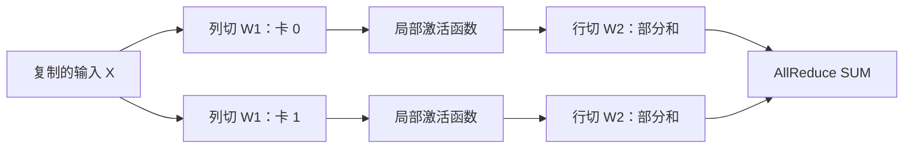

把一份大账单交给四个人算，局部计算可以同时进行；如果每算一行都要开会对账，会议时间很快会超过计算时间。**张量并行的价值来自分摊矩阵计算和权重读取，代价来自层内同步。** 这节把“拆矩阵”和“对账”接起来。

<!-- more -->

## 📑 目录

- [1. 先约定矩阵形状](#1-先约定矩阵形状)
  - [1.1 把矩阵看成一张数字表](#11-把矩阵看成一张数字表)
  - [1.2 先分清两种“合起来”](#12-先分清两种合起来)
- [2. Column Parallel：切输出通道](#2-column-parallel切输出通道)
  - [2.1 用两个输出数字看清列切](#21-用两个输出数字看清列切)
  - [2.2 为什么可以暂时不拼回](#22-为什么可以暂时不拼回)
- [3. Row Parallel：切输入通道](#3-row-parallel切输入通道)
  - [3.1 用同一组数字看清行切](#31-用同一组数字看清行切)
  - [3.2 为什么 MLP 喜欢把两者搭配使用](#32-为什么-mlp-喜欢把两者搭配使用)
- [4. Attention 与 KV Head，哪里会卡住](#4-attention-与-kv-head哪里会卡住)
  - [4.1 Q、K、V 与 Head 分别是什么](#41-qkv-与-head-分别是什么)
  - [4.2 为什么 KV Cache 不一定跟着 TP 等比例变小](#42-为什么-kv-cache-不一定跟着-tp-等比例变小)
- [5. 通信账本：更多卡为什么可能更慢](#5-通信账本更多卡为什么可能更慢)
  - [5.1 先不用公式，算一次时间账](#51-先不用公式算一次时间账)
  - [5.2 再读通信公式中的三个量](#52-再读通信公式中的三个量)
- [6. 动手验证：分片后还算同一个函数吗](#6-动手验证分片后还算同一个函数吗)
  - [6.1 按三个位置读代码](#61-按三个位置读代码)
- [7. 在 vLLM 中怎样选择 TP](#7-在-vllm-中怎样选择-tp)
  - [7.1 逐项读这条命令](#71-逐项读这条命令)
  - [7.2 一次只回答一个问题](#72-一次只回答一个问题)
- [总结](#-总结)
- [自我检验清单](#-自我检验清单)
- [参考资料](#-参考资料)

---

## 1. 先约定矩阵形状

本节采用 $X\in\mathbb{R}^{M\times K}$、$W\in\mathbb{R}^{K\times N}$，省略偏置时 $Y=XW$。这里 $M$ 是本次前向处理的 Token 数；PyTorch `Linear.weight` 的存储形状通常是这里 $W$ 的转置。

模型并行不是改变这个函数，而是改变中间结果在哪里计算、怎样合成。浮点归约次序会影响微小数值误差，数学等价不等于所有平台逐位相同。

### 1.1 把矩阵看成一张数字表

不用先掌握完整的线性代数，也可以跟着理解：$X$ 的每一行代表一个 Token 的输入特征，$K$ 是这行特征有多少个数字；$W$ 是模型已经学好的权重，负责把 $K$ 个输入数字变成 $N$ 个输出数字。输出 $Y$ 有 $M$ 行、$N$ 列。

| 符号 | 通俗含义 | 一个例子 |
|------|----------|----------|
| $M$ | 这次一起算多少个 Token | 一次处理 128 个输入 Token，可以形成 128 行 |
| $K$ | 每个 Token 输入特征的宽度 | 每行有 4096 个数字 |
| $N$ | 每个 Token 输出特征的宽度 | 投影后每行变成 14336 个数字 |
| $p$ | 参与这一组 TP 的 GPU 数 | TP=2 就把这一层的计算分给两卡 |

这里的“通道”可以先理解成特征表的一列。它不是请求连接，也不是 GPU 之间的网线。

Prefill 会同时处理输入中的许多 Token；普通 Decode 通常每条活跃序列提供一个新 Token，所以低并发时 $M$ 很小。分块 Prefill、推测解码等机制会改变实际调度形状，不能简单把所有步骤的 $M$ 都写成请求数。

### 1.2 先分清两种“合起来”

把 `[11]` 和 `[16]` 拼成 `[11, 16]`，叫**拼接**；把 `[2, 4]` 与 `[9, 12]` 对应位置相加，得到 `[11, 16]`，叫**求和**。两者都能得到一份完整结果，但参与合成的局部结果完全不同。这正是列并行与行并行最容易混淆的地方。

## 2. Column Parallel：切输出通道

沿 $N$ 切分权重：

$$
W=[W_0\ W_1\ \cdots\ W_{p-1}],\qquad
Y_i=XW_i,\qquad Y=[Y_0\ \cdots\ Y_{p-1}]
$$

各卡持有同样的输入，独立计算不同输出列。如果后续算子能接收分片输出，就不必立刻 AllGather；若确实需要完整输出，才需要拼接通信。

### 2.1 用两个输出数字看清列切

假设只有一行输入，权重也只有两行两列：

$$
X=[2\quad3],\qquad W=\begin{bmatrix}1&2\\3&4\end{bmatrix}
$$

不切分时，第一个输出是 $2\times1+3\times3=11$，第二个输出是 $2\times2+3\times4=16$，因此 $Y=[11\quad16]$。

现在沿权重的列切开：

| GPU | 保存的权重 | 收到的输入 | 本地输出 |
|-----|------------|------------|----------|
| 卡 0 | 第一列 `[1, 3]` | 完整的 `[2, 3]` | `[11]` |
| 卡 1 | 第二列 `[2, 4]` | 完整的 `[2, 3]` | `[16]` |

每卡都能独立算出自己负责的输出列。若下一步需要完整向量，就按列次序拼回 `[11, 16]`。这里不能把 11 和 16 相加，因为它们原本就是两个不同的输出位置。

### 2.2 为什么可以暂时不拼回

如果下一层也知道“卡 0 负责前半段，卡 1 负责后半段”，各卡就可以继续使用手里的分片。这样减少了一次把数据收齐的过程。只有后续算子确实需要完整输入时，才需要执行对应的通信。

**AllGather** 可以理解成“每人交出自己的分片，所有人都收齐一份”。实际框架会根据张量布局安排通信；看到数学上的拼接符号，不代表程序一定在这里立即执行一次 AllGather。

## 3. Row Parallel：切输入通道

令 $X=[X_0\ \cdots\ X_{p-1}]$，权重按输入维度纵向切成 $W_i$，则：

$$
Y=\sum_{i=0}^{p-1}X_iW_i
$$

这里每卡得到的是**同一输出的部分和**，通常需要 AllReduce 求和，让各卡拿到完整结果。Bias（偏置）若在归约前每卡都加一次，合成后就会变成 $p$ 份偏置，而正确结果只需要一份；正确实现要与算子布局一致。



标准 MLP 可以让第一层列切、第二层行切，中间逐元素激活在本地执行。SwiGLU 等门控结构要让成对通道的分片对应，不能随意把两条分支拆散。

### 3.1 用同一组数字看清行切

仍使用前面的 $X$ 和 $W$，这次把输入特征和权重行一起切：卡 0 拿 $X_0=[2]$、$W_0=[1\quad2]$；卡 1 拿 $X_1=[3]$、$W_1=[3\quad4]$。

- 卡 0 算出 `[2, 4]`：这是输入中的第一个数字对两个输出的贡献。
- 卡 1 算出 `[9, 12]`：这是第二个数字对两个输出的贡献。
- 对应位置相加，得到 `[2+9, 4+12] = [11, 16]`。

这里每张卡的输出形状都是完整输出的形状，但数值只是一部分贡献。直接拼接会得到四个数字，既改变形状，也改变函数。

**AllReduce SUM** 就是“大家把部分结果对应相加，并且每人拿到总和”。例如卡 0 持有 `[1, 2]`，卡 1 持有 `[3, 4]`，完成后两卡都拿到 `[4, 6]`。它与收集分片的 AllGather 用途不同。

| 对比点 | 列并行 | 行并行 |
|--------|--------|--------|
| 权重切哪里 | 输出维度 $N$ | 输入维度 $K$ |
| 本地输入 | 通常为完整输入 | 输入特征的一个分片 |
| 本地结果 | 一部分输出列 | 所有输出位置的部分和 |
| 完整结果怎样合成 | 按列拼接 | 对应位置求和 |

### 3.2 为什么 MLP 喜欢把两者搭配使用

一个简化 MLP 是“第一次线性投影 → 激活函数 → 第二次线性投影”。第一次投影列切后，每卡得到中间特征的一部分；ReLU、GELU 等逐元素激活只需要当前数字，因此可以本地处理；第二次投影再按这些中间特征行切，最后把部分和归约。

“逐元素”意味着每个位置可以独立处理。例如把负数变成零，不需要先问另一张卡的数字是多少。门控 MLP 则还要把对应的两条分支相乘，所以框架必须保证分片配对。这些布局由模型实现负责，用户设置 TP 数量并不等于可以随意切开任意张量。

## 4. Attention 与 KV Head，哪里会卡住

Q/K/V 投影可以按 Head 组织分片；各卡在自己负责的 Head 上计算 Attention，再通过输出投影合并。标准 Head 切分通常要求 Query Head 数与 TP 兼容。

GQA/MQA 的 KV Head 数可能小于 Query Head 数。当 TP 增大到 KV Head 无法继续均匀分配时，实现可能复制 KV Head，或对某个组合直接报不支持。于是：

- 权重分片仍可能继续变小；
- 每卡 KV 存储却未必继续按 $1/p$ 下降；
- Attention 后端、模型架构和量化 Kernel 还可能提出额外限制。

📌 **关键点**：从模型配置读 Head 数，再看框架的分片规则。不要把“隐藏维度能整除”当成全部兼容条件。

### 4.1 Q、K、V 与 Head 分别是什么

可以把 Attention 暂时理解成一次查资料：Q 是“当前想找什么”，K 是每条资料用于匹配的索引，V 是匹配后要取出的内容。模型用 Q 与 K 计算相关程度，再加权汇总 V。这里的资料是 Token 的向量表示，不是额外查询了外部数据库。

多个 Head 会在不同的特征子空间里完成这件事。因此，一种自然的 TP 方式是让每卡负责一些 Head，随后通过输出投影组合各 Head 的结果。先理解“多个 Head 分工”，再去看 Q/K/V 投影矩阵的切分，通常更容易。

### 4.2 为什么 KV Cache 不一定跟着 TP 等比例变小

MHA 通常让 Query Head 与 KV Head 一一对应；GQA 让多个 Query Head 共用一组 K/V；MQA 则让所有 Query Head 共用一组 K/V。共享减少了 KV 存储，但也减少了可以独立分给不同卡的 KV Head 数。

举例说，一个模型有 8 个 Query Head、2 个 KV Head，采用 TP=2 时，可以让每卡负责 4 个 Query Head 和 1 个 KV Head。若继续增加到 TP=4，就不能再给每卡分配半个独立 KV Head；支持这一布局的实现可能在部分卡间复制 KV，也可能限制该配置。

因此要分别问两件事：**权重有没有继续分小？KV 有没有继续分小？** 两者不能用同一个比例直接代替。实际兼容性还应以目标模型和所选 Attention 后端的实现为准。

## 5. 通信账本：更多卡为什么可能更慢

对 $n$ 字节消息，理想 Ring AllReduce 的单 Rank 通信量约为 $2(p-1)n/p$；把每轮链路启动时间记为 $\alpha$，有效传输速率记为 $\beta$，一种简化时间模型是：

$$
T_{\text{AR}}\approx2(p-1)\alpha+\frac{2(p-1)n}{p\beta}
$$

实际实现可能选择树、NVLink 专用算法、融合归约或 ReduceScatter/AllGather，以上只是解释成本的模型。常规稠密 Transformer 的 Attention 输出和 MLP 输出都可能引入归约；不能把固定通信次数套给所有架构与优化实现。

单步时间要同时算：

$$
T_{\text{step}}(p)\approx T_{\text{local}}(p)+T_{\text{comm}}(p)+T_{\text{launch}}(p)
$$

低并发 Decode 的局部矩阵小，通信启动延迟占比容易升高。Prefill 的矩阵更大，更容易摊薄这部分成本，但跨节点带宽仍可能成为瓶颈。

### 5.1 先不用公式，算一次时间账

假设单卡一轮耗时 10 ms，切到两卡后本地计算理想地降到 5 ms。如果同步需要 1 ms，总计 6 ms，比单卡快；如果跨节点同步需要 8 ms，总计 13 ms，反而更慢。这些是假设数字，只用于说明“省下的计算时间能否覆盖新增通信”。

注意这里比较的是完成同一轮计算的总时间。两张 GPU 同时忙了，并不能证明用户更早收到下一个 Token。

### 5.2 再读通信公式中的三个量

- $p$ 是这一 TP 组的 Rank 数。卡越多，Ring 算法需要参与的通信轮次也越多。
- $n$ 是这一次待归约张量的字节数，不是整个模型文件的大小。激活张量大小会随本轮 Token 数和特征宽度变化。
- $\alpha$ 是启动一次通信的固定时间，$\beta$ 是有效带宽。如果 $n$ 用字节、$\beta$ 用字节/秒，计算出的传输时间才是秒。

低并发 Decode 像频繁寄小包裹：包裹虽小，每次仍有办理手续的固定时间。Prefill 更像一次运很多货，更容易摊薄手续成本。这个类比也解释了为什么“网络标称带宽很高”仍不能保证小消息通信很快。

## 6. 动手验证：分片后还算同一个函数吗

下面只用标准库模拟两卡，不发起真实集合通信：

```python
def mm(a, b):
    return [[sum(x * y for x, y in zip(row, col))
             for col in zip(*b)] for row in a]

x = [[1, 2, 3, 4], [4, 3, 2, 1]]
w = [[1, 0, 2, 1], [0, 1, 1, 2],
     [2, 1, 0, 1], [1, 2, 1, 0]]
reference = mm(x, w)

# Column Parallel：局部输出沿列拼回。
columns = [mm(x, [row[:2] for row in w]),
           mm(x, [row[2:] for row in w])]
column_result = [a + b for a, b in zip(*columns)]

# Row Parallel：局部部分和逐元素相加。
a = mm([row[:2] for row in x], w[:2])
b = mm([row[2:] for row in x], w[2:])
row_result = [[u + v for u, v in zip(r0, r1)] for r0, r1 in zip(a, b)]
print(reference)
assert column_result == row_result == reference
```

用整数是为了直接比较结果；真实浮点执行应按误差容忍度验证，不能照搬这里的严格相等。

### 6.1 按三个位置读代码

第一处是 `mm`：`zip(*b)` 把矩阵的列取出来，内层 `sum` 完成一行与一列的点积。第二处是列并行的 `a + b`：这里 `a`、`b` 是 Python 列表，`+` 表示拼接。第三处是行并行的 `u + v`：这里两者是数字，`+` 表示求和。

程序应打印 `[[11, 13, 8, 8], [9, 7, 12, 12]]`，随后通过断言。可以故意把行并行的求和改成拼接，观察断言失败，再对照输出形状解释原因。这比只记住两个英文名更有帮助。

这段代码在普通 CPU 上即可运行，只验证数学切分。它没有启动 GPU、没有传输数据，也无法告诉我们 TP=2 的真实性能。

## 7. 在 vLLM 中怎样选择 TP

v0.19.0 的单节点两卡候选配置如下，假设显存和模型支持满足条件：

```bash
CUDA_VISIBLE_DEVICES=0,1 vllm serve Qwen/Qwen2.5-7B-Instruct \
  --dtype half --tensor-parallel-size 2 \
  --distributed-executor-backend mp --max-model-len 4096
```

先记录 `nvidia-smi topo -m`，再比较 TP=1、TP=2 的低并发 TPOT 和较高并发吞吐。若单卡根本装不下，则 TP=1 不是可执行基线；应比较能装下的配置，而不是编造单卡速度。

NVLink 通常有利于频繁同步，但 PCIe 拓扑、跨 NUMA 路径、网卡亲和性和其他流量都会影响结果。跨节点 TP 可以作为候选，前提是测量过实际通信成本。

### 7.1 逐项读这条命令

| 配置 | 作用 | 初学者容易误解的地方 |
|------|------|--------------------|
| `CUDA_VISIBLE_DEVICES=0,1` | 让本进程看到这两张物理卡 | 程序内部会使用自己的逻辑设备编号 |
| `--tensor-parallel-size 2` | 两张卡共同完成一个模型副本 | 不是各起一个完整副本各接请求 |
| `--distributed-executor-backend mp` | 使用多进程执行器 | 这条示例针对单节点，不是在启动 Ray 集群 |
| `--dtype half` | 使用 FP16 权重/计算配置 | 硬件、模型仍须兼容，也不等于整数权重量化 |
| `--max-model-len 4096` | 限制单序列的上下文总长度 | 输入与生成内容共同占用这个长度范围 |

### 7.2 一次只回答一个问题

先确认两卡都可见、模型能够加载、TP 组初始化成功，再发送一条短请求验证生成。接着固定模型、精度、输入输出长度和并发，只改变 TP 数量，测 TTFT、TPOT 与吞吐。模型刚加载成功时的截图，只能证明配置能运行，不能证明比单卡更快。

如果目标是“装下模型”，最小可行 TP 已经有价值；如果目标是“让低并发更快”，就需要实测通信是否抵消收益。初学者可以先完成本节 CPU 验证与显存估算，再根据现有设备进入 6.6 的完整实验。

## 📝 总结

- 列切输出通常需要拼接语义，行切输入产生部分和，需要求和语义。
- MLP 与 Attention 的布局决定哪些通信可以推迟或融合。
- KV Head 复制会改变 TP 的显存收益。
- TP 增加的是设备协作，性能是否变好取决于局部计算与通信的总账。

## 🎯 自我检验清单

- 能根据 $XW$ 写出两种切分的维度与合成方法
- 能解释为什么行并行不能直接拼接部分和
- 能说明 MLP 两次投影之间为什么可以保留分片
- 能解释小 Batch Decode 为什么容易被通信启动延迟拖慢
- 能列出 Head 数、GPU 拓扑和 Kernel 的兼容检查项
- 能手算 `[2, 3]` 的列切与行切结果，并解释拼接和求和的区别
- 能区分“模型终于装下了”和“同一工作负载真的更快了”

## 📚 参考资料

- [Megatron-LM：张量并行的经典设计](https://arxiv.org/abs/1909.08053)
- [NVIDIA NCCL — Collective Operations](https://docs.nvidia.com/deeplearning/nccl/user-guide/docs/usage/collectives.html)
- [vLLM v0.19.0 — Parallelism and Scaling](https://github.com/vllm-project/vllm/blob/v0.19.0/docs/serving/parallelism_scaling.md)

---

[返回本章](https://caomaolufei.github.io/AIInfraGuide/inference/模块四-推理优化/第6章-分布式推理/) · [上一节](https://caomaolufei.github.io/AIInfraGuide/inference/模块四-推理优化/第6章-分布式推理/61-推理并行策略总览/) · [下一节](https://caomaolufei.github.io/AIInfraGuide/inference/模块四-推理优化/第6章-分布式推理/63-流水线并行推理/)
