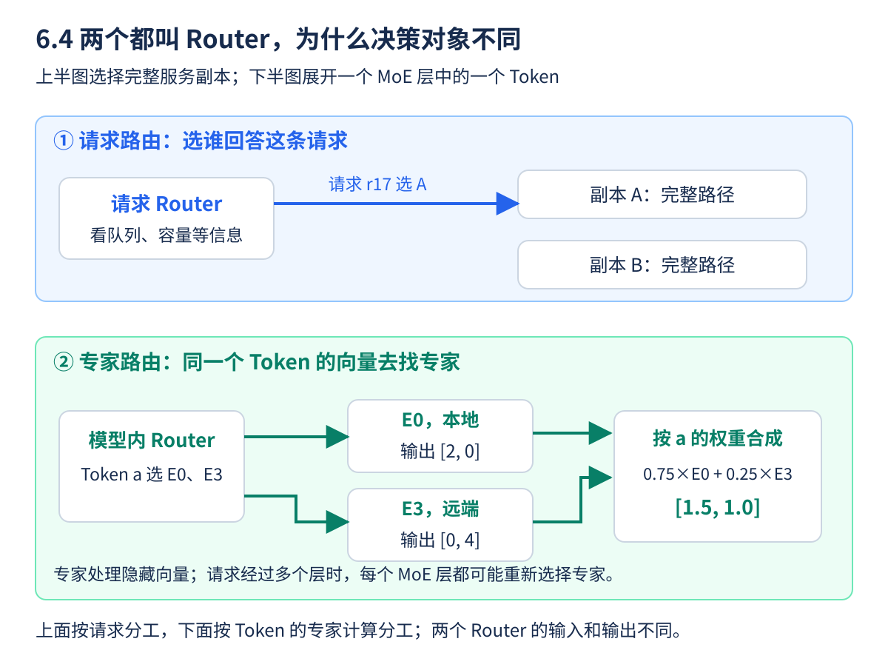

模型已经能在一张 GPU 上运行，但同时来的请求越来越多。增加第二份完整模型后，入口要决定每条请求交给谁；这属于 DP 的请求分配。另一种问题发生在 MoE 模型内部：一个 Token 选择的专家在不同 GPU 上，需要把隐藏向量送过去，再把专家结果取回；这属于 EP 的专家计算。

本节先讨论完整副本如何分流，再跟踪一个 Token 的 Top-2 专家路径。两个地方都可能出现 Router，但**请求 Router 选服务副本，模型 Router 选专家**。理解这两个层次以后，才能解释队列、前缀缓存、DP+EP 分组和专家热点分别影响哪里。

<!-- more -->

## 📑 目录

- [1. Dense DP：不同请求交给不同副本](#1-dense-dp不同请求交给不同副本)
  - [1.1 “完整副本”不一定只占一张 GPU](#11-完整副本不一定只占一张-gpu)
  - [1.2 DP 主要扩展什么，不扩展什么](#12-dp-主要扩展什么不扩展什么)
  - [1.3 读懂 DP 的配置边界](#13-读懂-dp-的配置边界)
- [2. 轮询为什么还会分配不均](#2-轮询为什么还会分配不均)
  - [2.1 先讲清楚：谁在选，依据什么选](#21-先讲清楚谁在选依据什么选)
  - [2.2 轮询与最少连接，并不是同一种依据](#22-轮询与最少连接并不是同一种依据)
  - [2.3 Running / Waiting：从入口看到引擎内部的队伍](#23-running--waiting从入口看到引擎内部的队伍)
  - [2.4 Token 与 KV：队伍里装的究竟是什么工作](#24-token-与-kv队伍里装的究竟是什么工作)
  - [2.5 前缀命中：哪个副本可以少算一段输入](#25-前缀命中哪个副本可以少算一段输入)
  - [2.6 把这些信息放在一起理解](#26-把这些信息放在一起理解)
  - [2.7 做一次信息不完整的路由判断](#27-做一次信息不完整的路由判断)
- [3. MoE：总参数与激活参数要分开算](#3-moe总参数与激活参数要分开算)
  - [3.1 专家不是一个完整的聊天模型](#31-专家不是一个完整的聊天模型)
  - [3.2 跟踪一个 Token 的来回路径](#32-跟踪一个-token-的来回路径)
  - [3.3 总权重与本轮工作量各算一笔账](#33-总权重与本轮工作量各算一笔账)
- [4. DP+EP 的 Rank 到底怎样组合](#4-dpep-的-rank-到底怎样组合)
  - [4.1 用同一批八个 Rank 画两张分组图](#41-用同一批八个-rank-画两张分组图)
  - [4.2 没有请求为什么还要配合](#42-没有请求为什么还要配合)
- [5. 专家热点与通信账本](#5-专家热点与通信账本)
  - [5.1 通信发送的是什么](#51-通信发送的是什么)
  - [5.2 一个专家热和一张卡热有什么区别](#52-一个专家热和一张卡热有什么区别)
- [6. 动手观察：同样 Token 总数，热点代价不同](#6-动手观察同样-token-总数热点代价不同)
  - [6.1 怎么读输出](#61-怎么读输出)
- [7. EPLB 与通信后端的选择](#7-eplb-与通信后端的选择)
  - [7.1 三类开关解决三个不同的问题](#71-三类开关解决三个不同的问题)
  - [7.2 新手应该按什么顺序尝试](#72-新手应该按什么顺序尝试)
- [总结](#-总结)
- [自我检验清单](#-自我检验清单)
- [参考资料](#-参考资料)

---

## 1. Dense DP：不同请求交给不同副本

最直接的 Dense DP 是运行多个完整引擎，每个引擎有自己的权重、调度队列和 KV Cache，再由入口分发请求。副本内部也可以使用 TP/PP。

理想情况下，$d$ 个相同副本的容量可接近单副本的 $d$ 倍，但需要流量足够、请求分配均衡，且入口没有成为瓶颈。DP 通常不会缩短某一条请求在一个副本中的计算路径。

两卡、模型单卡装得下时，vLLM v0.19.0 的内部负载均衡入口可以写为：

```bash
CUDA_VISIBLE_DEVICES=0,1 vllm serve Qwen/Qwen2.5-7B-Instruct \
  --dtype half --data-parallel-size 2 --tensor-parallel-size 1 \
  --max-model-len 4096 --served-model-name dp-demo
```

这里 `--max-num-seqs` 等容量约束要按 DP Rank 理解。两个副本允许的总活跃请求数可能比单引擎更多，比较时既要报告单 Rank 参数，也要报告整体并发。

### 1.1 “完整副本”不一定只占一张 GPU

Dense 指这里讨论的普通稠密模型，即一次前向会使用对应层的完整计算路径。假设模型能装入一张卡，DP=2 可以在两卡上各放一份模型；如果每份必须用两卡 TP 才能装下，那么 DP=2、TP=2 总共需要四卡。

每条请求进入某个副本后，由这个副本完成 Prefill、保存本请求的 KV，并逐步执行 Decode。副本 A 拥有的会话 KV，不会因为副本 B 加载了相同权重，就自动出现在 B 的显存里。

可以在外部运行多个 API 服务，再用 Router 分发；也可以使用 vLLM 内部 DP 的统一入口。对用户而言都可能只看到一个服务地址，但进程组织、状态上报与故障处理并不相同，不能把外部多进程和内部 DP 的启动命令混用。

### 1.2 DP 主要扩展什么，不扩展什么

假设一个副本在某种固定请求负载下能稳定服务 10 请求/秒，两份副本在足够流量、均衡分配且入口资源充足时，理想上有机会接近 20 请求/秒。这是教学假设，不是模型实测。

一条请求依然只在选中的副本中计算，因此不会因为有两个窗口，就把原本 100 ms 的计算自动变成 50 ms。如果原来主要在排队，新增副本减少等待后，用户延迟可能改善；这与把同一条请求的矩阵交给两卡共同计算，是不同来源的收益。

显存也要分别算：两份完整权重会在整个集群占用两倍存储，DP 不会把单副本的权重切半。如果单卡根本装不下模型，直接把 DP 从 1 改成 2 仍然不能解决这个问题。

### 1.3 读懂 DP 的配置边界

上面的 `--data-parallel-size 2` 是两份模型副本，`--tensor-parallel-size 1` 表示每份不使用 TP，`--served-model-name dp-demo` 是客户端请求里使用的模型别名。

若每个 DP Rank 配置 `--max-num-seqs 16`，两 Rank 的理论活跃序列上限合计可达到 32，但实际仍受 KV、调度和工作负载约束。假如客户端总共只并发 8 条请求，就不会因为上限写成 32 而自动产生更多工作。比较单副本与 DP 时，应同时记录这些上限与真实发送的全局并发。

## 2. 轮询为什么还会分配不均

同样一条请求，可能是“你好”，也可能是八千 Token 输入加两千 Token 输出。只数请求数量，就像把一封信和一个集装箱都记为“一件”。

### 2.1 先讲清楚：谁在选，依据什么选

假设服务后面有两个模型副本 A、B。新请求到达时，入口需要决定“交给 A，还是交给 B”。这个**把请求分配给某个副本的动作**叫请求路由；做决定的组件可以是外部负载均衡器，也可以是引擎服务内部的分发模块。

这里讨论的是 **DP 的请求级路由**。后面 MoE 的 Router 则在模型内部决定“这个 Token 去哪些专家”，两者的决策对象不同。

为了理解一种请求分配方案，要分别问三件事：

- **分配规则是什么？** 例如轮流选 A、B，或者优先选排队较少的副本。这回答“怎么选”。
- **参考的信息是什么？** 例如未完成请求数、等待队列长度、可分配的 KV Block。这些可供决策参考的数据，就是这里说的**路由信号**，回答“根据什么选”。
- **还有哪些重要情况不知道？** 例如看到某副本只有一个请求，却不知道它正在处理超长输入。这就是该信息的**局限，也叫盲区**，回答“单凭这些数据，还不能判断什么”。

“能看到什么”因此不是指用户在页面上看到什么，而是指**分发模块获取了哪些信息，能据此判断哪些负载情况**。信号还可能更新不及时，所以它反映的是观测到的状态，不是未来耗时的保证。

### 2.2 轮询与最少连接，并不是同一种依据

**轮询**（Round Robin）就像两个窗口轮流叫号：第一个请求给 A，第二个给 B，第三个再给 A。它通常只需要记住“下一个轮到谁”，不必查询副本当前有多忙。

假设四个请求几乎同时到达，暂时忽略它们完成时间的差异：

| 到达顺序 | 输入长度 | 完成后观察到的输出长度 | 轮询分配 |
|---|---|---|---|
| 请求 1：长文分析 | 8000 Token | 2000 Token | A |
| 请求 2：简短问候 | 32 Token | 16 Token | B |
| 请求 3：长文分析 | 8000 Token | 2000 Token | A |
| 请求 4：简短问候 | 32 Token | 16 Token | B |

两边都收到两个请求，数量很均匀，但 A 要处理的输入和生成工作明显更多。表中的输出长度是为了说明差异而假设的完成后结果，**分发时通常还不知道实际会生成多少 Token**。

**最少连接**（Least Connections）则会查询当前连接数，偏向连接更少的副本，比纯轮询多了一项观测。但连接并不等于计算工作量：流式长输出可能长期占着连接，Keep-alive 连接也可能在复用或空闲，协议还可能允许一条连接承载多个请求。

如果实现统计的是“未完成请求数”而非 TCP 连接数，就应按这个实际含义理解。即使一条连接恰好对应一个请求，也仍然不知道请求有多长、处在哪个阶段。

📌 **关键点**：轮询主要让分配次数接近；最少连接主要让连接数量接近。二者都不能直接保证计算量、缓存占用或等待时间接近。

### 2.3 Running / Waiting：从入口看到引擎内部的队伍

只在入口数连接，不一定知道请求进入引擎后发生了什么。进一步观察引擎，可以把状态粗略分为：

- **Running**：已进入活跃调度、正在逐步推进的请求；可能处于 Prefill 或 Decode，不表示每条请求此刻都独占 GPU 计算。
- **Waiting**：还在等待被调度的请求；可能因为前面有工作，也可能受到 KV 或其他资源限制。具体状态划分以引擎版本为准。

例如某一时刻：

| 副本 | Running | Waiting | 对新请求意味着什么 |
|---|---|---|---|
| A | 1 | 6 | 虽然活跃请求少，但已有六条请求在等 |
| B | 4 | 0 | 活跃请求较多，但当前没有等待队列 |

如果只看 Running，容易把 A 当成更空闲的副本；结合 Waiting，就会发现它并非“没事做”。但这仍不能仅凭表格保证 B 一定更快：六条短请求与一条长请求的成本可能差很多，调度还会把不同请求组批执行。

因此，**队列长度能帮助判断拥挤程度，却不能直接换算成毫秒等待时间**。同样是 Waiting=4，四条短输入和四条超长输入，未来占用的时间可能不同。

### 2.4 Token 与 KV：队伍里装的究竟是什么工作

再细一层，就不能把每条请求都当成一样大。这里要区分两类信息：

| 信息 | 具体在看什么 | 主要帮助判断 |
|---|---|---|
| Token 工作量 | 新请求有多少输入 Token、已有请求还有多少输入待算、预计还会生成多少输出 | 后续 Prefill 与 Decode 工作可能有多重 |
| KV 可用预算 | 活跃请求持有多少不可回收的 KV、还有多少 Block 可分配或回收 | 新请求能否放入，以及是否接近抢占或容量上限 |

输入在完成 Tokenization 后可以得到准确 Token 数；输出长度通常只能预测，或使用用户给出的 `max_tokens` 上限。**上限为 2000 不等于一定生成 2000**，也不意味着引擎一定一开始就为所有未来 Token 预留完缓存。

这些信息能解释“同样四个活跃请求，为什么一个副本更吃紧”：一边可能主要是短上下文，另一边已经积累了大量长上下文 KV。反过来，可用 KV 多也不代表计算空闲，该副本仍可能正在处理昂贵的 Prefill。

这里的 KV 预算应来自引擎的缓存状态。vLLM 可能预分配缓存池，所以 `nvidia-smi` 看到的已用显存差不多，不代表两个副本剩余的请求承载能力一样。

这一层的局限是：**Token 数不等于耗时，缓存余量也不等于算力余量**。Prefill/Decode、上下文长度、批次形状都会影响每个 Token 的成本，未知输出和统计延迟又会带来预测误差。

### 2.5 前缀命中：哪个副本可以少算一段输入

前缀缓存让新请求复用已经计算过的、相同 Token 前缀对应的 KV。例如两个请求都以同一份长文档开头，只在结尾追加不同问题，保留该前缀缓存的副本就有机会跳过重复输入的计算。

这里需要满足缓存已开启、精确 Token 前缀及相关模型配置兼容、KV 仍被保留等条件。**“会话编号相同”或“主题相似”本身不保证命中**。两个独立副本默认也不会因为模型相同，就自动共享对方的物理 KV。

所以 Router 可以进一步询问：“A、B 分别能复用这条请求的多少前缀？”但命中多也未必应选。下面的时间全部是假设值，只为演示决策；为了突出关系，暂时省略两边相同的其他首字开销：

| 副本 | 前缀情况 | 预计排队 | 未命中部分的 Prefill 耗时 | 两项合计 |
|---|---|---|---|---|
| A | 能命中大段前缀 | 150 ms | 20 ms | 170 ms |
| B | 没有可复用前缀 | 10 ms | 80 ms | 90 ms |

A 少算了输入，却要等更久；在这组假设下，新请求交给 B 反而更早完成这两项工作。如果 A 的排队降到 20 ms，其合计变为 40 ms，命中优势才更值得利用。

这就是“过度亲和可能形成热点”的含义：**一直把拥有相同前缀的请求送到 A，会让 A 越来越拥挤，甚至抵消缓存复用节省的计算时间。** 缓存亲和是倾向复用已有状态，不是无条件固定选择同一个副本。

第 6.6 节的基础性能对照关闭了前缀缓存，是为了控制变量；要研究缓存感知路由，应在可比较的副本上统一启用并记录命中。前缀复用主要减少 Prefill，也不能直接省掉后续新 Token 的 Decode 工作。

### 2.6 把这些信息放在一起理解

现在再看几种分配方式，先分清规则，再看它利用的数据：

| 分配方式 | 参考哪些信息 | 因此能判断什么 | 单靠它仍无法确定什么 |
|---|---|---|---|
| 轮询 | 下一个轮到哪个副本 | 分配顺序和次数 | 副本此刻是否忙、请求有多重 |
| 最少连接 / 未完成请求最少 | 实际定义的连接数或未完成请求数 | 哪边连接或请求较少 | 每条请求的长度、阶段与剩余工作 |
| 根据引擎队列分配 | Running、Waiting 等状态 | 哪边活跃或排队更拥挤 | 每条请求的真实服务成本 |
| 考虑 Token/KV 的分配 | 输入工作量、输出估计、可用 KV | 哪边可能更吃算力或缓存容量 | 未来输出、批处理效率与准确等待时间 |
| 考虑前缀缓存的分配 | 可复用的相同前缀及其缓存位置 | 哪边可能少算重复 Prefill | 排队成本是否已经超过复用收益 |

一种更完整的思路是：先排除不可用或模型配置不兼容的副本，检查容量约束，再综合预计排队、未命中输入计算和缓存复用机会，按服务目标选择。它仍需要处理信息过期和预测误差，不存在一列指标就能准确读出的“这条请求还要等几毫秒”。

🔑 **实现边界**：以上介绍的是可用于路由设计的不同信息，不表示 vLLM 默认已经把它们全部综合起来。[vLLM v0.19.0 的文档](https://github.com/vllm-project/vllm/blob/v0.19.0/docs/serving/data_parallel_deployment.md)明确说明，其内部 DP 负载均衡基于各引擎的 Running/Waiting 队列；缓存感知逻辑是进一步改进的方向。外部 Router 或其他版本采用什么策略，需要分别确认。

### 2.7 做一次信息不完整的路由判断

假设新请求到达时，A 有一条活跃请求、B 有三条活跃请求，两边都没有 Waiting。如果只比较活跃数量，会偏向 A。但接着发现 A 正在处理超长输入，B 的三条请求都是短输出、即将结束，就应该意识到“请求少”并不充分代表“新请求更快”。

再问两件事：A、B 是否还有足够 KV 接纳新请求？新请求的长前缀在哪边能够复用？即使补齐这些信息，也还需要估计服务时间，处理状态更新延迟。因此新手练习时，不必强行为这组不完整信息给出一个必然正确的副本；应先说清楚**当前规则会选谁，以及还缺什么信息**。

学习路由的目的不是背一张“某指标越小越好”的表，而是知道某个决策可能因为什么失准。实际优化时，再用相同业务请求比较排队、缓存命中、失败与尾延迟，验证新增信号有没有带来收益。

## 3. MoE：总参数与激活参数要分开算

MoE 每个 Token 通常只选择少数专家参与计算，所以单 Token 激活参数可以少于总参数。**未被当前 Token 选中的专家仍要存放，不能用激活参数代替权重容量。** 共享专家、Attention、Router 和其他 Dense 层也要单独核算。

EP 将专家分配到不同 Rank。一次专家层大致经历：


Dispatch/Combine 常被概括为 All-to-All，但实际后端可能使用 AllGather/ReduceScatter 或专用稀疏通信。不能只从论文术语推断实际 NCCL 调用了哪个原语。

### 3.1 专家不是一个完整的聊天模型

常见 MoE Transformer 会把某些层中的前馈网络替换为多个专家网络。它们处理 Token 的隐藏向量；Attention 等结构仍在模型其他部分执行。Router 是模型内部的一个选择模块，根据当前 Token 的表示计算专家分数。

Top-2 表示一个 Token 选两个专家。它不表示“一个请求只交给某一位专家直到回答结束”，也不表示每个 Token 永远选择相同专家。不同 Token、不同 MoE 层都可能有不同选择。

### 3.2 跟踪一个 Token 的来回路径

假设专家 E0、E1 在卡 0，E2、E3 在卡 1；Token a 由卡 0 上的 Attention 计算产生，Router 为它选择 E0 和 E3，对应权重 0.75、0.25：

1. **选择**：记下 a 的来源位置、所选专家及组合权重。
2. **发送**：E0 可以本地处理；E3 需要收到发送到卡 1 的 a 的隐藏向量。
3. **计算**：两个专家分别对收到的向量执行自己的前馈网络。
4. **返回与合成**：把两个专家的结果送回对应位置，按路由权重合成，继续后续层。

若另一个 Token b 选择 E1、E2，通信实现可能把发往同一卡的 Token 打包一起传。接收顺序因而不一定与原序列顺序相同，Combine 必须依据路由元数据恢复对应关系。

下面用两个假设专家输出演示加权合成，不模拟神经网络和通信：

```python
expert_0_output = [2.0, 0.0]
expert_3_output = [0.0, 4.0]
weights = [0.75, 0.25]
combined = [weights[0] * x + weights[1] * y
            for x, y in zip(expert_0_output, expert_3_output)]
print(combined)
assert combined == [1.5, 1.0]
```

这里是对**同一个 Token 的不同专家输出**求加权和，不是把不同 Token 的结果相加。



把图里的两个决策分开记录，会更容易跟踪真实服务。入口的记录是“请求 r17 分给副本 A”；进入某个 MoE 层以后，记录变成“r17 中 Token a 选 E0、E3，权重分别为 0.75、0.25”。整条请求包含许多 Token，并会经过多个层，所以后一种决策会反复发生，不能用一个会话的副本选择代替它。

图中 E0、E3 接收的是同一个隐藏向量，并非两位专家各自阅读原始聊天文本。返回的两个向量仍对应 a 的相同输出位置，才可以按图中的权重逐项加和。若派发时把多个 Token 重新排序或按目的 Rank 打包，回收结果还需要来源位置等元数据，才能交回正确 Token。

**练习与答案**：a 选择两个专家，是否必须占两张卡？不一定，两位专家可以同在一张卡；是否发生跨卡传输取决于专家位置。选择了两个专家也不等于新增两份完整模型，其他 Attention 与共享结构仍按该部署的分组执行。先数逻辑专家，再看物理映射，才不会把 Top-k、EP 和 GPU 数混为一个数字。

### 3.3 总权重与本轮工作量各算一笔账

假设共有 8 个专家，每个专家权重占 1 GiB，其他共享结构占 2 GiB。总权重就是 10 GiB；Top-2 下，一个 Token 走过的共享结构与所选专家涉及约 4 GiB 权重。但未被这个 Token 选中的另外六个专家，仍须在服务所使用的设备中保存，以便处理其他 Token。

这是简化的容量例子，不把权重字节数直接等同于 FLOPs 或实际显存峰值。KV、激活、通信缓冲和可能的冗余专家仍要额外计算。EP 的作用是把专家分散存放与执行，让每卡承担其中一部分。

## 4. DP+EP 的 Rank 到底怎样组合

按 vLLM v0.19.0 的组织，启用 `--enable-expert-parallel` 后，专家层的 EP 组大小为 TP×DP；Attention 层仍按每个 DP 组内的 TP 规则处理。

例如 TP=2、DP=4，总计八卡：Attention 是四组两卡 TP；专家层可跨八个 Rank 分布。它不是“八卡乘 EP=8，再要六十四卡”。本例不加入 PP；其他组合先查模型与版本支持。

更重要的是，MoE 的这些 DP Rank 可能仍须对齐前向、一起参与专家通信。某个 Rank 没有真实请求时也可能需要空前向来协同。不能把它们当成可随意独立启停的 Dense 副本。

### 4.1 用同一批八个 Rank 画两张分组图

为了读图，暂把八个进程编号为 R0～R7；实际日志中的编号以框架为准：

| 所在 DP Rank | Attention 的 TP 组 | 专家层的参与范围 |
|--------------|-------------------|------------------|
| DP 0 | R0、R1 | 与下列各组一起组成八 Rank EP 组 |
| DP 1 | R2、R3 | 同上 |
| DP 2 | R4、R5 | 同上 |
| DP 3 | R6、R7 | 同上 |

进入 Attention 时，四组分别处理各自请求；进入对应 MoE 专家层时，这八个 Rank 可以向彼此持有的专家派发 Token。同一批硬件在不同层采用不同的协作范围，因此 EP 大小不是额外再乘一次 GPU 数。

### 4.2 没有请求为什么还要配合

集体通信需要约定好的参与方按兼容的顺序进入。如果某个 DP Rank 暂时没真实请求就直接跳过，而其他 Rank 仍在等待它参与专家通信，就可能无法推进。所以实现需要协调空闲 Rank，必要时执行不服务真实用户的空前向。

“请求分给不同 DP Rank”与“设备完全独立”是两回事。Dense 副本通常没有这一专家通信依赖；MoE 的 DP+EP 则要把故障、弹性伸缩和调度当作协作组的问题考虑。

## 5. 专家热点与通信账本

假设一次专家层共处理 $T$ 个 Token，每个选择 $k$ 个专家，隐藏维度 $H$、元素字节数 $b$。只看一次 Dispatch 的未压缩载荷量级：

$$
S_{\text{dispatch}}\sim T k H b
$$

Combine 也要回传结果。真实跨网卡字节数取决于本地命中、Token 复制、通信压缩、共享专家与后端实现，不能直接把这个量级当成全部网络流量。

把专家接收的 Token 数记为 $c_e$，一个简单均衡指标是：

$$
\text{Balancedness}=\frac{\operatorname{mean}(c_e)}{\max(c_e)}
$$

即便平均负载不高，最热专家或最忙 Rank 也可能拖住同步组。分析时应同时看专家计数、Rank 汇总和链路排队。

### 5.1 通信发送的是什么

正常专家层派发传的是 Token 隐藏向量和专家编号、位置、权重等路由信息，不是每次把整个专家权重搬到请求所在 GPU。权重预先驻留在专家所在的设备，Token 去找权重。

若 $T=100$、Top-2、$H=1024$、每元素 2 字节，所有专家输入分配的未压缩载荷量级是 $100\times2\times1024\times2=409600$ 字节，约 0.39 MiB。若部分专家在本地，这些分配并不都经过网卡；Combine 还有输出回传，另有元数据和后端开销。

因此 Top-2 会让专家分配次数达到原 Token 数的两倍，但不能据此断言实际跨网卡字节数一定是某个固定值。

### 5.2 一个专家热和一张卡热有什么区别

一个专家收到很多 Token，会形成专家热点；一张卡持有的几个专家加起来很忙，则形成 Rank 热点。前者是模型路由造成的分布，后者还受专家如何映射到设备影响。

例如四个专家的计数为 `[40, 40, 10, 10]`。把两个 40 放在同一卡，会形成 80 对 20；改成每卡一个 40 加一个 10，则变成 50 对 50。专家自身的计数没有变化，但设备负载改善了。若某个单一专家就占了绝大多数工作，只重新摆放、不增加对应处理能力，仍可能受这个热点限制。

## 6. 动手观察：同样 Token 总数，热点代价不同

```python
def balancedness(counts):
    assert counts and all(c >= 0 for c in counts)
    return 1.0 if max(counts) == 0 else sum(counts) / len(counts) / max(counts)

even = [25, 25, 25, 25]
skew = [70, 10, 10, 10]
print("均匀:", balancedness(even), "偏斜:", balancedness(skew))
assert sum(even) == sum(skew)
assert balancedness(skew) < balancedness(even)

# 假设两张卡，分别持有两个专家。
rank_load = [sum(skew[:2]), sum(skew[2:])]
print("每 Rank Token 数:", rank_load)
assert rank_load == [80, 20]
```

这是计数模型，不含专家批次的非线性效率。真实服务还要观察热点是否持续，避免为了短暂波动频繁搬移专家。

### 6.1 怎么读输出

均匀分布的指标是 1；偏斜分布的平均计数是 25、最大计数是 70，所以指标约为 0.357。这个数越低，说明平均值与最大值差得越远，但它不是 GPU 利用率，也不是吞吐下降的直接比例。

这里的计数是一次窗口内的**专家分配次数**。Top-2 下，同一个原始 Token 可以在两个专家的计数里各出现一次。程序把两张卡的计数汇总为 `[80, 20]`，帮助我们从专家级别继续观察设备级别。

全零时返回 1.0 是代码为了避免除零设置的约定，含义是“没有可比较的不均衡工作”，不能理解成设备满负载。可以将偏斜数据改成 `[40, 40, 10, 10]`，分别按相邻配对和冷热配对汇总，验证上一节的例子。

## 7. EPLB 与通信后端的选择

EPLB 可以调整专家映射，并通过冗余专家改善热点。它有额外权重存储和迁移成本，省下的执行时间必须大于这些代价。不要把“打开负载均衡”理解为免费消除所有不均衡。

在已有兼容 MoE checkpoint、足够显存与依赖的前提下，一个两卡示意入口为：

```bash
CUDA_VISIBLE_DEVICES=0,1 vllm serve /models/moe-checkpoint \
  --tensor-parallel-size 1 --data-parallel-size 2 \
  --enable-expert-parallel --all2all-backend allgather_reducescatter
```

这里的本地路径是占位符，不代表任意 MoE 都能用两卡装下。先跑目标版本的通用可行路径，再比较 DeepEP 等后端的依赖、硬件要求和场景；Prefill 偏吞吐、Decode 偏延迟，不能只按名字选一个后端覆盖全部请求。

### 7.1 三类开关解决三个不同的问题

| 配置或机制 | 决定什么 | 不应混淆的地方 |
|------------|----------|----------------|
| `--enable-expert-parallel` | 让专家按 EP 方式分布 | 不等于自动消除专家热点 |
| `--all2all-backend` | 用哪条通信实现搬运专家输入输出 | 不负责改变模型选择哪个逻辑专家 |
| EPLB | 根据负载调整逻辑专家到物理位置的映射等 | 不是重新训练 Router，也有额外成本 |

逻辑专家指模型中的 E0、E1 等；物理位置指它们的权重实际放在哪个 Rank。冗余专家相当于为同一个逻辑专家保存额外的物理副本，用更多显存换取分摊机会；它不是新训练出一位能力不同的专家。具体是否启用、冗余数量和调整策略都需要按目标版本配置。

### 7.2 新手应该按什么顺序尝试

先检查模型架构、精度、GPU 数与显存，再用兼容的 EP 路径跑通短请求；然后记录专家计数、每 Rank 负载、通信时间和用户延迟。只有观察到持续热点，才进一步比较 EPLB 以及其他通信后端，并将额外显存纳入账本。

如果更换后端后服务启动失败，应先核对对应软件依赖、GPU 架构和网络要求；如果启动成功但变慢，则用相同 Prefill/Decode 负载重新比较。普通随机文本可以测试服务流程，却未必重现真实业务的专家分布，不能只靠一组均匀流量宣布热点已经解决。

## 📝 总结

- Dense DP 复制引擎分请求，容量扩展依赖负载均衡。
- 请求分配要区分规则与观测信息；数量、Token、KV 和前缀命中分别反映不同部分的负载。
- MoE 的激活参数少，不代表所有专家权重都不用存。
- EP 在专家层路由 Token，通信与热点共同影响同步步长。
- DP+EP 中的 DP Rank 不一定完全独立，EPLB 也有显存与迁移成本。

## 🎯 自我检验清单

- 能区分单副本延迟与 DP 总吞吐
- 能解释请求数均衡为何不等于工作量均衡
- 能区分分配规则、路由信号与这些信息的局限
- 能用排队与 Prefill 耗时解释“前缀命中更多，却不一定更快”
- 能画出 TP=2、DP=4 时的 Attention 组与专家组
- 能说明 MoE 空闲 Rank 为什么仍可能参与同步
- 能用专家分布、Rank 负载和网络信息定位热点
- 能跟踪同一个 Token 的 Top-2 派发、专家计算与加权返回
- 能分别说明 EP、通信后端与 EPLB 解决的问题

## 📚 参考资料

- [vLLM v0.19.0 — Data Parallel Deployment](https://github.com/vllm-project/vllm/blob/v0.19.0/docs/serving/data_parallel_deployment.md)
- [vLLM v0.19.0 — Automatic Prefix Caching](https://github.com/vllm-project/vllm/blob/v0.19.0/docs/features/automatic_prefix_caching.md)
- [vLLM v0.19.0 — Expert Parallel Deployment](https://github.com/vllm-project/vllm/blob/v0.19.0/docs/serving/expert_parallel_deployment.md)
- [DeepEP 官方实现](https://github.com/deepseek-ai/DeepEP)

---

[返回本章](https://caomaolufei.github.io/AIInfraGuide/inference/模块四-推理优化/第6章-分布式推理/) · [上一节](https://caomaolufei.github.io/AIInfraGuide/inference/模块四-推理优化/第6章-分布式推理/63-流水线并行推理/) · [下一节](https://caomaolufei.github.io/AIInfraGuide/inference/模块四-推理优化/第6章-分布式推理/65-多节点部署与ray/)
