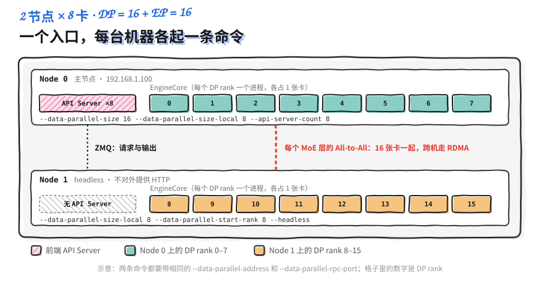

前几节算清了该怎么切：TP 留在节点内，跨节点交给 PP；MoE 用注意力 DP + 专家 EP。本节解决下一个问题：两台、四台机器上的 GPU 怎么组成一个 vLLM 服务。

vLLM 的多节点部署有两种运行时。Ray 先把各台机器拉成一个集群，之后只在一个节点上执行 `vllm serve`；多进程（`mp`）模式不需要集群，每台机器各执行一条带 `--node-rank` 的命令。MoE 的 DP + EP 部署又有一套自己的参数。不管用哪种，网络都要配对，否则跨机通信会退回 TCP Socket，前面的切分设计都会被它拖慢。

> ⏰ **信息时效**：vLLM 相关的参数、默认值与日志基于 v0.32.0（2026-10-18 发布）的文档与源码，包括 `docs/serving/parallelism_scaling.md`、`data_parallel_deployment.md`、`expert_parallel_deployment.md` 和 `examples/ray_serving/run_cluster.sh`。

<!-- more -->

## 📑 目录

- [1. 上线前的准备：环境一致，网络可信](#1-上线前的准备环境一致网络可信)
- [2. 两种运行时：Ray 与多进程](#2-两种运行时ray-与多进程)
- [3. 用 Ray 部署 TP×PP](#3-用-ray-部署-tppp)
- [4. 用多进程部署 TP×PP](#4-用多进程部署-tppp)
- [5. MoE 的多节点 DP + EP](#5-moe-的多节点-dp--ep)
- [6. 网络配置：让 NCCL 走 InfiniBand](#6-网络配置让-nccl-走-infiniband)
- [7. 排错清单](#7-排错清单)
- [总结](#-总结)
- [自我检验清单](#-自我检验清单)
- [参考资料](#-参考资料)

---

## 1. 上线前的准备：环境一致，网络可信

### 1.1 每个节点的环境要一模一样

多节点部署时，各节点上的进程会加载同一个模型、执行同一套代码。vLLM 文档的要求是：每个节点的执行环境必须一致，包括模型路径和 Python 包版本。最省事的办法是所有节点用同一个容器镜像（如 `vllm/vllm-openai`），把主机之间的差异挡在容器外面。

模型最好提前下载。可以在每个节点的相同路径下各放一份，也可以放在所有节点都能访问的分布式文件系统上，启动时传本地路径而不是 Hugging Face 仓库名。如果一定要在线下载，需要给每个节点传 `HF_TOKEN`。

⚠️ **注意**：放在网络文件系统上的大模型加载可能很慢。vLLM 的排错文档建议尽量放本地盘，并留意加载时的 CPU 内存占用，内存不够时系统频繁换页，看起来就像卡住了。

### 1.2 节点间的网络必须是私网

多节点时，vLLM 进程之间的控制流量不加密，交换数据用的序列化格式一旦被攻击者接入，可以被利用来执行任意代码。vLLM 文档对此有明确警告：用于节点间通信的地址（`VLLM_HOST_IP`）要设在私有网段上，确保不可信的一方无法访问这个网络。

📌 **关键点**：不要把 Ray 的端口或 DP 的 RPC 端口暴露到公网，对外只开放 API Server 的 HTTP 端口，并在前面加上鉴权。

---

## 2. 两种运行时：Ray 与多进程

vLLM 用 `--distributed-executor-backend` 选择运行时，常用的是 `mp` 和 `ray`：

| 📊 | Ray | 多进程（`mp`） |
|---|---|---|
| 准备工作 | 先在各节点拉起 Ray 集群 | 不需要额外组件 |
| 启动 `vllm serve` | 只在一个节点上执行一次 | 每个节点各执行一次 |
| 节点身份 | Ray 按资源自动分配 | `--nnodes`、`--node-rank` 手动指定 |
| 额外依赖 | `pip install "ray[cgraph]"` | 无 |
| 附带能力 | Ray 自带的可观测工具；可接入 Ray Serve / Ray Data | 无 |

vLLM 文档的说法是"多节点默认用 Ray、单节点默认用多进程"。v0.32.0 源码里的实际逻辑更具体，不传 `--distributed-executor-backend` 时：

- 设置了 `--nnodes > 1`，用 `mp`。
- 否则，如果单个副本的 world size（TP × PP）超过本机 GPU 数，直接报错，提示二选一：用 Ray 就设 `--distributed-executor-backend ray`，用多进程就设 `--nnodes`。
- 本机装得下时，设置了 `--data-parallel-backend ray` 或者已经处在 Ray Placement Group 里，用 `ray`；其余情况用 `mp`。

另外，`--nnodes > 1` 只能和 `mp` 搭配，和 `ray` 一起用会报错。

💡 **提示**：多节点部署时总是显式写出 `--distributed-executor-backend`，不要依赖默认值。启动日志里 `Defaulting to use ... for distributed inference` 这一行（DEBUG 级别）可以确认最终用了哪个。

---

## 3. 用 Ray 部署 TP×PP

### 3.1 拉起 Ray 集群

Ray 是一个把 Python 程序扩展到多台机器上的分布式计算框架。vLLM 用它管理跨节点的 Worker 进程，决定每个 Worker 跑在哪台机器的哪张卡上。

vLLM 仓库提供了一个辅助脚本 `examples/ray_serving/run_cluster.sh`，在每个节点上起一个容器并启动 Ray。选一台机器做 Head 节点：

```bash
# Head 节点
bash run_cluster.sh \
    vllm/vllm-openai \
    <HEAD_NODE_IP> \
    --head \
    /path/to/huggingface/home \
    -e VLLM_HOST_IP=<HEAD_NODE_IP>
```

其余每台机器作为 Worker 节点加入：

```bash
# 每个 Worker 节点，VLLM_HOST_IP 填本机的地址
bash run_cluster.sh \
    vllm/vllm-openai \
    <HEAD_NODE_IP> \
    --worker \
    /path/to/huggingface/home \
    -e VLLM_HOST_IP=<WORKER_NODE_IP>
```

脚本做了这几件事：

- 用 `docker run --network host --gpus all --shm-size 10.24g` 起容器，把第 4 个参数指定的目录挂到容器的 `/root/.cache/huggingface`，第 4 个参数之后的内容原样追加给 `docker run`。
- Head 节点执行 `ray start --block --head --node-ip-address=<HEAD_NODE_IP> --port=6379`，Worker 节点执行 `ray start --block --address=<HEAD_NODE_IP>:6379`，传了 `VLLM_HOST_IP` 时再加上 `--node-ip-address`。
- `--block` 让 Ray 停在前台，脚本退出时自动停止并删除容器。

所以执行这些命令的终端要一直开着。按脚本注释的说法，关掉任何一个，对应的 Ray 节点就会停止，整个集群也随之关闭。

集群起来以后，进入任意一个容器执行 `ray status` 和 `ray list nodes`，确认节点数和 GPU 数符合预期，并检查每个节点登记的 IP 是不是你给的 `VLLM_HOST_IP`。

💡 **提示**：额外的环境变量（如 `-e NCCL_SOCKET_IFNAME=eth0`）建议在这一步通过 `run_cluster.sh` 传入。vLLM 文档特别说明：在集群创建时设置的变量会传播到所有节点，而在某个 Shell 里 `export` 只影响本节点。需要用 Nsight 等工具读 GPU 性能计数器时，还要给 `docker run` 加 `--cap-add=CAP_SYS_ADMIN`。

在 Kubernetes 上也可以用 KubeRay 搭 Ray 集群，Ray 文档有 vLLM 的示例。

### 3.2 启动服务

Ray 集群运行后，整个集群的 GPU 对 vLLM 都可见，只需在**一个节点的容器内**执行一次 `vllm serve`。两台 8 卡机器，按 6.2 节的规则 TP 取每节点卡数、PP 取节点数：

```bash
# 在 Head 节点的容器内执行（docker exec -it <container_name> /bin/bash）
vllm serve /path/to/the/model/in/the/container \
    --tensor-parallel-size 8 \
    --pipeline-parallel-size 2 \
    --distributed-executor-backend ray
```

文档也给了 `--tensor-parallel-size 16` 的写法，把 16 张卡当成一个 TP 组。只有节点间带宽足够高时才值得这样做，6.3 节的成本模型算过它在普通 400 Gb/s 网络上的代价：并发 64 时 TPOT 约是 TP=8 × PP=2 的 1.9 倍。

### 3.3 Worker 怎么落到各张卡上

vLLM 向 Ray 申请一个 Placement Group：每个 Worker 一个 `{"GPU": 1}` 的资源块（bundle），共 TP × PP 个，放置策略是 `PACK`，即尽量往同一个节点里塞。v0.32.0 默认使用 `RayExecutorV2`（`VLLM_USE_RAY_V2_EXECUTOR_BACKEND=1`），不要求执行 `vllm serve` 的节点有空闲 GPU；把这个变量设为 0、切回旧的 `RayDistributedExecutor` 时，源码会强制第一个 bundle 落在执行 `vllm serve` 的节点上，这个节点至少要有一张空闲的 GPU。

拿到 bundle 后，vLLM 会检查每个节点分到的 bundle 数。某个节点分到的少于 TP 大小时，打印一条警告：TP 的 Worker 可能被分散到两个以上的节点上，除非节点间有 InfiniBand 这样的高速互联，否则性能会下降。

TP 组能正好落在一个节点内，靠的是 rank 的排列。vLLM 按 `ExternalDP × DP × PP × PCP × TP` 的顺序给所有 Worker 编号，TP 是最内层的维度，所以 rank 0–7 是 Stage 0 的 TP 组，rank 8–15 是 Stage 1 的 TP 组。Ray 执行器创建 Worker 后会按节点重新排序（执行命令的节点排在最前），再分配 rank，连续的 rank 就落在同一台机器上：

| 📊 rank | 节点 | PP Stage | TP rank |
|---|---|---|---|
| 0–7 | Head 节点 | 0 | 0–7 |
| 8–15 | Worker 节点 | 1 | 0–7 |

这正是 6.2 节示意图右半边的布局：AllReduce 都在机内 NVLink 上完成，节点之间只在段边界传一次激活。

---

## 4. 用多进程部署 TP×PP

不想维护 Ray 集群时，可以用多进程模式。同样是两台 8 卡机器、TP=8 × PP=2，在 Head 节点执行：

```bash
# Node 0（Head）
vllm serve /path/to/the/model/in/the/container \
    --tensor-parallel-size 8 --pipeline-parallel-size 2 \
    --nnodes 2 --node-rank 0 \
    --master-addr <HEAD_NODE_IP>
```

在另一个节点执行：

```bash
# Node 1
vllm serve /path/to/the/model/in/the/container \
    --tensor-parallel-size 8 --pipeline-parallel-size 2 \
    --nnodes 2 --node-rank 1 \
    --master-addr <HEAD_NODE_IP> --headless
```

几个参数的含义：

- `--nnodes`：节点总数。设置后 vLLM 自动选用 `mp`，不需要再写 `--distributed-executor-backend`。
- `--node-rank`：本节点的编号，从 0 开始。rank 布局和 Ray 模式相同，TP 在最内层，Node 0 承担 Stage 0。
- `--master-addr`：Head 节点的地址，所有节点填同一个。端口用 `--master-port` 指定，默认 29501，要保证所有节点都能访问。
- `--headless`：本节点只跑 Worker，不启动 API Server。请求统一从 Head 节点的 HTTP 端口进来。

两种运行时怎么选：

| 🎯 情况 | 选择 |
|---|---|
| 已经有 Ray 集群或 KubeRay，或者要用 Ray Serve 做上层编排 | Ray |
| 节点数少、不想引入新组件，由 Kubernetes 或 Slurm 负责拉起每个节点的进程 | 多进程 |

⚠️ **注意**：多进程模式下，各节点的命令除了 `--node-rank` 和 `--headless` 以外应该完全一致。所有节点加载的是同一个模型的不同分片，模型路径、并行度、`--max-model-len` 这类参数不一致会导致各节点对模型和显存的划分对不上。用同一份脚本、只替换节点编号，是最稳妥的做法。

---

## 5. MoE 的多节点 DP + EP

### 5.1 每台机器一条命令，各自声明自己的 rank

6.4 节讲过，DP + EP 部署里每个 DP rank 是一个独立的 EngineCore 进程。多节点时，每台机器要执行一条 `vllm serve`，说明这台机器上跑哪几个 DP rank。下面是 vLLM 文档里两台 8 卡机器部署 DeepSeek-V3-0324 的例子，每卡一个 DP rank，共 DP=16、EP=16：

```bash
# Node 0（主节点，192.168.1.100，负责接收请求）
vllm serve deepseek-ai/DeepSeek-V3-0324 \
    --all2all-backend deepep_low_latency \
    --tensor-parallel-size 1 \
    --enable-expert-parallel \
    --data-parallel-size 16 \
    --data-parallel-size-local 8 \
    --data-parallel-address 192.168.1.100 \
    --data-parallel-rpc-port 13345 \
    --api-server-count=8
```

```bash
# Node 1（headless，不启动 API Server）
vllm serve deepseek-ai/DeepSeek-V3-0324 \
    --all2all-backend deepep_low_latency \
    --tensor-parallel-size 1 \
    --enable-expert-parallel \
    --data-parallel-size 16 \
    --data-parallel-size-local 8 \
    --data-parallel-start-rank 8 \
    --data-parallel-address 192.168.1.100 \
    --data-parallel-rpc-port 13345 \
    --headless
```

下图是这两条命令拉起来的结构，青色和橙色的格子分别是两台机器上的 DP rank，红色虚线表示 MoE 层的 All-to-All 要 16 张卡一起完成：



| 📊 参数 | 含义 |
|---|---|
| `--data-parallel-size` | 全局 DP 大小，所有节点填同一个值 |
| `--data-parallel-size-local` | 本节点运行几个 DP rank |
| `--data-parallel-start-rank` | 本节点第一个 DP rank 的编号，等于前面所有节点的 local 数之和 |
| `--data-parallel-address` / `--data-parallel-rpc-port` | 主节点的地址和 RPC 端口，所有节点相同，端口要对所有节点可达 |
| `--headless` | 不启动 API Server，只运行 EngineCore |
| `--api-server-count` | 主节点上的 API Server 进程数，仍然对外暴露一个 HTTP 端口 |

几个要点：

- `--enable-expert-parallel` 要在**所有节点**上都加，EPLB 的参数也一样。
- DP 很大时，单个 API Server 进程会成为瓶颈，文档建议把 `--api-server-count` 加到和本地 rank 数相同。这种扩展只发生在主节点内部。v0.32.0 中不写这个参数时，内部负载均衡模式默认起 `--data-parallel-size` 个 API Server，Hybrid 模式下默认等于本地 rank 数。
- `--data-parallel-size-local` 可以是 0：主节点只跑 API Server，所有 EngineCore 放在其他节点上。
- DP Coordinator 进程和 DP rank 0 的引擎放在一起，负责 6.4 节说的空跑协调。

### 5.2 用 Ray 拉起 DP

加上 `--data-parallel-backend=ray` 后，只需在一个节点上执行一条命令，远端的 DP rank 由 Ray 按集群资源分配：

```bash
vllm serve $MODEL --data-parallel-size 4 --data-parallel-size-local 2 \
                  --data-parallel-backend=ray
```

这时不用写 `--data-parallel-address` 和 `--data-parallel-rpc-port`，执行命令的节点就是主节点。DP rank 在节点上的分布由环境变量 `VLLM_RAY_DP_PACK_STRATEGY` 控制：

| 📊 取值 | 行为 |
|---|---|
| `strict`（默认） | 每个选中的节点正好放 `--data-parallel-size-local` 个 DP rank |
| `fill` | 主节点放 `--data-parallel-size-local` 个，其他节点能放多少放多少 |
| `span` | 一个 DP rank 需要跨多个节点时使用，`--data-parallel-size-local` 被忽略 |

`span` 对应的是单个副本就装不下一台机器的情况，例如每个 DP rank 内部是 TP=8 × PP=2。

### 5.3 不用单一入口：Hybrid 与 External 负载均衡

上面的写法都只有一个 HTTP 入口。规模更大时，vLLM 还支持两种模式：

- **Hybrid**（`--data-parallel-hybrid-lb`）：每个节点都起自己的 API Server，只把请求分给本节点的 DP rank，前面再放一个外部负载均衡器。各节点仍要填全局的 `--data-parallel-size`，以及 `--data-parallel-size-local` 和 `--data-parallel-start-rank`。这种模式不能和 `--headless` 一起用。
- **External**（`--data-parallel-external-lb`）：每个 DP rank 都是一个独立的服务端点，用 `--data-parallel-rank` 指定编号，由外部路由器按各 rank 的实时状态分发请求。

⚠️ **注意**：vLLM 文档说明，External 模式的 DP 参数只支持 MoE 部署。Dense 模型的副本之间不需要同步，直接起多个不带 `--data-parallel-*` 参数的独立实例、前面放负载均衡器就行，6.4 节已经讲过。

---

## 6. 网络配置：让 NCCL 走 InfiniBand

### 6.1 InfiniBand 与 GPUDirect RDMA

跨节点的 TP、PP 和 EP 通信都由 NCCL 完成。节点间有 InfiniBand 时，要让容器能访问网卡。vLLM 文档的做法是给 `run_cluster.sh` 追加参数：

```bash
bash run_cluster.sh vllm/vllm-openai <HEAD_NODE_IP> --head /path/to/huggingface/home \
    -e VLLM_HOST_IP=<HEAD_NODE_IP> \
    --privileged -e NCCL_IB_HCA=mlx5
```

`NCCL_IB_HCA` 指定 NCCL 用哪些 RDMA 网卡。按 NCCL 文档，它默认按前缀匹配，`mlx5` 表示使用所有名字以 `mlx5` 开头的网卡的全部端口；要精确匹配某块卡，在前面加 `=`。具体要加哪些参数和集群的网络配置有关，需要和管理员确认。

GPUDirect RDMA 让网卡直接读写 GPU 显存，数据不用先拷到主机内存再发出去，延迟和 CPU 开销都更低。启用它需要两个条件：

- 容器有 `IPC_LOCK` 能力，用来锁定内存页、防止被换出到磁盘。
- 挂载 `/dev/shm`，给进程间通信提供共享内存。

Docker 的写法：

```bash
docker run --gpus all \
    --ipc=host \
    --shm-size=16G \
    -v /dev/shm:/dev/shm \
    vllm/vllm-openai
```

Kubernetes 的 Pod 里对应的是 `securityContext.capabilities.add: ["IPC_LOCK"]`，外加一个 `emptyDir`（`medium: Memory`）挂到 `/dev/shm`：

```yaml
spec:
  containers:
    - name: vllm
      image: vllm/vllm-openai
      securityContext:
        capabilities:
          add: ["IPC_LOCK"]
      volumeMounts:
        - mountPath: /dev/shm
          name: dshm
      resources:
        limits:
          nvidia.com/gpu: 8
  volumes:
    - name: dshm
      emptyDir:
        medium: Memory
```

### 6.2 确认 NCCL 真的走了 RDMA

配置写对不等于生效。用 `NCCL_DEBUG=TRACE vllm serve ...` 启动，在日志里找 NCCL 选用的传输方式：

| 📊 日志片段 | 含义 |
|---|---|
| `[send] via NET/IB/GDRDMA` | 走 InfiniBand + GPUDirect RDMA，正常 |
| `[send] via NET/Socket` | 退回 TCP Socket，跨节点 TP 会非常慢 |

📌 **关键点**：看到 `NET/Socket` 时，服务照样能启动、能返回结果，只是慢。很多"多节点比单节点还慢"的问题，根源就在这里。上线前一定要检查这一行。

### 6.3 多网卡机器要指定网卡

服务器常有多个网口（管理网、业务网、IB）。vLLM 选错 IP 时，通信可能走到错误的网络上，或者节点之间根本连不上。排查方法：

- 在日志里找 `distributed_init_method=tcp://x.x.x.x:port` 这一行，确认 IP 是你期望的。
- 不对时用 `VLLM_HOST_IP` 指定本机地址，每个节点填自己的。
- 同时用 `NCCL_SOCKET_IFNAME` 和 `GLOO_SOCKET_IFNAME` 指定网卡名，前者限定 NCCL 使用的 IP 网口，后者限定 PyTorch Gloo 后端（CPU 侧的集合通信）使用的网口。NCCL 的这个变量同样按前缀匹配，`eth` 会匹配 `eth0`、`eth1` 等，`=eth0` 只匹配 `eth0`。

---

## 7. 排错清单

### 7.1 先脱离 vLLM 测通信

多节点出问题时，先确认硬件和驱动层面的通信是通的，再看 vLLM。下面的脚本在每张卡上做一次 NCCL AllReduce 和一次 Gloo AllReduce，结果等于参与的进程数就说明通了。vLLM 排错文档里有一份更完整的版本，还会测 vLLM 自己的 NCCL 封装和 CUDA Graph 下的 AllReduce。

```python
# nccl_check.py：用 torchrun 在每张卡上起一个进程，分别测 GPU 侧 NCCL 和 CPU 侧 Gloo
import os
import torch
import torch.distributed as dist

dist.init_process_group(backend="nccl")
rank, world = dist.get_rank(), dist.get_world_size()
torch.cuda.set_device(int(os.environ["LOCAL_RANK"]))  # torchrun 为每个进程设置本机内的编号

x = torch.ones(1024, device="cuda")
dist.all_reduce(x)                                   # 跨节点时这里走 IB 或 Socket
torch.cuda.synchronize()
assert x[0].item() == world, f"NCCL: expected {world}, got {x[0].item()}"

gloo = dist.new_group(backend="gloo")
y = torch.ones(1024)
dist.all_reduce(y, group=gloo)                       # 验证 GLOO_SOCKET_IFNAME 选的网口
assert y[0].item() == world, f"Gloo: expected {world}, got {y[0].item()}"

if rank == 0:
    print(f"NCCL and Gloo all_reduce OK, world_size={world}")
dist.destroy_process_group()
```

两台 8 卡机器上分别执行（`NODE_RANK` 在 Head 节点上为 0，另一台为 1）：

```bash
NCCL_DEBUG=TRACE torchrun --nnodes 2 --nproc-per-node 8 \
    --rdzv_backend=static --rdzv_endpoint=<HEAD_NODE_IP>:29400 \
    --node-rank $NODE_RANK nccl_check.py
```

vLLM 文档特意用 `--rdzv_backend=static` 而不是 `c10d`，因为后者在多节点环境里可能出现 DNS 解析失败。同时打开了 `NCCL_DEBUG=TRACE`，可以顺便检查上文第 6 部分说的 `NET/IB/GDRDMA`。

脚本卡住或崩溃，通常是硬件、驱动或网络配置的问题。`NCCL_P2P_DISABLE=1` 这类变量可以临时绕过，但会影响性能，只适合定位问题，不能当成解决方案。

### 7.2 常见报错

| ❓ 现象 | 可能原因 | 处理 |
|---|---|---|
| `No available node types can fulfill resource request`，但 GPU 明明够 | 节点有多个 IP，vLLM 和 Ray 用的不是同一个 | 在 `run_cluster.sh` 里给每个节点设各自的 `VLLM_HOST_IP`，用 `ray list nodes` 核对 |
| `Current node has no GPU available` 或 `driver node id ... is not included in a placement group`（旧版 `RayDistributedExecutor`） | 执行 `vllm serve` 的节点没有空闲 GPU | 换到有空闲 GPU 的节点执行，或先释放本节点的 GPU |
| 日志警告 `Tensor parallel workers can be spread out to 2+ nodes` | TP 大于某个节点分到的 GPU 数 | 让 TP 不超过每节点卡数，或确认节点间有高速互联 |
| `NCCL error: unhandled system error`，出现在 `ncclCommInitRank` | 使用 GPUDirect RDMA 但缺 `IPC_LOCK` 或没挂 `/dev/shm` | 按上文第 6 部分补齐容器配置 |
| PCIe 机器上 `peer access is not supported between these two devices` | 驱动问题 | 设 `NCCL_CUMEM_HOST_ENABLE=0`，或升级驱动 |
| 能跑但跨节点很慢 | NCCL 退回了 `NET/Socket` | 检查 `NCCL_IB_HCA`、`--privileged`、GPUDirect RDMA 配置 |
| `World size (...) is larger than the number of available GPUs` | 多节点但没指定运行时 | 加 `--distributed-executor-backend ray` 或 `--nnodes` |

Custom AllReduce 相关的问题（6.2 节）可以用 `--disable-custom-all-reduce` 排除。

### 7.3 卡住时打开更多日志

服务卡住、没有报错时，vLLM 文档建议依次打开这些变量：

| 📊 环境变量 | 作用 |
|---|---|
| `VLLM_LOGGING_LEVEL=DEBUG` | vLLM 的详细日志 |
| `NCCL_DEBUG=TRACE` | NCCL 的详细日志 |
| `CUDA_LAUNCH_BLOCKING=1` | CUDA Kernel 同步执行，定位出错的 Kernel |
| `VLLM_TRACE_FUNCTION=1` | 记录所有函数调用，定位卡在哪里；会让生成慢 100 倍以上，非必要不开 |

⚠️ **注意**：多节点时这些变量要在**所有节点**上都设置。用 Ray 时通过 `run_cluster.sh` 的 `-e` 传入；用多进程时每个节点的启动脚本里各自设置。排查完记得去掉，否则调试功能会一直拖慢服务。

Ray 本身的问题（Actor 起不来、节点掉线）可以借助 Ray 的可观测工具和调试指南排查，KubeRay 部署另有专门的排错文档。

---

## 📝 总结

- 多节点部署要求各节点环境一致，推荐统一容器镜像、提前下载模型；节点间通信不加密，必须放在私网。
- Ray 模式先用 `run_cluster.sh` 拉起集群，再在一个节点上执行一次 `vllm serve --distributed-executor-backend ray`；多进程模式每个节点各执行一次，用 `--nnodes`、`--node-rank`、`--master-addr`，非主节点加 `--headless`。
- vLLM 按 `ExternalDP × DP × PP × PCP × TP` 排 rank，TP 在最内层；Ray 的 Placement Group 用 `PACK` 策略，并把 Worker 按节点排序，所以 TP=每节点卡数时 TP 组正好落在一台机器内。
- MoE 的多节点 DP + EP 每个节点一条命令，用 `--data-parallel-size-local` 和 `--data-parallel-start-rank` 声明本节点的 rank，非主节点 `--headless`；也可以用 `--data-parallel-backend=ray` 一条命令拉起。
- InfiniBand 需要 `--privileged -e NCCL_IB_HCA=mlx5`，GPUDirect RDMA 需要 `IPC_LOCK` 和 `/dev/shm`；用 `NCCL_DEBUG=TRACE` 确认日志里是 `NET/IB/GDRDMA` 而不是 `NET/Socket`。
- 出问题时先用 torchrun 脚本脱离 vLLM 测通信，再按报错对照排查。

## 🎯 自我检验清单

- 能说出多节点部署前要统一的环境项，以及为什么节点间网络必须是私网
- 能用 `run_cluster.sh` 拉起一个两节点 Ray 集群，并用 `ray status`、`ray list nodes` 验证
- 能分别写出 Ray 模式和多进程模式下 TP=8 × PP=2 的启动命令
- 能根据 rank 布局解释 TP 组为什么会落在同一个节点内，以及什么情况下会出现 TP 跨节点的警告
- 能为一个三节点、每节点 8 个 DP rank 的 MoE 部署写出每个节点的 `--data-parallel-*` 参数
- 能配置容器的 InfiniBand 与 GPUDirect RDMA，并通过 NCCL 日志确认是否生效
- 能用 torchrun 脚本测试跨节点通信，并对照常见报错表定位问题

## 📚 参考资料

- [vLLM 文档：Parallelism and Scaling](https://docs.vllm.ai/en/stable/serving/parallelism_scaling/)
- [vLLM 文档：Data Parallel Deployment](https://docs.vllm.ai/en/stable/serving/data_parallel_deployment/)
- [vLLM 文档：Expert Parallel Deployment](https://docs.vllm.ai/en/stable/serving/expert_parallel_deployment/)
- [vLLM 文档：Troubleshooting distributed deployments](https://docs.vllm.ai/en/stable/serving/distributed_troubleshooting/)
- [vLLM 文档：Troubleshooting](https://docs.vllm.ai/en/stable/usage/troubleshooting/)
- [vLLM 源码：examples/ray_serving/run_cluster.sh（v0.32.0）](https://github.com/vllm-project/vllm/blob/v0.32.0/examples/ray_serving/run_cluster.sh)
- [vLLM 源码：vllm/v1/executor/ray_utils.py（v0.32.0）](https://github.com/vllm-project/vllm/blob/v0.32.0/vllm/v1/executor/ray_utils.py)
- [vLLM 源码：vllm/distributed/parallel_state.py（v0.32.0）](https://github.com/vllm-project/vllm/blob/v0.32.0/vllm/distributed/parallel_state.py)
- [NCCL 文档：Environment Variables](https://docs.nvidia.com/deeplearning/nccl/user-guide/docs/env.html)
- [Ray 文档：Placement Groups](https://docs.ray.io/en/latest/ray-core/scheduling/placement-group.html)
- [Ray 文档：Ray on Kubernetes（KubeRay）](https://docs.ray.io/en/latest/cluster/kubernetes/index.html)
