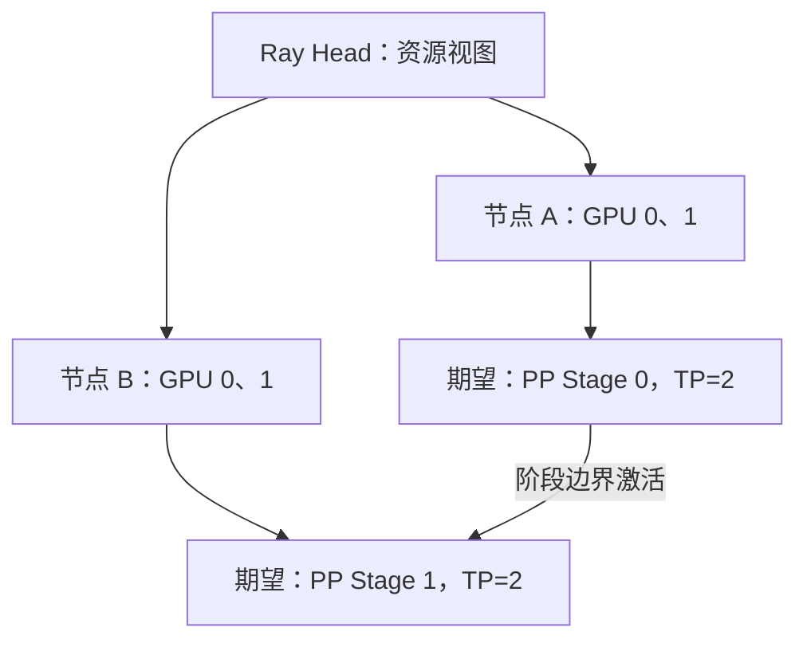

有八张卡，不等于引擎已经知道卡在哪；Ray 能看到八张卡，也不等于 TP 通信走上了正确的链路。可以把 Ray 想成“分配工位的管理员”，把 NCCL 想成“工位之间搬数据的通道”。**编排负责把进程放好，计算通信仍要单独验证。**

<!-- more -->

## 📑 目录

- [1. Ray 与 vLLM，各自负责什么](#1-ray-与-vllm各自负责什么)
  - [1.1 先分清“安排工作”和“搬运数据”](#11-先分清安排工作和搬运数据)
  - [1.2 Head、Worker、Actor 容易混在哪里](#12-headworkeractor-容易混在哪里)
- [2. 起集群前，先统一执行环境](#2-起集群前先统一执行环境)
  - [2.1 为什么“版本看着差不多”仍可能失败](#21-为什么版本看着差不多仍可能失败)
  - [2.2 模型路径一致，还要内容一致](#22-模型路径一致还要内容一致)
- [3. 两节点 Ray 集群怎样拉起](#3-两节点-ray-集群怎样拉起)
  - [3.1 地址与端口分别给谁用](#31-地址与端口分别给谁用)
  - [3.2 为什么先设置环境变量，再启动 Ray](#32-为什么先设置环境变量再启动-ray)
- [4. 资源可见，再检查成组放置](#4-资源可见再检查成组放置)
  - [4.1 把 Bundle 理解为一份资源申请](#41-把-bundle-理解为一份资源申请)
  - [4.2 总共四卡，为什么还是 Pending](#42-总共四卡为什么还是-pending)
- [5. 一个服务入口，拉起一个跨节点副本](#5-一个服务入口拉起一个跨节点副本)
  - [5.1 逐项核对启动意图](#51-逐项核对启动意图)
  - [5.2 一条请求之前，先确认三件事](#52-一条请求之前先确认三件事)
- [6. 排错按层走，不靠堆环境变量](#6-排错按层走不靠堆环境变量)
  - [6.1 从最早出现的错误向外排查](#61-从最早出现的错误向外排查)
  - [6.2 把大问题缩成最小失败配置](#62-把大问题缩成最小失败配置)
- [7. 从健康检查到可复现部署](#7-从健康检查到可复现部署)
  - [7.1 逐层定义“已经跑通”](#71-逐层定义已经跑通)
  - [7.2 给下一次复现留下一张部署记录](#72-给下一次复现留下一张部署记录)
- [总结](#-总结)
- [自我检验清单](#-自我检验清单)
- [参考资料](#-参考资料)

---

## 1. Ray 与 vLLM，各自负责什么

| 组件 | 主要职责 | 不能据此证明什么 |
|---|---|---|
| Head / GCS | 集群资源与控制信息 | 模型一定加载成功 |
| Worker 节点 | 提供 CPU/GPU 等资源 | GPU 通信一定高速 |
| Actor | 长驻执行进程 | 一定独占完整物理机器 |
| Placement Group | 成组申请和放置资源 | 所有模型自动采用最佳拓扑 |
| vLLM GPU Worker | 执行模型分片 | 自动修复网络和环境差异 |

Ray 的资源声明是调度信息，不会凭空生成显存。GPU、CPU 和网络都必须在宿主与容器里实际可用。

### 1.1 先分清“安排工作”和“搬运数据”

从用户发出请求开始，可以按这条链理解：API 接收请求，vLLM 组织模型计算，Ray 将所需 GPU Worker 安排到合适节点，Worker 再通过 NCCL 等机制交换计算数据。Ray 知道哪里有可用资源，不代表它替模型完成了矩阵乘法。

通常把成员管理、资源信息和任务安排叫**控制面**，把 GPU 之间传激活、归约结果等叫**数据面**。例如 Head 能列出节点 B，说明控制信息已通；但如果 B 的模型通信网卡不可达，第一次集合通信仍可能失败。

### 1.2 Head、Worker、Actor 容易混在哪里

Head 首先是一种集群角色，可以同时提供计算资源，不是“只有它计算模型”；Worker 节点指加入集群的机器；vLLM GPU Worker 则是运行模型分片的执行组件。一个节点可以运行多个执行进程。

Actor 可以先理解为“状态持续保留、可反复接收任务的进程”。GPU Worker 使用 Actor 时，可以持续保存已加载的模型分片，避免每次请求重新加载。Actor 申请 GPU 资源不意味着独占整台机器；同机 CPU、网络和其他资源仍可能共享。

## 2. 起集群前，先统一执行环境

两节点至少保持驱动兼容、vLLM/PyTorch/Ray 版本一致、模型和 Tokenizer revision 一致，并能从同一路径读到相同文件。环境变量需要进入实际 Worker，而不只是写在启动客户端的 Shell 中。

```bash
python -c "import torch, vllm, ray; print(torch.__version__, vllm.__version__, ray.__version__)"
nvidia-smi
nvidia-smi topo -m
python -m pip freeze > environment.txt
```

这些命令在各节点分别执行并留档。若基于容器，记录镜像 digest 与启动配置；同一个浮动镜像标签在不同时间可能对应不同内容。

本节以 vLLM v0.19.0 的 Ray 方案为基准。该版本还介绍了多节点 Multiprocessing；选择 Ray 是为了讲清编排，不代表所有多机部署都必须使用 Ray。

### 2.1 为什么“版本看着差不多”仍可能失败

本机 Shell 能导入包，只能证明本机当前 Python 环境可用。远端 Actor 可能使用另一套环境，或处于没有相同挂载的容器。典型现象是启动端一切正常，远端却报 `ModuleNotFoundError` 或模型文件不存在。

建议先选一套与 GPU、驱动兼容的环境，在两个节点安装相同版本并分别核对。vLLM 的 Ray 方案可能需要额外 Ray 依赖，按目标版本文档准备；若要使用后面的 State CLI，Ray 官方要求安装对应版本的 `ray[default]` 依赖并启用 Dashboard。补依赖时保持 Ray 版本不变，不能一台升级、另一台保持旧版。

### 2.2 模型路径一致，还要内容一致

`/models/target` 只是示例路径，要替换为真实模型目录，并在两个节点各自可读。目录名称相同不代表文件相同；应固定模型仓库的提交 revision，并核对配置、Tokenizer、权重分片和索引文件。共享存储或复制的固定快照都可以，关键是参与执行的环境读到相同内容。

下面所有 `export`、续行符和启动命令均为 Linux Bash 语法。在 Windows 上学习时，应进入已配置 GPU 的 WSL2/Linux 环境执行，而不是直接把 Bash 命令粘贴到 PowerShell。

## 3. 两节点 Ray 集群怎样拉起

下面假设两节点各两张 GPU，私网地址分别为 `10.0.0.10` 与 `10.0.0.11`。在已安装兼容 Ray 和 vLLM 的相同环境中，分别运行：

```bash
# 节点 A：替换为自己的私网地址。
export VLLM_HOST_IP=10.0.0.10
ray start --head --node-ip-address=10.0.0.10 --port=6379 --num-gpus=2
```

```bash
# 节点 B：VLLM_HOST_IP 必须是本节点地址。
export VLLM_HOST_IP=10.0.0.11
ray start --address=10.0.0.10:6379 --node-ip-address=10.0.0.11 --num-gpus=2
```

这里示范裸环境的集群入口。若使用容器，可改用同一 tag 的 [官方 run_cluster.sh](https://github.com/vllm-project/vllm/blob/v0.19.0/examples/online_serving/run_cluster.sh)，并在容器内部执行后续 vLLM 命令；不要混用宿主 Ray 与容器内 Worker 环境。

Ray 控制通信与模型数据通信需要的端口并不只有 6379。节点地址、端口范围与容器网络必须互通；这些集群内部接口应留在受控私网中，不能作为普通公网服务入口。

### 3.1 地址与端口分别给谁用

| 示例 | 用途 | 应怎样替换 |
|------|------|------------|
| `10.0.0.10` | 节点 A 的集群内地址 | 换成其他节点可访问的 A 的实际地址 |
| `10.0.0.11` | 节点 B 的集群内地址 | 换成 B 自己的实际地址，不能照抄 A |
| `10.0.0.10:6379` | Worker 加入 Head 的入口 | 保持与 Head 指定的端口一致 |
| `127.0.0.1:8000` | 后面 API 的本机访问入口 | 它不是 Ray 节点加入地址 |

`--num-gpus=2` 是向调度器声明该节点提供两份 GPU 资源，不会把只有一张卡的机器变成两卡。先用 `nvidia-smi` 和实际设备可见性确认，不能用增大这个数字解决物理资源不足。

### 3.2 为什么先设置环境变量，再启动 Ray

Shell 中的变量通常只影响它之后启动的子进程。Ray 节点已经启动后，再在另一个终端 `export`，并不会自动修改所有远端 Worker 的环境。需要在对应节点的 Ray 启动环境、容器配置或受支持的运行环境配置中传入，并检查实际 Worker。

`VLLM_HOST_IP` 在 A、B 应分别指向自身可达地址；包版本、模型快照应相同，节点地址则应正确区分。`ray start` 返回成功只代表本节点集群进程启动，模型尚未由这一步加载。已有共享 Ray 集群时，应先查看归属和资源，再决定加入方式，避免另外启动互相干扰的集群。

## 4. 资源可见，再检查成组放置

```bash
ray status
ray list nodes
```

除了总 GPU 数，还要检查每节点资源和存活状态。四张卡分布在两节点，不等价于一个节点能提供四卡。



Placement Group 按 Bundle 成组保留资源。`PACK`、`SPREAD` 及其严格版本有不同语义，资源碎片可能让请求一直 Pending；具体 vLLM Executor 的放置还需要看版本实现。图是期望映射，运行后必须从日志核对。

### 4.1 把 Bundle 理解为一份资源申请

例如一个 Bundle 申请 `{"GPU": 1, "CPU": 1}`，表示这一份工作需要一份 GPU 与 CPU 资源；一个 Placement Group 可以由多份 Bundle 组成。成组申请的意义是避免模型启动一半才发现剩下的资源无法满足。

根据 [Ray 的放置策略说明](https://docs.ray.io/en/latest/ray-core/scheduling/placement-group.html)，可以先记住：

| 策略 | 直观含义 |
|------|----------|
| `PACK` | 尽量集中，必要时可分散 |
| `SPREAD` | 尽量分散到不同节点 |
| `STRICT_PACK` | 必须把全部 Bundle 放在同一节点 |
| `STRICT_SPREAD` | 每个 Bundle 必须在不同节点 |

这是 Ray 的通用概念说明，不要求手工为 vLLM 重写一份 Placement Group。实际执行器如何申请和约束资源，以该版本的实现为准。

### 4.2 总共四卡，为什么还是 Pending

假设 A、B 各有两张空闲 GPU，申请四份各需要一张 GPU 的 Bundle。如果要求 `STRICT_PACK`，两个节点都无法单独提供四卡，所以总数足够仍不能满足放置。即使没有这个约束，CPU 不足、资源已被其他组预留或节点状态异常，也可能阻止调度。

Pending 表示“尚未安排成功”，应先检查资源需求与放置约束。此时还没有进入正常 GPU 计算，调 NCCL 带宽通常不能解决它。`ray status` 用来看资源和需求，`ray list nodes` 则进一步查看节点状态；后者的 State CLI 依赖需要按前述说明安装。

## 5. 一个服务入口，拉起一个跨节点副本

确认各节点 `/models/target` 内容一致后，在集群中的一个节点启动一次：

```bash
vllm serve /models/target \
  --tensor-parallel-size 2 --pipeline-parallel-size 2 \
  --distributed-executor-backend ray \
  --served-model-name ray-demo --max-model-len 4096 \
  --host 127.0.0.1 --port 8000
```

TP×PP 总计四卡。一条命令让 Ray Executor 调度 Worker，**不要在两个节点各自再启动一份相同服务来“补齐 Rank”**；那通常会形成两个竞争资源的部署。API 绑定 loopback 方便本机验收，远程接入时另行配置服务入口。

### 5.1 逐项核对启动意图

| 参数 | 这条示例里的含义 |
|------|------------------|
| `--tensor-parallel-size 2` | 每个 PP Stage 内有两卡共同完成层内计算 |
| `--pipeline-parallel-size 2` | 模型沿层分为两个 Stage |
| `--distributed-executor-backend ray` | 通过已有 Ray 集群安排执行 Worker |
| `--served-model-name ray-demo` | API 请求使用这个模型别名 |
| `--host 127.0.0.1 --port 8000` | 在启动 API 的节点上供本机客户端验收 |

两节点各自都可能把本机卡编号为 GPU 0、1，它们并非同一张物理卡。验收时用“节点地址 + 设备编号 + Rank”一起定位，不能只看日志里一个 `cuda:0` 就判断所有计算都挤在同一卡。

### 5.2 一条请求之前，先确认三件事

第一，Ray 已看到两个节点和所需资源；第二，各节点的实际 Worker 环境都能读取模型；第三，日志中的 Rank、TP/PP 组和设备符合预期。模型加载和初始化可能需要较长时间，应观察进度与具体错误，不能把 API 进程刚出现就当成服务就绪。

## 6. 排错按层走，不靠堆环境变量

| 层次 | 现象 | 核对证据 |
|---|---|---|
| 环境 | Worker 导入失败、文件不存在 | 版本、路径、容器挂载、模型校验 |
| 编排 | 一直 Pending、GPU 不够 | `ray status`、节点资源与 Placement Group |
| 集合通信 | 初始化挂起或第一步超时 | Rank/GPU 映射、地址、NCCL、网卡 |
| 服务 | 已启动但响应慢 | 队列、KV 抢占、图捕获、输入长度 |

可在对应执行环境设置 `NCCL_DEBUG=INFO`，结合目标集群检查实际网卡与传输。若用 `NCCL_SOCKET_IFNAME`、`GLOO_SOCKET_IFNAME` 等，网卡名应来自实际机器；不要复制教程里的 `eth0` 后就认为修复了通信。

跨机 `NET/Socket` 与预期的 RDMA 路径不同，需要进一步检查设备暴露、网络与驱动。Ray 调度成功不能替代集合通信的小规模测试；也不要用关闭快速链路的临时绕行结果充当正式性能结论。

### 6.1 从最早出现的错误向外排查

如果远端首先报“找不到权重文件”，先修路径或挂载；如果资源一直 Pending，先修资源申请与放置；只有 Worker 已启动、进入通信初始化后挂起，才重点检查通信链路。最后看到的客户端超时，往往只是前面失败的结果，不能把它直接当成根因。

`NCCL_DEBUG=INFO` 用于增加诊断日志，本身不是性能开关。设置后应确认所有相关进程实际收到该变量。`NCCL_SOCKET_IFNAME` 控制 Socket 网络接口的选择，也不是给任意机器强制打开 RDMA；具体传输与网卡还要结合日志、设备和集群网络检查。

### 6.2 把大问题缩成最小失败配置

先确认单机多进程能加载和生成，再检查单机 Ray 路径，最后扩到两节点。若只在跨机时失败，便可重点比较节点地址、通信接口、容器网络与远端环境，而不必同时怀疑所有模型算子。

每一步只改变一个主要条件，保存最早异常及其前后日志。不要一次设置十几个网上搜来的变量；即使暂时跑通，也难以知道哪项真正起作用，更无法判断是否绕到了更慢的路径。

## 7. 从健康检查到可复现部署

```bash
curl --fail http://127.0.0.1:8000/health
curl --fail http://127.0.0.1:8000/v1/models
```

健康检查通过后，还要发真实生成请求，观察所有预期 Worker 是否执行、KV 容量是否合理，以及输出是否完整。API 可访问并不能证明两节点都实际参与了推理。

结束实验时，先停止这一份服务，再按实验环境的归属回收 Ray 资源；共享集群不要用全局停机命令清理别人的任务。保存部署参数、各节点版本、Rank 放置与日志，下一节再用同一工作负载比较候选。

### 7.1 逐层定义“已经跑通”

`/health` 检查服务健康状态；`/v1/models` 帮助确认对外模型标识；发送真实生成请求，才能继续验证 Tokenization、模型执行和返回路径。可以沿用 6.6 的短问题，把请求中的模型名改为这里的 `ray-demo`。

检查输出的同时观察各 Stage 的 Worker 日志和设备活动。PP 本来就可能轮流忙闲，所以某一瞬间只有部分 GPU 忙不一定是错误；需要把时间窗口与阶段分工结合起来看，而不是用单张截图判断整套部署。

### 7.2 给下一次复现留下一张部署记录

至少保存节点/GPU 清单、各节点软件版本、模型 revision、启动命令、实际网卡与环境变量、Rank 放置、健康和生成结果。失败实验也保留这些信息，先收集证据再清理对应任务。

这样下一次遇到“上周能跑、今天不能跑”，才能具体比较是模型变了、环境变了、资源被占用，还是节点映射不同。确认功能正确后再进入压测，否则测到的低吞吐可能只是一个尚未排除的部署故障。

## 📝 总结

- Ray 解决资源和进程编排，NCCL 等处理模型通信。
- 环境、模型路径、私网地址和 Worker 环境变量要在各节点一致或正确区分。
- TP×PP 的期望映射需要通过实际 Worker 日志验收。
- Pending、通信挂起与服务排队属于不同层次，应分别定位。

## 🎯 自我检验清单

- 能说明 Head、Actor 与 Placement Group 的作用
- 能区分总资源足够与放置约束能够满足
- 能说明为什么两节点的 VLLM_HOST_IP 不应一样
- 能区分一个 Ray 跨机副本与两个独立 API 服务
- 能按环境、编排、通信、服务四层组织排错证据
- 能解释环境变量为什么要进入远端 Worker，而不只是留在客户端终端
- 能说明健康检查、真实生成和多卡性能验证分别证明什么

## 📚 参考资料

- [vLLM v0.19.0 — Parallelism and Scaling](https://github.com/vllm-project/vllm/blob/v0.19.0/docs/serving/parallelism_scaling.md)
- [vLLM v0.19.0 — Distributed Troubleshooting](https://github.com/vllm-project/vllm/blob/v0.19.0/docs/serving/distributed_troubleshooting.md)
- [Ray — Placement Groups](https://docs.ray.io/en/latest/ray-core/scheduling/placement-group.html)
- [Ray — Monitoring with the CLI or SDK](https://docs.ray.io/en/latest/ray-observability/user-guides/cli-sdk.html)
- [NCCL — Troubleshooting](https://docs.nvidia.com/deeplearning/nccl/user-guide/docs/troubleshooting.html)

---

[返回本章](https://caomaolufei.github.io/AIInfraGuide/inference/模块四-推理优化/第6章-分布式推理/) · [上一节](https://caomaolufei.github.io/AIInfraGuide/inference/模块四-推理优化/第6章-分布式推理/64-数据并行与专家并行/) · [下一节](https://caomaolufei.github.io/AIInfraGuide/inference/模块四-推理优化/第6章-分布式推理/66-vllm分布式部署实战/)
