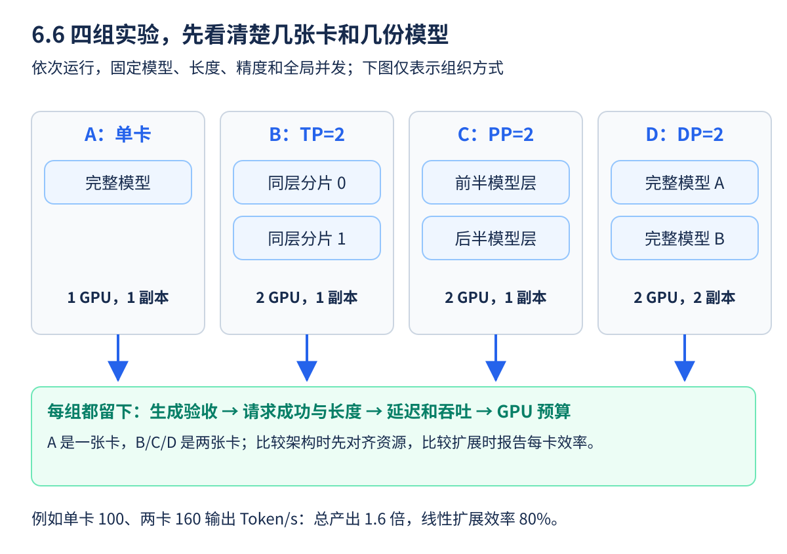

本节把前五节的概念放进一组可复查的实验：同一个模型分别采用单卡、两卡 TP、两卡 PP、两卡 DP，再按条件扩展到 Ray。每组都经过启动、生成验收、固定负载压测和结果解释。

第一次学习先完成自己硬件支持的一组，再加入下一组。GPU 数量、副本数量、真实输入输出长度和客户端并发都要写进记录。这样即使测到“两卡更慢”，也能继续区分通信、气泡、流量不足和配置差异，而不是只留下一个脱离条件的吞吐数字。接口以 **vLLM v0.19.0** 为基线。

<!-- more -->

## 📑 目录

- [1. 固定版本、模型与实验变量](#1-固定版本模型与实验变量)
  - [1.1 先准备两个终端](#11-先准备两个终端)
  - [1.2 先记录环境，再比较配置](#12-先记录环境再比较配置)
- [2. 启动一个可比较的服务](#2-启动一个可比较的服务)
  - [2.1 先把共同参数放在一起](#21-先把共同参数放在一起)
  - [2.2 一次只选一组启动](#22-一次只选一组启动)
  - [2.3 不要把“启动中”当成“可以压测”](#23-不要把启动中当成可以压测)
  - [2.4 先看懂实验分组，再比较成绩](#24-先看懂实验分组再比较成绩)
- [3. 先验收真实生成，再测速度](#3-先验收真实生成再测速度)
  - [3.1 在终端 B 发出短请求](#31-在终端-b-发出短请求)
  - [3.2 返回 JSON 应该看什么](#32-返回-json-应该看什么)
  - [3.3 核对设备与缓存证据](#33-核对设备与缓存证据)
- [4. 用统一负载测延迟与吞吐](#4-用统一负载测延迟与吞吐)
  - [4.1 跑一组有明确标签的负载](#41-跑一组有明确标签的负载)
  - [4.2 这些参数如何共同形成一次实验](#42-这些参数如何共同形成一次实验)
  - [4.3 一次测完后先检查，而不是马上换配置](#43-一次测完后先检查而不是马上换配置)
- [5. 增加 Ray 多节点这一组](#5-增加-ray-多节点这一组)
  - [5.1 沿用参数，额外检查远端环境](#51-沿用参数额外检查远端环境)
  - [5.2 对照时怎样解释多出来的两张卡](#52-对照时怎样解释多出来的两张卡)
- [6. 结果表与扩展效率](#6-结果表与扩展效率)
  - [6.1 先填写原始观察](#61-先填写原始观察)
  - [6.2 手算一次扩展效率](#62-手算一次扩展效率)
  - [6.3 平均值、P95 与有效吞吐分别回答什么](#63-平均值p95-与有效吞吐分别回答什么)
  - [6.4 表格中的“待实测”就是实验任务](#64-表格中的待实测就是实验任务)
- [7. 根据现象决定下一轮](#7-根据现象决定下一轮)
  - [7.1 先看现象，再提出可以验证的解释](#71-先看现象再提出可以验证的解释)
  - [7.2 写出一段可交给同事复查的结论](#72-写出一段可交给同事复查的结论)
- [总结](#-总结)
- [自我检验清单](#-自我检验清单)
- [参考资料](#-参考资料)

---

## 1. 固定版本、模型与实验变量

命令以 **vLLM v0.19.0** 为接口基线，采用 `Qwen/Qwen2.5-7B-Instruct`，各组均为 FP16；需要支持该版本的 Linux/WSL2 GPU 环境。建议各组顺序运行，结束前一组后再释放资源启动下一组。

### 1.1 先准备两个终端

终端 A 用来运行 `vllm serve`，启动后保持前台运行，方便观察日志；终端 B 用来执行 `curl` 和压测。两个终端都要进入同一 Python 环境，但终端 A 中定义的 Bash 变量不会自动出现在 B，后文会分别定义。

这些命令使用 Bash 语法。`vllm serve` 会持续占用前台，看到终端没有返回提示符是正常现象；要在另一个终端发送请求。实验结束后在 A 用 Ctrl+C 停止当前服务，确认进程退出、GPU 资源释放，再启动下一组。

### 1.2 先记录环境，再比较配置

```bash
python3 -m venv .venv
source .venv/bin/activate
python -m pip install 'vllm==0.19.0'
python -c "import torch, vllm; print(torch.__version__, torch.version.cuda, vllm.__version__)"
python -m pip freeze > environment.txt
nvidia-smi
nvidia-smi topo -m
vllm bench serve --help > bench-help.txt
```

模型与 Tokenizer 应固定 revision；多节点使用同一快照路径。单卡装不下时，跳过不可执行的单卡基线并记录原因，不得拿不同模型或不同量化精度补一个速度数字。

上面的安装命令是创建实验环境的示例，前提是 Python、GPU 架构和驱动满足该版本要求。若已有可用环境，先记录并核对版本；不要在共享环境中直接覆盖依赖。模型名首次使用时可能触发下载，下载和加载时间应与正常推理压测分开。

正式对照时，先把选定 revision 下载为固定快照，再让服务端和压测客户端的 Tokenizer 都指向该快照。后文的仓库名便于理解命令，不能代替“已固定 revision”的实验记录。

| 保持一致的条件 | 为什么要固定 |
|----------------|--------------|
| 模型、Tokenizer、精度 | 防止把模型差异误认为并行收益 |
| 输入/输出工作量、采样配置 | 长输入和长输出消耗的资源不同 |
| 缓存策略、上下文限制 | 前缀复用或容量改变会影响结果 |
| 客户端全局并发 | DP 每副本上限不是客户端真实并发 |
| GPU 型号、网络、其他负载 | 同样卡数不代表相同计算与通信能力 |

新手可以分两次完成：第一次只做单卡加载、生成和一次压测；第二次再加入一种有资源支持的并行配置。无需一次准备好所有多机与 MoE 实验。

## 2. 启动一个可比较的服务

以下 Bash 数组在每个启动终端中定义。各组先保持相同的每引擎配置：

### 2.1 先把共同参数放在一起

```bash
MODEL=Qwen/Qwen2.5-7B-Instruct
COMMON=(
  --served-model-name parallel-demo
  --dtype half --kv-cache-dtype auto
  --max-model-len 4096 --max-num-seqs 16
  --max-num-batched-tokens 4096
  --gpu-memory-utilization 0.85
  --no-enable-prefix-caching --generation-config vllm --seed 42
  --host 127.0.0.1 --port 8000
)
```

`COMMON=(...)` 是 Bash 数组，把多个参数保存起来；`"${COMMON[@]}"` 会把它们逐个传给命令。`"$MODEL"` 则取出前面定义的模型路径或名称。复制多行命令时，行尾的 `\` 是续行符，后面不要再追加空格或注释。

| 参数 | 在控制什么 | 不等于什么 |
|------|------------|------------|
| `--served-model-name parallel-demo` | 客户端请求使用的别名 | 不会重新下载一个叫这个名字的模型 |
| `--dtype half` | FP16 配置 | 不是 INT4/INT8 权重量化 |
| `--kv-cache-dtype auto` | 按框架规则选择 KV 精度 | 不是开启了 KV 量化实验 |
| `--max-model-len 4096` | 单序列输入与生成的上下文总长度上限 | 不是每次必须输入 4096 Token |
| `--max-num-seqs 16` | 每个 DP Rank/引擎的活跃序列上限 | 不是客户端固定发送 16 条请求 |
| `--max-num-batched-tokens 4096` | 一次调度迭代可处理的 Token 预算 | 不是所有请求历史 Token 的总和 |
| `--gpu-memory-utilization 0.85` | 为模型执行配置显存预算比例 | 不是 GPU 计算利用率固定为 85% |
| `--no-enable-prefix-caching` | 关闭前缀复用以控制变量 | 不会关闭生成所需的普通 KV Cache |
| `--generation-config vllm` | 使用 vLLM 的生成默认配置 | 不会替代请求里明确给出的采样参数 |
| `--seed 42` | 固定一部分随机过程 | 不保证跨硬件与并行布局逐位一致 |

`--host 127.0.0.1 --port 8000` 表示在本机 8000 端口提供 API，所以下文客户端也在该节点运行。

### 2.2 一次只选一组启动

按顺序单独启动一种配置，不能把下面四条当成同时运行的脚本：

```bash
# 组 A：单卡；完成采集后 Ctrl+C 停止，再执行下一组。
CUDA_VISIBLE_DEVICES=0 vllm serve "$MODEL" "${COMMON[@]}"
```

```bash
# 组 B：两卡 TP，一个副本。
CUDA_VISIBLE_DEVICES=0,1 vllm serve "$MODEL" "${COMMON[@]}" \
  --tensor-parallel-size 2 --distributed-executor-backend mp
```

```bash
# 组 C：两卡 PP，一个副本；需模型支持 PP。
CUDA_VISIBLE_DEVICES=0,1 vllm serve "$MODEL" "${COMMON[@]}" \
  --pipeline-parallel-size 2 --distributed-executor-backend mp
```

```bash
# 组 D：两卡 DP，两个副本，单一 API 入口。
CUDA_VISIBLE_DEVICES=0,1 vllm serve "$MODEL" "${COMMON[@]}" \
  --data-parallel-size 2 --tensor-parallel-size 1
```

📌 **关键点**：DP 的 `max-num-seqs` 是每 DP Rank 的限制，TP/PP 组则是同一副本协作。外部请求并发仍应先保持一致，再另测各自容量上限。

若机器只有一张 GPU，先做 A 即可；有两张且每卡能装下模型，才可能直接尝试 D。B、C 也需要足够显存、模型和执行后端支持。`CUDA_VISIBLE_DEVICES=0,1` 只是限定可见设备，不会单独完成并行，真正的协作方式由 TP/PP/DP 参数决定。

### 2.3 不要把“启动中”当成“可以压测”

服务会先读模型、建立执行进程和通信组、规划 KV，并按配置执行预热等步骤。先看日志是否完成初始化，再进入健康检查。若报显存不足，先核对权重、KV 与其他开销，不要只因为模型文件小于显存就认定能够运行。

### 2.4 先看懂实验分组，再比较成绩



图中每个框描述的是模型计算职责。TP 的两个分片合成一份模型，PP 的前后层也合成一份模型；DP 两个框各能完成请求，所以是两份模型。先在记录里写下这层含义，再看所有 GPU 上是否出现相应进程，避免仅用“启动了两张卡”概括不同实验。

比较有两种不同问题。A 与 B 的对照可以研究“多给一张卡，吞吐怎样扩展”；B、C、D 使用相同卡数，可以研究“同样两张卡，怎样组织更合适”。两种问题都要固定质量和工作负载，但解释结论时要分别报告资源变化。若一个模型单卡装不下，就记录 A 不可执行，继续比较其他可行组。

再将“固定参数”落实成文件：同一个模型快照和 Tokenizer、同一批输入及目标输出、每轮实际成功与失败、全局并发、服务启动参数和原始结果 JSON。记录实际输入输出长度尤其重要：两份结果标称都生成 128 Token，却有一份大量提前结束或失败，就不是等量工作对照。

**练习与答案**：单卡 100、两卡 160、四卡 250 输出 Token/s，哪组总产出最高，哪组单位卡最高？总产出是四卡最高，单位卡分别为 100、80、62.5，单卡最高。没有延迟和质量记录，仍无法据此确定哪组满足业务；这组假设数字只训练读表，不能填进“待实测”栏。

## 3. 先验收真实生成，再测速度

### 3.1 在终端 B 发出短请求

```bash
curl --fail http://127.0.0.1:8000/health
curl --fail http://127.0.0.1:8000/v1/models
curl --fail http://127.0.0.1:8000/v1/chat/completions \
  -H 'Content-Type: application/json' \
  -d '{"model":"parallel-demo","messages":[{"role":"user","content":"17 加 25 等于多少？只输出整数。"}],"temperature":0,"max_tokens":16}'
```

这是一条加载与路由检查，不是完整质量评测。对正式语料分别保存生成文本、结束原因、输入/输出 Token 数，检查截断、格式、任务正确率。TP/PP 的浮点执行顺序会有差异，不能把“固定 seed”解释为所有环境逐字一致。

请求中的 `model` 必须匹配服务别名；`messages` 提供角色与内容；`temperature: 0` 选择确定性采样方式；`max_tokens: 16` 限制最多生成多少 Token，不是要求一定生成 16 个。这里期待回答 42，重点是验证完整请求链能工作。

### 3.2 返回 JSON 应该看什么

| 字段 | 如何理解 |
|------|----------|
| `choices[0].message.content` | 模型生成的文本，应检查是否回答了问题 |
| `choices[0].finish_reason` | 为什么结束；`length` 常提示达到长度限制，需要排查是否被截断 |
| `usage.prompt_tokens` | 实际输入 Token 数，包括适用的模板开销 |
| `usage.completion_tokens` | 实际生成 Token 数 |

HTTP 成功只说明请求成功返回；还要看内容和结束原因。若 `/health` 通过但生成失败，应继续看服务端模型执行错误；若模型名不匹配，先检查 `/v1/models`，不要急着改 GPU 参数。

### 3.3 核对设备与缓存证据

同时记录每卡权重加载量、KV Token 容量、PP 层映射与 Worker 设备。`nvidia-smi` 的总占用可能包含预分配 KV 池；不能只凭显存截图证明权重恰好均分。

对两卡 TP，应该确认一个模型副本确实跨两卡；对 PP，确认两阶段各负责哪些层；对 DP，确认有两个服务副本及其队列。把这些信息与生成结果一起保存，才知道后面的性能数字来自哪一种实际部署。

## 4. 用统一负载测延迟与吞吐

先在终端 B 定义模型名，再对每一组运行相同 Benchmark：

### 4.1 跑一组有明确标签的负载

```bash
MODEL=Qwen/Qwen2.5-7B-Instruct
LABEL=single
CONCURRENCY=8
mkdir -p results
vllm bench serve --backend openai \
  --base-url http://127.0.0.1:8000 --endpoint /v1/completions \
  --model parallel-demo --tokenizer "$MODEL" \
  --dataset-name random --input-len 512 --output-len 128 \
  --num-prompts 128 --num-warmups 8 \
  --max-concurrency "$CONCURRENCY" --request-rate inf \
  --temperature 0 --ignore-eos --seed 42 \
  --percentile-metrics ttft,tpot,itl --metric-percentiles 50,95,99 \
  --save-result --save-detailed --result-dir results --result-filename "${LABEL}-c${CONCURRENCY}.json"
```

切换服务后修改标签为 `tp2`、`pp2`、`dp2`，再执行同一条压测命令。改变 `CONCURRENCY` 为 1、8、16 时，参数和文件名会一起变化，避免文件名写 c8、实际却测了并发 16。另做长输入/长输出两组，使用额外标签，防止覆盖旧结果。

### 4.2 这些参数如何共同形成一次实验

| 参数组 | 作用 |
|--------|------|
| `--backend openai` 与 `/v1/completions` | 使用兼容接口测试文本补全，和上面的 Chat 冒烟检查不是相同模板路径 |
| `--model parallel-demo --tokenizer "$MODEL"` | 对服务使用别名，对输入构造使用匹配的 Tokenizer |
| `--dataset-name random` 与长度参数 | 构造合成负载，便于控制工作量 |
| `--num-prompts 128` | 本轮请求总数，区别于同时进行的请求数 |
| `--num-warmups 8` | 测量前先发送预热请求，不代表覆盖了所有可能形状 |
| `--max-concurrency` 与 `--request-rate inf` | 在并发上限内尽快持续发送，完成后补充后续请求 |
| `--save-result --save-detailed` | 保存汇总及详细结果，便于复核成功、错误与实际工作量 |

`--request-rate inf` 配合并发上限属于容量型闭环测试，不能替代固定到达率的线上 SLO 评测。闭环可以理解成“窗口空出一个位置就再送一个请求”；固定到达率则是“外界按既定节奏持续到来”，系统忙时也可能继续积压，两者回答的问题不同。

该版本的通用 `--input-len/--output-len` 会映射到数据集参数。随机输入不是业务数据；若启用长度变化参数，先核对它表示比例、区间还是其他分布。保存实际 Token 用量，避免只按标称长度解释结果。

`--ignore-eos` 用于控制性能实验的输出工作量；正式质量评测应恢复正常 EOS。TTFT 包含客户端观察到的等待，TPOT 是首 Token 后的平均速度，ITL 是相邻输出到达的间隔，三者分别报告。

### 4.3 一次测完后先检查，而不是马上换配置

确认成功数与预期一致、没有错误爆发，核对实际输入输出长度，再查看延迟与吞吐。如果大量请求失败，只剩少量成功请求看起来很快，就不能把它当成优异成绩。若客户端 CPU 或网络先饱和，也可能低估服务能力。

先完成同一长度下的并发对照，再改变长度。长输入偏向考察 Prefill，长输出会增加 Decode 工作，但两者都仍会消耗 KV 和调度资源。把并发、输入长度、输出长度同时改掉，就难以解释结果为什么变化。

## 5. 增加 Ray 多节点这一组

先按 6.5 节建立两节点、每节点两卡的 Ray 集群。在启动节点的环境中定义同样 `COMMON`，将 `MODEL` 换成各节点一致的本地快照路径，再启动：

### 5.1 沿用参数，额外检查远端环境

```bash
MODEL=/models/qwen2.5-7b-instruct-snapshot
vllm serve "$MODEL" "${COMMON[@]}" \
  --tensor-parallel-size 2 --pipeline-parallel-size 2 \
  --distributed-executor-backend ray
```

客户端 Tokenizer 也应采用同一快照。这个副本使用四卡，不能与两卡候选只比总 Token/s 就宣称效率更好；同时报告总 GPU 数、每 GPU 有效吞吐与成本。

MoE 的 EP 对照则用 6.4 的兼容 MoE checkpoint 单独建组，不要把 Dense 和 MoE 的架构差异混入本组 TP/PP/DP 比较。

启动前再次检查：Ray 中的两节点存活、每节点确实提供两卡、GPU Worker 的包版本一致、快照文件一致。前面的安装命令只在本机执行一次，并不会自动替另一台机器安装环境。

### 5.2 对照时怎样解释多出来的两张卡

终端 B 将 `MODEL` 也改成同一快照，并把压测标签改为 `ray-tp2-pp2`，继续使用相同长度与全局并发。每组使用多少 GPU 是实验条件的一部分，不能省略。

如果四卡总吞吐高于两卡，只能先说“这个配置的总吞吐更高”；是否值得使用四卡，还要看单位卡吞吐、延迟目标与成本。如果单卡基线根本不能运行，则主要讨论可行配置间的容量与效率，不能凭空算出相对单卡的实测加速比。

## 6. 结果表与扩展效率

### 6.1 先填写原始观察

| 配置 | GPU 数 | 每卡 KV 容量 | TTFT P95 | TPOT P95 | 输出 Token/s | 任务质量 |
|---|---|---|---|---|---|---|
| Single | 1 | 待实测 | 待实测 | 待实测 | 待实测 | 待实测 |
| TP=2 | 2 | 待实测 | 待实测 | 待实测 | 待实测 | 待实测 |
| PP=2 | 2 | 待实测 | 待实测 | 待实测 | 待实测 | 待实测 |
| DP=2 | 2 | 每副本分别记 | 待实测 | 待实测 | 待实测 | 待实测 |
| Ray TP=2/PP=2 | 4 | 分 Stage/Rank 记 | 待实测 | 待实测 | 待实测 | 待实测 |

若单卡基线可执行，且工作量/质量一致，可计算总吞吐扩展比 $S_n=Q_n/Q_1$ 与效率 $E_n=S_n/n$。SLO 下的有效吞吐则应另算，不能把超时和失败算进分子。

### 6.2 手算一次扩展效率

假设单卡输出吞吐为 100 Token/s，两卡为 160 Token/s，则 $S_2=160/100=1.6$，$E_2=1.6/2=0.8$。它表示两卡达到了相对单卡线性扩展的 80%，不是 GPU 利用率 80%，也不是每条请求延迟下降 80%。这些是假设数值，表格仍应填自己的测量结果。

输出 Token/s 统计生成工作；如果把输入 Token 也加进来，得到的是另一种总 Token 吞吐。不同口径不能直接比较，尤其输入较长时，混用会让数字看起来差很多。

### 6.3 平均值、P95 与有效吞吐分别回答什么

P95 可粗略理解为“95% 的观测值不超过这个水平”，用于观察较慢一端，而不是最慢那个请求。TPOT 通常先按每条有效请求计算首 Token 后的平均间隔，再汇总其分位数；ITL 则观察单次相邻输出的间隔，某次明显卡顿可能被一条请求的平均值摊薄。

SLO 是事先规定的服务目标，例如同时限制首字等待和生成速度。假设 10 秒内成功完成 100 条请求，只有 80 条同时满足目标，则请求完成吞吐为 10 请求/秒，满足 SLO 的 Goodput 为 8 请求/秒。这个请求口径不要与前表的输出 Token/s 混淆；如果采用 Token 口径，也应明确计算规则。

多轮运行，记录波动；128 请求只能用于初步排查，尤其不足以稳定估计极端尾部。正式压测增加样本与持续时间，并确认客户端、API Server 和网络没有先饱和。

### 6.4 表格中的“待实测”就是实验任务

本节没有预设哪种策略一定获胜。至少记录一次完整的成功数、错误数、实际 Token 量、延迟分位数和设备信息，再运行多轮观察是否稳定。若样本太少、结果差距与波动相近，就先增加证据，而不是立刻宣布某个配置最优。

## 7. 根据现象决定下一轮

### 7.1 先看现象，再提出可以验证的解释

| 结果 | 下一步 |
|---|---|
| TP 在并发 1 更慢、并发 16 更快 | 分开看通信启动成本和批处理复用 |
| PP 有容量收益但低并发慢 | 看气泡、Stage 不均与自回归反馈 |
| DP 吞吐没有增加 | 看入口瓶颈、请求分配和流量是否足够 |
| 四卡只有部分卡忙 | 核对 Rank 放置和每 Stage 的负载 |
| 所有组都出现大量抢占 | 降低上下文/并发，重算 KV 预算 |

不要先把所有高级开关都打开。每轮只改变一个可解释的因素，并保存失败配置和日志；失败本身也是并行策略边界的证据。

例如 TP=2 在低并发变慢，可以先对照通信开销和本地计算时间；不要直接下结论“TP 没用”。DP 吞吐不涨时，先看是否有足够请求、两副本是否都分到工作，再查入口与资源瓶颈。表格提供的是下一步调查方向，不是仅凭现象就能确定的根因。

### 7.2 写出一段可交给同事复查的结论

最终结论至少回答四个问题：用了什么硬件和模型；在什么长度、并发与质量条件下比较；容量、延迟、吞吐各有什么变化；推荐方案满足哪个服务目标。把原始 JSON、命令和日志放在一起，避免只留下一个脱离条件的 Token/s 数字。

没有多卡时，也可以完成本章的矩阵分片、流水线和专家计数 CPU 练习，并为假设设备画出部署与显存账本。实际 GPU 成绩留待有条件时测量，概念理解和可复现记录仍然可以先完成。

## 📝 总结

- 对照实验先统一版本、模型、精度、请求与缓存设置。
- 健康检查、真实生成、质量评测与性能评测是不同层次。
- Single、TP、PP、DP 的资源语义不同，需同时报告总卡数与单位卡收益。
- Ray 多节点和 MoE EP 应作为有明确前提的独立实验组。

## 🎯 自我检验清单

- 能解释四种启动命令分别形成几份副本
- 能从日志确认实际 GPU、PP 层和 KV 容量
- 能区分闭环容量测试与固定到达率 SLO 测试
- 能说明为何 ignore-eos 的性能输出不能直接用作质量结论
- 能在没有真实测量时保留待实测字段，而不推算加速成绩
- 能在两个终端中分别启动服务、验收生成和运行带标签的压测
- 能手算扩展比、单位卡效率，并解释它们与延迟及 GPU 利用率的区别

## 📚 参考资料

- [vLLM v0.19.0 — Parallelism and Scaling](https://github.com/vllm-project/vllm/blob/v0.19.0/docs/serving/parallelism_scaling.md)
- [vLLM v0.19.0 — Data Parallel Deployment](https://github.com/vllm-project/vllm/blob/v0.19.0/docs/serving/data_parallel_deployment.md)
- [vLLM v0.19.0 — Benchmark Serve 源码与参数](https://github.com/vllm-project/vllm/blob/v0.19.0/vllm/benchmarks/serve.py)

---

[返回本章](https://caomaolufei.github.io/AIInfraGuide/inference/模块四-推理优化/第6章-分布式推理/) · [上一节](https://caomaolufei.github.io/AIInfraGuide/inference/模块四-推理优化/第6章-分布式推理/65-多节点部署与ray/) · [下一章](https://caomaolufei.github.io/AIInfraGuide/inference/模块四-推理优化/第7章-pd解耦架构/)
