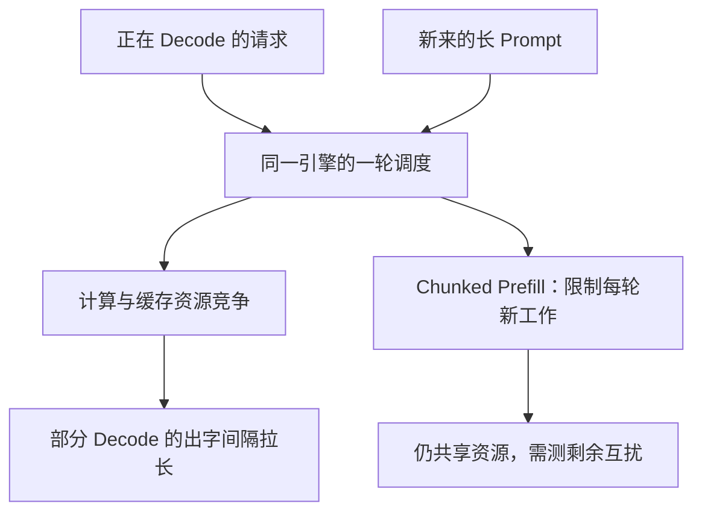
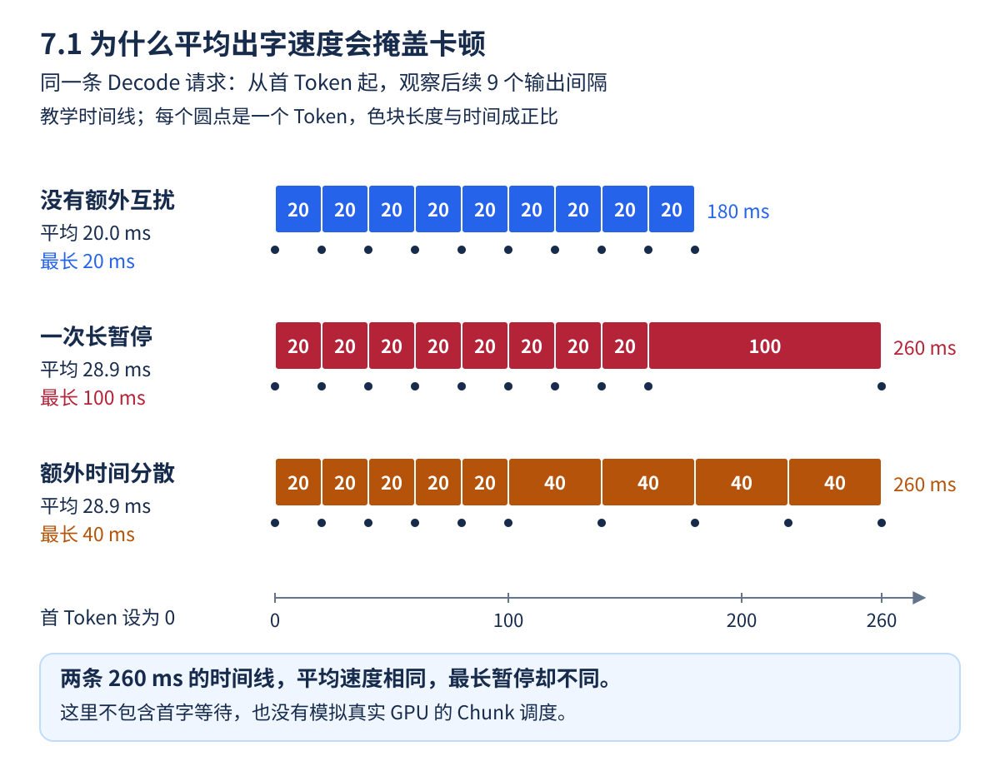

聊天窗口前面还在匀速出字，突然停住一小会，再恢复正常。模型没有换，可能只是另一个长 Prompt 加入了同一份引擎。像高速路上的小车遇到临时并入的重型车辆：**决定这一轮推进速度的，是整批工作的时间，而不是某个 Decode 请求单独需要的时间。**

第 2 章已经用 Chunked Prefill 控制单步工作量。这一章进一步讨论：如果把两类工作放到不同引擎，能换来什么，又要为此付出什么。

<!-- more -->

## 📑 目录

- [1. 两个阶段为什么偏好不同的批次](#1-两个阶段为什么偏好不同的批次)
  - [1.1 先跟着一条请求认识 P 和 D](#11-先跟着一条请求认识-p-和-d)
  - [1.2 为什么常说一个偏计算，一个偏访存](#12-为什么常说一个偏计算一个偏访存)
- [2. 混批怎样拉长某一步](#2-混批怎样拉长某一步)
  - [2.1 一轮调度不等于处理完一条请求](#21-一轮调度不等于处理完一条请求)
  - [2.2 它们具体在争什么](#22-它们具体在争什么)
- [3. 平均 TPOT 会掩盖一次长暂停](#3-平均-tpot-会掩盖一次长暂停)
  - [3.1 用四个到达时刻算一次](#31-用四个到达时刻算一次)
  - [3.2 P95 到底是在给谁排序](#32-p95-到底是在给谁排序)
- [4. 一个可手算的互扰例子](#4-一个可手算的互扰例子)
  - [4.1 不运行代码也能核对结果](#41-不运行代码也能核对结果)
  - [4.2 这个例子证明了什么](#42-这个例子证明了什么)
- [5. Chunked Prefill 与解耦分别改变什么](#5-chunked-prefill-与解耦分别改变什么)
  - [5.1 分块是在同一个工位中穿插工作](#51-分块是在同一个工位中穿插工作)
  - [5.2 解耦是在两个工位之间移交状态](#52-解耦是在两个工位之间移交状态)
- [6. 怎样做一组公平的互扰实验](#6-怎样做一组公平的互扰实验)
  - [6.1 保留同一组被观察的请求](#61-保留同一组被观察的请求)
  - [6.2 怎样读互扰比](#62-怎样读互扰比)
- [总结](#-总结)
- [自我检验清单](#-自我检验清单)
- [参考资料](#-参考资料)

---

## 1. 两个阶段为什么偏好不同的批次

Prefill 一次处理多个输入 Token，矩阵运算较大，常更偏计算密集；低并发 Decode 每条序列每步只推进少量 Token，常更偏权重和 KV 读取。它们是常见趋势，不是脱离模型、长度和批量的绝对分类。

| 阶段 | 常见工作形态 | 主要服务目标 |
|---|---|---|
| Prefill | 处理输入、生成初始 KV | 首 Token 及时到达 |
| Decode | 反复读取历史 KV、逐步生成 | 出字间隔稳定 |

高并发 Decode 也可能接近计算瓶颈；长上下文 Attention 又可能提高访存与通信占比。因此解耦规划先看 Profile，而不是仅凭阶段名称分配硬件。

### 1.1 先跟着一条请求认识 P 和 D

假设用户提交一份长文档，并要求“解释这份文档”。文字先被 Tokenizer 转成 Token ID；Token 不固定等于一个字或一个单词。模型读取这些输入、经过各层计算，并建立输入对应的 KV Cache，这段过程叫 **Prefill**，后文简称 P。

Prefill 的最后位置已经可以用于预测第一个输出 Token。接下来模型用刚产生的 Token 作为新输入，结合历史 KV，继续预测下一个 Token；这样逐步生成的过程叫 **Decode**，后文简称 D。某个解耦协议把首 Token 放在哪一端处理、怎样交给客户端，需要单独约定，不能只根据阶段名字猜。

KV Cache 保存的是 Attention 要复用的历史 Key/Value 向量。D 仍然要读取历史、执行当前 Token 的各层计算，并把新的 KV 加进去；“复用缓存”不等于后续输出不再需要模型计算。

### 1.2 为什么常说一个偏计算，一个偏访存

可以把 GPU 想成有计算工位和仓库通道的工厂。Prefill 一次有很多输入位置可处理，容易组成较大的矩阵运算；低并发 Decode 每轮的新 Token 少，却仍要使用大量模型权重、访问历史 KV，可能花更多时间等待数据。

“计算密集”指主要受计算能力限制，“访存密集”指主要受数据搬运速度限制。它们是瓶颈描述，不是 P/D 的永久标签。增加同时 Decode 的序列数，可以让一轮中更多 Token 共用权重读取，也会增加计算和缓存负担。

本章里的 Profile 指**测量时间花在哪里**：是矩阵计算、权重/KV 读取、通信，还是排队。先测量，再决定分配什么硬件；不能简单推出“P 要好卡，D 随便一张卡就行”。

## 2. 混批怎样拉长某一步

设八条 Decode 请求已在运行，这一步又加入长 Prompt 的 Prefill。它们共享计算、显存带宽、临时工作空间和调度预算。若前向或调度边界不能让 Decode 提前返回，该步输出就会一起延后。



不同实现可能重叠执行或安排不同 Kernel；图描述互扰机制，不假设所有引擎采用完全相同的执行顺序。

### 2.1 一轮调度不等于处理完一条请求

在线引擎通常反复执行“从队列选工作 → 计算 → 更新状态”的迭代。某条 Decode 请求在很多轮中各前进一步；新 Prefill 也可能分多轮进入。Batch 是这一轮选中的工作集合，不是永久不变的一组用户。

例如八条对话都在等待下一个 Token，此时来了一个 8000 Token 的新输入。调度器可能选择其一个输入 Chunk 与已有 Decode 一起处理，也可能采用其他安排。如果这轮变长，等待该轮结果的旧对话就可能同时出现更长的出字间隔。

因此“只加入一条请求”不代表影响很小。这条请求的输入长度、被分到本轮的工作量，以及当时已有请求的状态，都比入口请求数更接近实际成本。

### 2.2 它们具体在争什么

| 共享资源 | 怎样发生竞争 | 可以观察什么 |
|----------|--------------|--------------|
| 计算单元与执行时间 | 大输入计算占用更多本轮时间 | 每轮耗时、算子耗时 |
| 显存带宽 | 权重、KV、激活读写争用通道 | 实际带宽、内核等待情况 |
| KV 和临时显存 | 新输入生成缓存，旧请求仍保留历史 | 可用 KV Block、抢占与缓存容量 |
| 调度预算 | Token/序列预算有限，工作需要轮流进入 | Running/Waiting、本轮处理的 Token 数 |

Block 可以先理解成缓存池里的一页存储单元；抢占则是资源不足时让部分请求暂时退出活跃执行，之后再恢复或重算。即使显存没有报 OOM，等待和抢占也可能已经影响体验。

## 3. 平均 TPOT 会掩盖一次长暂停

输出 $n\ge2$ 个 Token，首末 Token 的到达时刻为 $t_1,t_n$，请求平均 TPOT 为：

$$
\mathrm{TPOT}=\frac{t_n-t_1}{n-1}
$$

逐个出字间隔为 $\mathrm{ITL}_i=t_i-t_{i-1}$。请求平均 TPOT 的 P95 和全部 Token 间隔的 P95 ITL，是不同统计量；后者会按输出间隔数量给长输出更多权重。

还要区分服务端 Token 生成时间与客户端流式块的到达时间。代理缓冲可能把多个 Token 合成一块，网络分片也不一定对应 Token 边界。只按 TCP 分包计数，不能当作 Token 级 ITL。

### 3.1 用四个到达时刻算一次

假设请求在 0 ms 发出，四个输出 Token 分别在 200、220、320、340 ms 被可靠地观测到：

| 指标 | 计算 | 回答什么问题 |
|------|------|--------------|
| TTFT | $200-0=200$ ms | 第一份输出等了多久 |
| 三个 ITL | 20、100、20 ms | 哪一步突然停顿 |
| 请求平均 TPOT | $(340-200)/(4-1)\approx46.7$ ms | 首 Token 后的平均出字间隔 |

其中一次暂停是 100 ms，但请求平均值不到 47 ms。若输出更长，一次暂停还可能被更多正常间隔摊薄。所以“平均出字速度还行”不能保证没有用户可感知的卡顿。

### 3.2 P95 到底是在给谁排序

P95 可以先理解成“把观测值从小到大排列后，靠近 95% 位置的数”。请求 TPOT P95 是先给每条请求算一个平均值，再给这些请求排序；Token ITL P95 则给很多次输出间隔排序。不同工具还可能使用不同分位数插值方法，比较时要记录口径。

客户端常收到 SSE 流式事件，但一次事件也不一定恰好包含一个 Token。若只能观测到事件到达，就应说明测到的是事件间隔或工具估计的指标。定位问题时，可以同时比较服务端执行时间、代理输出和客户端接收，判断暂停发生在哪一段。

## 4. 一个可手算的互扰例子

假设原来每轮 20 ms；某轮额外工作把这一轮变为 100 ms。这里的五倍是**人为设定的时间线**，不是任何 GPU 的实测结论：



**顺着时间线读图**：

1. 把首 Token 到达设为图里的 0 ms。每个圆点是后续一个 Token 的到达边界，两个圆点间的色块表示一次 ITL；宽度越长，用户这一次等得越久。
2. 第一行九个间隔都是 20 ms，后续九个 Token 共用 180 ms。第二行有一个 100 ms 的长间隔，合计变成 260 ms，用户会经历一次明显长于其他间隔的停顿。
3. 第三行把相同的额外 80 ms 分到四个位置。它仍花 260 ms，因此平均 TPOT 与第二行相同，但最长暂停只有 40 ms。

图从首 Token 开始，所以不能用它读取 TTFT。第二、三行也不是“真实 Chunked Prefill 前后必然如此”，而是帮助理解**总耗时相同，出字体验仍可能不同**的教学构造。下面的代码正好生成图中的三组数字。

```python
import math

def percentile(values, q):
    ordered = sorted(values)
    return ordered[max(0, math.ceil(q * len(ordered)) - 1)]

baseline = [20] * 9
interference = [20] * 8 + [100]
chunked = [20] * 5 + [40] * 4
for label, gaps in [("baseline", baseline), ("mixed", interference),
                    ("chunked-toy", chunked)]:
    print(label, "平均 TPOT", sum(gaps) / len(gaps),
          "P95 ITL", percentile(gaps, 0.95))
assert percentile(interference, 0.95) / percentile(baseline, 0.95) == 5
assert sum(interference) == sum(chunked)
```

把相同的额外时间摊到四轮，降低了最大暂停，却没有消灭全部额外工作。这不是生产调度模拟，也不能据九个样本稳定估计真实 P95；它只说明平均值和尖刺的区别。

### 4.1 不运行代码也能核对结果

基线九个间隔合计 180 ms，平均 20 ms。混合例子合计 $8\times20+100=260$ ms，平均约 28.9 ms；分块例子合计 $5\times20+4\times40=260$ ms，平均也约 28.9 ms，但最长间隔从 100 ms 降到了 40 ms。

代码使用 nearest-rank 方法：九个值的 95% 位置向上取整后是第九个，因此这里的 P95 正好取最大值。真实压测需要更多样本；不能因为这个小例子里二者相同，就把 P95 定义成最大值。

### 4.2 这个例子证明了什么

它证明的是“相同额外时间可以表现为一次长暂停，也可以表现为多次较小变慢”。它没有模拟 GPU 批处理、通信重叠或真实 Chunk 调度，尤其没有证明真实分块后的总耗时一定不变。

可以自己把 100 改成 180，观察平均值与尾部如何变化；再把额外时间分散到更多位置。先读懂数值，再去看真实 ITL 曲线上的尖刺，会更容易提出可以验证的解释。

**停下来想一想**：如果业务只要求平均 TPOT 不超过 30 ms，图中第二、三行谁通过？如果再要求每个 ITL 不超过 50 ms，答案会变吗？

两行的平均值都约为 28.9 ms，所以第一条要求下都通过；加上单次间隔要求后，第二行的 100 ms 不通过，第三行的最大 40 ms 通过。这说明业务要先说清“平均快”和“不能长时间停顿”各自的门槛。

## 5. Chunked Prefill 与解耦分别改变什么

Chunked Prefill 限制单轮输入工作量，让 Decode 更频繁获得推进机会；P/D 解耦把两类计算安排到不同引擎，允许分别设置批处理与并行策略。

| 维度 | 调整混合引擎的 Chunk | P/D 解耦 |
|---|---|---|
| 资源隔离 | 仍共享 GPU 与缓存预算 | 计算池可独立配置 |
| 输入计算 | 分多轮完成 | 在 P 池完成 |
| 跨引擎 KV 传输 | 通常不需要 | 必须正确移交 |
| 资源使用 | 两阶段可共用同一份权重 | 两个池各要装载模型 |
| 调度复杂度 | 单引擎内权衡 | 还需路由、传输与池间协调 |

长 Prefill 切小后，TTFT 可能因额外等待增长，也可能因更好的调度/并发而改善，需按负载测量；不能给所有场景预先规定方向。

### 5.1 分块是在同一个工位中穿插工作

Chunk 指一次交给调度器处理的输入片段。它能控制长输入单次占用工位的时间，但输入内容仍然要被计算，KV 仍占用同一引擎的预算。Chunk 太大可能增加 Decode 暂停，太小又可能降低计算效率或增加轮次开销。

### 5.2 解耦是在两个工位之间移交状态

P 实例先建立输入的 KV，D 实例拿到这些状态再继续生成。两个池可以分别安排批次和资源，减少直接的计算互扰；代价是两端各要装载相应模型权重，还新增路由、迁移和接收等待。

因此要比较的是**少掉的互扰是否足以覆盖新增开销**。D 不再被长 Prefill 直接拖住，并不代表 TTFT 自动变好；首字还可能等 P 排队或 KV 传输。下一节会沿完整请求路径拆开这些成本。

## 6. 怎样做一组公平的互扰实验

准备 Decode-heavy 和 Prefill-heavy 两类请求，记录到达时刻与实际 Token 数。至少比较 Decode-only、原混合配置、不同 Chunk 预算，以及同样总 GPU 预算的解耦配置。

计算同一类请求的互扰比：

$$
R_{\text{ITL}}=\frac{P95(\mathrm{ITL}_{\text{mixed,decode-group}})}{P95(\mathrm{ITL}_{\text{decode-only}})}
$$

排除预热、模型编译和客户端饱和；对失败、超时与长队列单独计数。混合流中不同请求的样本不能不分组直接合成一个 P95，否则工作负载变化本身也会改变结果。

第 7.6 节给出实际输入与对照矩阵。最终目标是同时守住首字与出字要求，而不是证明某个架构标签天然更快。

### 6.1 保留同一组被观察的请求

先让 Decode-heavy 组单独运行，建立“没有另一类工作时”的基线；再保持它的输入、输出目标、到达节奏和配置不变，同时加入 Prefill-heavy 组。这样才是在问新增工作如何影响原来的组。

随后在相同混合负载下比较 Chunk 配置和解耦部署。若解耦用了两卡，至少加入两卡聚合副本作为对照；拿两卡解耦对一张卡聚合，只能同时观察资源增加和组织方式改变，不能单独归因于解耦。

### 6.2 怎样读互扰比

假设某一部署的 Decode-only P95 ITL 为 25 ms，混合时同组变成 60 ms，则 $R_{\text{ITL}}=60/25=2.4$。这是假设例子，表示这一统计量变为基线的 2.4 倍，不代表每个 Token 都慢了 2.4 倍。

同时看 Prefill 组 TTFT、成功率、排队与 GPU 预算。若通过拒绝大量请求来让剩余请求更快，应把拒绝计入服务评估；若基线样本极少或接近零，比例也会不稳定。比值能帮助描述现象，日志与执行轨迹才能进一步判断原因。

## 📝 总结

- P/D 互扰来自共享资源和调度边界，程度随负载变化。
- 平均 TPOT、请求 TPOT 分位数、Token 级 ITL 分位数要分别解释。
- Chunked Prefill 控制单轮工作；解耦增加资源隔离，也引入迁移成本。
- 任何“慢几倍”的结论都应附带模型、硬件、负载和统计口径。

## 🎯 自我检验清单

- 能画出长 Prefill 进入后 Decode 时间线的变化
- 能解释为什么一次长暂停可能被平均 TPOT 掩盖
- 能区分流式网络块与真正的 Token 间隔
- 能说明 Chunked Prefill 与 P/D 解耦的不同成本
- 能设计固定 Decode 请求组的互扰对照
- 能用四个 Token 到达时刻分别算出 TTFT、ITL 与平均 TPOT
- 能解释为什么降低尾部暂停不等于减少全部计算工作

## 📚 参考资料

- [DistServe — USENIX OSDI 2024](https://www.usenix.org/conference/osdi24/presentation/zhong-yinmin)
- [vLLM v0.19.0 — Disaggregated Prefilling](https://github.com/vllm-project/vllm/blob/v0.19.0/docs/features/disagg_prefill.md)
- [vLLM v0.19.0 — Benchmark Serve 指标实现](https://github.com/vllm-project/vllm/blob/v0.19.0/vllm/benchmarks/serve.py)

---

[返回本章](https://caomaolufei.github.io/AIInfraGuide/inference/模块四-推理优化/第7章-pd解耦架构/) · [上一章](https://caomaolufei.github.io/AIInfraGuide/inference/模块四-推理优化/第6章-分布式推理/) · [下一节](https://caomaolufei.github.io/AIInfraGuide/inference/模块四-推理优化/第7章-pd解耦架构/72-解耦架构设计/)
