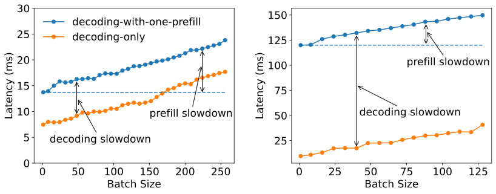

第 2 章 2.4 节讲过，长 Prompt 的 Prefill 挤进 Decode 所在的那一步时，同批所有请求都会卡一下，Chunked Prefill 通过切块把这个尖峰削平。本节换一个角度，把这种干扰算清楚：它有多大、从哪里来、切块之后还剩多少，以及为什么即使干扰被压住，把两个阶段放在同一组 GPU 上仍然有代价。这些问题是后面几节讨论 P/D 解耦的出发点。

> ⏰ **信息时效**：干扰的测量数据取自 DistServe（OSDI'24）、Splitwise（ISCA'24）论文和 vLLM 官方博客（2026-09-29）；硬件参数取自 NVIDIA H100 产品页；成本模型中的利用率是假设值。

<!-- more -->

## 📑 目录

- [1. 两个阶段要的资源不一样](#1-两个阶段要的资源不一样)
- [2. 混在同一步里会发生什么](#2-混在同一步里会发生什么)
- [3. 用成本模型估一估干扰有多大](#3-用成本模型估一估干扰有多大)
- [4. 线上看到的是尾延迟](#4-线上看到的是尾延迟)
- [5. Chunked Prefill 解决了什么，留下了什么](#5-chunked-prefill-解决了什么留下了什么)
- [6. 更深一层：两个阶段绑在同一套资源上](#6-更深一层两个阶段绑在同一套资源上)
- [总结](#-总结)
- [自我检验清单](#-自我检验清单)
- [参考资料](#-参考资料)

---

## 1. 两个阶段要的资源不一样

先用白话说：Prefill 像一次把整车货卸下来，快慢取决于力气，也就是算力；Decode 像每趟只送一件快递，大部分时间花在来回跑路上，也就是从显存里把权重读一遍。两种活放进同一辆车里，谁都干不痛快。

正式一点，用**算术强度**（每读 1 字节数据做多少次浮点运算）来比较。一个线性层的权重是 $W\in\mathbb{R}^{h\times f}$，BF16 存储占 $2hf$ 字节。一步里有 $n$ 个 Token 经过这层，计算量是 $2nhf$ FLOP，于是：

$$
\text{算术强度}\approx\frac{2nhf}{2hf}=n\quad(\text{FLOP/Byte})
$$

也就是说，线性层的算术强度约等于**这一步里同时处理的 Token 数**。GPU 能不能吃满算力，要和它的"屋脊点"比。H100 SXM 的 BF16 稠密算力约 989 TFLOPS，显存带宽 3.35 TB/s，屋脊点约为：

$$
\frac{989\times10^{12}}{3.35\times10^{12}}\approx295\ \text{FLOP/Byte}
$$

| 📊 阶段 | 一步处理的 Token 数 $n$ | 线性层算术强度 | 受什么限制 |
|---|---|---|---|
| Prefill 一个 4096 Token 的 Prompt | 4096 | 约 4096 | 算力 |
| Prefill 一个 512 Token 的 Prompt | 512 | 约 512 | 算力 |
| Decode，Batch = 32 | 32 | 约 32，再算上读 KV 会更低 | 显存带宽 |
| Decode，Batch = 256 | 256 | 约 256，仍低于屋脊点 | 显存带宽 |

DistServe 论文在 A100 上测到同样的现象：13B 模型处理一条 512 Token 的序列就能让 GPU 接近算力上限，再往 Batch 里加请求只会按比例拉长这一步的时间。Decode 则相反，Batch 越大吞吐越高，直到显存装不下 KV Cache。Splitwise 论文还从功耗角度补了一个证据：Prompt 阶段对功率上限很敏感，Token 生成阶段把每卡功率从 700 W 压到 350 W，延迟几乎不变。

🔑 **核心概念**：Prefill 是"算力型"的，Decode 是"带宽型"的。同一张 GPU 在同一时刻只能用一种方式跑，两类任务混在一起时，总有一方用不上它最需要的那份资源。

---

## 2. 混在同一步里会发生什么

Continuous Batching 每一步重新组批，新请求的 Prefill 和老请求的 Decode 会被放进同一次前向。这样做提高了 GPU 利用率，但两类任务开始互相拖累。

下图是 DistServe 论文的 Figure 2，测的是 13B 模型在一张 A100 上的单步耗时。横轴是 Decode 的 Batch 大小，橙线是只有 Decode 的批，蓝线是同一批再加一个 Prefill 请求。左图的 Prefill 长度是 128，右图是 1024。蓝色虚线是 Batch 很小时"带一个 Prefill"的耗时基线，箭头标出两种拖慢：



*图注：从图上读数，Prefill 长度为 1024 时，Batch 很小的 Decode 步从约 10 ms 变成约 120 ms；Batch = 128 时从约 41 ms 变成约 150 ms。图中的 decoding slowdown 是 Decode 被 Prefill 拖慢，prefill slowdown 是 Prefill 因为带上了 Decode 而变慢。*

> 来源：Zhong et al., "DistServe: Disaggregating Prefill and Decoding for Goodput-optimized Large Language Model Serving", OSDI 2024, Figure 2. [arXiv:2401.09670](https://arxiv.org/abs/2401.09670)

从这张图可以读出两个方向的干扰：

- **Decode 被拖慢**：一个 Prefill 混进来，同批所有 Decode 请求的这一步都要等它算完。Prompt 越长，拖得越久，右图里单步耗时差了一个数量级。这一步的延迟会直接计入这些请求的 TPOT 和 ITL。
- **Prefill 也被拖慢**：Batch 里的 Decode 请求越多，这一步越长，Prefill 请求的 TTFT 跟着变大。GPU 已经接近满载时这个效应更明显（图中蓝线随 Batch 上升的部分）。

DistServe 还指出，把两类任务分开调度、每一步只跑一类，也解决不了问题：Decode 要排队等正在运行的 Prefill，反过来也一样；纯 Decode 的批又常常用不满 GPU。优先调度任何一方，另一方的延迟目标就更难满足。

---

## 3. 用成本模型估一估干扰有多大

论文用的是 OPT 系列和 A100。换成现在常见的 Qwen3-8B 和 H100，可以用一个很粗的成本模型估一下量级：一步的耗时取"读完权重和 KV 的时间"与"做完全部浮点运算的时间"中较大的那个。

下面是**假设成本模型**，算力利用率 60% 是假设值，忽略了 Kernel 启动、调度和通信，只用来看相对大小：

```python
# 假设成本模型：一步耗时 = max(访存时间, 计算时间)，只用于看量级
PEAK = 989e12 * 0.6      # H100 SXM BF16 稠密峰值 × 假设 60% 利用率，FLOP/s
HBM = 3.35e12            # H100 SXM 显存带宽，B/s
P = 8.2e9                # Qwen3-8B 参数量
L, HQ, D = 36, 32, 128   # 层数、Q 头数、head_dim
KV_TOK = 2 * L * 8 * D * 2   # 每 Token 的 KV 字节（8 个 KV 头，BF16）= 144 KiB


def step_ms(decode_bs, ctx, prefill_new=0, prefill_past=0):
    """decode_bs 个 Decode 请求（每个上下文 ctx）+ 一段 Prefill（本步新算 prefill_new 个 Token，之前已算 prefill_past 个）"""
    n = decode_bs + prefill_new
    flops = 2 * P * n
    # 注意力：Decode 每个 Token 看 ctx 个历史；Prefill 块里的 Token 平均看 past + new/2 个
    flops += 4 * L * HQ * D * (decode_bs * ctx + prefill_new * (prefill_past + prefill_new / 2))
    bytes_ = 2 * P + KV_TOK * (decode_bs * ctx + prefill_past)
    return max(bytes_ / HBM, flops / PEAK) * 1e3


bs, ctx, prompt, chunk = 32, 2048, 4096, 512
base = step_ms(bs, ctx)
whole = step_ms(bs, ctx, prompt)
chunks = [step_ms(bs, ctx, chunk, i * chunk) for i in range(prompt // chunk)]
print(f"每 Token KV = {KV_TOK / 1024:.0f} KiB")
print(f"纯 Decode 一步          : {base:6.1f} ms")
print(f"+ 整段 {prompt} Prefill   : {whole:6.1f} ms  ({whole / base:.1f}x)")
print(f"+ {chunk} 分块（逐块）     : " + " ".join(f"{c:.1f}" for c in chunks) + " ms")
print(f"  分块最长一步 {max(chunks):.1f} ms ({max(chunks) / base:.1f}x)，8 块合计 {sum(chunks):.1f} ms")
pf = step_ms(0, 0, prompt)
print(f"解耦：P 上单独 Prefill  : {pf:6.1f} ms；D 上每步仍是 {base:.1f} ms")
```

输出：

```text
每 Token KV = 144 KiB
纯 Decode 一步          :    7.8 ms
+ 整段 4096 Prefill   :  122.5 ms  (15.7x)
+ 512 分块（逐块）     : 15.2 15.5 15.8 16.0 16.3 16.5 16.8 17.1 ms
  分块最长一步 17.1 ms (2.2x)，8 块合计 129.1 ms
解耦：P 上单独 Prefill  :  121.5 ms；D 上每步仍是 7.8 ms
```

下图把这几个数画在一起。蓝色是纯 Decode 的步，黄色是含 Prefill 的步，条的长度是单步耗时：


在这组假设下可以看到：

- **不切块**：这一步从 7.8 ms 变成 122.5 ms，同批 32 个请求各自的这个 Token 晚了约 115 ms。用户看到的就是"出字卡了一下"。
- **切块**：最长一步降到 17.1 ms，约为纯 Decode 的 2.2 倍，但要持续 8 步。干扰从一次大尖峰变成了一段持续的减速。8 个块合计 129.1 ms，比不切块多出约 7 ms，多出来的部分主要是每块都要重新读之前块的 KV。
- **解耦**：Prefill 在另一组 GPU 上算，Decode 实例的每一步保持 7.8 ms。代价是 KV 要从 Prefill 实例搬过来，4096 Token 的 KV 约 576 MiB，7.3 节会算这笔账。

⚠️ **注意**：这个模型没有算 Prefill 时 Attention Kernel 的实际效率，也没有算 CUDA Graph 对纯 Decode 步的加速（混合步往往用不上 CUDA Graph）。真实系统里"纯 Decode 步"更短，干扰倍数通常更大。

---

## 4. 线上看到的是尾延迟

单步变慢只发生在有 Prefill 到达的那几步，所以中位数延迟往往看不出问题，问题集中在 P99 这样的尾部指标上。

vLLM 官方博客（2026-09-29）给过一组实测：两张 L40S（PCIe，无 NVLink），Qwen2.5-7B-Instruct，约 8k Token 的 Prompt、256 个输出 Token，泊松到达。合并部署用 `--data-parallel-size 2`，P/D 解耦用一个 Prefill 实例加一个 Decode 实例：

| 📊 指标 | 合并部署 | P/D 解耦 |
|---|---|---|
| ITL 中位数（1 req/s 以内） | 21–24 ms | 21–24 ms |
| P99 ITL，0.4 req/s | 169 ms（0.2 req/s 时为 23 ms） | 29 ms |
| P99 ITL，全部测试负载（0.2–2 req/s） | 最高 263 ms | 25–52 ms |

中位数几乎一样，P99 差了约 6 倍。原因就是第 2 节的机制：8k Token 的 Prefill 落在正在 Decode 的 GPU 上，这一步里所有流都停下来等它。

DistServe 作者团队在 2025 年的回顾文章里给出的范围更宽：即使开了 Chunked Prefill，一个大的 Prefill 也能把 TPOT 放大 2 到 30 倍，突发负载下尤其明显。

💡 **提示**：评估干扰时至少看 P90 和 P99 的 ITL（或 TPOT），并且一定要在有长 Prompt 混入的负载下测。只用短 Prompt 压测，或者只看平均值，会得出"没有干扰"的结论。

---

## 5. Chunked Prefill 解决了什么，留下了什么

Chunked Prefill（SARATHI 及其后续 Sarathi-Serve）把长 Prefill 切成块，每一步只放一块，和 Decode 一起组批。第 3 节的估算已经显示，它能把单步尖峰从 15.7 倍压到 2.2 倍左右。Sarathi-Serve 的论文报告，在尾延迟约束下，它让 Mistral-7B（单张 A100）的服务能力提高到 vLLM 的 2.6 倍，Yi-34B（两张 A100）最高 3.7 倍。对很多部署来说，开好 Chunked Prefill 就够了。

DistServe 论文指出它没能消除的部分：

| 📊 问题 | 原因 |
|---|---|
| 块大小难选 | 块比"吃满 GPU 的长度"小得多时，Prefill 和 Decode 抢同一步，Prefill 变慢；块接近这个长度时，留给 Decode 的位置变少，搭车（piggyback）的机会就少了 |
| Prefill 本身变贵 | 每算一块都要把前面所有块的 KV 从 HBM 读一遍。切成 $N$ 块时，总共读 $N+(N-1)+\cdots+1=O(N^2)$ 块的 KV，不切块是 $O(N)$。上下文越长，这部分越明显 |
| 干扰只是被摊薄 | 每个含 Prefill 的步仍比纯 Decode 步长，只是长得少、持续得久 |
| TTFT 变长 | 长 Prompt 要跨多步才算完，首 Token 出得更晚（2.4 节讨论过这个权衡） |

vLLM 的官方文档也是这个判断：合适的块大小确实能控制尾部 ITL，"但实际中很难找到正确的块大小"，最佳值随流量变化，需要反复调。P/D 解耦则从结构上让 Decode 实例只跑 Decode，不依赖这个参数。

📌 **关键点**：Chunked Prefill 和 P/D 解耦不是二选一。解耦部署里的 Prefill 实例本身通常也开着 Chunked Prefill，用来处理超长 Prompt 和控制单步显存；7.2 节的 TaiChi 更是把"块大小"当成在两种模式之间切换的旋钮。

---

## 6. 更深一层：两个阶段绑在同一套资源上

即使干扰被压到可以接受，合并部署还有第二个问题：Prefill 和 Decode 必须用同一套 GPU、同一个并行策略、同一个扩缩容节奏。DistServe 把它叫作**资源与并行策略耦合**。

- **并行策略只能选一套**。Prefill 是算力型的，为了压 TTFT，更适合用 TP 这类算子内并行缩短单次执行时间；Decode 的最优并行方式取决于 Batch 大小，延迟要求严时靠 TP，之后再加 PP 线性提升吞吐。DistServe 为 OPT-175B 搜出来的方案里，Prefill 实例是 PP=3、TP=3，Decode 实例是 PP=3、TP=4，两者并不相同。合并部署只能取一个折中值，通常按两个 SLO 里更严的那个来配，另一个阶段就被过度配置了。
- **硬件只能选一种**。Splitwise 在 Llama-70B 上对比了 A100 和 H100：H100 让 TTFT 降到 A100 的约 0.51 倍，TBT 只降到约 0.70 倍。Token 生成阶段对算力不敏感，用上一代 GPU 跑它的性价比和能效更好。合并部署里两个阶段只能在同一种卡上跑。
- **扩容只能一起扩**。Prompt 变长时缺的是 Prefill 算力，并发变多时缺的是 Decode 的 KV 容量。合并部署只能整体加副本，两种资源按固定比例一起增加。

🔑 **核心概念**：P/D 解耦要解决两件事。一是消除两个阶段之间的干扰，二是让两个阶段各自选 GPU 数量、并行策略甚至硬件型号。后者往往比前者更能决定成本。

下一节看 DistServe、Splitwise 等系统具体怎么拆。

---

## 📝 总结

- 线性层的算术强度约等于一步处理的 Token 数。Prefill 一次几百上千个 Token，越过 H100 约 295 FLOP/Byte 的屋脊点，受算力限制；Decode 即使 Batch = 256 也低于屋脊点，受显存带宽限制。
- 在同一步里混合两者，Decode 被 Prefill 拖慢（TPOT/ITL 上升），Prefill 也被 Decode 拖慢（TTFT 上升）。DistServe 在 13B 模型上测到，带一个 1024 Token 的 Prefill 时，小 Batch 的 Decode 步从约 10 ms 变成约 120 ms。
- 干扰主要体现在尾延迟上：vLLM 博客的 L40S 实测里，合并部署的 P99 ITL 在 0.4 req/s 时达到 169 ms，P/D 解耦为 29 ms，中位数几乎相同。
- Chunked Prefill 把尖峰摊成持续的小幅减速，块大小难选，还会让长 Prompt 的 KV 重复读取量变成 $O(N^2)$。
- 合并部署还把两个阶段的 GPU 数量、并行策略、硬件型号和扩缩容绑在一起，这是 P/D 解耦的第二个动机。

## 🎯 自我检验清单

- 能推导线性层算术强度约等于本步 Token 数，并用 H100 的算力与带宽算出屋脊点
- 能说明为什么 Prefill 一个 512 Token 的 Prompt 就接近算力上限，而 Decode Batch = 256 仍受带宽限制
- 能看懂 DistServe Figure 2，分别指出 Decode 被拖慢和 Prefill 被拖慢的部分
- 能用"max(访存时间, 计算时间)"的模型估算混入一个长 Prefill 后单步时间的变化
- 能解释为什么干扰主要表现在 P99 ITL 上，并设计能暴露干扰的压测负载
- 能列出 Chunked Prefill 没能解决的问题，包括块大小两难和 $O(N^2)$ 的 KV 重读
- 能举例说明"资源与并行策略耦合"在并行度、硬件型号、扩容三个方面的表现

## 📚 参考资料

- [DistServe: Disaggregating Prefill and Decoding for Goodput-optimized Large Language Model Serving（OSDI'24）](https://arxiv.org/abs/2401.09670)
- [Splitwise: Efficient Generative LLM Inference Using Phase Splitting（ISCA'24）](https://arxiv.org/abs/2311.18677)
- [Taming Throughput-Latency Tradeoff in LLM Inference with Sarathi-Serve（OSDI'24）](https://arxiv.org/abs/2403.02310)
- [Disaggregated Inference: 18 Months Later（Hao AI Lab，2025-11-03）](https://haoailab.com/blogs/distserve-retro/)
- [Taking vLLM Apart: A Practical Guide to Disaggregated Serving（vLLM Blog，2026-09-29）](https://vllm.ai/blog/2026-09-29-disaggregated-serving-guide)
- [vLLM 文档：Disaggregated Prefilling (experimental)](https://docs.vllm.ai/en/stable/features/disagg_prefill/)
- [NVIDIA H100 Tensor Core GPU](https://www.nvidia.com/en-us/data-center/h100/)
