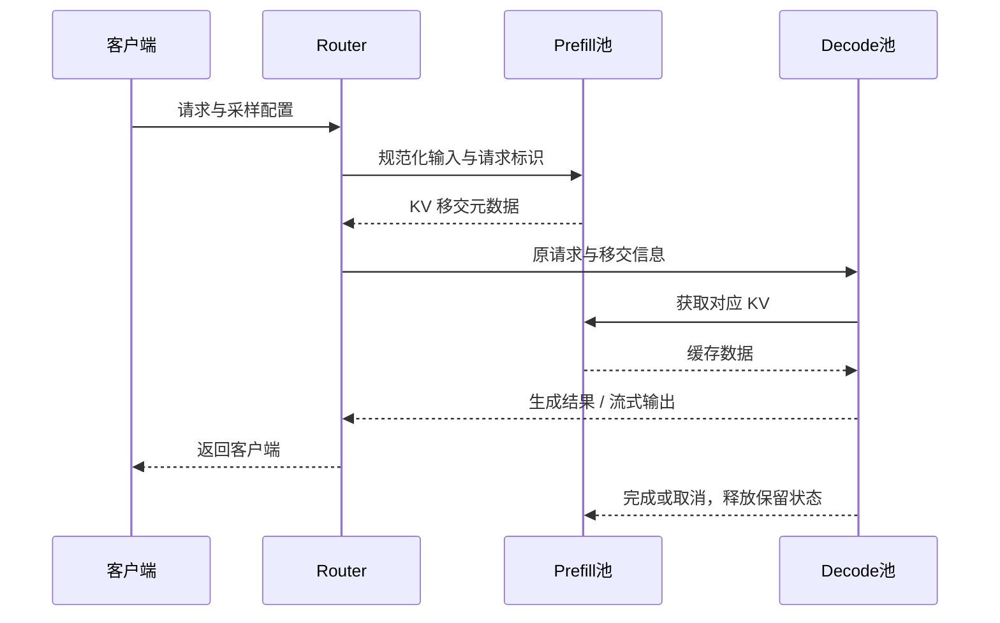
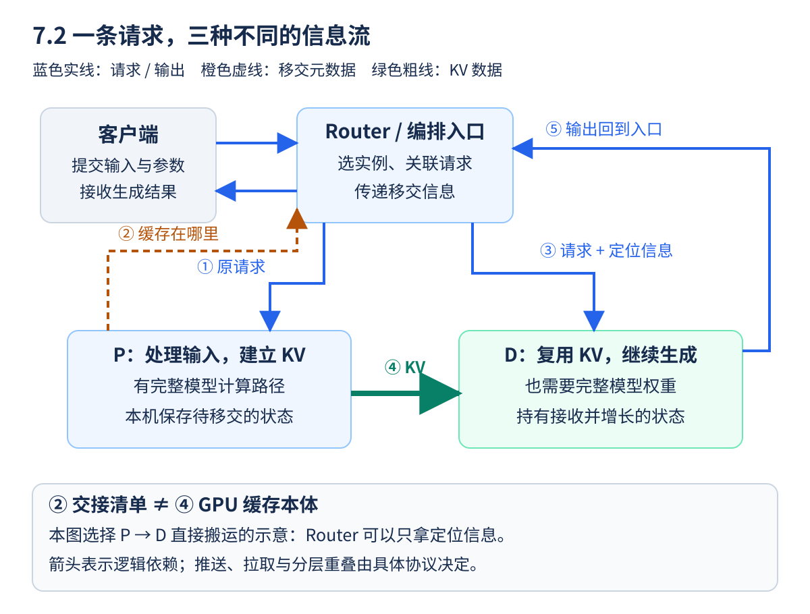

把餐厅的备菜和出餐分到两个区域，还不算完成改造。订单怎样移交、半成品放哪里、哪个区域排队、出餐失败以后谁清理，都需要重新设计。**P/D 解耦是围绕请求状态重组系统，并非把两个服务地址串起来。**

<!-- more -->

## 📑 目录

- [1. 先沿着一条请求走完生命周期](#1-先沿着一条请求走完生命周期)
  - [1.1 先区分三条路线](#11-先区分三条路线)
  - [1.2 P 和 D 分别保存多少模型](#12-p-和-d-分别保存多少模型)
  - [1.3 移交并没有消除首字路径上的等待](#13-移交并没有消除首字路径上的等待)
- [2. DistServe：把阶段与 SLO 一起规划](#2-distserve把阶段与-slo-一起规划)
  - [2.1 SLO 是约束，不是越快越好的口号](#21-slo-是约束不是越快越好的口号)
  - [2.2 从论文回到自己的部署问题](#22-从论文回到自己的部署问题)
- [3. Splitwise：阶段特性可以映射到不同硬件](#3-splitwise阶段特性可以映射到不同硬件)
  - [3.1 什么叫异构，为什么要考虑它](#31-什么叫异构为什么要考虑它)
  - [3.2 把“省钱”拆成完整账本](#32-把省钱拆成完整账本)
- [4. TaiChi：聚合与解耦之间不只有二选一](#4-taichi聚合与解耦之间不只有二选一)
  - [4.1 “偏 P”与“偏 D”不等于只能做一种工作](#41-偏-p与偏-d不等于只能做一种工作)
  - [4.2 怎样理解把延迟预算让给更急的请求](#42-怎样理解把延迟预算让给更急的请求)
- [5. Microserving：把移交操作变成可编排接口](#5-microserving把移交操作变成可编排接口)
  - [5.1 普通生成 API 隐藏了哪些步骤](#51-普通生成-api-隐藏了哪些步骤)
  - [5.2 可编程不等于已经完成资源调度](#52-可编程不等于已经完成资源调度)
- [6. 把几种设计放在同一张地图上](#6-把几种设计放在同一张地图上)
  - [6.1 用三个问题阅读陌生系统](#61-用三个问题阅读陌生系统)
  - [6.2 7.6 的实验位于哪一层](#62-76-的实验位于哪一层)
- [7. 设计时不能省略的控制面](#7-设计时不能省略的控制面)
  - [7.1 控制面是在管理哪些状态](#71-控制面是在管理哪些状态)
  - [7.2 用一次取消检查设计是否完整](#72-用一次取消检查设计是否完整)
- [总结](#-总结)
- [自我检验清单](#-自我检验清单)
- [参考资料](#-参考资料)

---

## 1. 先沿着一条请求走完生命周期

一个基本路径包含：入口规范化输入、选择 Prefill 实例、生成 KV、选择/准备 Decode 实例、移交状态、继续生成并释放资源。

图是一种拉取式示意，系统也可采用推送、分层传输或其他协议。某些实现的 Prefill 请求会先计算一个输出 Token，但最终响应怎样拼装，应由协议明确，避免重复或漏掉首 Token。

### 1.1 先区分三条路线

**请求路线**携带用户输入、采样参数和请求 ID；**元数据路线**说明缓存属于谁、位于哪里、哪些 Token 已计算；**数据路线**实际搬运 GPU 中的 KV。三者可能经过不同的组件和网络通道。

例如 Router 收到的是“请求 r17 的缓存定位信息”，不代表那份缓存已经下载到 Router 内存。D 可以依据定位信息向 P 获取数据，GPU 到 GPU 的数据流也不一定经过 HTTP 代理。

Router 在这里是**接收请求、选择后端实例并组织处理步骤的服务组件**。它像接待与派单员，可以运行在普通 CPU 进程里。P/D 感知 Router 除了选地址，还要把前后两阶段关联起来；仅有一个普通负载均衡器，把请求随机分到 P 或 D，不能自动完成移交。

**按编号走一遍**：

1. **① 请求到 P。** Router 给输入和采样配置关联请求身份，再交给选中的 P 实例建立历史状态。
2. **② 取回移交清单。** P 返回“这条请求哪些位置已计算、去哪里找缓存”等信息。可以把它想成取货凭证，凭证不是货物本身。
3. **③ 清单随请求交给 D。** D 根据同一请求身份、输入契约和定位信息准备接收与继续生成。
4. **④ 真正搬缓存，⑤ 返回输出。** 本图的 KV 从 P 到 D，生成内容则经过入口返回用户。箭头表示逻辑路线，不规定所有层必须串行传完后才能开始下一步。

**停下来想一想**：为什么不能拿 Router 收到的 HTTP 响应体大小，直接估算 KV 的迁移量？因为这里 HTTP 可能只搬了定位元数据，真正的大块 GPU 数据走的是另一条通路。要找实际搬运字节，应看 Connector/传输后端的记录。

### 1.2 P 和 D 分别保存多少模型

最小解耦部署中，P、D 各有足以执行相应模型前向的权重集合。它们可以各自跨多张卡 TP/PP，但不能理解成 P 只存前半层、D 只存后半层；那是第六章 PP 的分层思路。

两端角色的区别主要在于服务哪类工作：P 计算输入并保留待交接的 KV，D 接收状态、继续生成，并维护增长中的缓存。D 仍然需要模型各层权重，不能只带着一份 KV 就独立生成。

### 1.3 移交并没有消除首字路径上的等待

可以用一个不考虑重叠的示意，把客户端首字等待拆成：入口处理、P 排队、P 计算、KV 移交、D 等待与首个对外输出、返回客户端。某些步骤能重叠时，应计算实际暴露在关键路径上的部分，不能把所有耗时机械相加。

“关键路径”就是必须依次完成、决定用户最早何时拿到结果的那条依赖链。解耦可能让后续出字稳定，却在这条链上增加迁移等待。看架构图时既要问谁能并行，也要问谁必须等谁。

## 2. DistServe：把阶段与 SLO 一起规划

DistServe 在 OSDI 2024 中系统讨论 P/D 的资源耦合：如果两阶段共用同一部署计划，TTFT 与 TPOT 的优化容易相互牵制。它将两阶段放在不同 GPU，并结合 SLO 为各阶段选择资源量、并行策略和带宽相关放置。

读这项设计时，重点不是记住论文中的最高倍数，而是看三个决策如何联动：**阶段的单实例能力、需要多少实例、实例放在哪条链路两侧**。不同模型与网络条件下，答案可能不同。

### 2.1 SLO 是约束，不是越快越好的口号

SLO 是服务目标。假设某业务要求首 Token 不超过 1 秒，首 Token 后平均间隔不超过 50 ms：只把 P 算得很快，但让 D 长期排队，仍然不合格；让 D 出字很稳，但首字已经等了数秒，也没有满足同一份契约。门槛是教学假设，应由业务实际确定。

DistServe 的阅读重点因此是：怎样在两类约束下安排资源，而不是只追求一个最大的总 Token/s。原论文的系统规划和实验结果，应与本地框架已经实现的能力分开理解。

### 2.2 从论文回到自己的部署问题

可以把它转成一张规划卡：目标输入/输出分布是什么，P/D 单实例在该负载下各能承担多少工作，需要多少实例，以及它们之间的链路是否足够。这是借鉴设计思路，不是从论文抄一个固定的 P:D 数量比例。

## 3. Splitwise：阶段特性可以映射到不同硬件

Splitwise（ISCA 2024）从阶段的计算、存储、功耗与吞吐差异出发，研究把 Prompt 计算与 Token 生成放到适合它们的机器池。它同时考虑状态转移与硬件组合，以吞吐、成本或功耗为优化目标。

这给出一个有用视角：Decode 不一定需要与 Prefill 完全相同的算力配置。但“使用便宜 GPU”不是免费收益，仍须满足权重/KV 装载、实际 TPOT 与传输条件。本文不把该论文的异构成绩推广到任意 GPU 配对。

### 3.1 什么叫异构，为什么要考虑它

异构是指两个池使用不同能力的硬件或配置，例如计算能力、显存容量、带宽、功耗和价格不同。同构则是两边使用同类设备。阶段分开以后，可以分别选择设备，而不必让每份实例同时兼顾所有目标。

这个思路成立的前提是实际测量：某张卡的算力较低，不代表它在长上下文 Decode 中一定够用；某张卡计算很强，也可能受缓存容量或网络限制。型号与价格只能帮助筛选，不能代替阶段能力数据。

### 3.2 把“省钱”拆成完整账本

假设候选方案把 D 换成成本更低的设备，应同时检查：模型能否加载、目标并发的 KV 能否放下、出字是否达标、迁移是否变慢，以及为补偿能力下降是否需要更多实例。这里是选择流程，不是假定某个 GPU 配对一定省钱。

两边使用不同精度或布局时，还要确认缓存如何解释或转换。硬件可以不同，并不意味着可以把两个不兼容模型产生的状态直接接起来。

## 4. TaiChi：聚合与解耦之间不只有二选一

本章沿用提纲的 TaiChi 名称，对应论文 *Prefill-Decode Aggregation or Disaggregation? Unifying Both for Goodput-Optimized LLM Serving*。其设计讨论不同 TTFT/TPOT 约束下，聚合与解耦各有优势，并通过偏 Prefill、偏 Decode 的实例及调度配置形成混合方式。

它提示读者：可以把资源配比和 Chunk 大小看成调节变量，围绕 Goodput 寻找工作点，而不是先规定“所有请求必须解耦”。论文中的具体调度机制和实验保证，不等同于 vLLM 一个现成开关。

### 4.1 “偏 P”与“偏 D”不等于只能做一种工作

在 TaiChi 的混合思路中，P-heavy 与 D-heavy 描述能力和配置倾向，两类实例仍可处理混合工作。实例比例与各自的 Chunk 大小共同决定工作点。它与“P 池绝不做 Decode、D 池绝不做 Prefill”的严格分工不同。

直觉上，首字预算紧与出字预算紧的请求，可能需要不同安排。把所有请求固定走同一条路径，会错过利用其他实例余量的机会。

### 4.2 怎样理解把延迟预算让给更急的请求

可以把尚未用完的 SLO 预算看成一点可调度余量：某些请求稍慢一些仍达标，就可能让出资源给更接近超时的请求。论文通过 Decode 迁移和长度感知 Prefill 调度实现相应控制；迁移与预测仍有成本，并非凭空增加算力。

学习时先理解“在不超目标的前提下重新分配资源”的目标，再读具体策略。不能根据这段说明，直接在普通 vLLM 上随机迁移请求，期待获得同样的 Goodput。

## 5. Microserving：把移交操作变成可编排接口

MLC Microserving 暴露请求内部的细粒度操作，例如准备接收缓存、远端计算/迁移和使用已有状态继续生成，由 Router 组合执行。这里关注的是“让跨引擎流程可编程”的接口层次。

它与 DistServe/Splitwise 的资源规划视角互补，但不是 vLLM KV Connector 的别名。两边的 API、运行时与缓存布局不同，不能直接把一份 Router 脚本换个 URL 当作兼容实现。

### 5.1 普通生成 API 隐藏了哪些步骤

普通接口通常是“给 Prompt，拿完整或流式输出”。谁申请缓存、在哪边算输入、怎样迁移，都藏在引擎里面。Microserving 则把一部分内部动作开放出来，让可编程 Router 组合跨引擎流程。

MLC 的设计示例可按三类动作理解：

| 接口动作 | 通俗含义 | 为什么顺序重要 |
|----------|----------|----------------|
| `prep_recv` | 接收端查前缀并准备缓存空间 | 先知道哪里能接、还有哪些内容未命中 |
| `remote_send` | 远端计算所需范围并发送 KV | 发送范围要与接收端约定一致 |
| `start_generate` | 从已有状态继续处理并生成 | 不能在依赖状态尚未就绪时乱读 |

这些名称用于理解 MLC 的接口层次，不是 7.6 中可直接替换的 vLLM 客户端命令。

### 5.2 可编程不等于已经完成资源调度

接口提供了“可以怎样做”，Router 还要决定“此刻应该怎样做”：选哪台、传哪段、等多久、失败如何处理。把动作暴露出来，增加了设计灵活性，也把更多正确性和调度责任交给了编排层。

## 6. 把几种设计放在同一张地图上

| 方案 | 阅读时的核心问题 | 本地部署还需确认 |
|---|---|---|
| DistServe | 怎样联合规划两阶段的 SLO 与并行资源 | 模型能力、资源配置、链路成本 |
| Splitwise | 怎样匹配阶段与硬件/成本/功耗 | 异构兼容性与迁移开销 |
| TaiChi | 怎样在聚合、解耦与混合之间选工作点 | 调度机制是否实际实现 |
| Microserving | 怎样表达跨引擎细粒度流程 | API、状态所有权、失败清理 |
| vLLM Connector 部署 | 怎样接入某个具体缓存传输实现 | Connector 版本与运行条件 |

前三种是系统方案，Microserving 主要提供编排接口视角，Connector 是引擎内接入点。比较它们时先对齐层次，避免把“支持 KV 传输”误当成“已经有论文的完整调度器”。

### 6.1 用三个问题阅读陌生系统

第一问是**优化目标**：是首字、出字、Goodput、成本，还是功耗？第二问是**可调整的东西**：实例数、硬件、Chunk、路由还是迁移？第三问是**执行条件**：需要什么模型支持、缓存布局与网络？

只比较论文里的最高提升倍数，容易把不同模型、工作负载和 SLO 混在一起。先把这三个问题填齐，才能判断一项机制是否适合自己的服务。

### 6.2 7.6 的实验位于哪一层

7.6 使用具体的 vLLM Connector 与测试代理，目的是跑通 KV 移交并做资源对照。它不是复现上面所有系统的完整资源优化器。先建立正确的数据通路，再尝试更复杂的路由和配比，是更容易排错的学习顺序。

## 7. 设计时不能省略的控制面

至少写清四类信息：请求的稳定标识、精确的模型/输入契约、P/D 两端状态的所有者、失败或取消后的释放责任。

选择 Decode 实例应考虑剩余 KV、预计排队与传输距离；P 池不应无上限地生产 D 池接不住的状态。跨阶段重试还需要防止重复生成、重复计费和释放正在读取的 Block。

质量比较应固定模型 revision、Tokenizer、模板、位置编码与采样配置。P/D 的 TP 可以不同，但这要求 Connector 和缓存布局确实支持转换，并通过正确性验证；架构上的自由度不是实现上的自动兼容。

### 7.1 控制面是在管理哪些状态

控制面可以理解为维护“请求现在在哪里、下一步该谁做、哪些资源还不能回收”的管理逻辑。例如请求 r17 正在 P 计算、等待迁移、在 D 生成和已完成，是不同状态，不能只用“HTTP 请求结束了”代表全部结束。

| 必须明确的事项 | 缺失后可能出现的问题 |
|----------------|----------------------|
| 跨阶段请求 ID 与重试身份 | 把另一轮尝试的缓存当作当前状态 |
| D 接收预算 | P 不断产出，缓存却无处可去 |
| 完成与取消的传播 | 用户已离开，两端仍占着资源 |
| 传输完成与释放规则 | P 过早回收，D 读取到失效状态 |
| 对外输出的归属 | 首 Token 重复、遗漏或重复结束响应 |

### 7.2 用一次取消检查设计是否完整

假设 P 已计算完，但用户在 D 接收前取消。入口需要让相关执行方停止后续工作；P 不能简单无条件立即释放所有状态，也不能无限期保留。协议应确定是否仍有在途读取，并在安全条件满足后回收；通知丢失还需要超时兜底。

这说明取消、失败和重试并非部署完成后的附加功能，它们直接影响正确性、显存容量和用户延迟。下一节会进一步拆解缓存本身的布局与生命周期。

## 📝 总结

- 解耦重新组织的是请求、模型资源与缓存状态的完整生命周期。
- DistServe、Splitwise、TaiChi 分别提供 SLO 规划、硬件匹配与混合配置的视角。
- Microserving 将细粒度操作交给 Router 编排，不能与其他引擎 API 混用。
- 数据通路之外，还需管理准入、路由、故障、取消与资源所有权。

## 🎯 自我检验清单

- 能画出请求、元数据和 KV 各自经过的路径
- 能说明几种方案解决问题的层次差异
- 能解释为何论文中的最高加速比不能直接作为部署承诺
- 能列出异构 P/D 实例的兼容检查项
- 能指出请求取消后需要释放哪些状态
- 能区分按模型层划分的 PP 与按推理阶段划分的 P/D 解耦
- 能分别画出 HTTP 请求、移交元数据和 GPU KV 的路径

## 📚 参考资料

- [DistServe — OSDI 2024 论文与演讲](https://www.usenix.org/conference/osdi24/presentation/zhong-yinmin)
- [Splitwise: Efficient Generative LLM Inference Using Phase Splitting](https://arxiv.org/abs/2311.18677)
- [TaiChi：统一聚合与解耦的论文](https://arxiv.org/abs/2508.01989)
- [MLC — Microserving LLM Engines](https://blog.mlc.ai/2025/01/07/microserving-llm-engines)
- [MLC — Cross-engine Orchestration Tutorial](https://github.com/mlc-ai/mlc-llm/blob/main/docs/microserving/tutorial.rst)

---

[返回本章](https://caomaolufei.github.io/AIInfraGuide/inference/模块四-推理优化/第7章-pd解耦架构/) · [上一节](https://caomaolufei.github.io/AIInfraGuide/inference/模块四-推理优化/第7章-pd解耦架构/71-混合batching与pd互扰/) · [下一节](https://caomaolufei.github.io/AIInfraGuide/inference/模块四-推理优化/第7章-pd解耦架构/73-kvcache传输与connector/)
