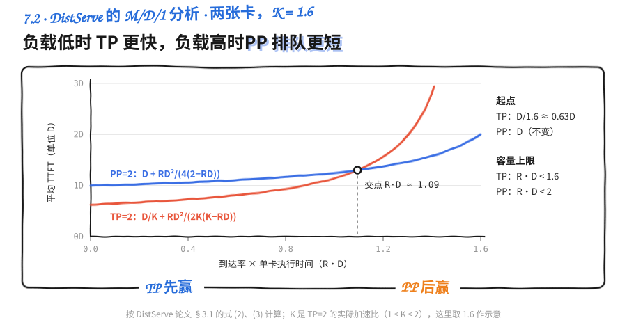
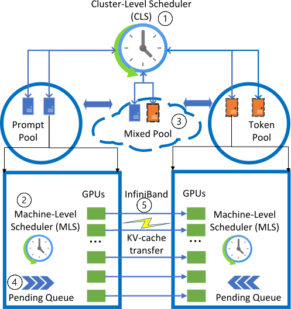
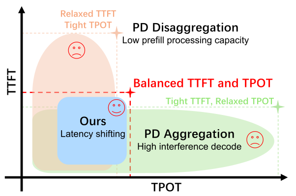

7.1 节说明了两件事：Prefill 和 Decode 混在一起会互相干扰，而且两者被迫共用同一套资源和并行策略。把它们拆到不同的 GPU 上，思路很直接，难点在于拆完之后怎么配：每个阶段给几张卡、用什么并行、放在集群的什么位置、请求怎么路由。本节按时间顺序看四个有代表性的设计，它们对这些问题给出了不同的回答。

> ⏰ **信息时效**：DistServe 依据 arXiv v3（2024-06），Splitwise 依据 arXiv v2（2024-05），TaiChi 依据 arXiv v1（2025-08），Microserving 依据 arXiv v1（2024-12）。

<!-- more -->

## 📑 目录

- [1. 解耦之后系统长什么样](#1-解耦之后系统长什么样)
- [2. DistServe：为两个阶段分别找最优配置](#2-distserve为两个阶段分别找最优配置)
- [3. Splitwise：按阶段划分机器池](#3-splitwise按阶段划分机器池)
- [4. TaiChi：在聚合和解耦之间连续调节](#4-taichi在聚合和解耦之间连续调节)
- [5. MLC Microserving：把编排交给可编程路由器](#5-mlc-microserving把编排交给可编程路由器)
- [6. 四种设计放在一起看](#6-四种设计放在一起看)
- [总结](#-总结)
- [自我检验清单](#-自我检验清单)
- [参考资料](#-参考资料)

---

## 1. 解耦之后系统长什么样

打个比方：一家小饭馆只有一个灶台，既要给新来的客人炒第一道菜，又要给已经开吃的客人一勺一勺地续汤。新客人一多，续汤就断；只顾续汤，新客人就干等。解耦的做法是分成两组灶台，一组专门炒第一道菜，一组专门续汤，中间用传菜员把锅端过去。

对应到推理服务里，一个解耦系统由四部分组成：

| 📊 组件 | 职责 |
|---|---|
| Prefill 实例 | 只做 Prefill：算完整段 Prompt，生成第一个 Token 和全部 KV Cache |
| Decode 实例 | 只做 Decode：拿到 KV Cache 后逐个生成后续 Token |
| KV 传输 | 把 Prefill 实例算出的 KV Cache 搬到 Decode 实例（7.3 节） |
| 路由 / 调度 | 决定请求去哪个 Prefill 实例、再去哪个 Decode 实例，以及两类实例各开多少（7.4、7.5 节） |

这里的**实例**沿用 DistServe 的定义：持有一份完整模型权重的一组资源。一个实例可以是一张卡，也可以是一个 TP=4 的 4 卡组。解耦之后，Prefill 实例和 Decode 实例**各自持有一份权重**，所以解耦的前提是显存里放得下两份权重之外，还能留出足够的 KV 空间。

常用 $x$P$y$D 表示配比，比如 2P1D 是 2 个 Prefill 实例配 1 个 Decode 实例。Decode 实例的 GPU 利用率通常较低，多个 Prefill 实例共享一个 Decode 实例，可以让 Decode 攒出更大的 Batch。

下图用同样 8 张 GPU 对比合并部署和后面三种设计的资源划分。黄色格是跑 Prefill 的 GPU，蓝色格是跑 Decode 的 GPU，黄蓝拼色的格表示这张卡两种都跑，黄色部分越宽越偏重 Prefill：

---

## 2. DistServe：为两个阶段分别找最优配置

DistServe（北京大学、阶跃星辰、UCSD，OSDI'24）是第一个系统化论证 P/D 解耦的工作。它的优化目标是**每卡 Goodput**：在满足 SLO 达标率（比如 90% 的请求同时满足 TTFT 和 TPOT 要求）的前提下，每张 GPU 能承受的最大请求速率。Goodput 的细节放在 7.4 节，这里先看它怎么用这个目标指导设计。

### 2.1 解耦之后，两个阶段可以分别选并行方式

拆开之后，Prefill 实例的行为接近一个排队系统：请求按泊松过程到达，每个请求的执行时间大致固定。DistServe 用 M/D/1 排队模型分析 Prefill 的平均 TTFT。设单卡上一个请求的执行时间为 $D$，到达率为 $R$（要求 $RD<1$）：

$$
\text{Avg\_TTFT}=D+\frac{RD^2}{2(1-RD)}
$$

第一项是执行时间，第二项是排队时间。换成两张卡后有两种用法：

- **算子间并行（PP=2）**：单个请求的延迟基本不变，但流水线让系统容量翻倍：

$$
\text{Avg\_TTFT}_{\text{inter}}=D+\frac{RD^2}{4(2-RD)}
$$

- **算子内并行（TP=2）**：单个请求变快，但通信开销让加速比 $K$ 达不到 2（$1<K<2$）：

$$
\text{Avg\_TTFT}_{\text{intra}}=\frac{D}{K}+\frac{RD^2}{2K(K-RD)}
$$

下图按这两个公式画出 $K=1.6$ 时平均 TTFT 随到达率的变化，横轴是 $RD$，纵轴是以 $D$ 为单位的平均 TTFT：

到达率低时，执行时间占主导，TP 把单次执行缩短到 $D/1.6$，更占优；到达率超过约 $1.09/D$ 后，排队时间占主导，PP 的容量更大，反而更好。TTFT 的 SLO 越严，越偏向 TP；$K$ 越小（比如互联带宽差），TP 的优势越小。DistServe 在两张 A100 上跑 66B 模型的实测结果与这个分析一致。

Decode 实例的分析不同。Decode 受带宽限制，Batch 越大利用率越高；解耦后多个 Prefill 实例可以共享一个 Decode 实例，Decode Batch 能攒得更大。Batch 大到接近算力上限后，TP 降低延迟的收益递减，PP 几乎能线性提升吞吐。所以 TPOT 要求严时先用 TP 把延迟压下来，再用 PP 扩吞吐。

📌 **关键点**：同一个模型，Prefill 和 Decode 的最优并行方式往往不同，而且随 SLO 和负载变化。合并部署只能选一套，解耦让两边各选各的。

### 2.2 按集群带宽决定放置

拆开之后多了一笔开销：KV Cache 要从 Prefill 实例传到 Decode 实例。DistServe 举的例子是 OPT-66B，一个 512 Token 请求的 KV 约 1.13 GB，按每秒 10 个请求算，每秒要传 11.3 GB，约合 90 Gbps。所以放置算法要看集群的网络条件：

| 📊 集群类型 | 放置算法 | 做法 |
|---|---|---|
| 高节点亲和（节点间有 InfiniBand 等高速网络） | Algorithm 1 | 跨节点传 KV 的开销可以忽略。先**分别**为 Prefill 和 Decode 枚举 (PP, TP) 组合，用模拟器二分搜索出每种配置的最大 Goodput，各取每卡 Goodput 最高的配置；再按目标流量复制实例。复杂度 $O(NM^2)$，$N$ 是单实例最多占的节点数，$M$ 是每节点 GPU 数 |
| 低节点亲和（节点间带宽有限） | Algorithm 2 | KV 只在 Prefill 和 Decode 的**对应层**之间传。把两个实例都按 PP 切成段，让同一段的 Prefill 段和 Decode 段放在同一个节点上，KV 只走节点内 NVLink。再在一个节点的 GPU 数以内枚举两边的段内并行配置 |

第二种做法有个前提：一个节点要能同时放下 Prefill 段和 Decode 段。DistServe 的例子是 175B 模型约 350 GB，一台 8 × 80 GB 的机器放不下 Prefill 和 Decode 两份完整权重（$640 < 700$），按 PP 切段之后才放得下。

模拟器根据 Prefill 和 Decode 的 FLOP 数与访存量建延迟模型，再从历史请求中拟合输入输出长度分布、重新采样作为负载。论文报告模拟器预测的 SLO 达标率与实测误差在 2% 以内，最大规模下搜索时间不到 1.3 分钟。

### 2.3 在线调度

DistServe 的运行时比较简单：

- **FCFS 加最短队列**：请求先发到队列最短的 Prefill 实例，算完后发到负载最轻的 Decode 实例。
- **按 $L_m$ 组批**：事先测出让 GPU 吃满算力的最短 Prompt 长度 $L_m$。Prefill 批的总长度尽量接近 $L_m$，比它短的请求合并成一批，比它长的单独跑。这样各批执行时间接近，PP 的流水线气泡更少。
- **拉取式 KV 传输**：突发流量会让大量 KV 同时涌向 Decode 实例，撑爆它的显存。DistServe 让 Decode 实例在需要时**主动拉取** KV，Prefill 实例的显存充当排队缓冲区。vLLM 的 NixlConnector 默认也是拉取模式（7.3 节）。
- **周期性重规划**：监控平均输入输出长度和到达率，变化明显时重新跑放置算法，算法几秒到几分钟，重载权重几分钟，比真实负载按小时变化的节奏快。

论文也坦白了没做的部分：没有抢占，FCFS 会出现长请求挡住短请求的"护航效应"；没有容错，一个被多个 Prefill 实例共享的 Decode 实例出故障，影响面比合并部署大。7.5 节会回到这些问题。

### 2.4 结果

在 4 个节点、32 张 A100-80GB（节点内 NVLink，节点间只有 25 Gbps）上，对 OPT-13B/66B/175B 的聊天、代码补全、摘要三类负载，DistServe 比 vLLM 和 DeepSpeed-MII 最多能多承受 7.4 倍的请求，或满足严 12.6 倍的 SLO，同时保持 90% 以上的请求达标。由于用了 Algorithm 2，OPT-175B 的 KV 传输只占总延迟的不到 0.1%，95% 以上的请求传输时间在 30 ms 以内。

---

## 3. Splitwise：按阶段划分机器池

Splitwise（Microsoft，ISCA'24）的出发点是云厂商的视角：同样的功率和成本预算下，怎么组一个推理集群。它先在 Azure 的两类生产负载（代码补全和对话）上做了特性分析，得到几条结论：

- 合并部署的 Continuous Batching 大部分时间批里只有很少的活跃 Token。对话负载下，60%–70% 的时间里批内不超过 20 个 Token。
- 多数请求的端到端时间主要花在 Token 生成阶段。BLOOM-176B 上，1500 个输入 Token 的 Prompt 阶段，耗时只相当于生成 6 个输出 Token。
- Prompt 阶段吃满功率预算，Token 阶段不会；Token 阶段可以跑在算力弱一些的硬件上，性价比和能效更好。

基于这些结论，Splitwise 维护三个机器池，由集群级调度器（CLS）分配请求，每台机器上的机器级调度器（MLS）管理本机队列和批处理。

下图是 Splitwise 论文的 Figure 10。左边 Prompt Pool 的机器只跑 Prompt 阶段，右边 Token Pool 只跑 Token 阶段，中间的 Mixed Pool 按负载伸缩，底部是 Prompt 机器通过 InfiniBand 把 KV Cache 传给 Token 机器。图中的 prompt 对应本章的 Prefill，token 对应 Decode：

*图注：① 集群级调度器（CLS）同时为请求选定一台 Prompt 机器和一台 Token 机器；② 每台机器的机器级调度器（MLS）维护 ④ 待处理队列；③ 混合池里的机器跑合并批处理；⑤ KV Cache 经 InfiniBand 传输。*

> 来源：Patel et al., "Splitwise: Efficient Generative LLM Inference Using Phase Splitting", ISCA 2024, Figure 10. [arXiv:2311.18677](https://arxiv.org/abs/2311.18677)

几个设计细节：

- **混合池兜底**：某个池的队列超过阈值时，CLS 先从混合池找机器，混合池也满了，就把对面池的机器临时拉进混合池。混合池里的机器跑普通的合并批处理，没有反向任务后再回到原来的池。这样可以吸收负载波动，减少资源碎片。
- **同时选好两台机器**：请求到达时就确定 Prompt 机器和 Token 机器，这样 KV 可以在 Prompt 计算的过程中逐层传过去（7.3 节）。
- **四种集群配置**：命名规则是"Prompt 机器型号 + Token 机器型号"。Splitwise-AA 全用 DGX-A100，HH 全用 DGX-H100，HA 是 H100 跑 Prompt、A100 跑 Token，HHcap 全用 H100 但 Token 机器限功率（每张 GPU 限到 50%）。
- **用模拟器定配比**：给定目标负载、峰值吞吐和功率或成本预算，用事件驱动的集群模拟器搜索两个池的机器数。在相同功率预算下，同样是 Splitwise-HH，代码补全负载配出 35 台 Prompt 机器、5 台 Token 机器，对话负载配出 25 台和 15 台。

论文的结论：和同构的合并部署集群相比，Splitwise 能在成本低 20% 的同时吞吐高 1.4 倍，或者在相同功率和成本下吞吐高 2.35 倍。

---

## 4. TaiChi：在聚合和解耦之间连续调节

DistServe 和 Splitwise 之后，学术界和工业界一直在争论合并部署（论文里叫 PD 聚合，代表是 Sarathi-Serve）和 P/D 解耦哪个更好。TaiChi（2025）的结论是：取决于 SLO 的形状。

下图是 TaiChi 论文的 Figure 1，横轴是 TPOT，纵轴是 TTFT，色块表示一种方案下请求延迟的分布范围，带十字星的虚线是 SLO 的边界。绿色的 PD 聚合 TTFT 低、TPOT 拖得很长；橙色的 PD 解耦 TPOT 集中、TTFT 拖得很高；蓝色是 TaiChi：

*图注：聚合方式让所有实例都参与 Prefill，TTFT 低，但 Decode 受干扰（High interference decode）；解耦方式只有一部分实例做 Prefill，Prefill 处理能力不足（Low prefill processing capacity），TTFT 高。SLO 落在两者之间（红色十字）时，两种方案都有大量请求越界。*

> 来源：Wang et al., "Prefill-Decode Aggregation or Disaggregation? Unifying Both for Goodput-Optimized LLM Serving", 2025, Figure 1. [arXiv:2508.01989](https://arxiv.org/abs/2508.01989)

TaiChi 的结论分三种情况：

| 🎯 SLO 形状 | 更好的方案 | 原因 |
|---|---|---|
| TTFT 紧，TPOT 松 | PD 聚合 | 所有实例都能做 Prefill，排队短 |
| TPOT 紧，TTFT 松 | PD 解耦 | Decode 不受干扰 |
| 两者都较紧 | 两者都不是最优 | 聚合违反 TPOT，解耦违反 TTFT |

它的做法是所有实例都跑混合批，但分成两类：

- **P-heavy 实例**：块大小（Chunk Size）设得大，Prefill 快，Decode 受的干扰大。
- **D-heavy 实例**：块大小设得小，Decode 干扰小，Prefill 慢。

系统暴露三个"滑杆"：两类实例的数量比例，以及各自的块大小。TTFT 很紧时调成接近聚合的配置，TPOT 主导时调成接近解耦的配置。两者都紧时，TaiChi 靠**延迟转移**（latency shifting）提高 Goodput：从已经稳稳达标的请求身上"借"一些延迟余量，让给快要越界的请求。具体有两种调度：

- **流动式 Decode 调度**：所有 Decode 先放在 D-heavy 实例上。需要腾资源时，把当前输出最长的请求迁到 P-heavy 实例上去（输出最长说明它的 TPOT 余量最大，最能扛干扰）；它的 TPOT 接近 SLO 时再迁回 D-heavy。
- **长度感知的 Prefill 调度**：短 Prompt 对 TTFT 不敏感，在预估 TTFT（排队时间加降速后的执行时间）不越界的前提下，把它们放到较慢的 D-heavy 实例上，把 P-heavy 实例留给长 Prompt。

TaiChi 基于 vLLM 实现，arXiv v1 报告在 TTFT 和 TPOT 都较紧的 SLO 下，Goodput 比最好的现有系统最多高 77%，TTFT 比 PD 解耦最多低 13.2 倍，TPOT 比 PD 聚合最多低 1.69 倍。这些数值来自 arXiv v1，后续版本可能有调整，引用时注意核对版本。

💡 **提示**：TaiChi 说明"解耦还是不解耦"可以不是一个开关。块大小、实例类型比例都是连续可调的量，最优点随 SLO 移动。

---

## 5. MLC Microserving：把编排交给可编程路由器

前面三个系统都把编排策略固化在系统里。MLC Microserving（CMU、清华等，2024-12）换了一个角度：推理引擎只暴露几个细粒度的子请求 API，用户在一个用 Python 写的路由器里组合它们，就能实现数据并行、P/D 解耦以及各种变体，而且能在运行时切换。

三个 REST API：

| 📊 API | 作用 |
|---|---|
| `prep_recv(prompt, end, seq_id)` | 检查本引擎 KV Cache 里是否已有 `prompt[:end]`，为缺失部分分配 KV 空间，返回这些 KV 条目的地址和已匹配的前缀长度 |
| `remote_send(prompt, kv_addr_info, recv_rank, begin, end, seq_id)` | 把 `prompt[begin:end]` 的 KV 发给 `recv_rank` 引擎。已经缓存的部分直接发，缺的部分先做 Prefill 再发 |
| `start_generate(prompt, begin, seq_id)` | 告诉引擎 `prompt[:begin]` 的 KV 已经就位，从 `begin` 开始 Prefill 剩余部分并开始 Decode |

用这三个调用组合：

- **数据并行**：轮询选一个引擎，调 `start_generate(prompt, begin=0)`。
- **P/D 解耦**：先在 Decode 引擎上 `prep_recv(end=-1)` 为除最后一个 Token 以外的部分分配空间；再让 Prefill 引擎 `remote_send(begin=0, end=-1)` 算 KV 并直接写进 Decode 引擎的地址；最后在 Decode 引擎上 `start_generate` 算最后一个 Token 并开始生成。
- **均衡的 P/D 解耦**：Decode 引擎负载不高时，路由器把 Prompt 的后一段留给 Decode 引擎自己算，只让 Prefill 引擎算前一段，分担 Prefill 引擎的压力。

论文的实验中每个引擎是一张 A100 SXM 40GB 跑 Llama-3.1-8B。在平均输入 3000 Token、输出 100 Token 的合成负载上，P/D 解耦相比数据并行，平均任务完成时间（JCT）最多降低 21%，P99 JCT 最多降低 47%；每卡请求速率升到 2.5 req/s 后，1P1D 的 Prefill 引擎成了瓶颈，把最后 20% Token 的 Prefill 交给 Decode 引擎的均衡变体能继续保持较低的 JCT。在 ShareGPT 这种输入较短（平均约 200 Token）的负载上，P/D 解耦相比数据并行没有观察到收益，因为 Prefill 引擎大部分时间是空闲的。

---

## 6. 四种设计放在一起看

| 📊 维度 | DistServe | Splitwise | TaiChi | Microserving |
|---|---|---|---|---|
| 优化目标 | 每卡 Goodput | 吞吐、成本、功率 | 各种 SLO 下的 Goodput | 任务完成时间，编排灵活性 |
| 资源划分 | P 实例与 D 实例，各自选并行 | Prompt / Token / 混合三个机器池，可异构 | 全部实例跑混合批，分 P-heavy 与 D-heavy | 由路由器逐请求决定 |
| 配比怎么定 | 模拟器加枚举搜索，周期性重规划 | 集群模拟器搜索，混合池兜底 | 三个滑杆随 SLO 调 | 路由器运行时调整 |
| KV 传输 | 拉取式；低带宽集群按段同节点放置 | 逐层传输，与 Prompt 计算重叠 | 迁移请求时传 KV | 发送方直接写远端地址 |
| 主要贡献 | 论证解耦的价值，给出放置算法 | 异构硬件与集群规划 | 指出解耦不是最优的情形并统一两者 | 可编程的细粒度 API |

另一个常被提到的系统是 Kimi 的 Mooncake（FAST'25），它的特点是以 KV Cache 为中心：把集群里空闲的 CPU 内存、SSD 和网卡也池化成分布式 KV Cache，配合 P/D 解耦和长上下文的分块流水线 Prefill。KV Cache 的存储与传输会在 7.3 节涉及。

这些思路已经落到开源框架里。vLLM 通过 KV Connector 支持 P/D 解耦（7.3、7.6 节），SGLang 用 `--disaggregation-mode prefill/decode` 启动两类实例，NVIDIA Dynamo 和 llm-d 在 vLLM 等引擎之上提供 P/D 路由与扩缩容。

---

## 📝 总结

- 解耦系统由 Prefill 实例、Decode 实例、KV 传输和路由调度四部分组成，两类实例各持一份权重，配比用 $x$P$y$D 表示。
- DistServe 以每卡 Goodput 为目标：用 M/D/1 模型说明 Prefill 低负载时偏好 TP、高负载时偏好 PP；按集群带宽选两种放置算法；用拉取式传输把 Prefill 实例的显存当作缓冲；最多多承受 7.4 倍请求或满足严 12.6 倍的 SLO。
- Splitwise 从云厂商视角划分 Prompt、Token、混合三个机器池，Token 池可以用上一代或限功率的 GPU，成本低 20% 时吞吐高 1.4 倍，或同成本同功率下吞吐高 2.35 倍。
- TaiChi 指出 TTFT 紧时聚合更好、TPOT 紧时解耦更好，两者都紧时用 P-heavy/D-heavy 实例和延迟转移统一两种方式。
- Microserving 用 `prep_recv`、`remote_send`、`start_generate` 三个 API 加可编程路由器实现各种编排；长 Prompt 负载上 P99 JCT 最多降低 47%，Prompt 很短的负载上解耦没有收益。

## 🎯 自我检验清单

- 能画出 P/D 解耦系统的四个组成部分，并解释为什么两类实例各需一份权重
- 能写出 DistServe 的三个 M/D/1 公式，解释到达率升高时 Prefill 的最优并行方式为什么会从 TP 变成 PP
- 能区分 DistServe 的高节点亲和与低节点亲和放置算法，说明后者为什么按 PP 段同节点放置
- 能说出 Splitwise 三个机器池的作用和混合池的进出规则，以及 Splitwise-HA 为什么用 A100 跑 Token 阶段
- 能根据 TaiChi 的结论，判断给定的 TTFT/TPOT SLO 更适合聚合、解耦还是混合方式
- 能用 Microserving 的三个 API 写出 P/D 解耦一个请求的调用顺序
- 能从优化目标、资源划分、配比方法、KV 传输四个维度对比这四种设计

## 📚 参考资料

- [DistServe: Disaggregating Prefill and Decoding for Goodput-optimized Large Language Model Serving（OSDI'24）](https://arxiv.org/abs/2401.09670)
- [Splitwise: Efficient Generative LLM Inference Using Phase Splitting（ISCA'24）](https://arxiv.org/abs/2311.18677)
- [Prefill-Decode Aggregation or Disaggregation? Unifying Both for Goodput-Optimized LLM Serving（TaiChi）](https://arxiv.org/abs/2508.01989)
- [A System for Microserving of LLMs](https://arxiv.org/abs/2412.12488)
- [Mooncake: A KVCache-centric Disaggregated Architecture for LLM Serving（FAST'25）](https://arxiv.org/abs/2407.00079)
- [Taming Throughput-Latency Tradeoff in LLM Inference with Sarathi-Serve（OSDI'24）](https://arxiv.org/abs/2403.02310)
- [DistServe 官方仓库](https://github.com/LLMServe/DistServe)
- [SGLang 文档：PD Disaggregation](https://docs.sglang.io/docs/advanced_features/pd_disaggregation)
- [NVIDIA Dynamo 文档：Disaggregated Serving](https://docs.nvidia.com/dynamo/dev/knowledge-base/concepts/system-architecture/disaggregated-serving)
