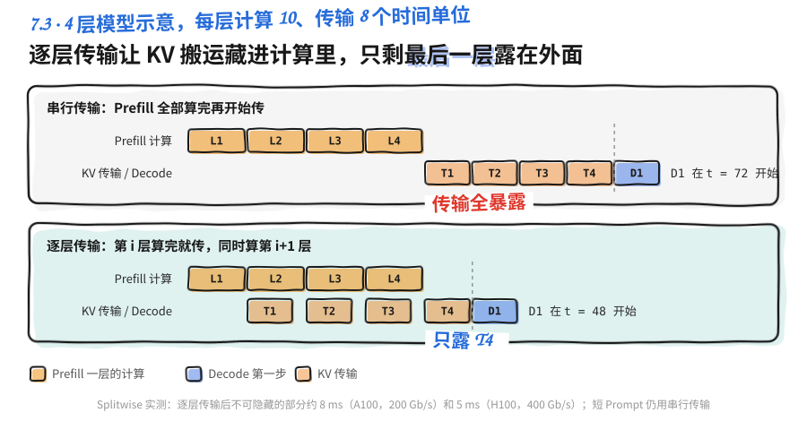
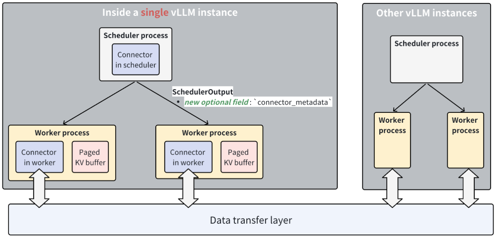
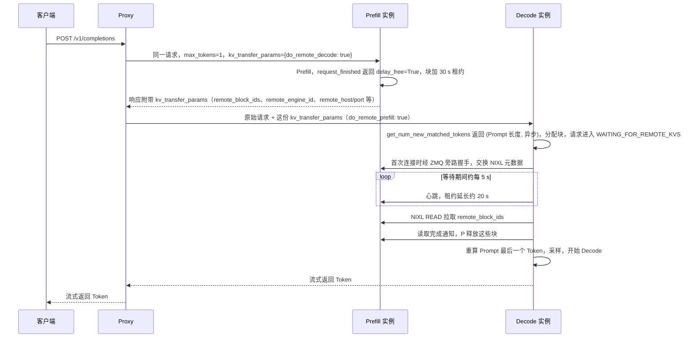

P/D 解耦把一个请求拆在两组 GPU 上完成，中间必须把 Prefill 算出的 KV Cache 搬到 Decode 实例。这一步做不好，7.1 节省下的 Decode 时间会全部赔在 TTFT 上。本节先估算要搬的数据量和所需带宽，再看几种传输方式的区别，最后拆开 vLLM 的 KV Connector 抽象和默认的 NixlConnector。

> ⏰ **信息时效**：vLLM 相关的类名、方法签名、参数与环境变量基于 v0.32.0（2026-10-18 发布）的源码与文档，NIXL 基于 v1.5.x（vLLM v0.32.0 固定依赖 `nixl==1.5.0`）。截至 2026-11，最新的 v0.34.0 在 Connector 基类上增加了几个可选方法，本节用到的抽象方法没有变化。KV Connector API 在官方文档中仍标注为实验性。

<!-- more -->

## 📑 目录

- [1. 要搬多少数据](#1-要搬多少数据)
- [2. 带宽够不够](#2-带宽够不够)
- [3. 什么时候搬、谁来发起](#3-什么时候搬谁来发起)
- [4. vLLM 的 KV Connector 抽象](#4-vllm-的-kv-connector-抽象)
- [5. NixlConnector：默认的点对点传输](#5-nixlconnector默认的点对点传输)
- [6. 其他 Connector](#6-其他-connector)
- [总结](#-总结)
- [自我检验清单](#-自我检验清单)
- [参考资料](#-参考资料)

---

## 1. 要搬多少数据

每个 Token 在每一层都存一份 K 和一份 V。对 MHA/GQA 模型：

$$
\text{每 Token KV 字节数}=2\times L\times n_{kv}\times d_{head}\times b
$$

$L$ 是层数，$n_{kv}$ 是 KV 头数，$d_{head}$ 是每个头的维度，$b$ 是每个元素的字节数（BF16 为 2）。一个 Prompt 要搬的总量再乘以 Prompt 长度。MLA（如 DeepSeek-V3）每层只缓存一个压缩后的潜向量和 RoPE 键，按 $L\times(d_c+d_r)\times b$ 计算。

用几个模型算一下（BF16，不含量化）：

| 📊 模型 | 注意力 | 每 Token KV | 8192 Token 的 Prompt |
|---|---|---|---|
| Qwen3-8B | GQA，36 层，8 个 KV 头 | 144 KiB | 1.12 GiB |
| Llama-3.1-70B | GQA，80 层，8 个 KV 头 | 320 KiB | 2.50 GiB |
| OPT-66B | MHA，64 层，72 个头 | 2304 KiB | 18.0 GiB |
| DeepSeek-V3 | MLA，61 层，512 + 64 维 | 68.6 KiB | 0.54 GiB |

OPT 系列是 DistServe 论文选来"给传输加压"的 MHA 模型，论文里 OPT-66B 一个 512 Token 请求的 KV 约 1.13 GB，与表中按 2304 KiB/Token 算出的值一致。现在主流模型都用 GQA 或 MLA，每 Token 的 KV 小了一个数量级。

💡 **提示**：KV Cache 量化（第 4 章 4.4 节）同样作用于传输量。把 KV 存成 FP8，要搬的数据减半。但 Prefill 和 Decode 两边的 `cache_dtype` 必须一致，NixlConnector 握手时会检查这一项。

---

## 2. 带宽够不够

### 2.1 单个请求的传输时间

把 8192 Token 的 KV 按理想带宽搬一次（不含握手、协议和内存注册开销）：

| 📊 模型 | NVLink 4（单向 450 GB/s） | 8 × 400 Gb/s 网卡并行 | 1 × 400 Gb/s 网卡 | 25 Gb/s 以太网 |
|---|---|---|---|---|
| Qwen3-8B | 2.7 ms | 3.0 ms | 24.2 ms | 386.5 ms |
| Llama-3.1-70B | 6.0 ms | 6.7 ms | 53.7 ms | 859.0 ms |
| DeepSeek-V3 | 1.3 ms | 1.4 ms | 11.5 ms | 184.2 ms |

"8 × 400 Gb/s 并行"指 Prefill 和 Decode 都是 TP=8，每张 GPU 只搬自己那份 KV 分片，各走各的网卡，相当于 8 倍带宽。

参照 Prefill 本身的计算时间：Llama-3.1-70B 在 8 张 H100 上 Prefill 8192 个 Token，按 60% 算力利用率估算约 262 ms。走单张 400 Gb/s 网卡的 53.7 ms 相当于给 TTFT 加了两成；8 张网卡并行时只有 6.7 ms，基本可以忽略。换成 25 Gb/s 的普通以太网，传输时间是计算时间的 3 倍多，解耦就不划算了。

vLLM 官方博客给过一个反面例子：两张不支持 P2P 的 L40S，Qwen2.5-7B 一个 8k Prompt 约 470 MB 的 KV 花了约 1.3 s 才到达 Decode 实例，P/D 的 TTFT 中位数是 2.2 s，合并部署只有 0.7 s，在每个测试负载下都没满足 2 s 的 TTFT 目标。

### 2.2 持续的带宽需求

单个请求之外还要看总量。设每个 Prefill 实例每秒处理 $R$ 个请求，平均输入长度为 $\bar{s}$：

$$
\text{所需带宽}=R\times\bar{s}\times\text{每 Token KV 字节数}
$$

Llama-3.1-70B、8k 输入、每秒 2 个请求，就是约 5.4 GB/s（约 43 Gb/s）；DistServe 论文里 OPT-66B 每秒 10 个 512 Token 请求是 11.3 GB/s（约 90 Gbps）。网卡还要和其他流量共用，规划时要留余量。

一个有利的趋势：KV 大小随 Prompt 长度线性增长，Prefill 的计算量（主要是注意力部分）超线性增长，所以 Prompt 越长，传输时间相对计算时间的占比越小。DistServe 据此认为解耦在长上下文场景里更有优势。

⚠️ **注意**：先确认传输路径真的走了 RDMA 或 NVLink，再做任何性能测试。单机上用 `nvidia-smi topo -p2p r` 检查两张卡之间是否显示 `OK`；跨机时确认 UCX 选中了 InfiniBand/RoCE 设备，而不是退回 TCP。

---

## 3. 什么时候搬、谁来发起

### 3.1 串行传输与逐层传输

最直接的做法是 Prefill 全部算完再开始传，传完 Decode 才能开始。传输时间全部叠加到第一个 Decode 步之前。

Splitwise 的优化是**逐层传输**：每算完一层，就异步发出这一层的 KV，同时开始算下一层。传输和计算重叠，最后只剩最后一层的传输暴露在外。下图示意 4 层模型两种方式的时间线，黄色是 Prefill 计算，橙色是 KV 传输，蓝色是 Decode 第一步：

Splitwise 在 A100（200 Gb/s）和 H100（400 Gb/s）集群上实测：

- 逐层传输后，不可隐藏的传输时间基本稳定在约 8 ms（A100）和约 5 ms（H100），总传输开销小于 Prompt 计算时间的 7%。
- 对端到端延迟的影响：串行传输最多约 3%，逐层传输约 0.8%。
- 用户能感知到的只有第二个 Token 的延迟：逐层传输让它增加约 16.5%，串行传输是 64%。

逐层传输需要每层做细粒度同步，Prompt 很短时同步开销反而拖慢 TTFT。所以 Splitwise 按 Batch 的 Token 数选择：短 Prompt 用串行，长 Prompt 用逐层。

### 3.2 推送与拉取

另一个问题是由谁发起传输：

| 📊 方式 | 做法 | 代表 | 特点 |
|---|---|---|---|
| 推送（push） | Prefill 实例把 KV 直接写进 Decode 实例预先分配好的显存 | Splitwise（MSCCL++ 单边 put）、Microserving、vLLM `NixlPushConnector` | Prefill 一算完就能发，延迟低；Decode 实例要提前分配好空间 |
| 拉取（pull） | Prefill 实例算完后保留 KV，Decode 实例准备好之后再去读 | DistServe、vLLM `NixlConnector`（默认） | Prefill 的显存充当缓冲，突发流量不会压垮 Decode；多一次往返，KV 在 Prefill 上停留时间更长 |

DistServe 选拉取，理由是突发流量下大量 KV 同时涌向 Decode 实例会撑爆它的显存，而让 Decode 按自己的节奏去取，两类实例就不需要复杂的协调。vLLM 的 NixlConnector 也默认拉取，并在 v0.32.0 提供了推送版本 `NixlPushConnector`。

---

## 4. vLLM 的 KV Connector 抽象

vLLM 把"KV 从哪里来、到哪里去"抽象成 **KV Connector**，代码在 `vllm/distributed/kv_transfer/`。P/D 解耦、KV 卸载到 CPU、接入 LMCache 这类外部 KV 存储，用的都是同一套接口。

### 4.1 两种角色、两侧接口

一个 vLLM 实例里有调度器进程和若干 Worker 进程，每个进程各有一个 Connector 对象，角色用 `KVConnectorRole.SCHEDULER` 和 `KVConnectorRole.WORKER` 区分。调度侧决定"哪些块要传"，Worker 侧负责"真正去传"。调度侧每一步把要做的事打包成 `connector_metadata`，随 `SchedulerOutput` 发给 Worker。

下图来自 vLLM 官方文档。左侧灰框是一个 vLLM 实例，调度器进程里的 Connector 通过 `SchedulerOutput` 的 `connector_metadata` 字段给各个 Worker 下发指令，Worker 里的 Connector 操作本地的分页 KV 缓冲区，所有实例通过底部的数据传输层交换 KV：

*图注：Paged KV buffer 就是 vLLM 的分页 KV Cache；Data transfer layer 在 NixlConnector 里对应 NIXL 库，在 MooncakeConnector 里对应 Mooncake Transfer Engine。*

> 来源：vLLM 项目文档，"Disaggregated Prefilling (experimental)"，Disaggregated prefilling high level design 图。[docs.vllm.ai](https://docs.vllm.ai/en/stable/features/disagg_prefill/)

v0.32.0 中基类 `KVConnectorBase_V1`（`kv_connector/v1/base.py`）的主要方法：

| 📊 位置 | 方法 | 作用 |
|---|---|---|
| 调度侧 | `get_num_new_matched_tokens(request, num_computed_tokens)` | 返回能从外部加载多少个 Token 的 KV，以及是否异步加载。返回 `None` 表示"稍后再问" |
| 调度侧 | `update_state_after_alloc(request, blocks, num_external_tokens)` | 调度器为这些外部 Token 分配好块之后回调，Connector 记下要往哪些块里写 |
| 调度侧 | `build_connector_meta(scheduler_output)` | 每步打包本步要执行的加载、保存操作，发给 Worker |
| 调度侧 | `request_finished(request, block_ids)` | 请求结束、块被释放前调用一次。返回 `(delay_free, kv_transfer_params)`：`delay_free=True` 表示先别释放，等 `get_finished()` 报告传输完成；`kv_transfer_params` 会随请求结果返回给调用方 |
| Worker 侧 | `register_kv_caches(kv_caches)` | 启动时把 KV Cache 张量注册给 Connector，NIXL 用它做 RDMA 内存注册 |
| Worker 侧 | `start_load_kv(forward_context)` | 前向开始前发起加载，可以是异步的 |
| Worker 侧 | `wait_for_layer_load(layer_name)` | 在注意力层里调用，阻塞到这一层的 KV 加载完，用于逐层流水 |
| Worker 侧 | `save_kv_layer(layer_name, kv_layer, attn_metadata)` | 在注意力层里调用，发起保存这一层的 KV |
| Worker 侧 | `wait_for_save()` | 每步结束时调用一次，提交保存并做必要的同步 |
| Worker 侧 | `get_finished(finished_req_ids)` | 返回已完成异步发送和异步接收的请求 ID |

`wait_for_layer_load` 和 `save_kv_layer` 就是第 3 节逐层传输在接口上的体现：Connector 可以在每一层前后插入加载和保存，用不用逐层由具体实现决定。

### 4.2 一个请求在 P/D 之间怎么走

以默认的拉取模式为例。客户端只和一个代理（Proxy）打交道，代理先把请求发给 Prefill 实例，再把 Prefill 返回的"KV 在哪里"转交给 Decode 实例：

几个细节：

- **Prefill 实例生成的那个 Token 不返回给客户端**。代理只取它响应里的 `kv_transfer_params`，客户端收到的所有 Token 都来自 Decode 实例。Decode 实例拉到全部 Prompt 的 KV 后，把最后一个 Prompt Token 重新算一遍，才能采样出第一个输出 Token。
- **租约与心跳**。早期版本用一个固定超时（`VLLM_NIXL_ABORT_REQUEST_TIMEOUT`，默认 480 s）决定 Prefill 实例保留块多久，Decode 实例崩溃时，几 GB 的块要白白占 8 分钟。v0.32.0 改成租约：初始 30 s（`kv_connector_extra_config.kv_lease_duration`），请求一进入 Decode 实例的调度器就开始心跳续约。Decode 实例挂了，Prefill 实例在最后一次心跳后很快就能回收。
- **传输失败怎么办**。`kv_load_failure_policy` 默认是 `fail`，请求直接报错；设为 `recompute` 时，Decode 实例自己把缺失的 KV 重算一遍，慢一些但请求能完成。

---

## 5. NixlConnector：默认的点对点传输

### 5.1 NIXL 是什么

NIXL（NVIDIA Inference Xfer Library）是 NVIDIA 为推理框架做的点对点传输库，最早随 Dynamo 发布。它对上层屏蔽了内存类型（CPU 内存、GPU 显存、文件、块存储、对象存储）和传输方式的差异：

- **传输代理**（Agent）：每个进程一个，负责注册内存、发起传输，返回异步句柄。
- **后端插件**：v1.5 的插件包括 UCX（默认）、GDS、LIBFABRIC、Mooncake、UCCL 等。UCX 再往下可以走 InfiniBand、RoCE、NVLink 或 TCP。
- **元数据交换**：两个 Agent 要先交换内存注册信息才能互相读写，可以走旁路通道，也可以通过 etcd 之类的中心服务。

在 vLLM 里用 `kv_connector_extra_config.backends` 选后端，默认 `["UCX"]`。UCX 用自己的环境变量（`UCX_TLS`、`UCX_NET_DEVICES`）配置网络，`NCCL_IB_HCA` 这类 NCCL 变量对它不起作用。

### 5.2 握手与端口

Prefill 实例在 `VLLM_NIXL_SIDE_CHANNEL_HOST:VLLM_NIXL_SIDE_CHANNEL_PORT` 上监听一个 ZMQ 旁路通道（默认 `localhost:5600`），Decode 实例第一次拉取某个 Prefill 实例的 KV 前，通过它取回对方的 NIXL Agent 元数据。要注意：

- 同一台机器上，每个 vLLM 实例的端口必须不同；开了数据并行时，实际端口是基准端口加 DP rank。
- Prefill 和 Decode 在不同机器上时，要把 `VLLM_NIXL_SIDE_CHANNEL_HOST` 设成本机对外可达的 IP，它会随 `kv_transfer_params` 传给 Decode 实例。
- 握手时会比对两边的兼容性哈希，覆盖 vLLM 版本与 NixlConnector 协议版本、模型结构与 dtype、注意力后端、`cache_dtype`、投机解码配置、推送还是拉取模式，不一致就拒绝连接。TP 大小、`block_size` 和 KV 布局不进哈希，在握手之后单独校验，这样才能支持两边 TP 不同的部署。

### 5.3 配置要点

| 📊 配置 | v0.32.0 的行为 |
|---|---|
| `kv_role` | Prefill 实例用 `kv_producer`，Decode 实例用 `kv_consumer`。`kv_both` 对 NixlConnector 已弃用，会打印警告 |
| `kv_buffer_device` | 默认是当前平台的设备（CUDA 上为 `cuda`），GPU 显存之间直接传；设为 `cpu` 时先暂存到主机内存，主要用于 TPU/XPU 等平台 |
| 异构 TP | Prefill 和 Decode 的 TP 可以不同，Dense 和 MoE 模型都支持，要求默认的按头优先 KV 布局。MLA 模型只有部分支持，Mamba 要求两边 TP 相同 |
| 推送模式 | `kv_connector` 设为 `NixlPushConnector`，Prefill 实例用 NIXL WRITE 把 KV 写进 Decode 实例预分配的块 |

异构 TP 很有用：Prefill 为了压 TTFT 可以用较大的 TP，Decode 为了多开副本可以用较小的 TP，对应 7.1 节说的"两个阶段各选各的并行方式"。

💡 **提示**：Decode 实例的日志会周期性打印 `KV Transfer metrics`，包括成功传输次数、平均和 P90 传输时间、租约过期的请求数；Prometheus 指标里有 `vllm:nixl_xfer_time_seconds`、`vllm:nixl_bytes_transferred`、`vllm:nixl_num_failed_transfers`、`vllm:nixl_num_kv_expired_reqs`。平均传输时间达到几百毫秒时，先排查网络再做别的调优。

---

## 6. 其他 Connector

v0.32.0 的 `KVConnectorFactory` 注册了 17 个 Connector。与 P/D 解耦相关的主要是下面这些：

| 📊 Connector | 用途 | 说明 |
|---|---|---|
| `NixlConnector` / `NixlPushConnector` | P/D 之间点对点传 KV | 默认拉取（`NixlConnector` 是 `NixlPullConnector` 的别名），推送版用 NIXL WRITE |
| `MooncakeConnector` | P/D 之间点对点传 KV | 基于 Mooncake Transfer Engine，默认走 RDMA；`MooncakeStoreConnector` 接入 Mooncake 的分布式 KV 存储 |
| `LMCacheConnectorV1` / `LMCacheMPConnector` | 接入 LMCache | LMCache 管理多级 KV 缓存，P/D 场景下底层也可以用 NIXL 传输 |
| `MoRIIOConnector` | P/D 传输（仅 ROCm） | AMD 的实现 |
| `OffloadingConnector` / `SimpleCPUOffloadConnector` | KV 卸载到 CPU 内存或更多层级 | 不跨实例，用来扩大有效的前缀缓存容量 |
| `FlexKVConnectorV1`、`HF3FSKVConnector` | 外部 KV 存储 | 分布式 KV 存储与多级缓存 |
| `MultiConnector` | 组合多个 Connector | 例如同时用 NixlConnector 做 P/D 传输、用卸载 Connector 扩充缓存 |
| `ExampleConnector` | 教学示例 | 通过共享存储路径读写 KV，原名 `SharedStorageConnector` |

自己实现 Connector 时，可以不改 vLLM 源码，通过 `kv_connector_module_path` 指定模块路径加载。

⚠️ **注意**：网上不少教程用的是 `P2pNcclConnector`（基于 NCCL 点对点通信、带 ZMQ 代理的 xPyD 方案），以及 `kv_rank`、`kv_parallel_size`、`kv_buffer_size`、`kv_ip` 这几个配置项。`P2pNcclConnector` 在 v0.23.0 之后的版本中已经移除，这四个字段在 v0.32.0 中也已不存在。照着旧教程配置前，先对照你所用版本的 `vllm/config/kv_transfer.py` 和 `factory.py`。

---

## 📝 总结

- 每 Token 的 KV 字节数是 $2\times L\times n_{kv}\times d_{head}\times b$。GQA 和 MLA 让主流模型降到每 Token 几十到几百 KiB，Llama-3.1-70B 一个 8k Prompt 约 2.5 GiB。
- 传输时间要和 Prefill 计算时间比：70B、8k Prompt 走单张 400 Gb/s 网卡约 54 ms，8 卡各走各的网卡约 7 ms，而 Prefill 本身约 260 ms；普通以太网或不支持 P2P 的 PCIe 环境会让解耦得不偿失。
- 逐层传输把传输和计算重叠，Splitwise 实测不可隐藏的部分约 5–8 ms；拉取式传输把 Prefill 实例的显存当缓冲，抗突发流量，推送式延迟更低。
- vLLM 的 KV Connector 分调度侧和 Worker 侧：调度侧决定哪些 Token 从外部加载、何时延迟释放块，Worker 侧在注意力层前后执行加载与保存。
- NixlConnector 的流程是代理先让 Prefill 实例跑 `max_tokens=1`，再把返回的 `kv_transfer_params` 交给 Decode 实例拉取 KV；租约与心跳决定 Prefill 实例保留块多久，失败时按 `kv_load_failure_policy` 报错或重算。
- 旧教程中的 `P2pNcclConnector` 和 `kv_rank` 等字段在 v0.32.0 中已不存在。

## 🎯 自我检验清单

- 能用公式算出给定模型每 Token 的 KV 字节数，并区分 MHA、GQA、MLA 的差别
- 能估算一个 Prompt 在 NVLink、单网卡、多网卡并行、以太网下的传输时间，并与 Prefill 计算时间比较
- 能根据请求速率和输入长度估算 Prefill 实例所需的持续带宽
- 能画出串行传输和逐层传输的时间线，说明逐层传输为什么不适合很短的 Prompt
- 能比较推送和拉取两种方式的优缺点，说出 DistServe 选拉取的理由
- 能说出 KV Connector 调度侧与 Worker 侧各自的主要方法，以及 `request_finished` 返回值的含义
- 能按时序讲清 NixlConnector 下一个请求在 Proxy、Prefill、Decode 之间的流转，包括握手、心跳和最后一个 Prompt Token 的重算
- 能判断一份旧教程里的 Connector 配置在 v0.32.0 中是否还能用

## 📚 参考资料

- [vLLM 文档：Disaggregated Prefilling (experimental)](https://docs.vllm.ai/en/stable/features/disagg_prefill/)
- [vLLM 文档：NixlConnector Usage Guide](https://docs.vllm.ai/en/stable/features/nixl_connector_usage/)
- [vLLM 源码：kv_connector/v1/base.py（v0.32.0）](https://github.com/vllm-project/vllm/blob/v0.32.0/vllm/distributed/kv_transfer/kv_connector/v1/base.py)
- [vLLM 源码：kv_connector/factory.py（v0.32.0）](https://github.com/vllm-project/vllm/blob/v0.32.0/vllm/distributed/kv_transfer/kv_connector/factory.py)
- [vLLM 设计文档：NIXL KV Cache Lease Renewal（v0.32.0）](https://github.com/vllm-project/vllm/blob/v0.32.0/docs/design/nixl_kv_cache_lease.md)
- [vLLM 设计文档：NIXL push-mode KV transfer（v0.32.0）](https://github.com/vllm-project/vllm/blob/v0.32.0/docs/design/nixl_kv_push_connector.md)
- [NIXL 官方仓库（ai-dynamo/nixl）](https://github.com/ai-dynamo/nixl)
- [Splitwise: Efficient Generative LLM Inference Using Phase Splitting（ISCA'24）](https://arxiv.org/abs/2311.18677)
- [DistServe: Disaggregating Prefill and Decoding for Goodput-optimized Large Language Model Serving（OSDI'24）](https://arxiv.org/abs/2401.09670)
- [Taking vLLM Apart: A Practical Guide to Disaggregated Serving（vLLM Blog，2026-09-29）](https://vllm.ai/blog/2026-09-29-disaggregated-serving-guide)
- [Mooncake 官方仓库](https://github.com/kvcache-ai/Mooncake)
