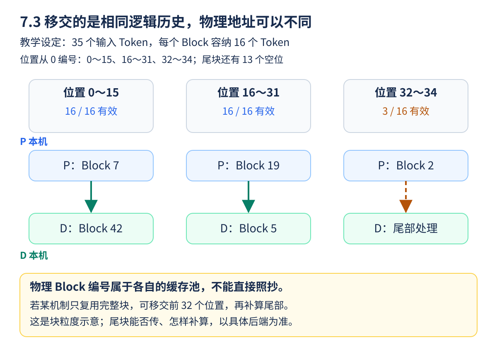
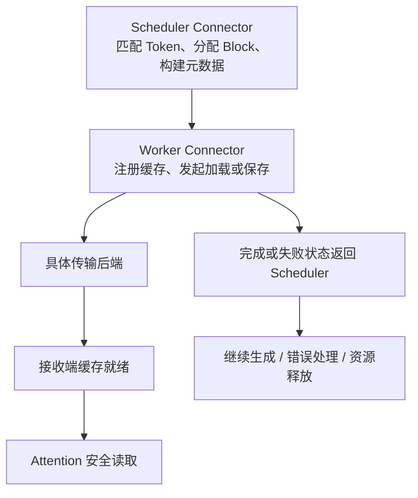

两台服务器都能回答 HTTP 请求，还不能证明它们完成了 P/D 解耦。真正需要交接的是“这段输入已经计算到哪里”的状态，就像接班医生需要完整病历和身份核对，而不仅是床号。**KV 数据、对应的 Token/位置、布局和生命周期必须一起对齐。**

<!-- more -->

## 📑 目录

- [1. KV 移交需要哪些信息](#1-kv-移交需要哪些信息)
  - [1.1 KV 不是模型权重，也不是聊天记录原文](#11-kv-不是模型权重也不是聊天记录原文)
  - [1.2 逻辑位置与物理位置不是一回事](#12-逻辑位置与物理位置不是一回事)
  - [1.3 看起来相同的文本，为什么还要核对 Token](#13-看起来相同的文本为什么还要核对-token)
- [2. 先算载荷，再估计传输时间](#2-先算载荷再估计传输时间)
  - [2.1 按一个 Token 开始计算](#21-按一个-token-开始计算)
  - [2.2 传输总时间与用户多等多久要分开](#22-传输总时间与用户多等多久要分开)
- [3. 带宽单位与共享链路](#3-带宽单位与共享链路)
  - [3.1 先把所有单位统一](#31-先把所有单位统一)
  - [3.2 四个 Rank 不等于四倍网卡带宽](#32-四个-rank-不等于四倍网卡带宽)
- [4. V1 Connector 的 Scheduler 与 Worker 分工](#4-v1-connector-的-scheduler-与-worker-分工)
  - [4.1 为什么要拆成两个角色](#41-为什么要拆成两个角色)
  - [4.2 用问题对应接口，而不是背调用名](#42-用问题对应接口而不是背调用名)
- [5. NIXL 与 NCCL，不能混用排错配置](#5-nixl-与-nccl不能混用排错配置)
  - [5.1 这些名字处在不同层](#51-这些名字处在不同层)
  - [5.2 先判断哪条路径失败](#52-先判断哪条路径失败)
- [6. 状态生命周期：什么时候才能释放](#6-状态生命周期什么时候才能释放)
  - [6.1 “P 算完了”和“缓存可以释放了”是两个事件](#61-p-算完了和缓存可以释放了是两个事件)
  - [6.2 取消与重试怎样改变资源责任](#62-取消与重试怎样改变资源责任)
- [7. 验证顺序：正确、确实传了、再谈快](#7-验证顺序正确确实传了再谈快)
  - [7.1 三类证据分别回答三个问题](#71-三类证据分别回答三个问题)
  - [7.2 一份完整的迁移记录应该留下什么](#72-一份完整的迁移记录应该留下什么)
- [总结](#-总结)
- [自我检验清单](#-自我检验清单)
- [参考资料](#-参考资料)

---

## 1. KV 移交需要哪些信息

除每层 Key/Value 数据，接收端还需要知道请求标识、已计算的 Token 范围、Block 对应关系、模型配置以及传输定位信息。元数据应指向有效且尚未释放的物理缓存。

| 契约 | 不一致可能造成什么 |
|---|---|
| 模型权重/revision、LoRA 等状态 | 相同 Token 对应不同隐藏状态 |
| Tokenizer、模板、完整 Token 序列 | 缓存对应了另一个输入 |
| 位置与 RoPE 配置 | 相同内容却使用了错误的位置状态 |
| dtype、Scale、布局、Head 分片 | 接收端无法正确解释数据 |
| Block 大小与有效长度 | 读取未计算部分或错位位置 |

不能仅靠“模型名称相同”或“Prompt 文本相同”判断兼容。若支持异构布局/TP，转换机制本身也必须经过验证。

### 1.1 KV 不是模型权重，也不是聊天记录原文

模型权重是训练得到、通常在加载时准备好的参数；KV 是这条输入经过模型后得到的中间状态。模型相同、输入或位置不同，KV 仍可能不同。把聊天原文发到 D，只是让它有机会重新计算，不代表复用了 P 已经做过的工作。

例如请求 r17 的前 100 个 Token 已在 P 计算，D 若要从这段历史继续，就需要兼容的历史 KV，以及清楚的有效范围。只有一个缓存地址而不知道它属于哪条请求、对应哪段历史，就像收到一个没有姓名和页码的病历文件。

### 1.2 逻辑位置与物理位置不是一回事

逻辑位置是“这条请求的第几个 Token”；物理位置是“它的 KV 存在本机缓存池的哪个 Block”。缓存池会复用空间，因此 P 的 Block 7 与 D 的 Block 7 没有天然对应关系，需要映射或接收布局。

假设每块容纳 16 个 Token，35 Token 的输入会覆盖两块完整块和一块部分使用的尾块。一种只复用完整块的机制可能交接前 32 个位置，再对尾部补算；这是说明块粒度的假设例子，不是承诺所有 Connector 都按这个规则发送。



**从上到下读图**：最上面是请求中的逻辑位置；中间是它们在 P 缓存池里的位置；下面是 D 为相同历史准备的位置。图中的物理块编号是任意示例，不是 vLLM 的固定分配结果。

P 的 Block 7 可以搬到 D 的 Block 42。只要布局、位置和映射正确，编号不同不影响它们代表相同逻辑历史；反过来，两边都叫 Block 7，也不能证明内容相同。35 个有效 Token 占三个容量为 16 的块，不代表有 48 个有效历史 Token，空槽不能当成已计算内容。

**停下来想一想**：假设某机制只交接完整块，35 Token 输入可以直接复用多少个位置？答案是前 32 个；余下 3 个如何补算或处理，要继续看协议。这个算例不能推出 NixlConnector 的所有布局和版本都采用同一种尾部策略。

### 1.3 看起来相同的文本，为什么还要核对 Token

聊天模板可能加入角色标记，Tokenizer 版本可能改变切分，LoRA 或位置编码配置又会改变对应状态。缓存要匹配的是模型实际处理的 Token 序列及执行契约，而不是用户界面里肉眼看到的一段文本。

因此交接元数据还要包含定位与有效性信息。元数据本身通常远小于 KV，但它负责把“大块数据”与“正确请求的正确位置”关联起来，不能省略。

## 2. 先算载荷，再估计传输时间

对常规 MHA/GQA 模型，先按未扣除前缀复用的完整输入估算，全模型 KV 纯数据量约为：

$$
S_{\text{KV}}=2LTH_{\text{KV}}d\,b
$$

取假设结构 $L=32,H_{\text{KV}}=8,d=128,b=2$，输入 $T=8192$，得到 1 GiB 的 KV。它不是任何所选模型的实际配置；MLA、窗口 Attention、量化元数据与缓存命中都要另算。

按有效带宽 $B_{\text{eff}}$，不能重叠的传输时间至少包含：

$$
T_{\text{xfer}}\gtrsim\frac{S_{\text{actually moved}}}{B_{\text{eff}}}
+T_{\text{handshake}}+T_{\text{layout}}+T_{\text{queue}}
$$

层间流水、Prefix Cache 命中和只传完整 Block 会改变实际发送量及暴露在关键路径上的时间。上式不代表必须等全部 Prefill 结束后才能开始任何传输。

### 2.1 按一个 Token 开始计算

公式中的 2 代表 Key、Value 两份，$L$ 是层数，$H_{\text{KV}}$ 是 KV Head 数，$d$ 是每个 Head 的宽度，$b$ 是每个数字的字节数。这里要用 KV Head 数，不是随手把 Query Head 数代进去。

在上面的假设结构中，每个输入 Token 对应 $2\times32\times8\times128\times2=131072$ 字节，即 128 KiB：

| 输入长度 | 完整 KV 纯数据估算 |
|----------|---------------------|
| 1024 Token | 128 MiB |
| 4096 Token | 512 MiB |
| 8192 Token | 1 GiB |

这是数据容量，不是 HTTP 请求体大小。几千个 Token 的文字只有一段文本，但经过许多层、许多 Head 后，对应的 KV 可能大得多。量化缓存还需要按实际 dtype 和 Scale 等元数据重新核算。

### 2.2 传输总时间与用户多等多久要分开

若某一层的 KV 产生后就能发送，它可能与后续层计算重叠。假设一段传输总共持续 30 ms，其中 20 ms 与其他必要计算重叠，关键路径上暴露的等待可能只有剩下的部分；这只是重叠关系示例，不是特定后端测量。

另一方面，即使数据传得很快，握手、布局转换、接收预算或链路队列仍可能让用户等待。因此应同时记录实际迁移数据量、传输持续时间与端到端可见开销，不能把“网络正在传”的每一毫秒都直接加到 TTFT 上。

## 3. 带宽单位与共享链路

100 Gb/s 的原始线速是 12.5 GB/s，不是 100 GB/s。假设有效率 80%，搬 1 GiB 的纯数据时间下界约为 107 ms；实际还要加协议与排队。

```python
size = 2 * 32 * 8192 * 8 * 128 * 2
assert size == 1024 ** 3
for link_gbps in (100, 400):
    effective_bytes_s = link_gbps * 1e9 / 8 * 0.8
    print(link_gbps, "Gb/s，纯数据下界 ms:", size / effective_bytes_s * 1000)
```

这是带宽算术，不是 RDMA 性能测试。多个请求、Rank 或通信任务共享同一网卡时，不能把网卡标称速率给每个传输各算一份。TP 改变每个 Rank 的数据量，也可能改变并行链路数与重复流量。

### 3.1 先把所有单位统一

小写 `b` 是 bit，大写 `B` 是 byte，1 byte 等于 8 bit。网络的 Gb/s 常按十进制计量，而 GiB 是 $1024^3$ 字节。算时间时，先把数据量都转成 byte、带宽转成 byte/s。

100 Gb/s 除以 8 是 12.5 GB/s，再乘假设的 0.8 有效率得到 10 GB/s。于是 1 GiB 约需 $1073741824/10000000000\approx0.107$ 秒。这个 80% 是为了算例设定的有效率，不是网络设备保证值。

### 3.2 四个 Rank 不等于四倍网卡带宽

假设四个 Rank 合计需要发送 1 GiB，每个各发 0.25 GiB，但它们共用一张网卡。可以并发发起四份任务，却仍在争同一条总带宽；不能给每份都分配完整网卡速率后，再宣称总时间变成四分之一。

只有确实存在可并行使用的独立链路，且路径、软件和接收端都能跟上，才可能得到相应收益。还要考虑 TP 归约、其他服务和多个请求是否共享该路径。

## 4. V1 Connector 的 Scheduler 与 Worker 分工

以 vLLM v0.19.0 的 V1 接口为基准，Scheduler 侧决定缓存命中、分配后的状态和传输元数据；Worker 侧处理真实设备缓存、加载、保存与完成通知。



可以从 `get_num_new_matched_tokens`、`build_connector_meta`、`start_load_kv`、`wait_for_layer_load`、`save_kv_layer` 和完成回调理解职责。这些是扩展接口，不是要求用户按顺序手工调用的一份通用客户端脚本；不同 Connector 实现的重叠与同步方式可能不同。

### 4.1 为什么要拆成两个角色

Scheduler 决定“本轮谁可以执行、需要哪些缓存、应保留哪些资源”；GPU Worker 才持有实际设备张量并执行加载或保存。就像调度员负责工单和位置，搬运人员负责把货物送到对应工位。

Scheduler 判断“这段 Token 有可用远端状态”，不表示数据已经进入 GPU；Worker 发起异步加载，也不表示 Attention 可以立刻读取。调度与传输需要用元数据和完成状态衔接。

### 4.2 用问题对应接口，而不是背调用名

| 关心的问题 | 可阅读的 V1 接口示例 |
|------------|---------------------|
| 哪些新 Token 有可复用状态 | `get_num_new_matched_tokens` |
| 本轮 Worker 应加载/保存哪些内容 | `build_connector_meta` |
| 如何发起设备侧加载 | `start_load_kv` |
| 使用某层前，它的数据是否就绪 | `wait_for_layer_load` |
| 某层计算后怎样保存/发送 | `save_kv_layer`、`wait_for_save` |
| 异步读写何时结束、哪些块还能保留 | `get_finished`、`request_finished` 等 |

实际实现可以让某些接口不做额外工作，也可以选择不同的传输粒度。读源码时先跟踪一个请求 ID 和它的块，再看哪一处开始加载、哪一处等待、哪一处上报完成，会比一次阅读所有类更容易。

## 5. NIXL 与 NCCL，不能混用排错配置

NIXL 提供传输抽象，v0.19.0 的 NixlConnector 默认使用 UCX，并有异步加载/保存及侧信道握手。NCCL 的 P2P Connector 是另一条实现路线，配置和协议不相同。

`NCCL_SOCKET_IFNAME` 影响相应 NCCL 路径，不能据此配置基于 UCX 的 NIXL 数据通道。后者需检查 UCX 网卡、传输选择、NIXL 构建插件和相关依赖；能通过 HTTP 的链路，也不一定就是 KV 真正使用的链路。

GPUDirect RDMA 让网卡直接访问设备内存，有机会减少 CPU 中转，但需要端到端驱动、设备和网络配置支持。不要从“安装了 NIXL”推断“所有传输都已经走上 RDMA”。

### 5.1 这些名字处在不同层

| 层次 | 示例 | 解决什么问题 |
|------|------|--------------|
| 引擎适配 | NixlConnector、P2P NCCL Connector | 把 vLLM 的缓存生命周期接到某种传输实现 |
| 传输软件 | NIXL、其 UCX 等后端 | 实际组织数据搬运与通信能力 |
| 设备与网络路径 | GPU、网卡、PCIe、节点间网络 | 提供真实的数据通路 |

NIXL 是库，NixlConnector 是使用它的 vLLM 组件；UCX 是可用传输后端之一。RDMA 描述一种数据访问/传输能力，不是给 HTTP 地址加一个参数就能开启的代理模式。

### 5.2 先判断哪条路径失败

如果代理连不到 P 的 HTTP 端口，先查服务地址与进程；如果 HTTP 返回了移交信息，但 D 无法加载，则检查侧信道、远端定位、UCX/NIXL 配置与实际设备。如果加载成功但很慢，再看是否走了预期通道、是否与其他流量争用带宽。

一个部署还可能同时使用 NCCL 做模型内部 TP 通信、使用 NIXL 搬运跨实例 KV。因此“UCX 通道不使用 NCCL 网卡变量”不等于整个 vLLM 进程都不需要考虑 NCCL；要把每类通信分开定位。

## 6. 状态生命周期：什么时候才能释放

P 侧产生的缓存必须保持有效，直到 D 侧完成所需读取，或按照取消/超时协议回收。发出 HTTP 元数据响应，不等于接收方已经读取全部 GPU 数据。

取消、接收失败与重试至少要明确：

1. 哪个请求拥有哪些 Block，重试有没有新的传输身份；
2. 哪个事件表示读取完成，哪些缓存仍被引用；
3. 谁负责超时清理，是否会释放被并发读取的状态；
4. 出错后是显式失败，还是允许 D 侧重算。

NixlConnector 的 `fail` 策略便于暴露传输错误；`recompute` 可提供另一种恢复路径，却会让 D 侧重新执行 Prefill，重新引入干扰。不能一边发生大量重算，一边把结果称为纯解耦吞吐。

### 6.1 “P 算完了”和“缓存可以释放了”是两个事件

可以把缓存状态想成“正在写入 → 等待移交 → 接收端读取中 → 不再需要本次传输 → 按规则回收”。P 的 HTTP 计算请求结束后，这份状态仍可能处于中间两步。

尤其是异步读取：调用返回可能只说明任务已经提交。若此时 P 把同一块分给另一个请求，D 后续读到的就可能是新内容。安全释放依赖后端的完成通知、引用管理和超时规则，不能用固定睡几毫秒代替。

**正常移交**：


**取消或失败**：


这是帮助理解所有权的通用流程，不是某个后端精确的函数调用图。正常路径上，**P 算完、HTTP 返回、D 读完、P 可回收**是不同事件；取消路径上，也要先确定数据不会再被使用。条件未满足时继续按协议保留，检查由协议与完成通知推进，不是要求写一个无限轮询的客户端脚本。

P 回收源端的一份缓存，不表示 D 侧也应同步删除。D 仍可能正在利用自己持有的历史生成；两端各自的状态，需要分别遵循本端生命周期。

### 6.2 取消与重试怎样改变资源责任

用户取消后，需要停止不再必要的计算和发送，同时确认是否还有在途读取；失败重试需要区分不同尝试，避免旧完成通知影响新状态。若通知丢失，超时回收可以防止永远占用，但超时值也不能短到经常破坏正常传输。

在 v0.19.0 的 NIXL 指南里，可通过相应超时机制处理未被读取的保留状态。初次验证应记录回收是否发生，不能只连续发送新请求、等到显存耗尽才发现老状态一直未释放。

## 7. 验证顺序：正确、确实传了、再谈快

先与聚合基线比较正常输出和结束原因，再核对 Connector 日志、有效接收 Token/Block 与失败计数，确认没有静默回退。最后记录传输字节、可见传输延迟、网络利用率和端到端指标。

某些后端只共享完整 Block，尾部需要补算；这不一定是错误。应结合有效长度解释接收量，而不是要求“接收字节严格等于理论完整 KV”。具体异构布局支持以该 Connector 的版本文档为准。

### 7.1 三类证据分别回答三个问题

| 验证层次 | 建议证据 | 单靠它还不能证明什么 |
|----------|----------|----------------------|
| 输出正确 | 与聚合路径比较文本、结束原因、Token 用量 | 可能仍是 D 本地重算所得 |
| 确实复用 | Connector 接收记录、有效 Token/Block、失败和回退计数 | 未必已经带来延迟或成本收益 |
| 性能有效 | 统一负载下的迁移开销、TTFT、ITL、Goodput | 不能跨不同模型或不同 GPU 预算泛化 |

首次实验选一个足以覆盖多个块的输入，使用 `fail` 暴露加载错误，再逐步增加并发。不要用过短输入没有完整块可复用的现象，直接判断整个后端失效。

### 7.2 一份完整的迁移记录应该留下什么

至少关联请求 ID、模型/Tokenizer revision、输入 Token 数、理论数据估算、实际接收范围、传输耗时、加载失败及清理结果。如果只剩一条“请求成功”，就无法区分真实迁移、部分补算与全部重算。

学完本节后，可以先不接触 GPU，在纸上为 35 Token、每块 16 Token 的请求画出块与有效位置；再算 1 GiB 在一条共享网卡上的下界。7.6 会把这些检查放回实际启动流程。

## 📝 总结

- KV 移交要对齐模型、Token、位置、布局与状态所有权。
- 标称带宽给出的只是乐观下界，实际流量与重叠程度要测量。
- V1 Connector 把调度决策与设备传输分开，具体后端决定同步细节。
- 失败重算会改变 D 池负载，必须计入解耦实验的解释。

## 🎯 自我检验清单

- 能按 MHA/GQA 配置估算 KV 纯数据字节数
- 能把 Gb/s 换成 GB/s，并说明下界遗漏了什么
- 能区分 Scheduler Connector 与 Worker Connector
- 能解释 NIXL/UCX 与 NCCL 环境变量的作用范围
- 能画出移交、取消、失败和回收的状态变化
- 能解释为什么缓存元数据返回后，P 仍可能必须保留物理 Block
- 能区分“输出正确”“确实复用”和“性能获益”三层证据

## 📚 参考资料

- [vLLM v0.19.0 — V1 Connector 基类](https://github.com/vllm-project/vllm/blob/v0.19.0/vllm/distributed/kv_transfer/kv_connector/v1/base.py)
- [vLLM v0.19.0 — NixlConnector Usage Guide](https://github.com/vllm-project/vllm/blob/v0.19.0/docs/features/nixl_connector_usage.md)
- [NIXL 官方项目](https://github.com/ai-dynamo/nixl)
- [vLLM v0.19.0 — P2P NCCL 示例](https://github.com/vllm-project/vllm/tree/v0.19.0/examples/online_serving/disaggregated_serving_p2p_nccl_xpyd)

---

[返回本章](https://caomaolufei.github.io/AIInfraGuide/inference/模块四-推理优化/第7章-pd解耦架构/) · [上一节](https://caomaolufei.github.io/AIInfraGuide/inference/模块四-推理优化/第7章-pd解耦架构/72-解耦架构设计/) · [下一节](https://caomaolufei.github.io/AIInfraGuide/inference/模块四-推理优化/第7章-pd解耦架构/74-goodput与slo感知调度/)
