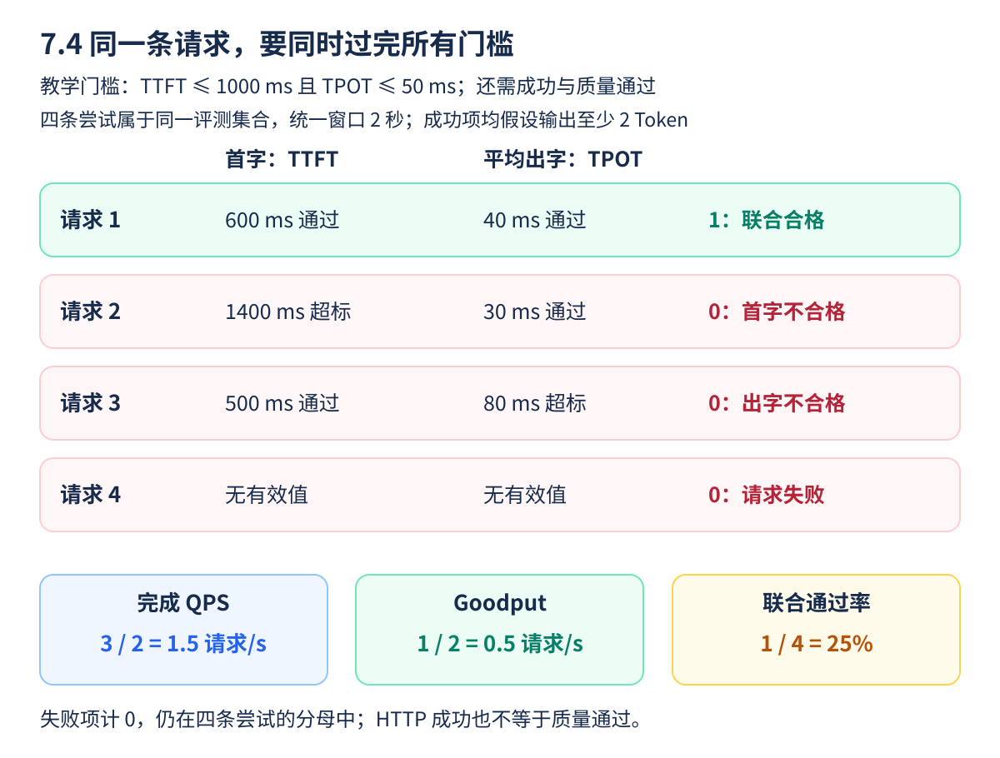
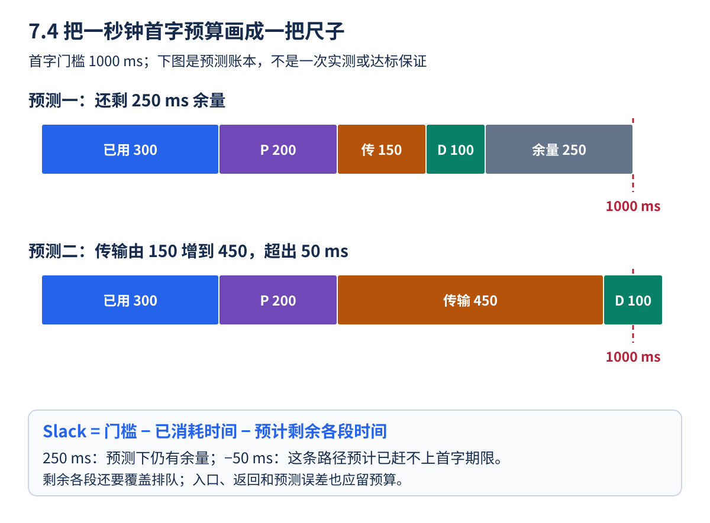
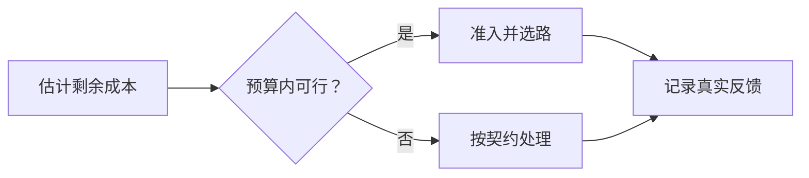

两秒内成功完成三条请求，其中一条首字太晚，另一条中途生成太慢。完成吞吐可以很好看，用户真正按要求得到的服务却只有一条。Goodput 就是把符合规定条件的请求单独计入有效产出。

本节先约定每条请求的计时和合格标准，再给四条请求逐一打分。之后把首字的一秒预算画成尺子，解释剩余时间、准入与背压如何影响调度。时间目标、失败和质量的判定要能落到同一条请求上，才可以比较不同部署。

<!-- more -->

## 📑 目录

- [1. 先把时间指标写成请求级定义](#1-先把时间指标写成请求级定义)
  - [1.1 从三个时刻开始记账](#11-从三个时刻开始记账)
  - [1.2 把 SLO 写成可判定的条件](#12-把-slo-写成可判定的条件)
- [2. 联合达标，不能用两个分位数相乘](#2-联合达标不能用两个分位数相乘)
  - [2.1 逐请求联合判断是什么](#21-逐请求联合判断是什么)
  - [2.2 失败请求与时间窗口也要有位置](#22-失败请求与时间窗口也要有位置)
- [3. 一个不依赖 GPU 的计分示例](#3-一个不依赖-gpu-的计分示例)
  - [3.1 先在纸上给四条请求打分](#31-先在纸上给四条请求打分)
  - [3.2 读代码时注意“且”的关系](#32-读代码时注意且的关系)
- [4. SLO 感知调度怎样使用剩余时间](#4-slo-感知调度怎样使用剩余时间)
  - [4.1 Slack 是“算完预计工作，还剩多少时间”](#41-slack-是算完预计工作还剩多少时间)
  - [4.2 准入、公平性与背压分别是什么](#42-准入公平性与背压分别是什么)
- [5. 输出长度未知，怎样避免乐观承诺](#5-输出长度未知怎样避免乐观承诺)
  - [5.1 输出上限不是输出预测](#51-输出上限不是输出预测)
  - [5.2 预测错了以后怎么办](#52-预测错了以后怎么办)
- [6. vLLM 的 Goodput 参数怎样解释](#6-vllm-的-goodput-参数怎样解释)
  - [6.1 门槛参数不会替你修改调度器](#61-门槛参数不会替你修改调度器)
  - [6.2 工具口径还要核对哪些细节](#62-工具口径还要核对哪些细节)
- [7. 从吞吐曲线找服务容量](#7-从吞吐曲线找服务容量)
  - [7.1 为什么不是挑 Goodput 数字最大的一行](#71-为什么不是挑-goodput-数字最大的一行)
  - [7.2 看曲线时同时看队列](#72-看曲线时同时看队列)
- [总结](#-总结)
- [自我检验清单](#-自我检验清单)
- [参考资料](#-参考资料)

---

## 1. 先把时间指标写成请求级定义

对请求 $i$，从客户端发出到第一个有效输出的时间为 $\mathrm{TTFT}_i$；生成 $n_i\ge2$ 个 Token 时，首末输出时间差除以 $n_i-1$ 得到平均 $\mathrm{TPOT}_i$。端到端时间还包含完成响应和可能的网络尾部。

这些定义需要明确计时点、代理缓冲、Tokenizer 与失败超时策略。只有一个输出 Token 时，TPOT 的分母为零，应标为不适用并规定该类请求的 SLO；不要拿它和长输出的 TPOT 直接比较。

请求的平均 TPOT 达标，不保证每个 ITL 都达标。如果业务对单次长暂停敏感，应另外设定尾 ITL 或最大间隔约束，并确保观测粒度足够。

### 1.1 从三个时刻开始记账

先为每条请求记录“何时发送、何时收到首个有效输出、何时完成”。例如请求在 0 秒发送，0.6 秒收到首 Token，1.8 秒收到第 31 个 Token，那么理想 Token 时间线下 TTFT 是 600 ms，平均 TPOT 是 $(1.8-0.6)/30=40$ ms。

若完整响应在 1.85 秒才结束，端到端时间还包含这段尾部。服务端计算时间和客户端体验时间也不相同：客户端可能额外经历入口排队、代理与网络等待。

### 1.2 把 SLO 写成可判定的条件

“响应要快”无法直接计分；“首字不超过 1000 ms，后续平均间隔不超过 50 ms”才是明确门槛。还要约定适用请求类型、成功/失败、输出质量和单 Token 请求怎样处理。

例如只要求回答一个整数的任务，TPOT 不适用并不意味着任务失败；它可以采用成功、质量和首字/端到端时间条件。与长文本组放在一起统计时，要保留不同契约，不能为了方便就让所有请求套同一条分母公式。

## 2. 联合达标，不能用两个分位数相乘

设首字与出字门槛为 $s_F,s_P$，请求成功且质量通过时，定义联合达标指示量：

$$
I_i=\mathbb{1}[\mathrm{success}_i\land\mathrm{quality}_i
\land\mathrm{TTFT}_i\le s_F\land\mathrm{TPOT}_i\le s_P]
$$

固定评测集合与统一观测窗口 $\Delta t$ 后：

$$
G=\frac{\sum_i I_i}{\Delta t},\qquad
R_{\text{pass}}=\frac{\sum_i I_i}{N_{\text{offered}}}
$$

窗口内的请求归属、跨边界请求与排空期要预先约定。失败、超时、拒绝不能偷偷从 offered 分母移除；若按“完成请求”另报成功率，应注明口径差异。

分别有 95% 请求满足 TTFT 和 TPOT，不代表同一批 95% 同时满足两项，也不能直接将两个通过率相乘。最可靠的方法是保留逐请求关联记录。

### 2.1 逐请求联合判断是什么

指示量 $I_i$ 只取 0 或 1：同一条请求同时成功、质量合格、首字合格、出字合格时记 1，任何一项不通过就记 0。最后把所有 1 加起来，除以秒数得到合格请求/秒；除以尝试提交的请求数，得到联合通过率。

假设有 100 条请求，首字不达标的有 5 条，出字不达标的也有 5 条。如果两组失败完全重合，就有 95 条联合达标；如果两组完全不同，就只有 90 条联合达标。单独两个“95%”不能告诉我们究竟是哪种情况，更不能无依据地假定独立后算成 90.25%。

### 2.2 失败请求与时间窗口也要有位置

这里的 $N_{\text{offered}}$ 指评测集合中尝试提交的请求，包括后来被拒绝、失败或超时的请求。否则服务可以只接最简单的少量请求，把其他请求从统计中删掉，制造很高的“通过率”。

一种适合入门的有限批次口径是：固定 N 条请求，从正式发流开始计时，持续到最后一条完成或被判定超时，排空等待计入时长；预热另算。若研究持续在线流量，则要另外约定窗口内按到达还是完成归属、如何追踪窗口外结束的请求。不同口径可以分别报告，但不能拿不同集合的分子和分母拼成一个 Goodput。

## 3. 一个不依赖 GPU 的计分示例

下面四条记录均假设输出至少两个 Token，单位为 ms。窗口包含这四条请求的评测活动，示例没有跨窗口请求：



**把图当作一张阅卷表**：先横着检查同一条请求的条件，只有成功、质量和两项时间要求全部满足，才在最后一列记 1。再竖着加总分数。不要分别统计两列有多少“通过”，然后把它们当成同一批请求。

第 2、3 条仍然成功返回了内容，只是超过时间门槛；它们与第 4 条请求执行失败不同。“不满足 SLO”不等于“HTTP 一定报错”，因此监控成功率还不够。

底部三个数的分母不同：完成 QPS 和 Goodput 都除以 **2 秒**，但前者数成功完成的三条，后者只数联合合格的一条；联合通过率除以 **4 条尝试**。失败请求没有有效延迟，不能把空值填成 0 ms 假装最快，也不能从尝试集合里删掉。

```python
rows = [
    {"ok": True, "quality": True, "ttft_ms": 600, "tpot_ms": 40},
    {"ok": True, "quality": True, "ttft_ms": 1400, "tpot_ms": 30},
    {"ok": True, "quality": True, "ttft_ms": 500, "tpot_ms": 80},
    {"ok": False, "quality": False, "ttft_ms": None, "tpot_ms": None},
]

def meets_slo(row, ttft_ms=1000, tpot_ms=50):
    return (row["ok"] and row["quality"]
            and row["ttft_ms"] is not None and row["tpot_ms"] is not None
            and row["ttft_ms"] <= ttft_ms and row["tpot_ms"] <= tpot_ms)

duration_s = 2.0
passed = sum(meets_slo(row) for row in rows)
print("完成 QPS:", sum(row["ok"] for row in rows) / duration_s)
print("Goodput:", passed / duration_s, "联合通过率:", passed / len(rows))
assert passed == 1
assert passed / duration_s == 0.5
```

这里的门槛是教学示例，不是服务通用标准。真实任务的质量判断可能需要离线评测；性能 CLI 的“Goodput”通常只覆盖配置的时间条件，不自动证明模型回答正确。

### 3.1 先在纸上给四条请求打分

| 请求 | 是否成功 | TTFT 是否不超过 1000 ms | TPOT 是否不超过 50 ms | 联合计分 |
|------|----------|-------------------------|------------------------|----------|
| 第 1 条 | 是，质量通过 | 是：600 | 是：40 | 1 |
| 第 2 条 | 是，质量通过 | 否：1400 | 是：30 | 0 |
| 第 3 条 | 是，质量通过 | 是：500 | 否：80 | 0 |
| 第 4 条 | 否 | 没有有效值 | 没有有效值 | 0 |

两秒里成功三条，完成 QPS 是 1.5；只有一条合格，Goodput 是 0.5 请求/秒；四条尝试中一条合格，联合通过率是 25%。三种数字描述的是同一个实验的不同侧面。

### 3.2 读代码时注意“且”的关系

`and` 要求条件全部成立；检查 `None` 是为了避免把失败缺失值当成零延迟。可以把第 2 条的 TTFT 改成 900，再手算合格数变化，确认计分过程。

代码中的 `quality` 是已知的教学标签。真实服务里“JSON 能解析”与“答案正确”可能是不同质量层次，应按任务定义额外检查，不应把 HTTP 200 直接写成质量通过。

**停下来想一想**：如果第 2 条的 TTFT 从 1400 改为 900 ms，其他记录和两秒窗口不变，哪些数字会改变？成功完成数仍是三条，所以完成 QPS 仍为 1.5；联合合格数从一变二，Goodput 变成 1 请求/秒，联合通过率变成 50%。优化应尽量让原本失败于体验门槛的工作变合格，而不是只增加总完成数。

## 4. SLO 感知调度怎样使用剩余时间

P 侧可用剩余首字预算估计紧迫性：

$$
\text{slack}_i=s_{F,i}-t_{\text{wait},i}
-\widehat T_{P,i}-\widehat T_{\text{xfer},i}-\widehat T_{D,\text{first},i}
$$

这只是一种调度估计，包含预测误差。若只按最短输入优先，长请求可能饥饿；若只按最早期限优先，也可能让一个已不可挽救的请求拖住很多仍能达标的请求。

可结合请求优先级、等待老化、资源预算与准入控制。D 池还需要保障现有请求的出字节奏，不能只根据新请求 TTFT 把更多缓存塞过去。

### 4.1 Slack 是“算完预计工作，还剩多少时间”

上式假设请求还在等待进入 P 路径：$t_{\text{wait}}$ 表示到目前已经消耗的首字预算；预测项应覆盖余下 P 排队/计算、移交，以及 D 侧等待和首个对外输出。入口与返回开销也需要留余量，不能漏算后宣称一定达标。

假设首字门槛 1000 ms，已消耗 300 ms，预计余下 P 为 200 ms、传输 150 ms、D 首输出路径 100 ms，则剩余余量为 250 ms。若传输预测增至 450 ms，余量就变成 -50 ms。这是假设账本：负数提示当前路径预计无法达标，正数也只说明预测下有余量，不是保证。



从请求发出时开始，这一秒预算就已经在走。图中“已用 300”不是未来还会再发生的等待，而是已经花掉的部分；其余色块预测从现在到首个对外输出还需要多久。这样加起来，才能与同一个 1000 ms 期限比较。只给 P 的计算设 1000 ms，而不管前后等待，会把整条请求的时间预算重复使用。

第二条尺子说明为什么路由也要看传输。P 的计算预测没有变，D 首输出路径也没有变，但链路拥挤让移交多等 300 ms，原来的 250 ms 余量就被用完。调度器接下来可以寻找另一条有资源且兼容的路径，或者按服务契约进行有界等待、拒绝或其他处理；改变统计门槛不会把已经消耗的时间拿回来。

**练习与答案**：若现在多等 100 ms，但剩余工作预测完全不变，第一条尺子的 Slack 从 250 变为 150 ms。若等待时 P 实际已经并行做完一部分，则应同步减少剩余 P 项，重新按当前状态核算。预算不能既保留已经完成的工作，又把它算进“尚需时间”。预测正数仍须为波动留量，并由实际 TTFT 检查。

### 4.2 准入、公平性与背压分别是什么

**准入**决定现在是否接受这项工作；**公平性**避免某类请求一直被其他请求挤掉；**背压**让上游知道下游已经接不住。等待老化可以理解为“等得越久，优先级适当提升”，缓解只服务短请求造成的饥饿。

这些目标会有冲突：抢救一个已经严重超时的长请求，可能影响很多还来得及达标的请求；无条件拒绝长请求，又可能违背服务契约。因此策略需要结合优先级、拒绝规则与业务目标，而不是只把 Slack 最小者永远排第一。



真实反馈用于修正预测和容量模型。图中“按契约处理”对应有界排队、拒绝或已约定的降级；不能省掉这些请求的统计，或把某次预测当成永久有效的调度保证。

## 5. 输出长度未知，怎样避免乐观承诺

输入长度可在 Tokenization 后得知，实际输出长度通常未知。最大输出上限可提供容量约束，但预留全部上限又可能降低利用率。

工程上可以使用长度桶、历史分布和保守余量，持续检查预测偏差。若模型突然开始长链推理，原有短输出容量估计就可能失效。调度器必须允许背压和显式过载处理，而不是依赖预测永远正确。

同样，缓存命中和传输时间也可能变化。只把平均耗时放进预算，会低估尾部排队；需要在目标负载下测量分布。

### 5.1 输出上限不是输出预测

用户设置 `max_tokens=128`，意思是最多允许生成这么多，不代表真实答案必定有 128 Token。普通 EOS、任务格式和推理行为都可能改变长度。全部按上限预留可能过于保守，全部按历史短均值安排又可能过载。

更实际的起点是区分短问答、长生成等类别，观察长度分布和预测误差，为长尾留出预算。这里讲的是容量估计思路，不是承诺一个通用预测器可以准确知道每条请求何时结束。

### 5.2 预测错了以后怎么办

持续观察真实长度、D 活跃序列和 KV 余量；当长输出增多时，及时限制新的准入或有界排队。限流、排队与拒绝的结果都应留在统计中，避免只展示预测成功的部分。

一次较短请求不应被当成长时间容量证明，昨天的平均值也不应永久有效。模型、模板、业务类型或用户行为变化后，都需要重新校准。

## 6. vLLM 的 Goodput 参数怎样解释

v0.19.0 的 `vllm bench serve` 可配置时间门槛，例如：

```bash
# 在已有、完整的 benchmark 命令上追加以下参数：
vllm bench serve --help
# --goodput ttft:1000 tpot:50
```

实际使用见 7.6 的完整命令，门槛单位为 ms。该版本按所选请求时间指标联合判断；单 Token 输出的 TPOT 在实现中按 0 处理。若业务需要不同口径，应单独分组或基于逐请求记录重算，不要不加说明地与本节“TPOT 不适用”的定义混用。

`--goodput` 的 TPOT 条件不是每个 ITL 都不超过同一个值。用 `--percentile-metrics ... itl` 可以补充观察，但“报了 P99 ITL”也不等于把它纳入逐请求联合 SLO。

### 6.1 门槛参数不会替你修改调度器

`--goodput ttft:1000 tpot:50` 是告诉压测工具“按这两个时间门槛给结果计分”，不是给服务端下发一个自动守住 1000/50 的调度策略。改变门槛会改变合格数，不会自动增加算力。

因此比较时先固定门槛，再改变部署或到达率。不能某个方案不达标就放宽它的门槛，而仍把新结果与旧门槛下的基线直接比较。

### 6.2 工具口径还要核对哪些细节

该版本使用客户端请求延迟、TTFT 与实际输出长度计算 TPOT，具体测量会受到响应尾部和流式观测粒度影响。输出长度不超过一个 Token 时，Goodput 计分按 TPOT=0 处理，不能不加说明地拿来代表“长输出非常流畅”。

还应保存失败记录、原始长度和生成内容。时间门槛、业务质量和 Token 级暂停各有检查入口，把几项证据放在一起，才能说明用户实际获得了什么服务。

## 7. 从吞吐曲线找服务容量

逐步增加固定到达率，记录 Offered QPS、完成 QPS、Goodput、拒绝/失败、队列和尾延迟。服务容量可以定义为“联合通过率至少达到业务目标时，能接受的最大到达率”，而不是排队已经无限增长时的峰值 Token/s。

Token/s、合格请求/s 和单位 GPU Goodput 应分别报告。长输出会提高 Token 计数权重；用不同输出分布比较时，这几个指标可能朝相反方向变化。

### 7.1 为什么不是挑 Goodput 数字最大的一行

假设用相同口径记录了下面的十秒教学窗口，所有请求归属和完成追踪都已明确：

| 尝试到达率 | 尝试数 | 成功数 | 联合合格数 | Goodput | 联合通过率 |
|------------|--------|--------|------------|---------|------------|
| 1 请求/s | 10 | 10 | 10 | 1 请求/s | 100% |
| 2 请求/s | 20 | 20 | 19 | 1.9 请求/s | 95% |
| 3 请求/s | 30 | 29 | 24 | 2.4 请求/s | 80% |
| 4 请求/s | 40 | 35 | 26 | 2.6 请求/s | 65% |

如果业务要求联合通过率至少 90%，表中更高的 2.6 Goodput 仍不满足约束；已测工作点里，到达率 2 请求/s 是合格候选。它也不是精确的最终容量，还可以在 2 与 3 之间继续扫描、增加持续时间和重复运行。

### 7.2 看曲线时同时看队列

若完成率看似稳定、Waiting 却持续增加，说明当前观察期可能在积压未来工作；更长时间运行可能出现越来越大的延迟和超时。容量结论需要稳定性、通过率与资源成本一起成立，不能只截取启动后最漂亮的几秒。

## 📝 总结

- Goodput 依赖明确的请求级成功、时间和质量口径。
- TTFT 与 TPOT 的分位数不能代替同一请求的联合达标判断。
- SLO 调度要考虑剩余预算、长度不确定性、背压与公平性。
- 性能工具的具体定义需要与业务 SLO 对齐。

## 🎯 自我检验清单

- 能区分 Offered QPS、完成 QPS、Goodput 与 Token/s
- 能说明失败和拒绝为什么不能从 offered 分母消失
- 能解释单 Token 输出的 TPOT 口径问题
- 能写出包含传输与 D 侧等待的首字预算
- 能说明 vLLM 的 tpot Goodput 条件为什么不是最大 ITL 条件
- 能用四条请求的原始记录手算完成吞吐、Goodput 与联合通过率
- 能说明 Goodput 参数是评测门槛，而不是自动调度开关

## 📚 参考资料

- [DistServe — Goodput-optimized LLM Serving](https://www.usenix.org/conference/osdi24/presentation/zhong-yinmin)
- [vLLM v0.19.0 — Goodput 计算与参数](https://github.com/vllm-project/vllm/blob/v0.19.0/vllm/benchmarks/serve.py)
- [TaiChi — 不同 SLO 下的聚合与解耦](https://arxiv.org/abs/2508.01989)

---

[返回本章](https://caomaolufei.github.io/AIInfraGuide/inference/模块四-推理优化/第7章-pd解耦架构/) · [上一节](https://caomaolufei.github.io/AIInfraGuide/inference/模块四-推理优化/第7章-pd解耦架构/73-kvcache传输与connector/) · [下一节](https://caomaolufei.github.io/AIInfraGuide/inference/模块四-推理优化/第7章-pd解耦架构/75-资源配比与调度挑战/)
