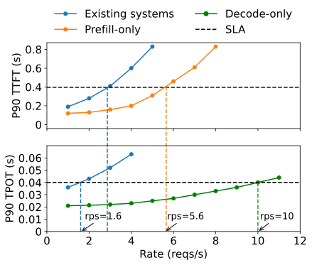
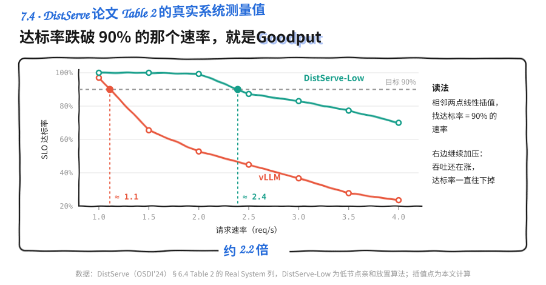

1.1 节提到过，Goodput（有效吞吐）只统计满足 SLO 的那部分请求，P/D 解耦的优化目标就是它。本节把这个指标讲细：它怎么定义、为什么用"每卡"、SLO 怎么定、怎么测，以及调度器能做哪些事情来提高它。

> ⏰ **信息时效**：Goodput 定义取自 DistServe 论文；`vllm bench serve` 的参数与计算逻辑基于 vLLM v0.32.0 的 `vllm/benchmarks/serve.py`；Dynamo 的条件解耦与 Planner 基于 Dynamo v1.7.0 文档，该功能标注为实验性。

<!-- more -->

## 📑 目录

- [1. 吞吐高不等于服务好](#1-吞吐高不等于服务好)
- [2. Goodput 的精确定义](#2-goodput-的精确定义)
- [3. SLO 怎么定](#3-slo-怎么定)
- [4. SLO 感知调度能做什么](#4-slo-感知调度能做什么)
- [5. 怎么测 Goodput](#5-怎么测-goodput)
- [总结](#-总结)
- [自我检验清单](#-自我检验清单)
- [参考资料](#-参考资料)

---

## 1. 吞吐高不等于服务好

一家快递公司说自己每天送出 10 万件，听起来很多；如果其中一半都超过了承诺时效，客户感受到的服务只有 5 万件。推理服务也一样：每秒处理多少请求、生成多少 Token 是**吞吐**，其中延迟满足要求的那部分才是 **Goodput**。

合并部署把 Prefill 和 Decode 塞进同一批，能把 GPU 用得很满，吞吐数字好看。但 7.1 节已经说明，这种做法会拉长 TPOT 的尾部；如果再加上严格的 TTFT 要求，系统只能在两者之间取舍，或者多配 GPU 同时满足两者。DistServe 的论文就从这一点出发：服务提供商真正关心的是**在满足 SLO 的前提下，每张 GPU 能服务多少请求**，这直接决定每个请求的成本。

下图是 DistServe 论文的 Figure 1：13B 模型、一张 A100-80GB、输入 512 Token、输出 64 Token，SLO 是 P90 TTFT 不超过 0.4 s（上图黑色虚线）、P90 TPOT 不超过 0.04 s（下图黑色虚线）。蓝线是合并部署，橙线是只跑 Prefill，绿线是只跑 Decode。图中的 SLA 就是本文的 SLO：



*图注：合并部署在约 2.9 req/s 时 TTFT 越界，在 1.6 req/s 时 TPOT 越界，取两者中较小的 1.6 req/s 作为 Goodput。单独跑 Prefill 能撑到 5.6 req/s，单独跑 Decode 能撑到 10 req/s。*

> 来源：Zhong et al., "DistServe: Disaggregating Prefill and Decoding for Goodput-optimized Large Language Model Serving", OSDI 2024, Figure 1. [arXiv:2401.09670](https://arxiv.org/abs/2401.09670)

从这张图可以算出解耦的收益：用 2 张卡做 Prefill（$2\times5.6=11.2$ req/s）、1 张卡做 Decode（10 req/s），整体能撑 10 req/s，即每卡 $10/3\approx3.3$ req/s，是合并部署 1.6 req/s 的约 2.1 倍。注意这里比的是**每卡**数字，3 张卡对 1 张卡，不能直接比总量。

---

## 2. Goodput 的精确定义

### 2.1 DistServe 的定义

DistServe 把**每卡 Goodput** 定义为：在 SLO 达标率不低于目标值（如 90%）的前提下，每张 GPU 能承受的最大请求速率。写成式子：

$$
\text{Goodput}_{\text{per-GPU}}=\frac{1}{N_{\text{GPU}}}\max\left\{R\ \middle|\ \text{attainment}(R)\ge\alpha\right\}
$$

- $R$ 是请求到达速率（req/s）。
- $\text{attainment}(R)$ 是**SLO 达标率**：在速率 $R$ 下，同时满足 TTFT 和 TPOT 要求的请求所占比例。
- $\alpha$ 是达标率目标，DistServe 的主实验用 90%，附录里也给了 99% 的结果。
- $N_{\text{GPU}}$ 是这个系统用的 GPU 总数。

几个要点：

- **一个请求要同时满足所有 SLO 才算数**。TTFT 达标但 TPOT 超了，这个请求就不计入。
- **Goodput 是一个速率上限**，要通过逐步加压找出来，不是某一次压测直接读出的数。
- **按卡数归一化**。解耦后两类实例的卡数可以不同，不归一化就没法和合并部署公平比较。

### 2.2 从达标率曲线读出 Goodput

下图用 DistServe 论文 Table 2 中真实系统的测量值画出两条达标率曲线（vLLM 与低节点亲和放置的 DistServe），灰色虚线是 90% 的目标：



两条曲线和 90% 线的交点就是 Goodput：vLLM 约 1.1 req/s，DistServe-Low 约 2.4 req/s（按相邻两点线性插值）。速率再往上，吞吐还会增长，但达标率持续下降，多接进来的请求大多是不达标的。

### 2.3 `vllm bench serve` 里的 Goodput

`vllm bench serve` 也有 `--goodput` 参数，但含义和论文不完全一样：

```bash
vllm bench serve ... --request-rate 4 --goodput ttft:2000 tpot:50
```

v0.32.0 的实现逐个检查请求：TTFT、TPOT、端到端延迟（`e2el`）中你指定的每一项都不超过阈值（单位毫秒），这个请求才算"好"。最后输出：

$$
\text{Request goodput}=\frac{\text{好请求数}}{\text{压测总时长}}
$$

也就是**在某个给定负载下**每秒完成的好请求数。它是论文定义的一个"采样点"：要得到论文意义上的 Goodput，需要扫多个 `--request-rate`，找出达标率（好请求数除以完成请求数）仍不低于目标的最大速率，再除以卡数。第 5 节给出完整流程。

⚠️ **注意**：`--goodput` 里的 `tpot` 检查的是每个请求自己的平均 TPOT，不是 ITL 的 P99。一个请求中间卡顿一次、其余 Token 很快，平均 TPOT 仍可能达标。关心卡顿时，要另外看 `--percentile-metrics` 里的 ITL 分位数。

---

## 3. SLO 怎么定

### 3.1 几个延迟指标

| 📊 指标 | 含义 | 对应的阶段 |
|---|---|---|
| TTFT | 从请求到达到第一个输出 Token 返回的时间，包括排队、Prefill，解耦时还包括 KV 传输 | Prefill |
| TPOT | 一个请求除第一个 Token 外，平均每个输出 Token 的时间：$(\text{E2E}-\text{TTFT})/(\text{输出长度}-1)$ | Decode |
| ITL | 相邻两个输出 Token 之间的时间间隔，每个间隔算一个样本 | Decode |
| E2EL | 端到端延迟，$\text{TTFT}+\text{TPOT}\times(\text{输出长度}-1)$ | 全程 |

TPOT 是"每个请求一个数"，ITL 是"每个 Token 间隔一个数"。Prefill 插入造成的卡顿，在 ITL 的 P99 上很明显，摊进某个请求的平均 TPOT 后会被稀释。vLLM 文档讲 P/D 解耦的收益时用的是"控制尾部 ITL"，原因就在这里。

### 3.2 不同应用要的不一样

DistServe 论文按应用设了不同的 SLO（OPT 系列，A100）：

| 🎯 应用 | 模型 | TTFT | TPOT | 数据集 |
|---|---|---|---|---|
| 聊天 | OPT-13B | 0.25 s | 0.1 s | ShareGPT |
| 聊天 | OPT-66B | 2.5 s | 0.15 s | ShareGPT |
| 聊天 | OPT-175B | 4.0 s | 0.2 s | ShareGPT |
| 代码补全 | OPT-66B | 0.125 s | 0.2 s | HumanEval |
| 摘要 | OPT-66B | 15 s | 0.15 s | LongBench |

规律是：

- **交互式聊天**两个都要。TPOT 只要快过人的阅读速度就够了，论文引用的阅读速度是每分钟约 250 个英文单词，再快用户也感受不到。
- **代码补全**最看 TTFT，用户在等补全弹出来，输出通常很短。
- **摘要**TTFT 可以很宽松，Prompt 很长，用户能接受等一会，但希望结果尽快生成完，TPOT 更重要。

结合 7.2 节 TaiChi 的结论：TTFT 紧、TPOT 松的应用（如代码补全）更适合合并部署；TPOT 紧、TTFT 松的应用（如长文档摘要）更适合解耦。

### 3.3 分位数和达标率目标

SLO 通常写成"P90 TTFT ≤ X 且 P90 TPOT ≤ Y"或"90% 的请求同时满足……"。两种写法不完全等价：前者对两个指标分别取分位数，后者要求同一个请求同时达标，更严格。DistServe 用后者，`vllm bench serve` 的 `--goodput` 也是按单个请求同时检查。

达标率目标从 90% 提到 99%，Goodput 通常会明显下降，因为要压住更远的尾部。DistServe 附录 C 给了 99% 下的结果，解耦的优势依然存在。

💡 **提示**：定 SLO 时先问清楚用户侧真正感知的是什么。流式输出的聊天界面里，用户感知的是首字快不快、中途卡不卡，对应 TTFT 和 ITL 的尾部；非流式的 API 调用里，用户只感知 E2E。目标不同，解耦是否有收益的结论也会不同。

---

## 4. SLO 感知调度能做什么

把目标从吞吐换成 Goodput 后，调度器做决策时要看的是"这个请求还能不能达标"。各系统在不同层面上做了不同的尝试：

### 4.1 发到哪个实例

- **DistServe**：新请求发到队列最短的 Prefill 实例，Prefill 完成后发到负载最轻的 Decode 实例。
- **KV 感知路由**：多轮对话和 Agent 场景里，同一会话的前缀 KV 可能已经在某个实例上。Dynamo 的路由器在 `--router-mode kv` 下根据各 Worker 上报的 KV 事件估算前缀命中，优先发到能复用更多 KV 的实例，减少要重算的 Token。

### 4.2 要不要走远程 Prefill

不是每个请求都值得拆开。Prompt 很短，或者大部分前缀已经缓存在 Decode 实例上时，本地算完 Prefill 比"远程 Prefill + 传 KV"更快。

- **Dynamo 的条件解耦**（v1.7.0，实验性）：路由器为每个请求算一个**有效输入长度**，即 Prompt 长度减去选中的 Decode Worker 上已缓存的前缀长度。默认策略 `isl_bounding` 在有效长度小于 2048 且有效长度与原始长度之比小于 0.7 时，直接让 Decode Worker 本地做 Prefill 加 Decode；另有按 Prefill Worker 负载决定的 `prefill_load` 策略，以及两者满足其一即可的 `isl_or_load`。文档建议按负载的有效长度分布来调这些阈值。
- **Microserving 的均衡 P/D**：Prefill 引擎压力大时，把 Prompt 尾部的一部分交给 Decode 引擎自己算（7.2 节）。

### 4.3 实例内部怎么排队

- **FCFS 的护航效应**：DistServe 用先来先服务，长 Prompt 会挡住后面的短 Prompt，短请求的 TTFT 因此越界。
- **优先级调度**：vLLM 的 `--scheduling-policy priority` 按请求携带的 `priority` 值排序（值越小越先处理，相同时按到达时间），可以让交互式请求排在离线批处理请求前面。
- **长度感知的 Prefill 调度**：TaiChi 在预估 TTFT 不越界的前提下，把短 Prompt 放到较慢的 D-heavy 实例，把快的 P-heavy 实例留给长 Prompt，因为长 Prompt 更容易超时。
- **流动式 Decode 调度**：TaiChi 把 TPOT 余量最大的请求迁到干扰较大的实例上，余量用完再迁回。

这些做法的共同点是**用已达标请求的余量去救快越界的请求**，TaiChi 把它叫作延迟转移。

### 4.4 准入与扩缩容

第 2.2 节的曲线说明，速率超过 Goodput 之后，多接的请求大多不达标，还会拖累原本能达标的请求。所以 SLO 感知的系统需要在入口和资源两个层面控制负载：

- **准入控制**：排队时间已经让一个请求不可能满足 TTFT 时，尽早拒绝或降级（比如路由到另一个集群），比让它占着资源更划算。
- **周期性重规划**：DistServe 监控输入输出长度和到达率，模式变化明显时重新计算 P/D 配置。
- **按 SLO 扩缩容**：Dynamo Planner 的 `optimization_target: sla` 模式接收 `ttft_ms`、`itl_ms` 这样的目标，用性能模型把延迟目标换算成 Prefill 和 Decode 各需要的副本数。

---

## 5. 怎么测 Goodput

### 5.1 扫请求速率

按论文的定义，Goodput 要靠扫请求速率找出来。下面的脚本对同一个服务端点扫一组速率，每个速率保存一份结果（命令按 v0.32.0 的参数编写，端点、模型和 SLO 换成你自己的）：

```bash
MODEL=Qwen/Qwen3-8B
URL_PORT=8192            # 合并部署时是 vllm serve 的端口，P/D 解耦时是代理的端口
for RATE in 0.5 1 1.5 2 2.5 3 4; do
  vllm bench serve \
    --model "$MODEL" --port "$URL_PORT" \
    --dataset-name random --random-input-len 4096 --random-output-len 256 \
    --num-prompts 300 --request-rate "$RATE" --ignore-eos \
    --goodput ttft:2000 tpot:50 \
    --percentile-metrics ttft,tpot,itl,e2el --metric-percentiles 50,90,99 \
    --save-result --result-dir results --result-filename "rate_${RATE}.json"
done
```

几个参数的作用：

- `--request-rate` 按泊松过程发请求（`--burstiness` 默认 1.0）。不设时默认是 `inf`，所有请求在开始时一次性发出，测不出排队行为。
- `--ignore-eos` 让每个请求都生成满 `--random-output-len` 个 Token，避免模型提前结束导致不同配置之间输出长度不一致。
- `--num-prompts` 要足够多，让压测时长明显大于单个请求的时长，否则分位数不稳定。

### 5.2 从结果里读出 Goodput

保存的 JSON 里有 `completed`、`request_throughput`、`request_goodput` 和各项分位数（如 `p99_itl_ms`）。两者相除就是这个速率下的达标率：

```python
import glob
import json

ALPHA = 0.9      # 达标率目标
NUM_GPUS = 2     # 这个部署用的 GPU 总数，用于按卡归一化

rows = []
for path in glob.glob("results/rate_*.json"):
    r = json.load(open(path))
    rate = float(path.split("rate_")[1].removesuffix(".json"))
    attain = r["request_goodput"] / r["request_throughput"]   # = 好请求数 / 完成请求数
    rows.append((rate, attain, r["p99_ttft_ms"], r["p99_itl_ms"]))

rows.sort()
print(f"{'rate':>5} {'达标率':>7} {'P99 TTFT':>9} {'P99 ITL':>8}")
for rate, attain, ttft, itl in rows:
    print(f"{rate:>5.1f} {attain:>7.1%} {ttft:>8.0f}ms {itl:>7.1f}ms")

# 在相邻两点之间线性插值，找达标率降到 ALPHA 的速率
goodput = None
for (r0, a0, *_), (r1, a1, *_) in zip(rows, rows[1:]):
    if a0 >= ALPHA > a1:
        goodput = r0 + (r1 - r0) * (a0 - ALPHA) / (a0 - a1)
        break
if goodput is None:
    print("扫描范围内达标率没有跨过目标，扩大速率范围后重测")
else:
    print(f"Goodput ≈ {goodput:.2f} req/s，每卡 {goodput / NUM_GPUS:.2f} req/s")
```

合并部署和 P/D 解耦各跑一遍，比较**每卡 Goodput**，而不是某一个速率下的吞吐。7.6 节会在一台机器上完整走一遍这个流程。

⚠️ **注意**：比较时负载必须相同：输入输出长度分布、到达过程、SLO、达标率目标都要一致。解耦对短 Prompt、长输出的负载收益很小，换一个负载结论就可能反过来。

---

## 📝 总结

- Goodput 只统计同时满足所有 SLO 的请求。DistServe 的每卡 Goodput 是达标率不低于目标值时的最大请求速率除以 GPU 数，P/D 解耦以它为优化目标。
- DistServe Figure 1 的例子：合并部署每卡 1.6 req/s，2P1D 每卡约 3.3 req/s，约为 2.1 倍。
- `vllm bench serve --goodput` 给出的是某个负载下每秒完成的好请求数，要扫多个速率并找出达标率跌破目标的位置，才能得到论文意义上的 Goodput。
- TPOT 是每个请求一个平均值，ITL 是每个 Token 间隔一个样本，Prefill 造成的卡顿主要体现在 ITL 尾部。SLO 要按应用定：代码补全看 TTFT，长文档摘要看 TPOT，聊天两个都要。
- SLO 感知调度可以作用在路由（最短队列、KV 感知）、是否远程 Prefill（Dynamo 条件解耦）、实例内排序（优先级、长度感知、流动式 Decode）、准入控制和按 SLO 扩缩容几个层面。

## 🎯 自我检验清单

- 能写出每卡 Goodput 的定义，并说明为什么必须按卡数归一化
- 能从 DistServe Figure 1 的数字算出 2P1D 的每卡 Goodput，并解释为什么是 2P1D 而不是 1P1D
- 能说明 `vllm bench serve` 的 `request_goodput` 与论文 Goodput 的区别，以及如何从多次压测结果中得到后者
- 能区分 TTFT、TPOT、ITL、E2EL，并解释为什么 Prefill 干扰在 ITL 的 P99 上比在 TPOT 上更明显
- 能为代码补全、聊天、长文档摘要三类应用分别说出哪个 SLO 更严、更适合合并部署还是解耦
- 能说出 Dynamo 条件解耦 `isl_bounding` 策略的判断条件和"有效输入长度"的含义
- 能列出至少三种 SLO 感知的调度手段，并说明它们作用在哪一层
- 能写出扫请求速率、计算达标率并插值求 Goodput 的完整流程

## 📚 参考资料

- [DistServe: Disaggregating Prefill and Decoding for Goodput-optimized Large Language Model Serving（OSDI'24）](https://arxiv.org/abs/2401.09670)
- [Throughput is Not All You Need: Maximizing Goodput in LLM Serving using Prefill-Decode Disaggregation（Hao AI Lab）](https://haoailab.com/blogs/distserve/)
- [Prefill-Decode Aggregation or Disaggregation? Unifying Both for Goodput-Optimized LLM Serving（TaiChi）](https://arxiv.org/abs/2508.01989)
- [A System for Microserving of LLMs](https://arxiv.org/abs/2412.12488)
- [vLLM 源码：vllm/benchmarks/serve.py（v0.32.0）](https://github.com/vllm-project/vllm/blob/v0.32.0/vllm/benchmarks/serve.py)
- [vLLM 源码：vllm/config/scheduler.py（v0.32.0）](https://github.com/vllm-project/vllm/blob/v0.32.0/vllm/config/scheduler.py)
- [NVIDIA Dynamo 源码文档：Conditional Disaggregation（v1.7.0）](https://github.com/ai-dynamo/dynamo/blob/v1.7.0/docs/fern/pages/developer-guide/advanced-customizations/conditional-disaggregation.md)
- [NVIDIA Dynamo 源码文档：Tune the Planner（v1.7.0）](https://github.com/ai-dynamo/dynamo/blob/v1.7.0/docs/fern/pages/kubernetes/auto-deployment/dynamo-planner.mdx)
