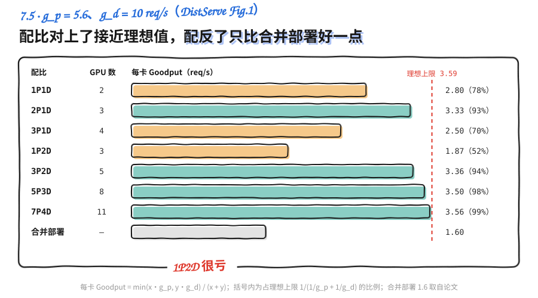

前几节讲的都是解耦的收益。这一节讨论代价：系统多了一种实例、一条数据通路和一层路由，原来不用考虑的问题都冒了出来。其中最常被问到的是"Prefill 和 Decode 各开几个"，本节用一个可复算的模型推导它，并说明为什么这个比例不能一次定死。最后汇总什么情况下应该用解耦，什么情况下不该用。

> ⏰ **信息时效**：系统层面的挑战取自 DistServe、Splitwise 论文，vLLM v0.32.0 文档，以及 NVIDIA Dynamo v1.7.0 文档；配比推导中的成本模型为假设模型，GPU 参数取自 NVIDIA H100 产品页。

<!-- more -->

## 📑 目录

- [1. 解耦带来的新问题](#1-解耦带来的新问题)
- [2. 配比与每卡 Goodput](#2-配比与每卡-goodput)
- [3. 从单实例容量估算配比](#3-从单实例容量估算配比)
- [4. 配比要跟着负载变](#4-配比要跟着负载变)
- [5. 什么时候该用，什么时候不该用](#5-什么时候该用什么时候不该用)
- [总结](#-总结)
- [自我检验清单](#-自我检验清单)
- [参考资料](#-参考资料)

---

## 1. 解耦带来的新问题

合并部署时，一个请求从头到尾待在一个实例里，状态都在本地。解耦后，一个请求要经过路由、Prefill 实例、KV 传输、Decode 实例四段，每段都可能出问题，也都有状态要管：

| ⚠️ 问题 | 具体表现 | 常见应对 |
|---|---|---|
| 路由要做两次决策 | 先选 Prefill 实例，再选 Decode 实例，两边的负载、队列和缓存命中都要考虑 | 最短队列、KV 感知路由；Splitwise 在请求到达时就同时选好两台机器 |
| KV 的位置要追踪 | Prefill 实例要保留块直到 Decode 取走，保留太久浪费显存，太短会让 Decode 取不到 | 拉取模式下用租约和心跳（vLLM NixlConnector 默认 30 s 租约，7.3 节） |
| 传输会失败 | 网络抖动、对端重启、块已被回收 | `kv_load_failure_policy` 设为 `recompute` 时由 Decode 实例重算，默认 `fail` 直接报错 |
| 故障影响面变大 | 一个 Decode 实例接着多个 Prefill 实例，它出故障会影响整条链路，DistServe 论文专门指出了这一点 | 多副本、健康检查、请求重试；DistServe 本身没有实现容错 |
| 前缀缓存分散 | 多轮对话第二轮时，上一轮生成部分的 KV 在 Decode 实例上，Prefill 实例从没算过 | vLLM 的 `bidirectional_kv_xfer` 让 Prefill 实例从 Decode 实例取回这部分 KV；Dynamo 条件解耦在 Decode 实例命中足够多时本地 Prefill |
| 权重存两份 | Prefill 和 Decode 实例各持一份完整权重，可用于 KV 的总显存变少 | 大模型用 PP/TP 切分；DistServe 在低带宽集群把同一 PP 段的两类实例放在同一节点 |
| 两边配置要一致 | 模型、`cache_dtype`、注意力后端、投机解码配置、块大小、KV 布局任一不一致，传输就无法进行 | NixlConnector 握手时校验兼容性哈希，异构 TP 需要默认的按头优先布局 |
| 运维成本 | 至少三类进程（代理、Prefill、Decode），多了一种故障模式和一套网络配置 | 用 Dynamo、llm-d 等编排框架管理；vLLM 自带的代理只适合开发测试 |

⚠️ **注意**：vLLM 仓库里的 `toy_proxy_server.py` 和 `disagg_proxy_demo.py` 是示例代理，按轮询选实例，没有健康检查和负载感知。vLLM 官方博客也明确说它适合开发，不适合生产。

还有一个容易忽略的问题来自 Dynamo 文档：Prefill 池里的 GPU 不用来存 Decode 阶段的 KV。当系统的瓶颈是 Decode 的 KV 容量时，把卡挪去做 Prefill 反而会降低总的服务能力。

---

## 2. 配比与每卡 Goodput

设一个 Prefill 实例在 TTFT 约束下最多能承受 $g_p$ req/s，占 $G_p$ 张卡；一个 Decode 实例在 TPOT 约束下最多能承受 $g_d$ req/s，占 $G_d$ 张卡。$x$P$y$D 系统整体能承受的速率由较弱的一侧决定：

$$
\text{Goodput}_{x\text{P}y\text{D}}=\min(x\,g_p,\ y\,g_d),\qquad
\text{每卡 Goodput}=\frac{\min(x\,g_p,\ y\,g_d)}{x\,G_p+y\,G_d}
$$

两侧刚好平衡（$x\,g_p=y\,g_d$）时每卡 Goodput 最大，所以理想配比是：

$$
\frac{x}{y}=\frac{g_d}{g_p}
$$

配比只能取整数，所以实际值会低于理想上限。$G_p=G_d=1$ 时，理想上限是 $\frac{1}{1/g_p+1/g_d}$。

用 DistServe Figure 1 的数字代入：$g_p=5.6$，$g_d=10$，每个实例 1 张卡。理想配比约为 $10/5.6\approx1.79$，理想上限约 3.59 req/s/卡。下图比较几种整数配比，灰色条是合并部署的 1.6 req/s/卡：



从图里能读出三点：

- **配错比例损失很大**：1P2D 只有 1.87，比 2P1D 低约 44%，只比合并部署好一点。多出来的那个 Decode 实例大部分时间在等 Prefill。
- **规模越大，越容易贴近理想值**：2P1D 已经达到上限的 93%；7P4D 能到 99%，但要 11 张卡，而且对负载变化更敏感。
- **偏离多少比偏向哪边更要紧**：3P1D 是 Decode 不够，1P2D 是 Prefill 不够。3P1D 的比例是理想值的约 1.7 倍，1P2D 只有理想值的约 0.28 倍，偏得更远，所以 1P2D 掉得更多。

📌 **关键点**：这里的 $g_p$ 和 $g_d$ 都是"在 SLO 约束下"的容量，不是峰值吞吐。SLO 一变，两者都会变，配比也跟着变。

---

## 3. 从单实例容量估算配比

$g_p$ 和 $g_d$ 最终要靠测量（7.6 节），但上线前可以先用模型估一个起点，判断解耦值不值得做、大致配多少。

### 3.1 Prefill 实例的容量

把 Prefill 实例看成 7.2 节的 M/D/1 队列：单个请求的执行时间是 $D_t$（这里用 $D_t$ 和 DistServe 的 $D$ 同义），要求平均 TTFT 不超过 $T_{\text{SLO}}$：

$$
D_t+\frac{R\,D_t^2}{2(1-R\,D_t)}\le T_{\text{SLO}}
$$

令 $k=T_{\text{SLO}}/D_t-1$（允许的排队时间是执行时间的几倍），解出利用率上限 $R\,D_t\le\frac{2k}{1+2k}$，于是 $g_p=\frac{2k}{(1+2k)\,D_t}$。TTFT 宽松时 $k$ 很大，$g_p$ 趋近 $1/D_t$，也就是 GPU 被 Prefill 占满。

### 3.2 Decode 实例的容量

Decode 实例同时服务 $C$ 个请求，每一步给每个请求生成一个 Token。$C$ 受两个条件限制：

- **KV 容量**：$C\times(\text{ISL}+\text{OSL})\times\text{每 Token KV}\le$ 可用于 KV 的显存。
- **TPOT**：并发越大单步越慢，单步时间 $t_{\text{step}}(C)$ 不能超过 TPOT 的 SLO。

一个请求在 Decode 实例上停留约 $\text{OSL}\times t_{\text{step}}$。根据 Little 定律（系统内平均请求数 = 到达率 × 平均停留时间）：

$$
g_d=\frac{C}{\text{OSL}\times t_{\text{step}}(C)}
$$

### 3.3 算一个例子

下面是**假设成本模型**：每个实例是一张 H100 跑 Qwen3-8B，TTFT SLO 为平均 2 s，TPOT SLO 为 50 ms；算力利用率 60%、为激活预留 4 GB 都是假设值；没有计入 KV 传输时间（单张 400 Gb/s 网卡下 4096 Token 约 12 ms，见 7.3 节）。

```python
# 假设成本模型：估算单张 H100 上 Qwen3-8B 的 Prefill 实例与 Decode 实例容量，推导 P/D 配比
PEAK, HBM = 989e12 * 0.6, 3.35e12        # 假设 60% 算力利用率；显存带宽 B/s
P, L, HQ, D = 8.2e9, 36, 32, 128
KV_TOK = 2 * L * 8 * D * 2               # 144 KiB/Token
KV_POOL = 80e9 * 0.9 - 2 * P - 4e9       # 可用于 KV 的显存：90% 显存减权重，再预留 4 GB 给激活等（假设）


def prefill_time(isl):
    flops = 2 * P * isl + 4 * L * HQ * D * isl * isl / 2
    return max(2 * P / HBM, flops / PEAK)


def decode_step(conc, ctx):
    bytes_ = 2 * P + KV_TOK * conc * ctx
    flops = 2 * P * conc + 4 * L * HQ * D * conc * ctx
    return max(bytes_ / HBM, flops / PEAK)


def g_prefill(isl, ttft_slo):
    """M/D/1：平均 TTFT = Dt + R·Dt²/(2(1-R·Dt)) ≤ SLO，解出最大到达率 R"""
    dt = prefill_time(isl)
    k = ttft_slo / dt - 1                 # 允许的排队时间 / Dt
    if k <= 0:
        return 0.0, dt
    x = 2 * k / (1 + 2 * k)               # 利用率 R·Dt 的上限
    return x / dt, dt


def g_decode(isl, osl, tpot_slo):
    """并发受 KV 容量和 TPOT 双重限制；Little 定律：速率 = 并发 / (输出长度 × 单步时间)"""
    ctx = isl + osl / 2                  # 平均上下文长度
    conc = int(KV_POOL // (KV_TOK * (isl + osl)))   # 按峰值 KV 占用预留
    while conc > 1 and decode_step(conc, ctx) > tpot_slo:
        conc -= 1
    t = decode_step(conc, ctx)
    return conc / (osl * t), conc, t


print(f"{'ISL/OSL':>10} {'Prefill 单次':>11} {'g_p':>7} {'并发':>5} {'单步':>7} {'g_d':>7} {'g_d/g_p':>8} {'建议':>6} {'每卡':>6}")
for isl, osl in [(4096, 256), (8192, 512), (1024, 1024), (512, 2048)]:
    gp, dt = g_prefill(isl, ttft_slo=2.0)
    gd, conc, t = g_decode(isl, osl, tpot_slo=0.05)
    cands = [(x, y) for x in range(1, 8) for y in range(1, 8) if x + y <= 8]   # 一台 8 卡机以内
    best = max(cands, key=lambda c: (round(min(c[0] * gp, c[1] * gd) / sum(c), 2), -sum(c)))
    per_gpu = min(best[0] * gp, best[1] * gd) / sum(best)
    print(f"{isl:>5}/{osl:<4} {dt * 1e3:>9.0f}ms {gp:>6.2f} {conc:>5} {t * 1e3:>5.1f}ms {gd:>6.2f} {gd / gp:>8.2f} {best[0]}P{best[1]}D {per_gpu:>6.2f}")
```

输出：

```text
   ISL/OSL  Prefill 单次     g_p    并发      单步     g_d  g_d/g_p     建议     每卡
 4096/256        122ms   7.97    80  19.8ms  15.81     1.98 2P1D   5.27
 8192/512        260ms   3.58    40  19.8ms   3.95     1.10 1P1D   1.79
 1024/1024        29ms  34.44   170  16.4ms  10.13     0.29 1P3D   7.60
  512/2048        14ms  69.77   136  14.1ms   4.71     0.07 1P7D   4.12
```

在这组假设下：

- **长输入、短输出（4096/256）**：Prefill 是重活，$g_d/g_p\approx2$，2P1D 正好平衡。这类负载（RAG、长文档问答）是解耦最典型的场景。
- **很长的输入（8192/512）**：Prefill 更重，但 KV 也更大，Decode 实例只能装下 40 个并发，两边容量接近，1P1D。
- **输入输出相当（1024/1024）或短输入长输出（512/2048）**：Prefill 很轻，Prefill 实例大部分时间空闲，要配 3 到 7 个 Decode 实例才平衡。这时解耦的收益通常很小，Microserving 在 ShareGPT 上没有观察到解耦的收益，原因相同。
- 所有情况下 Decode 并发都先撞上 KV 容量上限，单步时间 14–20 ms，离 50 ms 的 TPOT 还远。这说明在这组参数下 Decode 实例是**容量受限**而不是延迟受限，增加 Decode 实例的显存（更大的卡、KV 量化）比增加算力更有用。

⚠️ **注意**：这个模型用平均 TTFT 代替 P90 TTFT，没有算 Prefill 的组批、KV 传输、Decode 的 CUDA Graph 和调度开销，也没有算输入输出长度的方差。它只用来判断量级和方向，不能代替压测。

---

## 4. 配比要跟着负载变

第 3 节的表说明，输入输出长度一变，配比就可能从 2P1D 变成 1P3D。实际负载在一天之内都会变，所以配比不能一次定死。几个系统的做法：

| 📊 系统 | 怎么调整配比 |
|---|---|
| Splitwise | 混合池兜底：某个池排队超过阈值时，把对面池的机器临时拉进混合池跑合并批处理，没有反向任务后再回原池。论文的集群规划里，同一种硬件配置在代码补全负载下配出 35P5T，在对话负载下配出 25P15T |
| DistServe | 周期性重规划：监控平均输入输出长度和到达率，变化明显时重新跑放置算法并重载权重 |
| TaiChi | 不改实例数量，而是调 P-heavy 与 D-heavy 实例的比例和块大小 |
| NVIDIA Dynamo | Planner 按负载或 SLO 自动扩缩两个池的副本数 |

Dynamo 的性能调优文档建议把副本数当作对观测到的瓶颈的响应，而不是一个固定比例：

| 🔍 观测到的现象 | 可以尝试的调整 |
|---|---|
| Prefill 队列持续增长，Decode 还有余量 | 增加 Prefill 容量，或调整 Prefill 的路由策略 |
| Decode 的 KV 使用率一直接近上限 | 增加 Decode 容量，或降低每个请求的 KV 占用 |
| 两个池都用不满 | 减少副本，或和合并部署对比一下 |
| 延迟达标但每卡吞吐低 | 合并副本，或试更小的并行度 |
| 解耦的性能还不如合并部署 | 先检查 NIXL/RDMA 和 KV 布局兼容性，再动副本数 |

在 vLLM 上观察这两类瓶颈，对应的指标是 Prefill 实例的 `vllm:num_requests_waiting`（排队请求数）和 Decode 实例的 `vllm:kv_cache_usage_perc`（KV Cache 使用率），7.6 节会用到。

---

## 5. 什么时候该用，什么时候不该用

综合前面各节的论文结论和官方经验：

| 🎯 场景 | 建议 | 依据 |
|---|---|---|
| P99 ITL 在线上负载下超出 SLO | 优先考虑解耦 | vLLM 博客把它列为主要场景 |
| 长 Prompt、高并发，TPOT 要求严 | 解耦，前提是 KV 传输够快 | 7.1 节的干扰在这种负载下最严重；TaiChi：TPOT 紧、TTFT 松时解耦最好 |
| 长上下文 | 倾向解耦 | DistServe：KV 线性增长而 Prefill 计算超线性增长，传输占比随长度下降 |
| TTFT 是最紧的约束 | 保持合并部署，或先实测 | 每个首 Token 都要付传输时间；TaiChi：TTFT 紧时聚合更好 |
| KV 传输慢（无 RDMA、无 P2P） | 先修网络，否则不用解耦 | vLLM 博客 L40S 实测：TTFT 2.2 s 对 0.7 s |
| 低负载、突发流量或对延迟不敏感的离线任务 | 保持合并部署 | DistServe：吞吐优先的场景下 Chunked Prefill 能把每批填到算力上限；Dynamo：低并发时合并部署省掉传输和资源碎片 |
| 只有一两张卡 | 保持合并部署 | DistServe：资源受限时解耦的配置空间很小 |
| 输入短、输出长的负载 | 收益有限 | 第 3 节的估算；Microserving 在 ShareGPT 上的结果 |
| 多轮对话、Agent 循环 | 可以解耦，但要配合 KV 回传或共享 KV 缓存 | vLLM `bidirectional_kv_xfer`，LMCache、Mooncake |

💡 **提示**：做决定前先在合并部署上把 Chunked Prefill 调好（2.4 节），把它当作对照组。如果调好之后 P99 ITL 已经满足 SLO，就不需要承担解耦的运维成本。

---

## 📝 总结

- 解耦带来两级路由、KV 位置追踪、传输失败、故障扩散、前缀缓存分散、两份权重、配置一致性和运维成本等新问题，vLLM 自带的代理只适合开发测试。
- $x$P$y$D 的每卡 Goodput 是 $\min(x\,g_p,\ y\,g_d)/(x\,G_p+y\,G_d)$，理想配比满足 $x/y=g_d/g_p$。按 DistServe 的数字，2P1D 达到理想上限的 93%，配错成 1P2D 会少 44%。
- $g_p$ 可以用 M/D/1 模型从 Prefill 执行时间和 TTFT SLO 估算，$g_d$ 由 KV 容量、TPOT SLO 和 Little 定律决定。
- 假设模型下，Qwen3-8B 在 4096/256 的负载上适合 2P1D，在 1024/1024 的负载上要 1P3D，Prefill 实例大部分时间空闲。
- 配比要随负载调整：Splitwise 用混合池，DistServe 周期性重规划，Dynamo 按观测到的瓶颈扩缩容。
- TPOT/ITL 尾部是瓶颈、Prompt 长、网络快时适合解耦；TTFT 最紧、网络慢、规模小、负载短输入长输出时，合并部署配合 Chunked Prefill 往往更合适。

## 🎯 自我检验清单

- 能列出解耦相比合并部署多出的至少五类问题，并各说出一种应对方法
- 能写出 $x$P$y$D 每卡 Goodput 的公式，推导理想配比 $x/y=g_d/g_p$
- 能用 DistServe 的 $g_p=5.6$、$g_d=10$ 算出几种整数配比的每卡 Goodput，并解释为什么 1P2D 的每卡 Goodput 很低
- 能用 M/D/1 公式从 Prefill 执行时间和 TTFT SLO 估算 $g_p$
- 能用 KV 容量、TPOT SLO 和 Little 定律估算 $g_d$，并判断 Decode 实例是容量受限还是延迟受限
- 能解释为什么同一个模型在不同输入输出长度下配比会从 2P1D 变成 1P3D
- 能根据 Prefill 排队数和 Decode KV 使用率两个指标判断该加哪一侧的实例
- 能针对给定场景判断是否应该采用解耦，并说出依据

## 📚 参考资料

- [DistServe: Disaggregating Prefill and Decoding for Goodput-optimized Large Language Model Serving（OSDI'24）](https://arxiv.org/abs/2401.09670)
- [Splitwise: Efficient Generative LLM Inference Using Phase Splitting（ISCA'24）](https://arxiv.org/abs/2311.18677)
- [Prefill-Decode Aggregation or Disaggregation? Unifying Both for Goodput-Optimized LLM Serving（TaiChi）](https://arxiv.org/abs/2508.01989)
- [A System for Microserving of LLMs](https://arxiv.org/abs/2412.12488)
- [Taking vLLM Apart: A Practical Guide to Disaggregated Serving（vLLM Blog，2026-09-29）](https://vllm.ai/blog/2026-09-29-disaggregated-serving-guide)
- [NVIDIA Dynamo 文档：Disaggregated Serving](https://docs.nvidia.com/dynamo/dev/knowledge-base/concepts/system-architecture/disaggregated-serving)
- [NVIDIA Dynamo 源码文档：Performance Tuning（v1.7.0）](https://github.com/ai-dynamo/dynamo/blob/v1.7.0/docs/fern/pages/kubernetes/operations/performance-tuning.md)
- [vLLM 文档：NixlConnector Usage Guide](https://docs.vllm.ai/en/stable/features/nixl_connector_usage/)
- [NVIDIA H100 Tensor Core GPU](https://www.nvidia.com/en-us/data-center/h100/)
