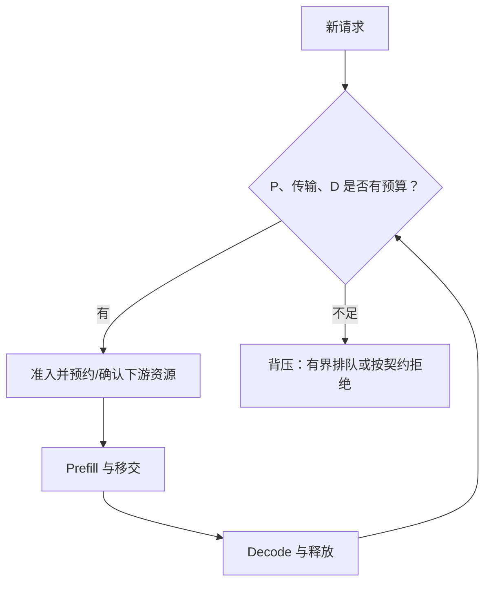
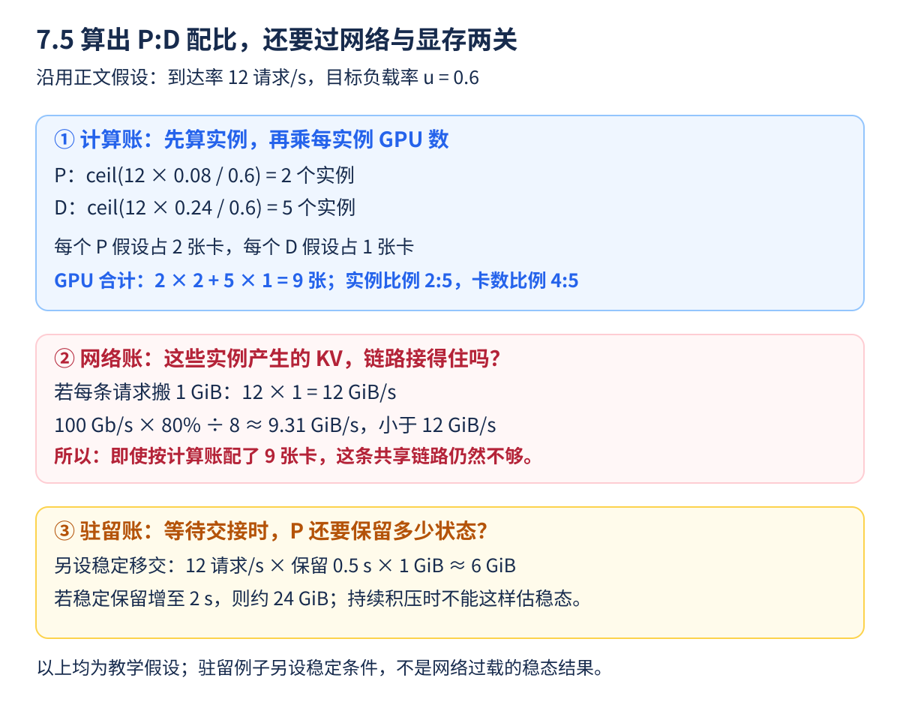

餐厅的备菜员增加一倍，出餐口却没变宽，结果可能只是半成品越堆越多。P/D 解耦以后，两类 GPU 可以独立扩展，也必须独立面对排队。**配比不是把 GPU 对半分，而是让计算、缓存和传输都能接住同一股请求流。**

<!-- more -->

## 📑 目录

- [1. 先用实例能力，建立可解释的起点](#1-先用实例能力建立可解释的起点)
  - [1.1 先认清公式里的四种数字](#11-先认清公式里的四种数字)
  - [1.2 服务需求不是单条请求的墙钟延迟](#12-服务需求不是单条请求的墙钟延迟)
- [2. 请求数、Token 数与实例服务时间](#2-请求数token-数与实例服务时间)
  - [2.1 先把请求量换成输入与输出工作量](#21-先把请求量换成输入与输出工作量)
  - [2.2 用流量比例汇总，而不是只挑一条样例](#22-用流量比例汇总而不是只挑一条样例)
- [3. 从实例数换成 GPU 数](#3-从实例数换成-gpu-数)
  - [3.1 逐行手算程序](#31-逐行手算程序)
  - [3.2 九张卡够不够，还没有算完](#32-九张卡够不够还没有算完)
- [4. 网络是一项独立的容量约束](#4-网络是一项独立的容量约束)
  - [4.1 一秒产生的 KV，能在一秒内搬走吗](#41-一秒产生的-kv能在一秒内搬走吗)
  - [4.2 平均接得住，不代表首字一定达标](#42-平均接得住不代表首字一定达标)
- [5. KV 驻留与背压，不能等 OOM 才处理](#5-kv-驻留与背压不能等-oom-才处理)
  - [5.1 P 计算结束后，为什么还会占显存](#51-p-计算结束后为什么还会占显存)
  - [5.2 为什么不能总把平均尺寸乘平均等待](#52-为什么不能总把平均尺寸乘平均等待)
  - [5.3 背压应在做昂贵计算之前传回来](#53-背压应在做昂贵计算之前传回来)
- [6. 流量变化后，静态配比怎样失效](#6-流量变化后静态配比怎样失效)
  - [6.1 用症状判断该扩哪边](#61-用症状判断该扩哪边)
  - [6.2 平滑窗口与迟滞是什么意思](#62-平滑窗口与迟滞是什么意思)
- [7. 什么时候不值得解耦](#7-什么时候不值得解耦)
  - [7.1 从简单基线开始做三个判断](#71-从简单基线开始做三个判断)
  - [7.2 最终比较必须带上预算](#72-最终比较必须带上预算)
- [总结](#-总结)
- [自我检验清单](#-自我检验清单)
- [参考资料](#-参考资料)

---

## 1. 先用实例能力，建立可解释的起点

设到达率为 $\lambda$ 请求/s；在指定请求分布与批处理策略下，一个 P 实例、D 实例的有效服务能力分别为 $\mu_P,\mu_D$。保守的负载约束为：

$$
\rho_P=\frac{\lambda}{n_P\mu_P}<1,\qquad
\rho_D=\frac{\lambda}{n_D\mu_D}<1
$$

这里的能力应来自同一输入/输出分布、同一硬件和配置，不能从 Prefill 的瞬时 Token/s 与 Decode 的总 Token/s 直接相除。服务接近满载时，尾部等待可能很大，$\rho<1$ 也不保证 SLO。

把每请求的平均实例服务需求写为 $s_P=1/\mu_P$、$s_D=1/\mu_D$，相近目标利用率下，初始实例比例约为 $n_P/n_D\approx s_P/s_D$。这是工作负载相关的容量近似，不是通用比例。

### 1.1 先认清公式里的四种数字

| 符号 | 单位与含义 | 直观问题 |
|------|------------|----------|
| $\lambda$ | 请求/秒，到达相应阶段的流量 | 每秒来了多少份工作 |
| $\mu$ | 请求/秒，一个实例在指定工作点的能力 | 一个工位能稳定处理多少 |
| $n$ | 实例数量 | 开了几个工位 |
| $\rho$ | 无单位的负载比例 | 到来工作占总能力的多少 |

例如到达 8 请求/s、每个实例能力 5 请求/s，只有一个实例就接不住；两个实例提供合计 10 请求/s，负载比例为 0.8。它只是一张平均容量账本，没有描述突发、长尾和排队。

本节先假设每个被接纳请求都需要一次 P 和后续 D，所以两边使用同一个到达率。若存在取消、缓存直接命中其他路径或不同准入规则，应改用实际进入各阶段的流量，不能机械套用。

### 1.2 服务需求不是单条请求的墙钟延迟

批处理让多个请求共享一次计算。若一个实例在某工作点每秒完成 10 条请求，等效需求是 0.1 实例秒/请求；某条请求实际从进入到完成仍可能超过 0.1 秒。不能把一次端到端响应时间直接取倒数，当成批处理实例的服务能力。

为了留余量，可选目标负载比例 $u<1$，用 $n\ge\lambda s/u$ 估算实例数，再向上取整。$u=0.6$ 之类的数字只是假设规划点，不是所有系统的最佳设置；需要用真实队列与 SLO 校验。

## 2. 请求数、Token 数与实例服务时间

若使用 Token 级容量估计，需要同时知道输入长度、输出长度与批次效率。输入翻倍不一定使 Prefill 耗时严格翻倍，长上下文 Attention 和缓存命中会改变关系；Decode 还受活跃序列数与历史长度影响。

可以先按输入/输出长度分桶，实测每个桶的服务需求，再用真实流量权重汇总。直接取一次请求的端到端时间，里面混入的排队不能当成纯计算服务需求。

### 2.1 先把请求量换成输入与输出工作量

假设每秒来 4 条请求，每条平均输入 1000 Token、输出 200 Token，那么流量约带来 4000 输入 Token/s 和 800 输出 Token/s。它们是两个不同阶段的工作量，不应相加后拿去与任意一个阶段的能力直接比较。

还要检查这些能力在哪个并发、上下文和批次形状下测得。输入 Token 的单位相同，不表示每个输入 Token 的计算代价完全相同；长历史下的后续 Decode 也可能更贵。

### 2.2 用流量比例汇总，而不是只挑一条样例

为了接到下一节的算例，假设在已选定配置下得到如下等效需求：

| 请求类型 | 流量比例 | P 需求：实例秒/请求 | D 需求：实例秒/请求 |
|----------|----------|---------------------|---------------------|
| 较短请求 | 80% | 0.04 | 0.10 |
| 较长请求 | 20% | 0.24 | 0.80 |

按比例加权，P 为 $0.8\times0.04+0.2\times0.24=0.08$，D 为 $0.8\times0.10+0.2\times0.80=0.24$。这些是假设数据，不是所用 Qwen 模型的实测值。

这种加权用于初始规划；不同类型混在同一批次时，效率可能变化，因此最后仍要实测混合流量。若线上长请求比例从 20% 上升，旧的平均需求就不应继续照用。

## 3. 从实例数换成 GPU 数

假设一个 P 实例内部使用 $g_P$ 张卡，一个 D 实例使用 $g_D$ 张卡：

$$
N_{\text{GPU}}=n_Pg_P+n_Dg_D
$$

P 的 TP=4、D 的 TP=2 时，两个池的“1:1 实例数”实际是“2:1 GPU 数”。不同 GPU 型号还要换成成本或功耗预算，不能只数卡。

下面给出纯假设规划，输出不是部署建议：

```python
import math

arrival_rps = 12
service_p_s, service_d_s = 0.08, 0.24
target_utilization = 0.6
n_p = math.ceil(arrival_rps * service_p_s / target_utilization)
n_d = math.ceil(arrival_rps * service_d_s / target_utilization)
g_p, g_d = 2, 1
print("P/D 实例:", n_p, n_d, "GPU:", n_p * g_p + n_d * g_d)
assert (n_p, n_d) == (2, 5)
assert n_p * g_p + n_d * g_d == 9
```

这里的服务需求已经假定对应一种批处理工作点。改变并发、TP 或 GPU 后，需要重新测量，不能沿用常数。

### 3.1 逐行手算程序

到达率是 12 请求/s，P 每请求需要 0.08 实例秒，因此每秒约消耗 0.96 实例秒；除以目标 0.6，得到 1.6 个实例，向上取整为 2。D 对应 $12\times0.24/0.6=4.8$，取整为 5。

P 每个实例用两卡，两个实例占四卡；D 每个实例用一卡，五个实例占五卡，所以总共九卡。**实例比例是 2:5，GPU 比例是 4:5**，不能只报一个“P:D”而不写单位。

按这些固定能力估算，P 的负载比例为 $12\times0.08/2=0.48$，D 为 $12\times0.24/5=0.576$。取整使它们不必恰好等于目标 0.6；这些数也不是 `nvidia-smi` 的计算利用率。

### 3.2 九张卡够不够，还没有算完

程序目前只满足假设的阶段计算能力条件，没有证明缓存能放下、链路能传完或尾延迟达标。如果总预算只有八卡，可以调整可行配置或准入率，也可能需要保留聚合方案；不能把 4.8 个实例向下取整后假装满足原来的余量要求。

接下来要继续检查网络和缓存，而不是把程序输出当成最终采购或部署建议。

## 4. 网络是一项独立的容量约束

设每请求平均跨网络迁移 $E[S_{\text{KV}}]$ 字节，一个共享路径的有效总带宽为 $B$，则至少需要：

$$
\lambda E[S_{\text{KV}}]<B
$$

多条独立链路可分别核算，不能把同一共享链路的带宽重复分配。短时并发传输造成的尾延迟，也可能在平均条件满足时违反首字预算。

增加 P 实例却没有增加瓶颈网卡，只会更快地产生等待传输的状态。应该共同观察生成 KV 的速率、实际迁移速率与待迁移字节。

### 4.1 一秒产生的 KV，能在一秒内搬走吗

继续用 12 请求/s，另假设每请求需跨同一链路发送 1 GiB，那么每秒产生约 12 GiB 待迁移数据。100 Gb/s 链路若按假设的 80% 有效率，只能提供 10 GB/s，约 9.31 GiB/s，平均都已经接不住。

即使前面的 P、D 计算实例都足够，状态仍会排队。这也说明单位转换很重要：12 GiB/s 与 10 GB/s 不能只看前面的数字比较，需先统一进制。

### 4.2 平均接得住，不代表首字一定达标

几条长输入同时完成 P，可能在很短时间内形成一大批迁移。链路平均利用率没有到 100%，这一批仍要轮流发送，尾部请求因此多等。

所以还要观察待传字节、传输排队和突发分布。在同一瓶颈上加更多 P，会增加生产速度；只有瓶颈真正得到扩展或工作量被减少，才能改善长期积压。

## 5. KV 驻留与背压，不能等 OOM 才处理

P 已算完、D 还没接收的请求，会继续占用 P 侧缓存。若这类状态平均停留 $E[W_{\text{hold}}]$ 秒，稳定条件下可用 Little 定律估计数量：

$$
E[N_{\text{hold}}]=\lambda E[W_{\text{hold}}]
$$

占用字节更一般地与 $\lambda E[S_{\text{KV}}W_{\text{hold}}]$ 相关；长请求可能同时更大、等待更久，不能总写成两个均值的乘积。



背压应尽早让上游知道下游接不住，避免囤积已经计算好的昂贵 KV。取消、失败和超时回收也属于容量控制的一部分。

### 5.1 P 计算结束后，为什么还会占显存

D 还没读完时，P 必须保留有效缓存。假设稳定进入待移交状态的流量为 12 请求/s，平均保留 0.5 秒，则平均有 6 条这样的请求；若每条持有 1 GiB，就是约 6 GiB 待移交 KV。若保留时间增至 2 秒，平均占用就可能增至约 24 GiB。

这个例子假设尺寸相同、状态流稳定，且只计算待移交部分，不包括权重和其他活跃缓存。Little 定律描述长期平均关系，不保证某一瞬间恰好有六条请求。



**把三本账按顺序核对**：

1. **计算账回答开几个工位。** 用实例服务需求推得 2P、5D；再乘各自内部卡数，得到 4 张 P 卡、5 张 D 卡。实例数量和卡数从这一步开始分开记。
2. **网络账回答工位之间能不能搬完。** 12 请求/s、每请求搬 1 GiB，要求约 12 GiB/s；图里的链路只有约 9.31 GiB/s，因此这组假设已经不可持续，不能因为算出九张卡就宣布可部署。
3. **驻留账回答等待时占多少空间。** 这一栏另外假设移交通路已稳定，才用平均保留时间估算 6 GiB 或 24 GiB。它不是上面网络过载场景运行后的固定缓存占用；持续积压时，等待和占用可能继续上升。

**停下来想一想**：把 P 实例从两个加到四个，能修复图里的网络瓶颈吗？不能；如果瓶颈链路与迁移数据量不变，增加生产端只可能更快地产生待搬状态。可以研究更充足的有效链路、减少实际迁移量或降低准入流量，但每种改动都要重新验证 SLO 与质量。

### 5.2 为什么不能总把平均尺寸乘平均等待

真实长请求可能 KV 更大，也更容易等得久，尺寸与等待时间存在关联。直接把两个均值相乘可能低估它们共同造成的字节驻留；更稳妥的是按请求或长度桶记录“占多少、保留多久”，再汇总。

### 5.3 背压应在做昂贵计算之前传回来

可以在接入新请求前检查 D 余量、待传队列和 P 保留空间，在不足时有界排队或按契约拒绝。不是每个系统都必须事先完整预留未来全部资源，但都应防止上游无上限生产。

“有界”意味着有明确数量、字节或等待上限，不是把 GPU 中的队列搬到 CPU/代理里无限增长。用户取消和失败请求的回收，也应进入同一容量监控。

## 6. 流量变化后，静态配比怎样失效

长输入增多，P 与网络压力可能上升；长输出增多，D 驻留与 KV 容量可能先成为瓶颈。前缀命中率、工具调用、多轮对话和推理长度变化，都可能让昨天的比例不再合适。

扩缩容需要加载权重、预热与建立传输连接，不是瞬时切换。可以使用分桶监控、平滑窗口和迟滞，避免每次抖动都迁移资源；故障或突发时还要保留恢复余量。

### 6.1 用症状判断该扩哪边

| 变化 | 可能首先增加的压力 | 还要排除什么 |
|------|--------------------|--------------|
| 输入更长、输出相近 | P 计算、KV 迁移 | 是否只是前缀命中率下降 |
| 输出更长、输入相近 | D 工作与缓存驻留 | 是否有异常不结束的请求 |
| D 空闲但 P 堆积 | P 或移交路径 | 不一定是 D 卡太多，可能是上游故障 |
| P 完成很多、保留缓存上涨 | 网络、D 接收或释放 | 不一定只靠增加 P 能解决 |

表格提供调查方向，不是仅凭一个指标就能自动选出答案。应关联各池队列、实际迁移和失败记录。

### 6.2 平滑窗口与迟滞是什么意思

平滑窗口是在一段时间内看趋势，避免一两个尖刺就触发迁移；迟滞是在扩容和缩容时采用不同触发条件，避免负载在某个阈值附近来回切换。扩容完还要等实例可用，再观察效果。

独立扩展也不代表可以忽略总预算：把一张卡从 D 调给 P，可能缓解首字排队，却损害现有 Decode。动态策略应保留可恢复路径，并用同一份 SLO 检查全系统变化。

## 7. 什么时候不值得解耦

| 条件 | 可能更合适的第一步 |
|---|---|
| 低流量、两阶段没有明显互扰 | 聚合引擎，减少重复权重与迁移 |
| Chunk 调整后已满足 SLO | 先保留简单配置作为基线 |
| 短请求、网络开销占比较高 | 测量移交成本能否被收益覆盖 |
| KV 超大、链路或驻留预算不足 | 先解决网络、缓存或准入瓶颈 |
| 两阶段 SLO/硬件需求明显不同 | 将解耦纳入候选并验证 |

最终可以枚举可行的实例配置，以相同 GPU 或成本预算比较 SLO 下的 Goodput。纸面配比用于缩小搜索范围，不能替代完整系统压测。

### 7.1 从简单基线开始做三个判断

先问聚合引擎调整 Chunk 后能否满足目标；再问测到的主要问题是否确实来自 P/D 互扰；最后问减少互扰的收益能否覆盖重复模型、迁移和运维开销。若前一步已经满足需求，可以把更复杂的方案保留为候选，等待规模变化后再比较。

### 7.2 最终比较必须带上预算

同类 GPU 下，可以同时报告合格请求/s 和每 GPU 合格请求/s；异构时还应报告成本或功耗口径。多用卡得到更多总 Goodput，并不能单独证明单位资源收益更好。

一个可复查的配比结论应包含：请求长度分布、阶段能力的测量条件、实例内部卡数、网络/驻留预算、联合通过率和失败情况。如果只留下“1P:2D 最优”，下一次更换模型或业务长度后，几乎无法复用。

## 📝 总结

- 初始比例来自同一工作负载下的阶段服务需求。
- 实例数与 GPU 数不同，还要计入各实例内部的 TP/PP。
- 计算能力、迁移带宽、KV 驻留和排队余量需要同时满足。
- 静态配比会随长度分布与缓存命中变化，背压是必要机制。

## 🎯 自我检验清单

- 能把阶段服务需求换成有余量的实例数量
- 能解释 1:1 实例数为什么不一定是 1:1 GPU 数
- 能写出共享网络的平均容量约束
- 能用 Little 定律解释待移交 KV 为什么会堆积
- 能说明何时先调 Chunk，而不是直接拆分 GPU 池
- 能手算为什么示例需要 2 个 P、5 个 D，却合计 9 张 GPU
- 能说明实例计算能力足够时，网络或待移交 KV 仍可能让部署不可行

## 📚 参考资料

- [DistServe — 资源规划与带宽相关放置](https://www.usenix.org/conference/osdi24/presentation/zhong-yinmin)
- [Splitwise — 阶段与硬件资源匹配](https://arxiv.org/abs/2311.18677)
- [TaiChi — 聚合、解耦与混合工作点](https://arxiv.org/abs/2508.01989)
- [vLLM v0.19.0 — NixlConnector 生命周期与失败策略](https://github.com/vllm-project/vllm/blob/v0.19.0/docs/features/nixl_connector_usage.md)

---

[返回本章](https://caomaolufei.github.io/AIInfraGuide/inference/模块四-推理优化/第7章-pd解耦架构/) · [上一节](https://caomaolufei.github.io/AIInfraGuide/inference/模块四-推理优化/第7章-pd解耦架构/74-goodput与slo感知调度/) · [下一节](https://caomaolufei.github.io/AIInfraGuide/inference/模块四-推理优化/第7章-pd解耦架构/76-vllm-pd解耦实战/)
