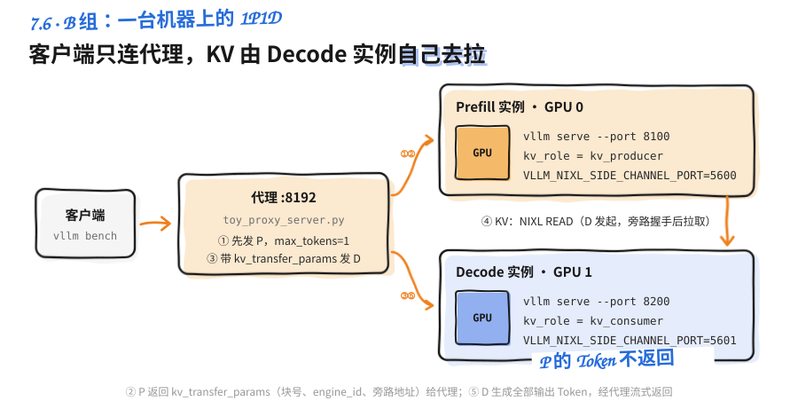

前五节讲了 P/D 解耦为什么能提高 Goodput、KV 怎么传、配比怎么推。本节在 vLLM 上把这些串起来：用同样 2 张 GPU 分别跑合并部署和 1P1D 解耦，先确认 KV 传输走对了路径，再用两组实验回答两个问题：Prefill 对 Decode 的干扰在你的环境里到底有多大，解耦后每卡 Goodput 提高了多少；最后用测到的数据推导配比，并在更多卡上验证。

命令按 vLLM v0.32.0 的文档与源码编写。GPU 实验需要在你自己的环境中执行，文中不填写未经实测的成绩，结果按第 7 节的记录表整理。

> ⏰ **信息时效**：基于 vLLM v0.32.0（2026-10-18 发布）与其固定的 `nixl==1.5.0`；参数取自 `vllm/config/kv_transfer.py`、`vllm/benchmarks/serve.py`，代理取自 `tests/v1/kv_connector/nixl_integration/toy_proxy_server.py`，环境变量取自 `docs/features/nixl_connector_usage.md`。P/D 解耦在官方文档中仍标注为实验性功能，换版本时请重新核对参数。

<!-- more -->

## 📑 目录

- [1. 实验设计](#1-实验设计)
- [2. 准备环境并检查传输路径](#2-准备环境并检查传输路径)
- [3. 启动两组部署](#3-启动两组部署)
- [4. 启动后核对](#4-启动后核对)
- [5. 实验一：量化 Prefill 对 Decode 的干扰](#5-实验一量化-prefill-对-decode-的干扰)
- [6. 实验二：扫请求速率比较 Goodput](#6-实验二扫请求速率比较-goodput)
- [7. 从实测数据推导配比](#7-从实测数据推导配比)
- [8. 常见问题](#8-常见问题)
- [总结](#-总结)
- [自我检验清单](#-自我检验清单)
- [参考资料](#-参考资料)

---

## 1. 实验设计

### 1.1 只改变部署方式

| 📊 项目 | 固定值 |
|---|---|
| 硬件 | 一台机器上的 2 张同型号 GPU（第 7 节需要 3 到 4 张），最好有 NVLink，至少要支持 P2P |
| 模型 | `Qwen/Qwen3-8B`，BF16，每 Token KV 为 144 KiB（7.3 节） |
| vLLM | v0.32.0，两组使用相同的 `--max-model-len`、`--gpu-memory-utilization`，其余保持默认 |
| 压测工具 | `vllm bench serve`，与服务端同版本 |

两组部署：

| 🧪 组 | 部署方式 | 客户端连接的端口 |
|---|---|---|
| A：合并部署 | 一个 `vllm serve`，`--data-parallel-size 2`，每张卡都跑 Prefill 和 Decode | 8000 |
| B：1P1D 解耦 | GPU 0 上的 Prefill 实例（8100）+ GPU 1 上的 Decode 实例（8200）+ 代理（8192） | 8192 |

A 组用数据并行而不是两个独立实例加负载均衡，和 vLLM 官方博客的对照方式一致。这不一定是最强的合并部署基线，结论里要注明。

### 1.2 两个实验回答两个问题

- **实验一（第 5 节）**：干扰有多大。同时运行两个压测客户端，一个持续发短 Prompt、长输出的"Decode 流"，另一个按固定速率插入长 Prompt。比较 Decode 流在有、无长 Prompt 插入时的 P99 ITL。
- **实验二（第 6 节）**：Goodput 提高多少。用一个长输入、短输出的负载扫请求速率，按 7.4 节的方法求每卡 Goodput。

下图是 B 组的进程与端口布局。客户端只连代理，代理先把请求转给 Prefill 实例，再带着返回的 `kv_transfer_params` 转给 Decode 实例；KV 由 Decode 实例通过 NIXL 从 Prefill 实例的显存拉取：



---

## 2. 准备环境并检查传输路径

### 2.1 安装并记录版本

```bash
python -m venv ~/venvs/vllm-pd && source ~/venvs/vllm-pd/bin/activate
pip install "vllm==0.32.0" "nixl==1.5.0"

# 代理脚本在仓库的 tests 目录里，取与安装版本相同的 tag
git clone --depth 1 --branch v0.32.0 https://github.com/vllm-project/vllm.git ~/vllm-v0.32.0

mkdir -p ~/pd-exp && cd ~/pd-exp
{ python -c "import vllm; print('vllm', vllm.__version__)"
  python -c "import importlib.metadata as m; print('nixl', m.version('nixl'))"
  nvidia-smi --query-gpu=index,name,driver_version,memory.total --format=csv
  nvidia-smi topo -m; } > env.txt
```

`nixl` 的版本要与 vLLM 的 `requirements/kv_connectors.txt` 一致；Prefill 和 Decode 两边的 vLLM、NIXL 版本也必须相同，握手时会校验（7.3 节）。

### 2.2 先确认 KV 能走 P2P

vLLM 官方博客的反例是：两张 L40S 不支持 P2P，一个 8k Prompt 的 KV 要 1.3 s 才到 Decode 实例，解耦后 TTFT 反而从 0.7 s 变成 2.2 s。所以在做任何性能测试之前先检查：

```bash
nvidia-smi topo -p2p r      # GPU0 与 GPU1 之间应显示 OK；NS、CNS、GNS、TNS 等都表示不支持 P2P 读
nvidia-smi topo -m          # NV# 表示 NVLink 直连；PIX/PXB/PHB/SYS 表示经过 PCIe 或 CPU
```

| 🔍 `topo -p2p r` 的结果 | 含义 | 处理 |
|---|---|---|
| `OK`，且 `topo -m` 显示 `NV#` | NVLink P2P | 可以继续 |
| `OK`，`topo -m` 是 PCIe 路径 | PCIe P2P，带宽低一些 | 可以继续，传输时间会更长 |
| `NS` 等非 `OK` 值 | 不支持 P2P | 换一对卡或换机器，否则实验二的结论没有参考意义 |

UCX 默认会自动选择传输方式。如果需要限定，按 NIXL 文档设置 `UCX_TLS` 和 `UCX_NET_DEVICES`，单机实验用 `UCX_NET_DEVICES=all` 即可。

---

## 3. 启动两组部署

### 3.1 公共参数

```bash
export MODEL=Qwen/Qwen3-8B
export COMMON="--max-model-len 16384 --gpu-memory-utilization 0.9"
```

两组都不加 `--enforce-eager`。NIXL 文档的快速上手示例里带着它，是为了启动快；做性能对比时它会关掉 CUDA Graph，让 Decode 步变慢，两组都要去掉。

💡 **提示**：下面的命令用 `CUDA_VISIBLE_DEVICES` 指定 GPU。如果集群通过调度器（Slurm、Kubernetes 或排队工具）分配 GPU，按调度器的方式申请卡，不要手动指定。

### 3.2 A 组：合并部署

```bash
CUDA_VISIBLE_DEVICES=0,1 vllm serve $MODEL --port 8000 \
  --data-parallel-size 2 $COMMON 2>&1 | tee a_server.log
```

### 3.3 B 组：1P1D 解耦

开三个终端，按顺序启动 Prefill 实例、Decode 实例和代理：

```bash
# 终端 1：Prefill 实例（kv_producer），GPU 0
CUDA_VISIBLE_DEVICES=0 UCX_NET_DEVICES=all VLLM_NIXL_SIDE_CHANNEL_PORT=5600 \
vllm serve $MODEL --port 8100 $COMMON \
  --kv-transfer-config '{"kv_connector":"NixlConnector","kv_role":"kv_producer"}' \
  2>&1 | tee b_prefill.log

# 终端 2：Decode 实例（kv_consumer），GPU 1
CUDA_VISIBLE_DEVICES=1 UCX_NET_DEVICES=all VLLM_NIXL_SIDE_CHANNEL_PORT=5601 \
vllm serve $MODEL --port 8200 $COMMON \
  --kv-transfer-config '{"kv_connector":"NixlConnector","kv_role":"kv_consumer"}' \
  2>&1 | tee b_decode.log

# 终端 3：代理，客户端连 8192
python ~/vllm-v0.32.0/tests/v1/kv_connector/nixl_integration/toy_proxy_server.py \
  --port 8192 \
  --prefiller-hosts localhost --prefiller-ports 8100 \
  --decoder-hosts localhost --decoder-ports 8200
```

要点：

- **两个实例的旁路端口必须不同**（5600、5601）。它们在同一台机器上，端口冲突会导致握手失败。
- **角色分开写**。v0.32.0 中 NixlConnector 的 `kv_both` 已弃用，Prefill 用 `kv_producer`，Decode 用 `kv_consumer`。
- **`kv_load_failure_policy`** 保持默认的 `fail`，实验期间传输出错会直接暴露成请求失败，不会被重算悄悄掩盖。上线时可以考虑改成 `recompute`。
- **跨机器部署**时，在每个实例上加 `VLLM_NIXL_SIDE_CHANNEL_HOST=<本机对外 IP>`，代理的 `--prefiller-hosts`、`--decoder-hosts` 也换成对应 IP。
- 代理是 FastAPI 应用，缺依赖时按报错安装即可。它按轮询选实例，没有健康检查，只适合实验。

---

## 4. 启动后核对

### 4.1 发一个请求，看两边日志

```bash
curl -s http://localhost:8192/v1/completions -H 'Content-Type: application/json' -d '{
  "model": "Qwen/Qwen3-8B", "prompt": "用三句话解释什么是 KV Cache。", "max_tokens": 64
}' | python -m json.tool
```

请求成功后核对三处：

| 🔍 检查项 | 在哪里看 | 期望 |
|---|---|---|
| Prefill 实例收到了请求 | `b_prefill.log` 的访问日志 | 每个客户端请求对应一个 Prefill 请求（代理把它改成了 `max_tokens=1`） |
| Decode 实例完成 KV 拉取 | `b_decode.log` 中周期性出现的 `KV Transfer metrics` 行 | 成功传输次数增加，失败次数为 0 |
| KV 容量 | 两个实例启动日志中的 `KV cache size: ... tokens, Maximum concurrency for 16,384 tokens per request: ...x` | 记下 Decode 实例的 Token 数，第 7 节要用 |

### 4.2 单独测一次传输时间

在没有其他负载时，逐个发几个长 Prompt，读 Decode 实例 `KV Transfer metrics` 里的平均和 P90 传输时间：

```bash
vllm bench serve --model $MODEL --port 8192 \
  --dataset-name random --random-input-len 8192 --random-output-len 16 \
  --num-prompts 20 --max-concurrency 1 --ignore-eos
```

8192 Token 的 KV 约 1.12 GiB。按 7.3 节的估算，NVLink 下是几毫秒，单张 400 Gb/s 网卡约 24 ms。如果实测的平均传输时间达到几百毫秒，说明没走 P2P 或 RDMA，回到 2.2 节排查，不要继续做性能对比。

### 4.3 运行中盯两个指标

两个实例都在 `/metrics` 暴露 Prometheus 指标，实验中可以定时抓取：

```bash
watch -n 2 "curl -s localhost:8100/metrics | grep -E '^vllm:num_requests_(waiting|running)'; \
            curl -s localhost:8200/metrics | grep -E '^vllm:(kv_cache_usage_perc|num_requests_running)'"
```

Prefill 实例的 `vllm:num_requests_waiting` 持续增长，说明 Prefill 是瓶颈；Decode 实例的 `vllm:kv_cache_usage_perc` 接近 1，说明 Decode 的 KV 容量是瓶颈。第 7 节判断配比时用的就是这两个信号。

---

## 5. 实验一：量化 Prefill 对 Decode 的干扰

### 5.1 用两个客户端把干扰分离出来

如果只用一种负载压测，很难区分"Decode 变慢是因为被 Prefill 打断"还是"因为并发高了"。做法是同时开两个客户端：

- **Decode 流**：短 Prompt、长输出，并发固定。它的 ITL 反映 Decode 的出字节奏。
- **干扰流**：长 Prompt、输出 1 个 Token，按固定速率插入。它几乎只产生 Prefill 负载。

先只跑 Decode 流，得到基线；再两个一起跑，看 Decode 流的 ITL 变化。A、B 两组各做一遍。

```bash
# run_interference.sh <端口> <组名>，例如 ./run_interference.sh 8000 A
PORT=$1; TAG=$2
DECODE_ARGS="--model $MODEL --port $PORT --dataset-name random \
  --random-input-len 256 --random-output-len 1024 --ignore-eos \
  --num-prompts 128 --max-concurrency 32 \
  --percentile-metrics ttft,tpot,itl --metric-percentiles 50,90,99 \
  --save-result --result-dir results"

# 1) 基线：只有 Decode 流
vllm bench serve $DECODE_ARGS --result-filename "${TAG}_decode_only.json"

# 2) 混合：Decode 流 + 每秒 1 个 8192 Token 的长 Prompt
vllm bench serve --model $MODEL --port $PORT --dataset-name random \
  --random-input-len 8192 --random-output-len 1 --ignore-eos \
  --num-prompts 120 --request-rate 1 > "results/${TAG}_noise.log" 2>&1 &
NOISE=$!
sleep 5                                  # 让干扰流先跑起来
vllm bench serve $DECODE_ARGS --result-filename "${TAG}_mixed.json"
wait $NOISE
```

干扰流的时长要覆盖整个 Decode 流：120 个请求按每秒 1 个发，约 2 分钟。Decode 流 128 个请求、并发 32、每个输出 1024 Token，按 20 ms 的 ITL 估算约 1.5 分钟。你的环境更慢时，加大干扰流的 `--num-prompts`。

### 5.2 计算干扰倍数

```python
import json

def load(name):
    return json.load(open(f"results/{name}.json"))

print(f"{'组':<4}{'负载':<14}{'P50 ITL':>9}{'P99 ITL':>9}{'P99 TPOT':>10}")
for tag in ["A", "B"]:
    base, mixed = load(f"{tag}_decode_only"), load(f"{tag}_mixed")
    for name, r in [("仅 Decode 流", base), ("混入长 Prompt", mixed)]:
        print(f"{tag:<4}{name:<14}{r['p50_itl_ms']:>7.1f}ms{r['p99_itl_ms']:>7.1f}ms{r['p99_tpot_ms']:>8.1f}ms")
    print(f"    P99 ITL 干扰倍数 = {mixed['p99_itl_ms'] / base['p99_itl_ms']:.2f}x")
```

### 5.3 带着预期看结果

| 🎯 预期 | 依据 | 如果不符合 |
|---|---|---|
| A 组混合后 P50 ITL 变化不大，P99 ITL 明显上升 | 7.1 节：干扰只发生在有 Prefill 进入的那几步 | P50 也大幅上升，说明 Decode 流本身已接近容量上限，降低 `--max-concurrency` 重测 |
| B 组混合后 P99 ITL 基本不变 | Decode 实例上不跑 Prefill | 先看 `KV Transfer metrics` 是否异常，再看 Decode 实例是否发生了抢占（日志中的 preemption 相关信息） |
| B 组的 Decode 流基线 ITL 可能比 A 组略高 | A 组的 Decode 流分摊在两张卡上，B 组只有一张卡跑 Decode | 正常现象，比的是同组内的干扰倍数 |

vLLM 博客在两张 L40S 上看到的是：合并部署的 P99 ITL 在 0.4 req/s 时从 23 ms 跳到 169 ms，P/D 一直在 25–52 ms。你的数值会因 GPU、模型和 Chunked Prefill 的默认块大小而不同，但方向应该一致。

⚠️ **注意**：这个实验只说明"解耦消除了干扰"，不说明"解耦更划算"。B 组只用一张卡跑 Decode，Decode 流的总容量比 A 组小。划算与否看实验二的每卡 Goodput。

---

## 6. 实验二：扫请求速率比较 Goodput

### 6.1 负载与 SLO

选一个解耦"应该占优"的负载：输入 4096、输出 256，SLO 设为 TTFT ≤ 2000 ms、TPOT ≤ 50 ms，达标率目标 90%。7.5 节的假设模型估算这个负载在 H100 上适合 2P1D；这里先用 1P1D，第 7 节再调整。

```bash
# sweep.sh <端口> <组名>
PORT=$1; TAG=$2
for RATE in 1 2 3 4 5 6 8; do
  vllm bench serve --model $MODEL --port $PORT \
    --dataset-name random --random-input-len 4096 --random-output-len 256 --ignore-eos \
    --num-prompts 400 --request-rate $RATE \
    --goodput ttft:2000 tpot:50 \
    --percentile-metrics ttft,tpot,itl,e2el --metric-percentiles 50,90,99 \
    --save-result --result-dir results --result-filename "${TAG}_rate_${RATE}.json"
done
```

速率档位按你的硬件调整：最低档的达标率应接近 100%，最高档要明显低于 90%，否则插值不出 Goodput。每轮之间可以等几秒，让上一轮的请求排空。

### 6.2 汇总

```python
import glob
import json

ALPHA = 0.9
GPUS = {"A": 2, "B": 2}

for tag, n_gpu in GPUS.items():
    rows = []
    for path in glob.glob(f"results/{tag}_rate_*.json"):
        r = json.load(open(path))
        rate = float(path.split("_rate_")[1].removesuffix(".json"))
        rows.append((rate, r["request_goodput"] / r["request_throughput"],
                     r["p90_ttft_ms"], r["p90_tpot_ms"], r["p99_itl_ms"]))
    rows.sort()
    print(f"== {tag} 组")
    for rate, att, ttft, tpot, itl in rows:
        print(f"  rate {rate:>4.1f}  达标率 {att:6.1%}  P90 TTFT {ttft:7.0f}ms  P90 TPOT {tpot:5.1f}ms  P99 ITL {itl:6.1f}ms")
    gp = next((r0 + (r1 - r0) * (a0 - ALPHA) / (a0 - a1)
               for (r0, a0, *_), (r1, a1, *_) in zip(rows, rows[1:]) if a0 >= ALPHA > a1), None)
    print(f"  Goodput ≈ {gp:.2f} req/s，每卡 {gp / n_gpu:.2f} req/s" if gp else "  达标率没有跨过 90%，调整速率范围")
```

### 6.3 读结果时注意什么

- **看是哪个 SLO 先越界**。A 组如果是 TPOT 先越界，说明干扰是瓶颈，解耦有机会；如果是 TTFT 先越界，说明 Prefill 算力不够，1P1D 只有一张卡做 Prefill，很可能更差。
- **B 组的 TTFT 包含传输时间**。B 组 TTFT 普遍比 A 组高几十毫秒是正常的；高出几百毫秒要回到 4.2 节检查传输。
- **1P1D 不一定赢**。如果 B 组是 Prefill 先饱和（Prefill 实例的 `vllm:num_requests_waiting` 持续增长、TTFT 越界），说明配比不对，第 7 节处理这个问题。

---

## 7. 从实测数据推导配比

### 7.1 分别测两侧的单实例容量

用 7.5 节的公式 $x/y=g_d/g_p$，需要测出 $g_p$ 和 $g_d$。两者都可以在单张卡上的普通 `vllm serve`（不带 `--kv-transfer-config`）上测，避免互相影响。先停掉 A 组，在一张卡上用同样的 `$COMMON` 起一个实例监听 8000 端口。

**Prefill 容量 $g_p$**：发只有 1 个输出 Token 的请求，这时负载几乎全是 Prefill。扫速率，找出 TTFT 达标率跌破 90% 的速率：

```bash
vllm bench serve --model $MODEL --port 8000 \
  --dataset-name random --random-input-len 4096 --random-output-len 1 --ignore-eos \
  --num-prompts 400 --request-rate $RATE --goodput ttft:2000 \
  --save-result --result-dir results --result-filename "gp_rate_${RATE}.json"
```

**Decode 容量 $g_d$**：Decode 实例上的请求都带着 4096 Token 的上下文，但不做 Prefill。可以借前缀缓存模拟：让所有请求共享一段 4032 Token 的固定前缀，只有 64 个 Token 是随机的，第一个请求之后 Prefill 几乎都命中缓存。固定并发，读单步时间：

```bash
for C in 16 32 64 96 128; do
  vllm bench serve --model $MODEL --port 8000 \
    --dataset-name random --random-prefix-len 4032 --random-input-len 64 \
    --random-output-len 256 --ignore-eos \
    --num-prompts $((C * 4)) --max-concurrency $C \
    --percentile-metrics tpot,itl --metric-percentiles 50,90 \
    --save-result --result-dir results --result-filename "gd_conc_${C}.json"
done
```

共享前缀只存一份，所以这个实验里实际能达到的并发会比真实情况高。并发上限要用 4.1 节记下的 Decode 实例 KV 容量另外算：

$$
C_{\max}=\min\left(\left\lfloor\frac{\text{KV 容量（Token 数）}}{\text{ISL}+\text{OSL}}\right\rfloor,\ \text{TPOT}\le\text{SLO 时的最大并发}\right)
$$

然后按 Little 定律 $g_d=C_{\max}/(\text{OSL}\times\text{TPOT}(C_{\max}))$ 计算。

### 7.2 计算配比

```python
import json

ALPHA, OSL, ISL = 0.9, 256, 4096
KV_TOKENS = 400_000          # 换成 4.1 节 Decode 实例日志里的 "KV cache size: ... tokens"
TPOT_SLO = 50.0              # ms

# g_p：TTFT 达标率跌破 ALPHA 的速率（同 6.2 节的插值，这里手工填入结果）
g_p = 6.0                    # 换成实测值

# g_d：在 KV 上限以内、P90 TPOT 达标的最大并发
c_kv = KV_TOKENS // (ISL + OSL)
best = None
for c in [16, 32, 64, 96, 128]:
    r = json.load(open(f"results/gd_conc_{c}.json"))
    if c <= c_kv and r["p90_tpot_ms"] <= TPOT_SLO:
        best = (c, r["median_tpot_ms"])
if best is None:
    raise SystemExit("没有满足 KV 上限和 TPOT SLO 的并发档位，降低并发重测")
c, tpot = best
g_d = c / (OSL * tpot / 1000)
print(f"KV 并发上限 {c_kv}，取并发 {c}，TPOT 中位数 {tpot:.1f} ms → g_d ≈ {g_d:.2f} req/s")
print(f"g_d / g_p = {g_d / g_p:.2f}")
for x, y in [(1, 1), (2, 1), (3, 1), (1, 2), (3, 2)]:
    print(f"{x}P{y}D: 每卡 Goodput 上限 ≈ {min(x * g_p, y * g_d) / (x + y):.2f} req/s")
```

脚本里的 `KV_TOKENS` 和 `g_p` 是占位值，必须换成你的实测结果。

### 7.3 用更多卡验证

有 3 张卡时，按推导结果部署 2P1D 或 1P2D：再起一个 Prefill 实例（端口 8101，旁路端口 5602），代理的 host 与 port 列表一一对应：

```bash
python ~/vllm-v0.32.0/tests/v1/kv_connector/nixl_integration/toy_proxy_server.py \
  --port 8192 \
  --prefiller-hosts localhost localhost --prefiller-ports 8100 8101 \
  --decoder-hosts localhost --decoder-ports 8200
```

然后用第 6 节的脚本重新扫速率，`GPUS` 里这一组改成 3。比较时注意三点：

- 推导出的配比应该让两个瓶颈信号（Prefill 排队数、Decode KV 使用率）在接近 Goodput 时差不多同时出现。只有一侧饱和，说明比例还要往另一侧调。
- 推导值和实测最优值有偏差是正常的：均值模型忽略了长度方差和突发，代理的轮询也没有负载感知。
- 和 A 组比的是**每卡 Goodput**。3 卡的 2P1D 和 2 卡的合并部署不能直接比总量。

### 7.4 记录表

| 组 | 部署 | GPU 数 | KV 容量（Decode 侧 Token） | 平均 KV 传输时间 | P99 ITL 干扰倍数 | 先越界的 SLO | Goodput（req/s） | 每卡 Goodput |
|---|---|---|---|---|---|---|---|---|
| A | 合并部署，DP=2 | 2 | 待实测 | — | 待实测 | 待实测 | 待实测 | 待实测 |
| B | 1P1D | 2 | 待实测 | 待实测 | 待实测 | 待实测 | 待实测 | 待实测 |
| C | 按推导的配比 | 3 或 4 | 待实测 | 待实测 | — | 待实测 | 待实测 | 待实测 |

同时存档 `env.txt`、各实例的启动日志和 `results/` 目录，方便以后换版本时复现。

---

## 8. 常见问题

| ❓ 现象 | 可能原因 | 排查与处理 |
|---|---|---|
| 请求卡住，Decode 实例日志报握手超时 | 旁路端口冲突或不可达；跨机时 `VLLM_NIXL_SIDE_CHANNEL_HOST` 仍是默认的 `localhost` | 每个实例用不同的 `VLLM_NIXL_SIDE_CHANNEL_PORT`；跨机时设成对外可达的 IP，并放通防火墙 |
| 握手被拒绝，提示兼容性不一致 | 两边 vLLM/NIXL 版本、`cache_dtype`、注意力后端或投机解码配置不同 | 两边用同一个环境和同一组模型参数启动 |
| 启动时出现 `kv_both` 弃用警告 | 沿用了旧示例的配置 | Prefill 用 `kv_producer`，Decode 用 `kv_consumer` |
| 平均传输时间几百毫秒，TTFT 比合并部署高很多 | 没走 P2P 或 RDMA，UCX 退回了 TCP 或经主机内存中转 | 按 2.2 节检查 `topo -p2p r`；检查 `UCX_TLS`、`UCX_NET_DEVICES`；确认 `kv_buffer_device` 是 `cuda` |
| `vllm:nixl_num_kv_expired_reqs` 增加，Decode 实例报块已失效 | Decode 实例排队太久，Prefill 实例上的租约到期，块被回收 | 先查 Decode 实例是否过载；必要时调大 `kv_connector_extra_config.kv_lease_duration` |
| 照旧教程配置 `P2pNcclConnector` 或 `kv_rank`、`kv_parallel_size` 报错 | 这些在 v0.32.0 中已移除 | 改用 NixlConnector 或 MooncakeConnector（7.3 节） |
| 解耦后吞吐和 Goodput 都下降 | 配比不对、负载不适合（短输入长输出），或 TTFT 是主要约束 | 按第 7 节重新推配比；对照 7.5 节第 5 部分判断是否应该解耦 |
| 用 `--enforce-eager` 做的测试，B 组 Decode 很慢 | CUDA Graph 被关掉 | 性能测试两组都去掉 `--enforce-eager` |

---

## 📝 总结

- 实验只改变部署方式：同样 2 张卡，A 组 `--data-parallel-size 2` 合并部署，B 组 1P1D，由 NixlConnector 传 KV、示例代理转发请求。两组都不加 `--enforce-eager`。
- 性能测试之前先确认传输路径：`nvidia-smi topo -p2p r` 显示 `OK`，单请求测试中 `KV Transfer metrics` 的平均传输时间在几到几十毫秒量级。
- 实验一用"Decode 流 + 干扰流"两个客户端，比较 P99 ITL 的干扰倍数，单独回答"干扰有多大、解耦是否消除了它"。
- 实验二扫请求速率，按 7.4 节的方法求每卡 Goodput，并看哪个 SLO 先越界、哪一侧先饱和。
- 配比推导：在单卡上分别测只有 1 个输出 Token 的 Prefill 容量 $g_p$，以及借共享前缀模拟的 Decode 容量 $g_d$（受 KV 容量限制），按 $x/y=g_d/g_p$ 选配比，再用多实例部署验证。
- 结果用记录表整理，文中不提供未经实测的数值。

## 🎯 自我检验清单

- 能写出 1P1D 部署的三条启动命令，说明每个实例的端口、旁路端口和 `kv_role`
- 能在压测前用 `nvidia-smi topo -p2p r` 和 `KV Transfer metrics` 确认 KV 传输路径
- 能解释代理如何把一个客户端请求拆成 Prefill 和 Decode 两段
- 能设计双客户端实验，把 Prefill 对 Decode 的干扰从"并发升高"中分离出来
- 能用 `vllm bench serve` 扫速率并从保存的 JSON 中算出每卡 Goodput
- 能用前缀缓存和 Little 定律估算 Decode 实例容量，并说明这个方法会高估什么
- 能根据 Prefill 排队数和 Decode KV 使用率判断配比该往哪边调
- 能对照常见问题表定位握手失败、传输过慢、租约过期等问题

## 📚 参考资料

- [vLLM 文档：Disaggregated Prefilling (experimental)](https://docs.vllm.ai/en/stable/features/disagg_prefill/)
- [vLLM 文档：NixlConnector Usage Guide](https://docs.vllm.ai/en/stable/features/nixl_connector_usage/)
- [vLLM 源码：toy_proxy_server.py（v0.32.0）](https://github.com/vllm-project/vllm/blob/v0.32.0/tests/v1/kv_connector/nixl_integration/toy_proxy_server.py)
- [vLLM 源码：vllm/config/kv_transfer.py（v0.32.0）](https://github.com/vllm-project/vllm/blob/v0.32.0/vllm/config/kv_transfer.py)
- [vLLM 源码：vllm/benchmarks/serve.py（v0.32.0）](https://github.com/vllm-project/vllm/blob/v0.32.0/vllm/benchmarks/serve.py)
- [vLLM 源码：vllm/benchmarks/datasets/datasets.py（v0.32.0）](https://github.com/vllm-project/vllm/blob/v0.32.0/vllm/benchmarks/datasets/datasets.py)
- [Taking vLLM Apart: A Practical Guide to Disaggregated Serving（vLLM Blog，2026-09-29）](https://vllm.ai/blog/2026-09-29-disaggregated-serving-guide)
- [NIXL 官方仓库（ai-dynamo/nixl）](https://github.com/ai-dynamo/nixl)
- [DistServe: Disaggregating Prefill and Decoding for Goodput-optimized Large Language Model Serving（OSDI'24）](https://arxiv.org/abs/2401.09670)

