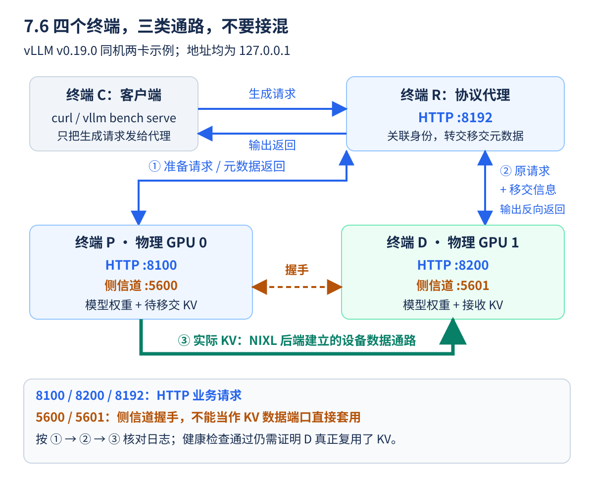
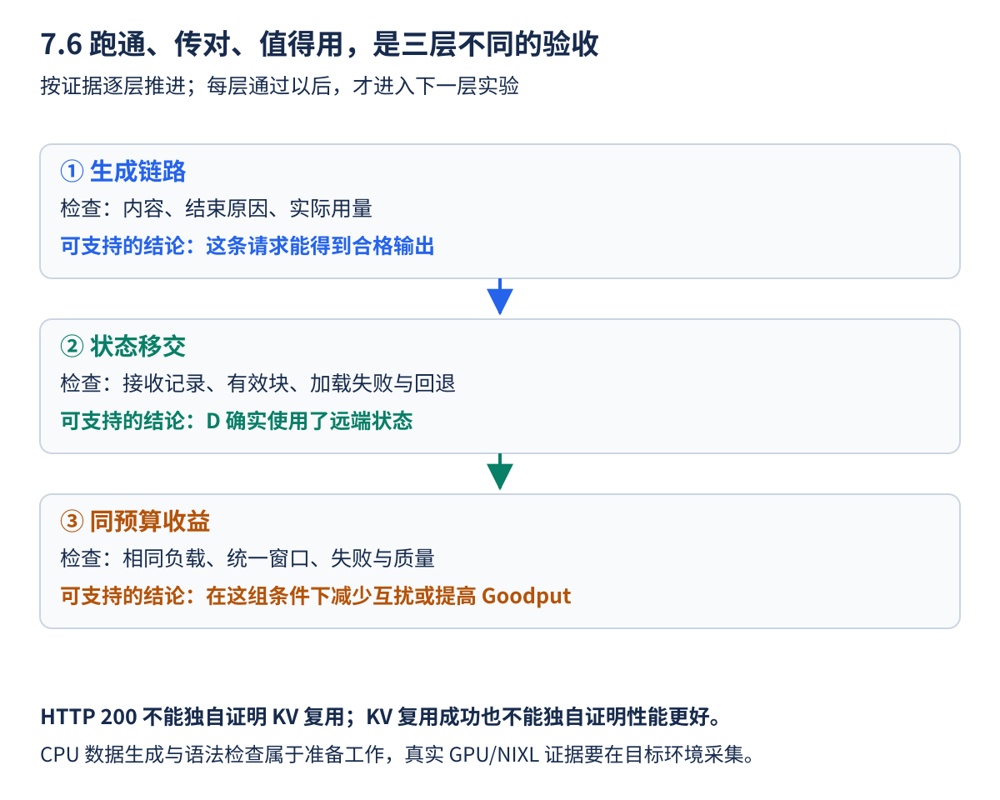

前五节已经解释了为何分开两阶段、怎样移交状态，以及如何按 SLO 计分。本节使用 **vLLM v0.19.0、NixlConnector 和同 tag 的官方测试代理**，把这些步骤落到同机两卡实验。

实验分三层推进：先得到正常输出，再确认 D 确实复用了 P 的 KV，最后比较同 GPU 预算下的互扰与 Goodput。四个终端分别观察 P、D、代理和客户端，便于从最早失败的位置排查。文中的 GPU 结果保留待实测；CPU 数据生成和命令语法检查不能代替真实设备验证。

<!-- more -->

## 📑 目录

- [1. 固定运行版本与依赖](#1-固定运行版本与依赖)
  - [1.1 四个终端分别做什么](#11-四个终端分别做什么)
  - [1.2 准备环境时先留下版本记录](#12-准备环境时先留下版本记录)
- [2. 分别启动 P 与 D 实例](#2-分别启动-p-与-d-实例)
  - [2.1 先读懂共同参数与传输配置](#21-先读懂共同参数与传输配置)
  - [2.2 两个服务和侧信道端口不要混淆](#22-两个服务和侧信道端口不要混淆)
  - [2.3 服务初始化完成后再继续](#23-服务初始化完成后再继续)
- [3. 使用同一版本的官方代理](#3-使用同一版本的官方代理)
  - [3.1 在终端 R 获取并运行示例](#31-在终端-r-获取并运行示例)
  - [3.2 代理究竟多做了哪几步](#32-代理究竟多做了哪几步)
- [4. 先证明正确移交，再测吞吐](#4-先证明正确移交再测吞吐)
  - [4.1 在终端 C 做三层健康检查](#41-在终端-c-做三层健康检查)
  - [4.2 每条成功信息的证明范围](#42-每条成功信息的证明范围)
  - [4.3 按最早失败的位置排错](#43-按最早失败的位置排错)
  - [4.4 每一层验收，只写证据能支持的结论](#44-每一层验收只写证据能支持的结论)
- [5. 准备两类工作负载](#5-准备两类工作负载)
  - [5.1 先生成可追踪的两类数据](#51-先生成可追踪的两类数据)
  - [5.2 按数据表读生成器](#52-按数据表读生成器)
  - [5.3 为什么性能负载与质量题要分开](#53-为什么性能负载与质量题要分开)
- [6. 三组资源对照，顺序运行](#6-三组资源对照顺序运行)
  - [6.1 每一组要回答什么问题](#61-每一组要回答什么问题)
  - [6.2 切换部署时的一次完整操作](#62-切换部署时的一次完整操作)
- [7. 采集分组指标与混合互扰](#7-采集分组指标与混合互扰)
  - [7.1 在客户端明确部署入口与标签](#71-在客户端明确部署入口与标签)
  - [7.2 按参数读一次 run_load](#72-按参数读一次-run_load)
  - [7.3 两类负载同时运行，指标仍要分组看](#73-两类负载同时运行指标仍要分组看)
  - [7.4 先检查原始记录，再填写结果表](#74-先检查原始记录再填写结果表)
- [8. 从结果回到资源配比](#8-从结果回到资源配比)
  - [8.1 把症状连回请求生命周期](#81-把症状连回请求生命周期)
  - [8.2 从同机扩到跨机，还多了哪些变量](#82-从同机扩到跨机还多了哪些变量)
  - [8.3 给这轮实验写一段有条件的结论](#83-给这轮实验写一段有条件的结论)
- [总结](#-总结)
- [自我检验清单](#-自我检验清单)
- [参考资料](#-参考资料)

---

## 1. 固定运行版本与依赖

需要两张满足 vLLM/NIXL 条件的 NVIDIA GPU 和目标版本支持的 Linux 环境；使用 WSL2 时还须另外核对 GPU 与传输后端兼容性，不能只因普通单卡推理可运行就认定 NIXL 也可用。跨机时还需相应传输支持。先用同机两卡减少变量，再扩到跨机。

### 1.1 四个终端分别做什么

| 终端 | 职责 | 启动后怎样使用 |
|------|------|----------------|
| P | 在 GPU 0 上运行 Prefill 服务 | 保持前台，观察 P 日志 |
| D | 在 GPU 1 上运行 Decode 服务 | 保持前台，观察 D 日志 |
| R | 运行理解 KV 移交的代理 | 保持前台，观察转发错误 |
| C | 发健康检查、生成与压测请求 | 后文所有客户端命令在这里运行 |

四个终端都进入同一实验目录并激活相同环境。Bash 变量不是全局共享的，在 P 定义的 `MODEL` 和数组不会自动出现在 D 或 C。这里的 `export`、数组、续行和后台任务语法均针对 Bash，不应直接粘贴到 Windows PowerShell。

### 1.2 准备环境时先留下版本记录

```bash
python3 -m venv .venv
source .venv/bin/activate
python -m pip install 'vllm==0.19.0' 'nixl>=0.7.1,<0.10.0'
python -m pip check
python -m pip freeze > pd-environment.txt
nvidia-smi
nvidia-smi topo -m
mkdir -p results data
```

NIXL 约束取自该 tag 的 `requirements/kv_connectors.txt`；范围安装仍会随时间选择不同包，复测时保存最终版本与镜像 digest。若 Wheel、UCX 或 GPU 不兼容，按同一 tag 的指南调整并重新建立基线，不能直接升级一端后混测。

示例用官方 NIXL 指南中的 `Qwen/Qwen3-0.6B`。正式固定模型与 Tokenizer revision；所有服务读取同一快照。小模型便于验证协议，不代表大模型的性能或最优配比。

`pip check` 只检查已安装 Python 包的依赖关系，不能证明网卡、UCX、驱动和 GPU 通路已经正常。`nvidia-smi topo -m` 帮助了解拓扑，也不是传输性能测试。若已有共享环境，应先核对配置，避免直接覆盖别人的依赖。

范围安装完成后，保存最终实际版本；模型仓库名也不能代替固定 revision。复测时让 P、D 和客户端 Tokenizer 使用同一快照。`results` 保存结果，`data` 保存负载文件；相对路径都以当前实验目录为起点。

## 2. 分别启动 P 与 D 实例

先在两个终端各定义以下 Bash 数组；模型名也可替换成固定快照目录：

### 2.1 先读懂共同参数与传输配置

```bash
MODEL=Qwen/Qwen3-0.6B
COMMON=(
  --served-model-name pd-demo --dtype half
  --max-model-len 8192 --max-num-seqs 16
  --max-num-batched-tokens 4096 --gpu-memory-utilization 0.85
  --no-enable-prefix-caching --generation-config vllm --seed 42
  --enforce-eager --host 127.0.0.1
)
KV_CONFIG='{"kv_connector":"NixlConnector","kv_role":"kv_both","kv_load_failure_policy":"fail"}'
```

`COMMON=(...)` 把公共命令参数保存为 Bash 数组，`"${COMMON[@]}"` 会逐项展开；`KV_CONFIG` 是一段 JSON 字符串，外层单引号避免 Shell 改写里面的双引号。命令的行尾 `\` 表示续行，后面不要加空格或行内注释。

| 设置 | 用途 | 初学者需要留意 |
|------|------|----------------|
| `--served-model-name pd-demo` | 对外请求用的模型别名 | P/D 与压测端必须一致 |
| `--dtype half` | 使用 FP16 配置 | 两端精度与布局仍需兼容 |
| `--max-model-len 8192` | 限制单序列上下文总长度 | 输入与后续生成共同占用，不是输入必须有 8192 Token |
| `--max-num-seqs 16` | 限制每引擎/DP Rank 的活跃序列 | 不是整个实验固定只有 16 条请求 |
| `--max-num-batched-tokens 4096` | 控制一次调度的 Token 预算 | 不等于所有活跃请求历史总长度 |
| `--gpu-memory-utilization 0.85` | 为模型执行配置显存预算比例 | 不是计算利用率固定 85% |
| `--no-enable-prefix-caching` | 关闭前缀复用以控制变量 | 普通生成需要的 KV Cache 仍存在 |
| `kv_connector` | 选择 NixlConnector | 普通 HTTP 转发不能代替它 |
| `kv_load_failure_policy=fail` | 加载失败时暴露错误 | 防止本地重算把移交故障掩盖掉 |

`--generation-config vllm`、`--seed 42` 用于统一生成配置与随机设置，但不保证跨硬件逐位相同。`--enforce-eager` 的选择也要在所有性能对照中保持一致。

### 2.2 两个服务和侧信道端口不要混淆

```bash
# 终端 P。
CUDA_VISIBLE_DEVICES=0 VLLM_NIXL_SIDE_CHANNEL_PORT=5600 \
  vllm serve "$MODEL" "${COMMON[@]}" --port 8100 \
  --kv-transfer-config "$KV_CONFIG"
```

```bash
# 终端 D；先定义同样的 MODEL、COMMON、KV_CONFIG。
CUDA_VISIBLE_DEVICES=1 VLLM_NIXL_SIDE_CHANNEL_PORT=5601 \
  vllm serve "$MODEL" "${COMMON[@]}" --port 8200 \
  --kv-transfer-config "$KV_CONFIG"
```

这两个进程各加载一份模型。`kv_both` 不等于它们已经自动分工；在该版本的 NixlConnector 中，实际 P/D 行为由代理与请求中的移交信息驱动。`fail` 用于暴露加载失败，避免重算掩盖问题。

`--enforce-eager` 用来减少初次跑通时的图捕获变量，所有基线保持一致。后续比较 CUDA Graph 时应重新测全组；不能只优化解耦组后沿用旧基线。

| 角色 | 示例 GPU | HTTP 端口 | NIXL 侧信道端口 |
|------|----------|-----------|------------------|
| P | 物理 GPU 0 | 8100 | 5600 |
| D | 物理 GPU 1 | 8200 | 5601 |
| 代理 | CPU 进程 | 8192 | 不由这个 HTTP 端口代替 |

HTTP 端口接请求；侧信道用于握手和交换传输定位等信息，实际 KV 数据通路由后端建立。两个进程在同一主机不能争用相同的监听端口。物理设备经 `CUDA_VISIBLE_DEVICES` 筛选后，进程内部看到的逻辑编号可能重新从 0 开始。



**启动前，先照图检查连线**：终端是方便观察的四个 Shell 窗口，不是必须购买四台服务器。这个最小示例在同一台兼容主机上运行，P、D 各使用一张物理 GPU；R 和 C 不需要各占一张 GPU。

客户端生成请求发往 `127.0.0.1:8192`。代理先请求 `8100` 上的 P，再把移交信息随原请求交给 `8200` 上的 D；D 的生成内容经代理返回。客户端健康检查可以分别访问引擎，但正式解耦生成实验要经过协议代理，不能绕过它直接打 D 后声称已经完成同一流程。

图中橙色侧信道只表示握手定位，绿色才表示实际 KV 搬运。不要将 `5600` 或 `5601` 填进 HTTP 请求地址，也不要仅凭这两个监听端口能连通就认定 GPU 数据已传好。同机传输也未必经过外部网卡；具体设备通路仍需结合 NIXL 后端与拓扑确认。

**停下来想一想**：如果 P 的 `/health` 正常、代理也正常，但 D 报缓存加载失败，应该先增加请求速率吗？不应。先按图检查请求身份与移交信息、侧信道和实际传输后端；等单条请求能证明正确复用后，再进入后面的分组压测。

### 2.3 服务初始化完成后再继续

P、D 都会加载各自的模型、建立缓存与传输组件。观察两端是否完成初始化，有无显存不足、导入失败或端口占用。P 正常不代表 D 正常；两端 HTTP 正常也还不等于 KV 已移交成功。

## 3. 使用同一版本的官方代理

### 3.1 在终端 R 获取并运行示例

```bash
curl --fail -L \
  https://raw.githubusercontent.com/vllm-project/vllm/v0.19.0/tests/v1/kv_connector/nixl_integration/toy_proxy_server.py \
  -o toy_proxy_server.py
sha256sum toy_proxy_server.py > toy_proxy_server.sha256
python toy_proxy_server.py --host 127.0.0.1 --port 8192 \
  --prefiller-hosts 127.0.0.1 --prefiller-ports 8100 \
  --decoder-hosts 127.0.0.1 --decoder-ports 8200
```

代理先向 P 侧发有限输出的准备请求，提取响应中的 `kv_transfer_params`，再把原请求与移交参数交给 D 侧，并关联请求身份。**通用轮询 HTTP 代理不能代替这段协议。** 不要手写“两边各发一次同样 Prompt”就声称已共享 KV。

这个代理是测试示例，不包含完整生产准入、鉴权、超时和故障治理。它的健康路径是 `/healthcheck`，也没有要求提供普通引擎的 `/v1/models`；Benchmark 明确传入模型名即可。

下载地址固定在 v0.19.0，避免把新代理与旧引擎接口混用。`sha256sum` 留下本次文件的校验记录，便于复现时比较；记录哈希本身不等于与一个预先可信的期望哈希完成了比对。

### 3.2 代理究竟多做了哪几步

在这个版本的测试实现中，代理建立请求身份，向 P 发送一个限制输出为 1 Token 的准备请求，读取返回的 `kv_transfer_params`，再交给 D 执行原始生成请求。客户端看到的不是简单拼接两个普通服务各自的答案。

如果自己分别向 P、D 发两次相同 Prompt，D 完全可能重新计算输入，所以两边都有正确答案不能证明解耦。初次实验使用同一版本示例，是为了先把移交协议跑对，再研究更复杂的 Router。

## 4. 先证明正确移交，再测吞吐

### 4.1 在终端 C 做三层健康检查

```bash
curl --fail http://127.0.0.1:8100/health
curl --fail http://127.0.0.1:8200/health
curl --fail http://127.0.0.1:8192/healthcheck
curl --fail http://127.0.0.1:8192/v1/completions \
  -H 'Content-Type: application/json' \
  -d '{"model":"pd-demo","prompt":"Explain how a key value cache stores previously computed attention states. Describe why it grows as more tokens are processed and why cached blocks must match the original model and input sequence.","max_tokens":128,"temperature":0,"stream":false}'
```

输入应长于一个 KV Block，便于观察完整块复用。不要只发“你好”就判断没有传输。检查 P/D 日志中的移交、接收与加载失败信息，确认没有静默本地重算；完成后的资源也应被回收。

正常 EOS 下，对一批确定性问题分别保存聚合与解耦输出、结束原因和 Token 用量。检查截断、遗漏/重复首 Token 和任务正确率；不能只看 HTTP 200。执行顺序差异可能造成微小数值变化，质量验收不要求所有平台逐位相同。

### 4.2 每条成功信息的证明范围

P、D 的 `/health` 分别检查引擎；代理 `/healthcheck` 检查代理自身和配置的实例信息。这些检查都不能替代真实请求。生成请求还应检查 `choices` 中的内容、`finish_reason` 与 `usage`，再结合两端的接收/加载记录确认实际复用。

输入长于一个块，是为了给完整块复用留下观察空间；Token 数要由实际 Tokenizer 确认，不能按英文单词数或字符串字符数推断。即使有尾部补算，也应区分它与加载失败后重算全部输入。

### 4.3 按最早失败的位置排错

| 现象 | 优先检查 |
|------|----------|
| P 或 D 的健康检查不通 | 进程是否就绪、HTTP 地址与端口 |
| 两引擎正常，代理请求失败 | 代理配置、模型别名与移交响应 |
| 返回移交信息，D 加载失败 | 侧信道、NIXL/UCX、布局和有效块 |
| 输出成功但无法确认复用 | 接收记录、补算/回退计数，而不是立刻压测 |

先用单条请求查清功能，再小并发连续发送，检查状态是否回收。这样比直接压入几百条请求、更容易看出最早异常来自哪一步。

### 4.4 每一层验收，只写证据能支持的结论



第一层拿到一条正常生成，检查文本、`finish_reason` 和实际用量，说明输入到输出的功能链路工作。第二层关联 P、D 与代理中的同一请求身份，核对 Connector 的实际接收范围、加载异常和回退情况，才能说明这条请求复用了状态。输出正确有可能由本地重算得到，所以两层不能合并成一个 HTTP 成功率。

第三层才讨论值不值得解耦：使用相同模型、总 GPU 预算和输入输出负载，比较首字、出字、失败、质量和 Goodput，并检查缓存清理。一次迁移成功不代表重负载时仍稳定，也不代表收益足以覆盖迁移与重复权重的开销。

第一次实验可以按下面的记录表逐项填写，尚未运行的项就保留“待执行”，不要填推算成绩：

| 本次做到了哪层 | 需要留下什么 | 可以写出的结论 |
|----------------|--------------|----------------|
| 只生成了 JSONL | 文件、样本数量和长度目标 | 负载文件已准备，GPU 尚待验证 |
| 两端健康且输出正确 | 请求、输出、结束原因、模型与环境记录 | 该输入完成了功能链路 |
| 进一步核对迁移 | 对应请求的接收/失败/回退与清理记录 | 在这些输入和配置下确认状态复用 |
| 完成同预算重复对照 | 原始时间、实际长度、错误、质量与多轮结果 | 在所记录负载和资源下评估了互扰与收益 |

**练习与答案**：一条请求成功返回，但没有可关联的接收记录，可否写“已验证 NIXL 带来加速”？还不可以，迁移与性能两层都缺证据。先补第二层，再按后文的分组实验完成第三层；这也是为什么示例使用 `fail` 暴露加载错误，并要求记录是否发生重算。

## 5. 准备两类工作负载

保存为 `prepare_pd_workloads.py`，用标准库生成输入：

### 5.1 先生成可追踪的两类数据

```python
import json
from pathlib import Path

Path("data").mkdir(exist_ok=True)
sentence = "Cache pages store prior keys and values. "
groups = [("decode", 32, 128, 256), ("prefill", 256, 16, 64)]
for name, repeats, output_tokens, count in groups:
    with Path(f"data/{name}.jsonl").open("w", encoding="utf-8") as out:
        for i in range(count):
            prompt = (f"Document {name}-{i}. " + sentence * repeats
                      + "Explain the document clearly and continue with examples.")
            row = {"prompt": prompt, "output_tokens": output_tokens}
            out.write(json.dumps(row, ensure_ascii=False) + "\n")
    print(name, count, "requests; target output", output_tokens)
```

两类是相对的“短输入长输出”和“长输入短输出”，并不保证各自绝对处于某一种 Roofline 瓶颈。输入 Token 数由同一 Tokenizer 实际统计，不把文本重复次数当作 Token 数；确认输入加输出不超过上下文上限。

本节走普通 Completions 路径，Benchmark 使用 `--skip-chat-template`，避免 CustomDataset 自动套入聊天模板。这里没有启用 Qwen3 的聊天 Thinking 模板；若切换 Chat API，需统一模板与 Thinking 设置并重新建立基线。

### 5.2 按数据表读生成器

| 文件 | 请求数 | 文本句子重复次数 | 每条目标输出 |
|------|--------|------------------|--------------|
| `data/decode.jsonl` | 256 | 32 | 128 Token |
| `data/prefill.jsonl` | 64 | 256 | 16 Token |

JSONL 是“一行一个 JSON 对象”。`prompt` 是输入文字，`output_tokens` 供性能工具读取目标输出长度。前面的 Document 标识使每条样本可区分；重复次数只用于形成相对长短，不是输入 Token 数。

生成器可以在 CPU 上运行，它不会加载模型或测出 GPU 性能。正式发流前，用匹配的 Tokenizer 核对每组长度范围，保证输入加输出目标没有超过 8192；若超限，应统一修改并重建全组基线。

### 5.3 为什么性能负载与质量题要分开

重复文本有助于控制计算量，却不代表真实业务。`--ignore-eos` 又会让性能实验继续生成到目标长度，因此不能拿这批受长度控制的输出直接评价回答质量。质量检查应恢复正常结束规则，使用实际任务和一致的模板。

## 6. 三组资源对照，顺序运行

### 6.1 每一组要回答什么问题

| 组别 | GPU 预算 | 服务组织 | 用途 |
|---|---|---|---|
| A：单卡聚合 | 1 | 一个普通引擎 | 功能和互扰诊断，不是等预算结论 |
| B：双副本聚合 | 2 | Dense DP=2 的普通引擎 | 与解耦相同 GPU 总数 |
| C：P=1、D=1 | 2 | 本节 NIXL + 代理 | 验证阶段隔离与迁移成本 |

停止 P/D 与代理、确认释放 GPU 后，可在定义同样 `COMMON` 的终端启动聚合基线：

```bash
# 组 A；先完成全部采集再停止。
CUDA_VISIBLE_DEVICES=0 vllm serve "$MODEL" "${COMMON[@]}" --port 8000
```

```bash
# 组 B；不要与组 A 或 C 同时启动。
CUDA_VISIBLE_DEVICES=0,1 vllm serve "$MODEL" "${COMMON[@]}" \
  --data-parallel-size 2 --port 8000
```

对每一组都测试 Decode-only、Prefill-only 和混合负载，并扫描聚合引擎的 `max-num-batched-tokens` 等 Chunk 相关配置。基线已经不满足资源条件时，应记录不可行，而不是暗中减少输入长度。

A 告诉我们一份普通引擎的功能和互扰表现；B、C 都用两张同类 GPU，才更接近“资源相同、组织方式不同”的对照。B 的每个副本都处理 P 与 D，C 的两个实例按阶段分工；两者每阶段可用容量与序列上限并不完全相同，报告中要写清。

### 6.2 切换部署时的一次完整操作

先停止当前组的客户端负载，再停止对应服务；解耦组还要停止代理。确认相关进程退出、资源释放后，在启动终端重新定义 `MODEL`、`COMMON`，选择下一条服务命令，再做健康与生成检查。

本节先用 C 跑通移交功能，性能采集时可按 A、B、C 顺序逐组执行，每次使用同一份数据。扫描 Chunk 预算时也要换结果标签，避免覆盖；不能让旧服务仍占着 GPU，再启动下一组并将资源竞争当作策略效果。

## 7. 采集分组指标与混合互扰

下面函数在客户端终端定义，所有组都用相同数据和参数。实际运行前先执行生成器：

### 7.1 在客户端明确部署入口与标签

| 正在运行的服务 | `BASE_URL` | `LABEL` |
|----------------|------------|---------|
| 单卡聚合 A | `http://127.0.0.1:8000` | `single` |
| 双副本聚合 B | `http://127.0.0.1:8000` | `dp2` |
| 解耦代理 C | `http://127.0.0.1:8192` | `pd` |

下方默认值对应 B，执行时先按当前服务改好。函数定义不会自己发请求，后面的 `run_load` 调用才会开始。若单独运行客户端 Shell，也要激活环境并保证 `data`、`results` 路径正确。

```bash
python prepare_pd_workloads.py
MODEL=Qwen/Qwen3-0.6B
BASE_URL=http://127.0.0.1:8000
LABEL=dp2

run_load() {
  local group="$1" count="$2" rate="$3" phase="$4"
  vllm bench serve --backend openai --base-url "$BASE_URL" \
    --endpoint /v1/completions --model pd-demo --tokenizer "$MODEL" \
    --dataset-name custom --dataset-path "data/${group}.jsonl" \
    --custom-output-len -1 --skip-chat-template \
    --num-prompts "$count" --num-warmups 8 \
    --request-rate "$rate" --max-concurrency 16 \
    --temperature 0 --ignore-eos --seed 42 \
    --goodput ttft:1000 tpot:50 \
    --percentile-metrics ttft,tpot,itl --metric-percentiles 50,95,99 \
    --save-result --save-detailed --result-dir results \
    --result-filename "${LABEL}-${phase}-${group}.json"
}

# 两次单独运行，分别建立这一部署的隔离负载基线。
run_load decode 256 4 isolated
run_load prefill 64 1 isolated

# 两类客户端同时发流，分别保存所属请求组的指标。
run_load decode 256 4 mixed > "results/${LABEL}-mixed-decode.log" 2>&1 &
decode_pid=$!
run_load prefill 64 1 mixed > "results/${LABEL}-mixed-prefill.log" 2>&1 &
prefill_pid=$!
load_status=0
wait "$decode_pid" || load_status=1
wait "$prefill_pid" || load_status=1
if [ "$load_status" -ne 0 ]; then
  printf '%s\n' '至少一组负载失败，请先检查对应日志。' >&2
  exit 1
fi
```

对组 C 改为 `BASE_URL=http://127.0.0.1:8192`、`LABEL=pd`；组 A 用 `LABEL=single`。所有服务名仍为 `pd-demo`。`--custom-output-len -1` 让 v0.19.0 从每行 `output_tokens` 读取长度；`--ignore-eos` 只用于固定性能工作量，不用于前面的正常生成质量检查。

### 7.2 按参数读一次 run_load

`run_load decode 256 4 isolated` 表示使用 decode 数据组，总共 256 条请求，配置到达率 4 请求/s，并在结果名中标记 isolated。Prefill 组为 64 条、1 请求/s。理想按平均速率看，两组发流时长都约 64 秒，但随机到达、预热、并发上限与排空会改变实际时间，不能直接拿 64 当结果窗口。

| 参数 | 对实验的作用 |
|------|--------------|
| `--backend openai --endpoint /v1/completions` | 使用文本补全流式性能路径 |
| `--dataset-name custom --dataset-path ...` | 读取刚生成的 JSONL |
| `--custom-output-len -1 --skip-chat-template` | 使用每行输出长度，不额外套聊天模板 |
| `--num-warmups 8` | 正式采集前先预热，不保证覆盖全部形状 |
| `--request-rate` | 配置发流速率，需要核对真实发送与排队 |
| `--max-concurrency 16` | 每个客户端的并发上限，混合两进程合计可到 32 |
| `--goodput ttft:1000 tpot:50` | 用教学时间门槛计分，不替服务端保证达标 |
| `--save-result --save-detailed` | 保存汇总、逐请求长度与时间等复核信息 |

`&` 把一条发流放到后台，`$!` 记录该任务 PID，`wait` 等待它完成。分别保存 PID 并检查退出状态，是为了避免一组失败后仍把另一组的结果当作完整混合实验。

### 7.3 两类负载同时运行，指标仍要分组看

`--save-detailed` 保留该版本的 `start_times`、`ttfts`、`itls`、`output_lens`、`generated_texts` 与 `errors`，便于关联请求时间和失败。两个客户端的预热和实际发流起点可能不同；跨进程或跨机器关联时间时还要确认时钟口径。

以上是初步诊断流程：正式结论应使用同步回放和逐请求时间戳，只统计稳定重叠窗口，增加样本、持续时间与重复运行。**不能把两个独立运行窗口各自的 req/s 直接相加，当作同一窗口的系统 Goodput。** 窗口过滤也应保留归属该评测集合的失败请求，不能只筛出成功响应。

按 7.1 的定义比较同一部署中 Decode 组的 isolated/mixed P95 ITL，再用同总 GPU 预算比较各部署的联合 SLO 与失败。另记录实际输入长度、排队、传输与 KV 容量；CLI 的 Goodput 只覆盖配置的时间条件，不包括业务质量。

例如 `dp2-mixed-decode.json` 与 `dp2-isolated-decode.json` 才是同一部署、同一请求类型的互扰对照。随后再与 `pd-mixed-decode.json` 比较部署差异；不能拿 Decode 组直接对 Prefill 组，或把不同组的 TTFT 混成一列后解释为互扰。

### 7.4 先检查原始记录，再填写结果表

| 部署与请求组 | 尝试/成功/失败 | 实际输入/输出长度 | TTFT P95 | 请求 TPOT P95 | ITL P95 | 时间 Goodput |
|--------------|----------------|-------------------|----------|---------------|---------|--------------|
| 当前组的 isolated | 待实测 | 待实测 | 待实测 | 待实测 | 待实测 | 待实测 |
| 相同组的 mixed | 待实测 | 待实测 | 待实测 | 待实测 | 待实测 | 待实测 |

表中数值按部署和请求组分别填写。额外关联迁移失败、D 本地重算、KV 余量和队列，才能解释变快或变慢的原因。两份独立客户端文件提供初步诊断；要报告统一窗口系统 Goodput，仍需同步发流与对齐后的逐请求集合，不能只做两列吞吐相加。

## 8. 从结果回到资源配比

### 8.1 把症状连回请求生命周期

| 现象 | 优先检查 |
|---|---|
| P 侧很忙、D 侧常等 | Prefill 服务能力、输入长度、P 排队 |
| P 算完后长时间保留缓存 | D 背压、网络、接收与释放状态 |
| D 出字稳定但 TTFT 变差 | P 排队、KV 迁移、D 首步等待 |
| 双副本聚合更好 | 低流量、短请求、重复权重与迁移成本 |
| P/D 输出错误或频繁失败 | 协议、revision、布局、有效 Block 与日志 |

固定同预算后，枚举可行的 P/D 实例数与内部 TP，按 7.5 的服务需求建立起点，再实测 Goodput 曲线。跨节点时分别设置可达的侧信道地址和唯一端口范围，并核对 UCX 传输；不能把单机两卡的延迟当成跨机成绩。

表格是排查起点，不是自动诊断器。例如 P 很忙、D 很闲，既可能是 P 能力不足，也可能是移交通路失败导致 D 收不到工作；先检查失败和状态，再决定是否加卡。

### 8.2 从同机扩到跨机，还多了哪些变量

`127.0.0.1` 只指本机。在跨机环境中，代理的服务地址、各端的侧信道地址及传输设备都要变成相应节点实际可达的配置；HTTP 通了也不能证明 GPU KV 通路正常。端口规划还要考虑每主机上的所有 Worker，不能把这里的两端口示例原样套给任意 TP/DP 规模。

先保存同机的正确性和迁移证据，再逐步改变节点位置、网络与并行配置，每次检查同一批请求。这样新增问题更容易归因。

### 8.3 给这轮实验写一段有条件的结论

至少说明硬件、软件/模型 revision、总卡数、P/D 或副本配置、输入输出分布、真实到达与并发、SLO 门槛、质量与失败，以及主要瓶颈。当前若只完成 CPU 数据生成和脚本语法检查，就明确记录这些进展，把 GPU 指标保留待实测。

学完本章的目标是能够解释“为什么这组资源和流量下采用这个安排”，而不是记住某条命令或一个固定 P:D 比例。

## 📝 总结

- 两端 Connector 和理解移交协议的代理共同组成最小 P/D 链路。
- 先验证输出、有效 KV 接收与失败策略，再测性能。
- 聚合双副本是同预算对照，单卡只作为诊断组。
- 分组互扰、统一窗口 Goodput、传输成本和资源配比应一起解释。

## 🎯 自我检验清单

- 能解释 kv_both 为什么不自动完成请求路由
- 能区分引擎 health 与测试代理 healthcheck
- 能验证不是两端重复执行完整 Prefill
- 能说明 skip-chat-template 与 custom-output-len 的作用
- 能解释为什么两条异步 Benchmark 的 Goodput 不能直接相加
- 能在正常 EOS 下另做质量检查，并记录 GPU 实验尚未运行的边界
- 能区分 HTTP 服务端口、代理端口与 NIXL 侧信道端口
- 能按同资源、同负载与同统计窗口解释一次聚合/解耦对照

## 📚 参考资料

- [vLLM v0.19.0 — NixlConnector Usage Guide](https://github.com/vllm-project/vllm/blob/v0.19.0/docs/features/nixl_connector_usage.md)
- [vLLM v0.19.0 — NIXL 测试代理](https://github.com/vllm-project/vllm/blob/v0.19.0/tests/v1/kv_connector/nixl_integration/toy_proxy_server.py)
- [vLLM v0.19.0 — Connector 依赖范围](https://github.com/vllm-project/vllm/blob/v0.19.0/requirements/kv_connectors.txt)
- [vLLM v0.19.0 — CustomDataset 与输入处理](https://github.com/vllm-project/vllm/blob/v0.19.0/vllm/benchmarks/datasets.py)
- [vLLM v0.19.0 — Benchmark 与 Goodput 实现](https://github.com/vllm-project/vllm/blob/v0.19.0/vllm/benchmarks/serve.py)

---

[返回本章](https://caomaolufei.github.io/AIInfraGuide/inference/模块四-推理优化/第7章-pd解耦架构/) · [上一节](https://caomaolufei.github.io/AIInfraGuide/inference/模块四-推理优化/第7章-pd解耦架构/75-资源配比与调度挑战/)
